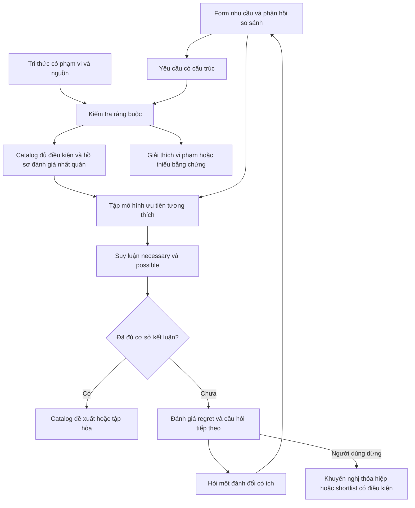

# Nâng cấp cơ chế suy luận lựa chọn catalog

Ngày: **17/10/2026**. Trạng thái: **đề xuất phương pháp và thiết kế đánh giá; chưa có prototype hoặc thực nghiệm chọn catalog**. Hai ví dụ số trong tài liệu đã được kiểm tra bằng Python với số hữu tỉ chính xác; việc đó chỉ kiểm tra phép tính minh họa.

Liên quan: [cơ sở tri thức](README.md), [flow hiện tại](decision-flow.md), [nghiên cứu MCDA trước](../catalog-method-review/group-2-mcda.md).

## 1. Đề xuất chính

Phát triển **hệ hỗ trợ lựa chọn catalog có giải thích, dựa trên ràng buộc và suy luận ưu tiên khi thông tin chưa đầy đủ**. Phần nâng cao đáng thử là **Robust Ordinal Regression (ROR)** kết hợp hỏi tương tác. **Minimax regret** là một chính sách quyết định có thể dùng khi chưa xác định được lựa chọn tốt nhất chung cho mọi mô hình còn hợp lệ.

Độ sâu kỹ thuật nằm ở ngữ nghĩa, giả định, khả năng kiểm tra kết luận và thực nghiệm. Chưa có căn cứ nói người đánh giá sẽ chấm cao hơn hoặc phương pháp này thắng baseline trên catalog. Các thuật toán nền đã tồn tại; đóng góp của đề tài cần đặt ở mô hình hóa miền catalog, xử lý bằng chứng và đánh giá ứng dụng.

Output chính vẫn là **công nghệ catalog**. Phiên bản, edition và phạm vi tích hợp là điều kiện của tri thức dùng để đánh giá; không chuyển mục tiêu thành thiết kế triển khai.

## 2. Vấn đề mà điểm tổng hợp cố định chưa giải quyết

Hai catalog cùng đáp ứng yêu cầu có thể khác nhau về công vận hành, chi phí hoặc khả năng quản trị. Người dùng có thể so sánh các đánh đổi cụ thể nhưng chưa biết trọng số chính xác. Chọn ngay một bộ trọng số sẽ đưa thêm một quyết định mà người dùng chưa xác nhận.

ROR giữ **toàn bộ mô hình thuộc lớp đã chọn còn tương thích với thông tin ưu tiên**, rồi kiểm tra kết luận nào đúng với mọi mô hình đó. Đây là nguyên tắc của UTA-GMS trong nghiên cứu gốc, không phải phát minh mới của đề tài. [Greco, Mousseau & Słowiński, 2008](https://doi.org/10.1016/j.ejor.2007.08.013)

Phân biệt hai nguồn chưa biết:

| Nguồn | Ví dụ | Cách xử lý |
|---|---|---|
| Nhu cầu/ưu tiên chưa rõ | Chưa biết chấp nhận thêm công vận hành để tiết kiệm bao nhiêu | Hỏi người dùng; cập nhật tập mô hình ưu tiên |
| Bằng chứng công nghệ chưa đủ | Chưa xác minh khả năng đọc/ghi qua đường tích hợp cần thiết | Bổ sung nguồn/lab; giữ UNKNOWN |

ROR không tạo ra bằng chứng còn thiếu về công nghệ. Giảm trọng số hoặc gán điểm 0 cho UNKNOWN không giải quyết đúng vấn đề này.

## 3. Kiến trúc suy luận

Sơ đồ là đề xuất tổng hợp. ROR, minimax regret, active elicitation và diagnosis giải những câu hỏi khác nhau; cần kiểm chứng từng thành phần thay vì mặc định việc ghép chúng làm hệ tốt hơn.

## 4. Lớp ràng buộc có bằng chứng

Với tập yêu cầu bắt buộc H và snapshot KB cố định, bộ kiểm tra trả:

- `SAT_VERIFIED`: có nhân chứng đáp ứng đồng thời mọi yêu cầu trong một phạm vi nhất quán.
- `UNSAT_VERIFIED_IN_SCOPE`: mọi ứng viên/phạm vi được xét đều bị loại có căn cứ.
- `UNKNOWN`: chưa chứng minh được một trong hai.

Không kết luận UNSAT chỉ vì không tìm thấy ứng viên toàn PASS. Không ghép sự hỗ trợ của các edition/phiên bản không thể cùng áp dụng. Một đường tích hợp thất bại chưa đủ để loại toàn bộ catalog.

Với số catalog nhỏ, có thể duyệt ứng viên/phạm vi và kiểm tra quy tắc. Solver SAT/SMT/CSP chỉ cần thiết khi cấu trúc quan hệ và không gian lựa chọn đòi hỏi nó; bản thân việc dùng solver chưa chứng minh chất lượng hệ.

## 5. Mô hình ưu tiên và ROR

### 5.1. Lớp hàm được xét

Gọi F là tập catalog đã xác minh đủ điều kiện. Mỗi catalog a có hồ sơ đánh giá g(a) trên các tiêu chí ưu tiên, trong cùng bối cảnh so sánh. Mô hình ban đầu đề xuất:

\[
U_\theta(a)=\sum_{j=1}^{m}u_{j,\theta}(g_j(a)).
\]

Các hàm biên đơn điệu theo chiều tốt/xấu đã định nghĩa. Có thể biểu diễn giá trị tại các mức rubric hoặc các mốc định lượng; nếu nội suy tuyến tính từng đoạn thì phải công bố đó là giả định của prototype. Chỉ nên nói "mọi hàm trong lớp được mô hình hóa", không nói mọi sở thích có thể tồn tại.

Với tiêu chí thứ bậc, học giá trị tại từng mức có thể tránh việc mặc định khoảng cách 1–2 bằng 4–5. Tuy nhiên, cần định nghĩa rubric và thứ tự có ý nghĩa trước. Thuộc tính danh nghĩa chưa có thứ tự không được tự biến thành thang đơn điệu.

Chuẩn hóa thường dùng là giá trị mức xấu bằng 0 và tổng giá trị tại các mức tốt bằng 1. Mốc tốt/xấu cần cố định theo miền và mục đích sử dụng; không thay theo min/max của danh sách catalog đang hiển thị.

Mô hình cộng vẫn có giả định về bù trừ và độc lập ưu tiên. ROR không chữa được tiêu chí trùng nhau hoặc tương tác bị bỏ sót. Nếu effort đã nằm trong TCO, cần cấu trúc lại để không đếm lợi ích hai lần. Nguồn gốc cũng nêu rõ giới hạn của mô hình cộng. [Bản bài báo tác giả, pp.416–419](https://www.lamsade.dauphine.fr/mcda/biblio/PDF/GMS-EJOR2008.pdf)

### 5.2. Tập mô hình tương thích

Gọi Theta là tập tham số thỏa các điều kiện cấu trúc và phản hồi đã thu thập. Ví dụ, người dùng xác nhận A ít nhất tốt bằng B thì thêm:

\[
U_\theta(A)\ge U_\theta(B).
\]

Không bắt người dùng nhập trực tiếp một vector trọng số. Có thể trình bày hai hồ sơ đánh đổi bằng đơn vị quen thuộc; nếu hồ sơ giả định, phải nói rõ đó là tình huống giả định. Tên catalog có thể được che trong câu hỏi để khảo sát ảnh hưởng của thương hiệu.

Trước mọi suy luận phải kiểm tra **Theta không rỗng**. Nếu rỗng, phản hồi có thể mâu thuẫn, tiêu chí thiếu hoặc lớp mô hình chưa phù hợp. Giải thích phần gây bất tương thích và để người dùng xem lại; không âm thầm xóa phản hồi. Chấp nhận sai số là một lựa chọn mô hình mới cần công bố.

### 5.3. Quan hệ chắc chắn và có thể

Với mỗi cặp a,b:

\[
L_{ab}=\min_{\theta\in\Theta}[U_\theta(a)-U_\theta(b)],\qquad
H_{ab}=\max_{\theta\in\Theta}[U_\theta(a)-U_\theta(b)].
\]

- **Necessary weak preference:** a ít nhất tốt bằng b với mọi mô hình còn hợp lệ khi L_ab >= 0.
- **Possible weak preference:** tồn tại mô hình cho a ít nhất tốt bằng b khi H_ab >= 0.

Đây là các quan hệ được định nghĩa trong UTA-GMS. Nếu hàm tuyến tính theo các giá trị biên chưa biết, các phép kiểm tra trên là bài toán quy hoạch tuyến tính. [Greco et al., 2008, §4.3](https://www.lamsade.dauphine.fr/mcda/biblio/PDF/GMS-EJOR2008.pdf)

Một **necessary winner** phải ít nhất tốt bằng mọi đối thủ với mọi mô hình. Có thể có nhiều lựa chọn hòa. Một **possible winner** cần có *một cùng mô hình* khiến nó ít nhất tốt bằng tất cả đối thủ; khả năng thắng từng đối thủ ở các mô hình khác nhau chưa đủ.

Tolerance của solver phục vụ tính toán, khác với ngưỡng khác biệt có ý nghĩa cho người dùng. Ưu tiên nghiêm ngặt, hòa và gần tương đương cần được đặc tả riêng.

### 5.4. Chuyển phản hồi thành ràng buộc và giới hạn nhận diện

Ví dụ thuần minh họa: hai thuộc tính đã có thang giá trị, x về chi phí dịch vụ và y về công vận hành. Dùng U(a)=w*x(a)+(1-w)*y(a). Nếu người dùng nói hồ sơ P=(0,8;0,3) ít nhất tốt bằng Q=(0,4;0,7), phản hồi tạo bất đẳng thức:

\[
0{,}8w+0{,}3(1-w)\ge0{,}4w+0{,}7(1-w)
\quad\Longleftrightarrow\quad w\ge0{,}5.
\]

Hệ thống đã thu hẹp miền trọng số bằng một đánh giá hồ sơ, không yêu cầu người dùng tự nhập "chi phí chiếm 50%". Kết quả này chỉ đúng dưới thang giá trị và mô hình tuyến tính đang giả định. Nếu các hàm biên cũng chưa biết, giữ chúng làm biến và thêm ràng buộc trên tổng giá trị, không rút ra cùng cận trọng số như trên. Giao diện vẫn trình bày mức chi phí và công vận hành bằng đơn vị người dùng hiểu.

Không cần nhận diện duy nhất mọi tham số để có quyết định: có thể nhiều mô hình khác nhau đều chọn cùng catalog. Ngược lại, nếu ít phản hồi trong khi có quá nhiều mức rubric và tiêu chí, Theta có thể còn rất rộng, chưa tạo được kết luận mạnh hơn Pareto. Với sáu catalog, chỉ có 15 cặp khác nhau giữa các catalog; việc hỏi đủ các cặp cũng chưa bảo đảm nhận diện được mọi hàm biên.

Trước khi tăng độ phức tạp, chọn một số chiều đánh đổi có bằng chứng và thực sự phân biệt ứng viên; giữ điều kiện bắt buộc ở lớp ràng buộc. Thử xem người dùng có hiểu và trả lời các so sánh hồ sơ nhất quán không. Hồ sơ giả định có thể mở rộng tập câu hỏi, nhưng phải có ý nghĩa trong miền và được kiểm tra mức dễ hiểu. Nếu không thu được thông tin ưu tiên cần thiết, kết quả đúng vẫn là shortlist có căn cứ.

## 6. Minimax regret: quyết định khi chưa có một lựa chọn chung

Nếu phải chọn khi Theta còn rộng, có thể dùng chính sách:

\[
MR(a,\Theta)=\max_{b\in F}\max_{\theta\in\Theta}
[U_\theta(b)-U_\theta(a)],
\qquad
a^*\in\arg\min_{a\in F}MR(a,\Theta).
\]

Ý nghĩa: chọn catalog có tổn thất giá trị lớn nhất thấp nhất, so với lựa chọn tốt nhất dưới một mô hình còn hợp lệ. Đây là một chính sách quyết định có tính thận trọng; regret không phải xác suất chọn sai hay độ tin cậy. Không cần giả định một phân phối xác suất trên Theta. [Boutilier et al., 2006](https://www.cs.toronto.edu/~cebly/Papers/BPPS-aij06.pdf)

Không nên gọi nghiệm minimax là "luôn tốt nhất". Nếu người dùng chưa chấp nhận chính sách thỏa hiệp này, trả shortlist và đánh đổi còn mở.

Regret là chênh lệch giá trị nên phụ thuộc lớp hàm và cách chuẩn hóa. Chỉ có thứ tự A > B chưa xác định mức chênh lệch này. Chuẩn hóa cố định và xét cả tập hàm giúp xác định một bài toán minimax cụ thể; không làm số regret trở thành một đại lượng khách quan như tiền. Không diễn giải regret 0,09 là "9% khả năng sai" hoặc "thiệt hại 9% ngân sách".

### Ví dụ số đã kiểm tra — hoàn toàn giả định

Giả sử có hai tiêu chí đã có thang giá trị: chi phí dịch vụ thấp và ít công vận hành. Các hồ sơ dưới đây không phải dữ liệu của catalog thật:

| Catalog | Giá trị về chi phí | Giá trị về công vận hành |
|---|---:|---:|
| A | 0,9 | 0,4 |
| B | 0,6 | 0,8 |
| C | 0,5 | 0,6 |

Dùng U(a)=w*x(a)+(1-w)*y(a), với w thuộc [0,3;0,7] là miền ưu tiên giả định. Kết quả:

| Catalog | Maximum regret |
|---|---:|
| A | 0,19 |
| B | 0,09 |
| C | 0,22 |

B là lựa chọn minimax, dù A vẫn tốt hơn khi w > 4/7. Nếu phản hồi mới thu hẹp miền còn [0,6;0,7], A trở thành necessary winner và regret của A bằng 0. Phép tính được kiểm tra bằng `fractions.Fraction`; do chênh lệch utility là hàm affine một biến, cực đại trên đoạn đạt tại đầu mút.

### Phản ví dụ cần giữ trong đặc tả

Cho A=(0,4;0,4), B=(1;0), C=(0;1), w thuộc [0;1]. A có thể thắng B khi w <= 0,4 và thắng C khi w >= 0,6, nhưng không bao giờ đồng thời tốt nhất. Tuy vậy, maximum regret của A là 0,6, của B và C đều là 1: minimax chọn A.

Vì vậy **không lọc chỉ giữ possible winners rồi tuyên bố kết quả là minimax trên toàn bộ F**. Nếu chủ đích chỉ cho phép chọn possible winners, phải ghi rõ miền quyết định đã bị giới hạn. Đây là kiểm tra logic do nghiên cứu này xây dựng, không phải kết quả thực nghiệm catalog.

## 7. Hỏi tương tác theo giá trị đối với quyết định

Mỗi câu hỏi q và câu trả lời r cập nhật Theta thành Theta(q,r). Một cách chọn câu hỏi nhìn trước một bước:

\[
q^*\in\arg\min_q\max_{r:\Theta(q,r)\ne\varnothing}
MMR(\Theta(q,r)).
\]

Tức là ưu tiên câu hỏi có regret còn lại thấp nhất trong nhánh trả lời bất lợi nhất. Đây là đề xuất thích nghi một bước, không phải sao chép toàn thuật toán của một nguồn. Nghiên cứu robust active elicitation cung cấp nền tảng cho việc gắn lựa chọn câu hỏi với chất lượng khuyến nghị, đồng thời cho thấy bài toán nhiều bước có thể phức tạp. [Vayanos et al., arXiv v2, 2021](https://arxiv.org/abs/2003.01899v2)

Quy tắc thực dụng cho prototype:

1. Sinh các câu hỏi so sánh hồ sơ có khác biệt quyết định, từ một tập câu hỏi hữu hạn đã biên soạn.
2. Kiểm tra các nhánh phản hồi có thông tin và nhất quán; ước lượng regret còn lại bằng cùng bộ giải.
3. Chọn câu tốt nhất; khi ngang nhau ưu tiên câu dễ hiểu và ít tốn công.
4. Sau phản hồi thật, kiểm tra lại tính nhất quán rồi mới suy luận.

Cho phép "chưa biết" hoặc bỏ qua, và không đồng nhất nó với hòa. Nhánh này giữ nguyên Theta. Nếu đưa nó vào worst-case của mọi câu hỏi thì có thể không câu nào bảo đảm tiến bộ; phải công bố cách chấm câu hỏi và không hứa luôn giảm regret sau mỗi lần hỏi.

Dừng khi có necessary winner/tập hòa đủ rõ; hoặc regret dưới ngưỡng được chấp nhận; hoặc hết ngân sách hỏi/người dùng dừng. Ngưỡng regret phải gắn với thang giá trị và mức chấp nhận, không tự đặt một phần trăm rồi gọi là độ tin cậy.

Với dữ liệu, tập ứng viên và chuẩn hóa cố định, phản hồi nhất quán làm Theta thu hẹp thì MMR không tăng. Bảo đảm này phụ thuộc mô hình; cập nhật KB hoặc thêm ứng viên có thể làm bài toán thay đổi.

### Kết quả bộ giải cũng cần được kiểm tra

Mỗi phép kiểm tra lưu mã mô hình, snapshot dữ liệu, trạng thái bộ giải, cận tối ưu nếu có và quy ước tolerance. Một nghiệm tham số khiến B tốt hơn A là nhân chứng rằng A chưa chắc tốt hơn B; để chứng minh A ít nhất tốt bằng B với mọi tham số, cần cận dưới đã chứng nhận của bài toán tối thiểu chênh lệch. Một nghiệm khả thi đơn lẻ không thay thế được chứng minh này.

Tương tự, tính được một kịch bản regret lớn mới cho một cận dưới của maximum regret; muốn bảo đảm tổn thất không vượt mức đã nêu cần cận trên được chứng nhận. Nếu timeout hoặc trạng thái số học chưa rõ, trả kết luận tạm thời/cận hiện có, không tự chuyển thành necessary preference hoặc regret chính xác. Đây là yêu cầu đặc tả prototype đề xuất, chưa phải khả năng bộ giải đã triển khai.

## 8. Giải thích có chứng cứ và chẩn đoán

Ba loại giải thích cần tách rõ:

- **Vì sao chọn:** ràng buộc đã vượt; quan hệ ưu tiên cần thiết hoặc chính sách minimax; nguồn và giả định.
- **Vì sao không chọn một catalog:** vi phạm bắt buộc, bị ưu tiên thấp hơn, hoặc chưa đủ chứng cứ; ghi đúng loại.
- **Vì sao không có lời giải:** tổ hợp yêu cầu làm hết ứng viên trong phạm vi đã xét.

QuickXplain là một nguồn nền cho việc tìm tập xung đột tối thiểu theo quan hệ tập con bằng bộ kiểm tra tính nhất quán. *Subset-minimal* không có nghĩa ít phần tử nhất. Với số yêu cầu nhỏ, thuật toán bỏ lần lượt một yêu cầu là baseline dễ kiểm tra trước khi cân nhắc QuickXplain. [Junker, AAAI 2004](https://cdn.aaai.org/AAAI/2004/AAAI04-027.pdf)

Oracle chuẩn của QuickXplain cần tính đơn điệu và kết luận nhất quán rõ. Với UNKNOWN, không được biến thiếu tri thức thành UNSAT. Muốn chứng nhận tập xung đột irreducible, cần chứng minh tập đó không có nghiệm trong phạm vi xét và sau khi bỏ từng phần tử đều có nhân chứng khả thi đã xác minh. Nếu chưa đủ, chỉ gọi là tập yêu cầu gây loại trừ theo bằng chứng hiện có, chưa chứng nhận tính tối thiểu.

Có thể bổ sung giải thích giả định: "Nếu thay đổi yêu cầu X, A trở thành đủ điều kiện". Muốn nói "A được đề xuất" phải chạy lại cả phần ưu tiên. Mọi đề xuất sửa yêu cầu phải giới hạn ở điều kiện người dùng cho phép đổi; bỏ một yêu cầu trong một conflict chưa bảo đảm giải quyết mọi conflict khác.

Chuỗi truy vết phải nối được **input → yêu cầu → luật → claim → nguồn → kết luận**. LLM, nếu dùng, chỉ diễn đạt cấu trúc giải thích đã tính; có mẫu cố định khi kiểm tra bám dữ liệu không đạt.

## 9. Bất định bằng chứng và phạm vi bảo đảm

Prototype đầu nên áp dụng ROR trên những hồ sơ đã đủ bằng chứng và có thể so sánh. UNKNOWN ở điều kiện bắt buộc tiếp tục được giữ riêng.

Mở rộng sau có thể đánh giá trên tập kịch bản bằng chứng X có căn cứ, nhưng phải xét sự phụ thuộc giữa thuộc tính và ưu tiên. Khi vừa có trọng số chưa biết vừa có giá trị thuộc tính chưa biết, tích của chúng không tự còn là LP. Với X hữu hạn, có thể giải từng kịch bản; không tuyên bố mọi trường hợp đều là bài toán tuyến tính đơn giản.

Các công thức phía trên giả định mỗi catalog có một hồ sơ đánh giá nhất quán cho ca đang xét. Nếu một catalog có nhiều phạm vi nội bộ, không lấy chi phí tốt nhất từ phạm vi này và tính năng tốt nhất từ phạm vi khác. Cần mô hình thêm lựa chọn nội bộ hoặc công bố điều kiện của hồ sơ.

Tính robust chỉ đúng tương đối với lớp hàm, các miền/kịch bản, tập ứng viên và snapshot bằng chứng đã khai báo. Đây không phải bảo đảm về mọi công nghệ hoặc mọi nhu cầu ngoài mô hình.

## 10. Đóng góp nghiên cứu và cách đánh giá

Tên đề tài làm việc: **Hỗ trợ lựa chọn công nghệ catalog có giải thích dưới thông tin ưu tiên và bằng chứng không đầy đủ**.

Câu hỏi nghiên cứu đề xuất:

1. Giữ tập mô hình ưu tiên giúp giảm bao nhiêu quyết định nhạy với lựa chọn trọng số so với một mô hình cố định?
2. Hỏi theo regret giảm số câu cần trả lời đến cùng mức chất lượng quyết định bao nhiêu so với hỏi ngẫu nhiên hoặc form cố định?
3. Giải thích và diagnosis có giúp người dùng xác định đúng nguyên nhân không có kết quả và sửa yêu cầu hợp lệ không?
4. Khi bằng chứng bị thiếu hoặc phản hồi không phù hợp lớp hàm cộng, hệ có nhận diện đúng giới hạn kết luận không?

Giữ cùng KB, tiêu chí và ràng buộc khi so sánh các baseline/ablation:

| Cấu hình | Vai trò đối chiếu |
|---|---|
| Ràng buộc + Pareto | Phần giá trị thêm của mô hình ưu tiên |
| Ràng buộc + một bộ trọng số được khai báo | Ảnh hưởng của việc chốt một mô hình |
| ROR/minimax không hỏi thêm | Giá trị của tương tác |
| Hỏi ngẫu nhiên với cùng bộ giải và ngân sách | Giá trị của chiến lược chọn câu hỏi |
| Hỏi chủ động theo regret | Phương án nghiên cứu chính |
| Phương pháp thủ công đã nghiên cứu | Mức hữu ích đối với công việc thực |

Thực nghiệm mô phỏng dùng utility được giữ kín để tính regret thực; công bố phân phối chỉ là cách sinh ca, không phải thông tin hệ được biết. Thử thêm ưu tiên có tương tác, dữ liệu thiếu, phản hồi nhiễu và ca ngoài lớp mô hình để tránh chỉ đánh giá trên giả định thuận lợi.

Các ca thực/chuyên gia cần giữ riêng khỏi ca dùng để viết luật. Chuyên gia có thể cho tập lựa chọn chấp nhận được hoặc trạng thái chưa đủ bằng chứng, không ép một nhãn duy nhất. Đo đồng thời lỗi và tỷ lệ có thể kết luận để hệ luôn từ chối không được xem là tốt chỉ vì ít sai.

Chỉ số chính: vi phạm bắt buộc; regret thực và regret bound; số câu hỏi; thời gian phản hồi; tính đúng của giải thích; tỷ lệ cần xác minh; mức đồng thuận chuyên gia có ghi bất đồng. Báo cáo độ biến thiên qua các ca/lần chạy, không suy chất lượng từ một ví dụ đẹp.

Các kiểm tra đặc tả cần có: Theta rỗng; hòa; phân biệt possible pairwise/possible winner; minimax chọn phương án chưa bao giờ đứng đầu; UNKNOWN; bằng chứng không thể đồng thời áp dụng; sửa yêu cầu nhưng vẫn còn conflict khác. Đánh giá số lần gọi oracle và thời gian trước khi khẳng định QuickXplain hoặc solver phức tạp có lợi.

## 11. Phạm vi thực hiện hợp lý

**Lõi nên nghiên cứu:** tri thức có nguồn/phạm vi; ràng buộc ba trạng thái; ROR; giải thích; đánh giá với baseline.

Trước khi chốt ROR là lõi triển khai, làm một thử nghiệm mô hình hóa nhỏ: xác định các chiều đánh đổi có bằng chứng so sánh được, dựng một số câu hỏi hồ sơ và kiểm tra xem phản hồi có thực sự thu hẹp miền mô hình để phân biệt ứng viên. Nếu sáu catalog chủ yếu đã phân biệt bằng điều kiện bắt buộc, phần giá trị thêm của ROR có thể nhỏ; kết quả nghiên cứu phải phản ánh điều đó.

**Mở rộng ưu tiên:** minimax regret và chọn câu hỏi một bước, sau khi thang đo và lớp hàm được kiểm tra. Với F nhỏ, ma trận regret và quan hệ cặp có thể dùng chung kết quả LP; thử nhánh câu hỏi làm tăng số bài toán phải giải, cần đo thời gian thực.

**Mở rộng có điều kiện:** diagnosis tối thiểu, kịch bản bất định bằng chứng, mô hình tương tác hoặc tìm câu hỏi nhiều bước. Chọn theo vấn đề thực nghiệm còn tồn tại. Không cần đồng thời xây ontology/KG, huấn luyện LLM, fuzzy scoring và reinforcement learning để thực hiện lõi này.

Đóng góp có thể bảo vệ là mô hình hóa, thích nghi và kiểm chứng hệ cho miền catalog. Muốn tuyên bố thuật toán mới hoặc vượt công trình có sẵn, cần khảo sát riêng và chứng minh thêm; bản tổng quan tập trung này chưa đáp ứng mức đó.

## 12. Phiếu nguồn và mức đọc

Tổng quan có chọn lọc, không phải systematic review. Exa/Firecrawl không có trong phiên công cụ; dùng tìm kiếm trình duyệt, bản trên máy chủ tác giả và PDF chính thức. HAL gặp kiểm tra bot; bản ROR đọc được từ LAMSADE. Không có nguồn nào ở đây kiểm chứng trực tiếp sáu catalog của đề tài.

| Nguồn | Mức đọc trong đợt nghiên cứu | Điều thực sự kế thừa |
|---|---|---|
| Greco, Mousseau, Słowiński (2008). *Ordinal regression revisited: Multiple criteria ranking using a set of additive value functions*. EJOR 191, 415–435. [DOI](https://doi.org/10.1016/j.ejor.2007.08.013); [PDF](https://www.lamsade.dauphine.fr/mcda/biblio/PDF/GMS-EJOR2008.pdf) | PDF pp.1–12: abstract, §§1–4.4; đoạn về cập nhật ưu tiên ở p.15; kết luận p.20. Không đọc toàn bộ ví dụ và mọi chứng minh mở rộng | Tập hàm tương thích; necessary/possible; LP; xử lý bất tương thích. Bài có ví dụ minh họa, chưa là validation catalog |
| Boutilier, Patrascu, Poupart, Schuurmans (2006). *Constraint-based Optimization and Utility Elicitation using the Minimax Decision Criterion*. Artificial Intelligence 170(8–9), 686–713. [Trang tác giả](https://www.cs.toronto.edu/~cebly/Papers/BPPS-aij06-abs.html); [PDF tác giả](https://www.cs.toronto.edu/~cebly/Papers/BPPS-aij06.pdf) | Bản thảo 45 trang: pp.1–5; §3 pp.11–14; §5 mở đầu p.30, §5.1 p.31, §5.3 p.34, thiết lập thực nghiệm §5.5 p.36, §5.6 và đầu kết luận pp.39–40 | Regret và chọn câu hỏi gắn quyết định. Không kế thừa mọi thuật toán MIP; thực nghiệm của bài chủ yếu bound queries, không suy thắng lợi tương tự cho câu hỏi so sánh catalog |
| Vayanos, Ye, McElfresh, Dickerson, Rice. *Robust Active Preference Elicitation*. [arXiv:2003.01899v2, 08/12/2021](https://arxiv.org/abs/2003.01899v2) | Bản PDF 74 trang: abstract/intro pp.1–5, mô hình và §3.2–3.3 pp.10–12, mở đầu §4 p.13; không đọc trọn thuật toán, thí nghiệm hoặc appendix | Thiết kế elicitation và khuyến nghị cùng mục tiêu; tập bất định; cần chú ý phản hồi không nhất quán và độ phức tạp. Không chuyển nguyên mô hình sang catalog |
| Junker (2004). *QUICKXPLAIN: Preferred Explanations and Relaxations for Over-Constrained Problems*. AAAI-04, 167–172. [Metadata](https://aaai.org/papers/00167-AAAI04-027-quickxplain-preferred-explanations-and-relaxations-for-over-constrained-problems/); [PDF](https://cdn.aaai.org/AAAI/2004/AAAI04-027.pdf) | Nhánh nghiên cứu đọc toàn bộ 6 trang, kỹ pp.168–171: định nghĩa, thuật toán, giả thiết checker | Conflict subset-minimal; diagnosis. Paper dùng relaxation cho tập giữ lại, nên tài liệu này gọi rõ tập yêu cầu được bỏ/được giữ |
| Roy & Słowiński (2013). [Questions guiding the choice of a multicriteria decision aiding method](https://link.springer.com/article/10.1007/s40070-013-0004-7) | Đã đọc ở đợt trước; xem [ghi chú MCDA](../catalog-method-review/group-2-mcda.md) | Kiểm tra thang đo, bù trừ, tương tác, bất định và khả năng giải thích trước khi chọn phương pháp |

Mọi ví dụ A/B/C, công thức truy vấn một bước, chính sách UNKNOWN và thiết kế baseline trong tài liệu là đề xuất thích nghi hoặc kiểm tra logic của nghiên cứu này. Chưa có số liệu thực nghiệm để kết luận phương án nào tốt nhất cho bài toán catalog.
