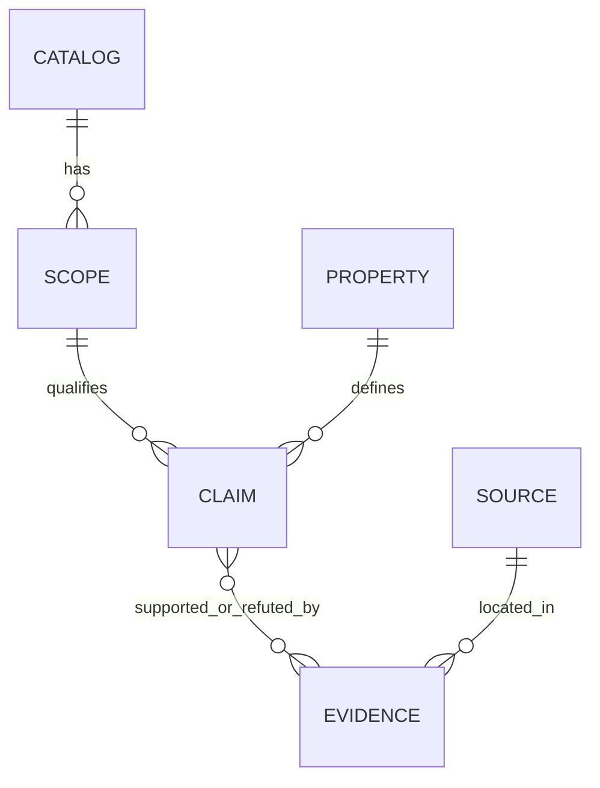

# Cấu trúc lớp 1: tri thức về catalog có phạm vi và bằng chứng

Ngày: **17/10/2026**. Trạng thái: **đề xuất thiết kế để chuẩn bị triển khai**. Chưa xây KB đầy đủ, schema validation, bộ phân giải mệnh đề hoặc hệ thống khuyến nghị.

Đầu vào nghiên cứu: hướng ba lớp người dùng gửi; [input v1 đã chốt](input-v1.md); [thiết kế KB trước](README.md); [flow quyết định](decision-flow.md). Đầu ra cuối cùng vẫn là công nghệ trong sáu catalog hiện hành, kèm điều kiện. Không tự thêm dịch vụ managed thương mại vào danh sách ứng viên.

## 1. Quyết định đề xuất

Xây **kho mệnh đề kỹ thuật có kiểu, phạm vi áp dụng và bằng chứng**, dùng mô hình dữ liệu có thể chuyển sang quan hệ. Bảng catalog × đặc tính là **view tổng hợp để đọc/review**, không phải bản ghi gốc duy nhất.

Đơn vị tri thức:

> Một mệnh đề về một thuộc tính của một catalog trong một phạm vi xác định, được nguồn hoặc phép thử cụ thể ủng hộ/phản bác.

Ví dụ: “Polaris 1.7.0 có cơ chế vending trên AWS S3 qua REST, được mô tả trong tài liệu release đó” có nghĩa rõ hơn “Polaris: credential vending = có”. Hai câu không có cùng phạm vi chứng minh.

| Cách tổ chức | Điểm phù hợp | Giới hạn cho đề tài | Đề xuất |
|---|---|---|---|
| Một hàng/catalog, một cột/tính năng | Dễ đọc và bắt đầu | Một ô khó chứa nhiều edition, engine, thao tác và nguồn trái nhau; mô tả điều kiện dễ thành text không truy vấn được | Dùng làm view xuất ra |
| Các mệnh đề có phạm vi + định nghĩa thuộc tính + nguồn | Tách form khỏi sự thật; quan hệ nhiều-nhiều; có thể kiểm tra và truy vết | Phải thống nhất từ điển và cách xét điều kiện | **Chọn cho v1** |
| RDF/OWL/KG và SHACL | Phù hợp khi thật sự cần ontology, quan hệ phân cấp và suy diễn tương ứng | Tăng công mô hình hóa; không tự giải quyết đúng/sai bằng chứng hoặc quyết định chọn catalog | Chưa cần cho v1; giữ khả năng chuyển đổi |

Các lựa chọn trên là đánh giá thiết kế theo quy mô hiện tại, không phải kết quả benchmark ba công nghệ lưu trữ. Noy–McGuinness khuyến nghị xác định phạm vi bằng các câu hỏi KB phải trả lời; W3C có pattern biểu diễn quan hệ nhiều ngôi khi quan hệ cần thêm các tham số và thuộc tính. Kế thừa ý tưởng này không bắt buộc dùng RDF/OWL. [R1](https://protege.stanford.edu/publications/ontology_development/ontology101-noy-mcguinness.html), [R2](https://www.w3.org/TR/swbp-n-aryRelations/)

## 2. Ranh giới ba lớp

| Thành phần | Nằm ở đâu? |
|---|---|
| Catalog, edition, release, tính năng, cơ chế, giới hạn, giá niêm yết và bằng chứng | Lớp 1 |
| Câu hỏi, đáp án, ID I01–I10, hiện trạng nào trở thành yêu cầu nào | Lớp 2 |
| Bắt buộc/nice-to-have, PASS/FAIL theo yêu cầu, ưu tiên, trọng số nếu hợp lệ, xếp hạng | Lớp 3; hồ sơ yêu cầu được tạo qua lớp 2 |
| Giá trị tính toán như TCO cho một ca, điểm sức khỏe/rủi ro, khả năng phù hợp của một catalog | Kết quả phân tích; không ghi thành sự thật phổ quát ở lớp 1 |

Lớp 1 có các luật dữ liệu và kiểm tra cấu trúc, nhưng không có luật ưu tiên người dùng. Trong ba lớp nghiệp vụ, chỉ lớp 2 biết cấu trúc form. UI, lưu session và lịch sử câu trả lời đương nhiên vẫn có thể biết form, không thuộc kho facts.

“Đổi form chỉ sửa lớp 2” đúng khi form mới hỏi nhu cầu mà từ điển và tri thức hiện có đã bao phủ. Nếu hỏi một năng lực chưa nghiên cứu, vẫn phải mở rộng từ điển và thu bằng chứng lớp 1; không cần thiết kế lại toàn kho.

## 3. Sáu loại bản ghi cốt lõi



### 3.1. Catalog — định danh đầu ra

Trường: `id`, `name`, `family`, `edition_boundary`, `in_decision_scope`.

Giữ sáu ID cho Hive Metastore, AWS Glue Data Catalog, Apache Polaris, Project Nessie, Apache Gravitino, Unity Catalog OSS. Không dùng tên họ sản phẩm để kế thừa mọi tính năng của các sản phẩm dịch vụ liên quan.

Một dịch vụ bên thứ ba dựa trên Polaris có thể là thực thể tham chiếu sau này, nhưng không được gộp vào Polaris OSS hoặc tự trở thành ứng viên trong phạm vi hiện hành. Unity Catalog OSS và bản managed phải có định danh/phạm vi tách biệt nếu nghiên cứu cả hai.

### 3.2. Scope — miền mà mệnh đề có hiệu lực

Trường: `id`, `catalog_id`, `scope_kind`, `edition`, `provider`, `deployment_mode`, `release_selector` hoặc `service_as_of`, và các giới hạn chung đã biết.

- `scope_kind`: `product`, `release`, `service_snapshot`. License cấp sản phẩm có thể dùng scope khác với hỗ trợ thao tác của một release.
- Với phần mềm: ưu tiên release/commit đã xác định; không để `latest` làm định danh tái lập.
- Với dịch vụ như Glue: lưu snapshot theo thời điểm và region nếu liên quan; không bịa phiên bản server tương đương OSS.
- Scope là phạm vi bằng chứng, **không phải đầy đủ một cấu hình triển khai**. Chỉ đưa engine, backend hoặc flag vào scope/qualifier khi nó có thể làm đổi ý nghĩa mệnh đề.

Một công nghệ có thể có nhiều scope. Lớp 3 phải tìm được ít nhất một phạm vi/tổ hợp nhất quán thỏa các điều kiện cần xét, rồi gom kết quả theo Catalog. Không nối tính năng release A với release B hoặc edition khác để tạo một catalog “đáp ứng tất cả”.

### 3.3. Property — từ điển thuộc tính

Trường: `id`, `label`, `definition`, `value_type`, `allowed_values/unit`, `required_dimensions`, `allowed_dimensions`, `interpretation_limits`.

Ví dụ `storage.credential_vending` là thuộc tính boolean, yêu cầu chỉ rõ storage và đường API. `integration.client_property_keys` là tập tên thuộc tính cấu hình, cần thêm client và thư viện client. Không bắt mọi loại mệnh đề cùng mang một cột “supported”.

Giá trị có thể là boolean, enum, tập giá trị hoặc quantity có đơn vị. Các record phức tạp phải có kiểu con đã định nghĩa, không mở một ô JSON tùy ý cho mọi thuộc tính. Định nghĩa phải nói rõ cái gì được kiểm tra, tránh các nhãn chưa đo được như `easy_operations` hay `good_project_health`.

### 3.4. Claim — mệnh đề nguyên tử

Trường tối thiểu: `id`, `scope_id`, `property_id`, `value`, `qualifiers`, `evidence_links`, `review`, `revision`.

Trường tùy loại: `availability`, `limitations`, `observation_context`, `supersedes`, `validity`.

- `value` giữ kiểu thật: `false` khác với không có dữ liệu; measurement phải có đơn vị và bối cảnh.
- `qualifiers` chứa điều kiện máy có thể đối chiếu. `limitations` diễn giải giới hạn cho người đọc, không thay thế qualifiers.
- `availability` nếu liên quan: `released`, `preview`, `experimental`, `roadmap`, `removed`, `unspecified`. Đây là điều kiện vòng đời, không trộn với chất lượng bằng chứng.
- `evidence_links` ghi `evidence_id` và vai trò `supports`, `refutes` hoặc `qualifies`. Không cộng số link thành confidence.
- `review.state`: `draft`, `reviewed`, `needs_review`, `retired`; có người/ngày/lý do. `reviewed` không đồng nghĩa đã runtime-test hoặc có reviewer độc lập.

Một claim chỉ trả lời một mệnh đề có thể kiểm tra. “Hỗ trợ Spark, Trino, S3, GCS và row filtering” cần tách theo các quan hệ thực sự được nguồn chứng minh. Không phát triển thành tích Descartes mọi giá trị nếu nguồn không nói chúng phối hợp được.

### 3.5. Evidence — đoạn chứng cứ hoặc quan sát

Trường: `id`, `source_id`, `locator`, `finding`, `method`, `captured_at`, `limitations`; khi cần có `artifact_ref`, `environment`, `derived_from_evidence_ids`.

- `method`: `document_reading`, `code_inspection`, `runtime_test`, `measurement`, `estimate`.
- Tài liệu nói có hỗ trợ là bằng chứng tài liệu; chỉ đọc code không tự là runtime verification.
- Lab lỗi vì cấu hình chưa đúng hoặc chưa phân giải nguyên nhân không đủ chứng minh sản phẩm không hỗ trợ.
- Một evidence có thể phục vụ nhiều claim. Một báo cáo dẫn lại tài liệu chính thức cần giữ đường truy nguồn, không đếm thành hai xác nhận độc lập.

### 3.6. Source — tài liệu/artifact gốc

Trường: `id`, `title`, `kind`, `publisher`, `url/local_path`, `version_or_commit`, `retrieved_at`; thêm `content_hash/snapshot_ref` nếu đã lưu bản chụp.

`kind` mô tả nguồn: official doc, release note, source code, báo cáo nội bộ, artifact thử nghiệm, trang giá, quan sát repository hoặc nguồn bên ngoài. Không dùng `official_doc > blog > tested` như một thứ tự đúng tuyệt đối: một test sai scope vẫn không trả lời được yêu cầu, tài liệu chính thức có thể mô tả roadmap.

W3C PROV-O cung cấp cách phân biệt dữ liệu, hoạt động tạo dữ liệu và chủ thể chịu trách nhiệm. Thiết kế này kế thừa nguyên tắc truy vết đó, chưa tuyên bố triển khai đầy đủ PROV-O. [R3](https://www.w3.org/TR/prov-o/)

## 4. Qualifier: điều kiện phải có cấu trúc

Các chiều dùng chung ban đầu: engine, engine release, client library release, format/version, storage implementation, API/connector, operation, resource boundary, source catalog, backend, required flag/dependency và region nếu cần.

| Biểu diễn | Ý nghĩa |
|---|---|
| `{"match":"eq","value":"aws_s3"}` | Chỉ đúng giá trị này |
| `{"match":"one_of","values":["read","append"]}` | Các thao tác nêu rõ trong cùng phạm vi nguồn chứng minh |
| `{"match":"release_line","scheme":"iceberg","major":1,"minor":7}` | Dòng phiên bản được nguồn nêu; cần matcher hiểu đúng scheme |
| `{"match":"version_range","scheme":"iceberg","min_inclusive":"1.8.0"}` | Khoảng nguồn tuyên bố, không phải đã thử mọi phiên bản tương lai |
| `{"state":"not_stated"}` | Nguồn không nói rõ chiều này; không phải ANY |
| `{"state":"not_applicable"}` | Chiều không áp dụng, theo định nghĩa thuộc tính và có lý do |

Không so version bằng thứ tự chuỗi; không áp SemVer cho mọi công nghệ. V1 có thể bắt đầu bằng exact/release-line với scheme đã hỗ trợ; gặp matcher chưa hỗ trợ phải báo chưa phân giải, không xem là match.

Thiếu một qualifier quan trọng không được mặc định “đúng với tất cả”. Nếu nguồn thực sự không hạn chế một chiều và có cơ sở dùng khái quát, phải ghi rõ phạm vi tuyên bố; thông tin vắng mặt không chứng minh tính tổng quát.

Ví dụ thật cho nhu cầu qualifier: bảng Polaris 1.7.0 phân biệt tên property credential ADLS cho Spark dùng Iceberg 1.7.x với Iceberg ≥1.8. Đây là lý do lưu storage + client library release, thay vì một cờ vending cho cả sản phẩm. [R4](https://polaris.apache.org/releases/1.7.0/vended-credentials/)

## 5. Bộ thuộc tính khởi đầu

Các hàng sau là **nhóm quan hệ/thuộc tính**, không phải 24 boolean hay 24 ô bắt buộc cho mọi catalog. Định nghĩa nguyên tử và value type cần được chốt khi biên soạn thử; không điền chiều không liên quan chỉ để hoàn thành bảng.

| Mã | Nhóm thuộc tính | Dữ liệu cần giữ |
|---|---|---|
| P01 | Mô hình triển khai | Self-managed/service, provider và điều kiện áp dụng |
| P02 | Môi trường và phụ thuộc kết nối | Môi trường được tài liệu hỗ trợ, yêu cầu endpoint/kết nối; không đồng nhất nơi chạy engine với nơi đặt catalog |
| P03 | Tích hợp engine–thao tác | Engine/client × format × read/append/merge/DDL × đường tích hợp |
| P04 | Đối tượng và format | Loại đối tượng, format/version và thao tác catalog liên quan |
| P05 | API/connector | Endpoint/operation được hỗ trợ, giới hạn protocol; REST không tự nghĩa là đầy đủ spec |
| P06 | Xác thực | Cơ chế identity, token/refresh, phụ thuộc IdP |
| P07 | Phân quyền | Resource/action, boundary thực thi, engine và đường truy cập |
| P08 | Credential delegation | Vending/signing/cơ chế khác được tách rõ; storage, scope quyền, client và TTL nếu biết |
| P09 | Commit và xung đột | Atomic commit, phát hiện conflict, retry, visibility đúng operation/boundary |
| P10 | Phục hồi trạng thái commit | Idempotence/status lookup và hành vi khi kết quả chưa rõ, đúng API |
| P11 | Quan sát multi-writer | Các writer, engine, thao tác và workload đã thử; không tự coi số thử là giới hạn tối đa |
| P12 | Quy mô và hiệu năng metadata | Quy mô/tải quan sát, latency/goodput/errors, cấu hình và semantics; phân biệt quota với benchmark |
| P13 | Đường ghi streaming | Engine/connector/format/mode, commit/checkpoint và giới hạn; không một cờ streaming chung |
| P14 | Branch/tag/merge | Cấp bảng/catalog/tập đối tượng, thao tác và visibility |
| P15 | Transaction nhiều bảng | Primitive/API, atomicity/visibility, client orchestration và failure boundary |
| P16 | Federation | Nguồn/catalog provider, thao tác, authority/sync và enforcement; không chỉ danh sách connector |
| P17 | Migration/import/export | Nguồn–đích, đối tượng được giữ, lịch sử/quyền, điều kiện rollback; không nhãn “dễ” chung |
| P18 | Persistence và phụ thuộc | DB/service/backend, cấu hình bền vững/backup và yêu cầu vận hành có nguồn |
| P19 | Quan sát vận hành | Task/giờ công/mức tự động hóa, bối cảnh đo hoặc ước tính, không suy từ số container |
| P20 | License | License của đúng edition/component/revision và nguồn; không suy nghĩa vụ pháp lý từ một nhãn |
| P21 | Giá và đơn vị tính phí | Giá thành phần, tiền tệ, unit, tier, region, ngày; TCO từng ca tính ở lớp phân tích |
| P22 | Quản trị và bảo trì dự án | Tổ chức/provider, release/EOL, quan sát contributor có cửa sổ thời gian và phương pháp; không đồng nhất GitHub stars với chất lượng |
| P23 | Audit và lineage | Hai thuộc tính riêng trong nhóm, loại event/relation, integration và mức bao phủ |
| P24 | Support policy | Đơn vị cung cấp, edition/phiên bản, vòng đời và cam kết hỗ trợ được nguồn xác nhận |

Phạm vi đề xuất: biên soạn các quan hệ ảnh hưởng input trước, thêm metadata license/release/nguồn ngay từ đầu; chỉ thu sâu vận hành/chi phí/project observations khi có câu hỏi quyết định hoặc mục tiêu giải thích rõ. Không đặt mục tiêu điền mọi tổ hợp sáu catalog × mọi thuộc tính bằng suy đoán.

## 6. Truy vết với form, nằm ngoài dữ liệu lớp 1

Bảng này là tài liệu thiết kế ranh giới lớp 2, không phải trường trong Claim hoặc Property:

| Input đã chốt | Nhóm tri thức được dùng | Giới hạn |
|---|---|---|
| I01 Nơi chạy | P01, P02, P18 | Nhãn cloud chưa tự là B hoặc chỉ định vendor |
| I02 Engine | P03, P05, P07, P08 | Giữ điều kiện nếu chưa rõ thao tác/release |
| I03 Format | P03, P04 | Hỗn hợp chưa biết thành phần không tự là AND cả ba format |
| I04 Số bảng | P12 | Dữ liệu quy mô không tự xác nhận performance/SLO |
| I05 Engine cùng ghi | P03, P09, P10, P11 | Số engine không thay số writer, workload và mức conflict |
| I06 Streaming, nếu giữ | P03, P09, P12, P13 | Độc lập với quyết định có giữ câu này; không suy transaction nhiều bảng |
| I07 Phân quyền | P06, P07, P23 | Audit/lineage không tự là yêu cầu bắt buộc từ câu này |
| I08 Vending | P06, P08, P18 | Cần đúng storage/client, không suy row filtering |
| I09 Nền tảng gắn bó | P01, P03, P16, P17, P20, P21, P24 | Hợp đồng của người dùng ở hồ sơ yêu cầu; không là fact về catalog |
| I10 Đặc thù | P14, P15, P16 | Bắt buộc/nice-to-have thuộc quyết định; các capability không tương đương nhau |

P19/P22 và các thuộc tính ngoài form có thể phục vụ giải thích/bảo trì. Không tự gắn cờ rủi ro hoặc cộng/trừ điểm chỉ vì đã thu được dữ liệu. Chỉ giữ thuộc tính khi có câu hỏi KB, nhu cầu bảo trì/truy vết hoặc lý do nghiên cứu rõ; không bắt buộc mỗi thuộc tính có một câu trên form.

## 7. Trạng thái: không dùng một enum để diễn đạt mọi thứ

| Trục | Ví dụ | Cách xử lý |
|---|---|---|
| Giá trị mệnh đề | Có hỗ trợ/không hỗ trợ; một cơ chế; một số đo | Lưu `value` đúng kiểu và scope |
| Vòng đời khả năng | Released/preview/roadmap | Không lấy roadmap làm khả năng đang sẵn có |
| Bằng chứng | Doc/code/test/measurement/estimate; có nguồn phản bác | Giữ phương pháp, điều kiện và cả nguồn trái chiều |
| Duyệt | Draft/reviewed/needs-review/retired | Kiểm soát biên soạn và revision |
| Kết quả truy vấn lớp 1 | Có căn cứ, có căn cứ không hỗ trợ, thiếu dữ liệu, xung đột, có điều kiện | Sinh từ mệnh đề phù hợp và chính sách phân giải đã khai báo |
| Kết quả theo yêu cầu | PASS/FAIL/UNKNOWN/N/A | Thuộc lớp đánh giá, không ghi cố định vào catalog |

`unknown` hợp lệ nhưng không nhất thiết tạo hàng `value = unknown` cho mọi ô chưa điền. Không có claim áp dụng → thiếu dữ liệu; có thể lưu việc cần nghiên cứu ở coverage/task register riêng. Không có dữ liệu khác với có nguồn nói không hỗ trợ.

`partial` chỉ có nghĩa khi biết phần nào được hỗ trợ và phần nào không/thiếu bằng chứng. Lưu các mệnh đề con; hiển thị partial như view theo phạm vi truy vấn, không dùng nhãn này thay điều kiện cụ thể.

Nguồn khác edition/release thường không mâu thuẫn. Nếu nguồn cùng phạm vi có kết luận trái nhau, giữ conflict và việc cần phân giải; không lấy đa số nguồn hoặc ngày truy cập mới hơn để tự chọn bên đúng. Những mệnh đề còn conflict không được xuất như một fact đã xác nhận mà bỏ dấu cảnh báo.

Ngày đọc nguồn, ngày review, phiên bản sản phẩm và thời điểm giá/measurement có ý nghĩa khác nhau. `review_due` chỉ mở việc xem lại, không biến mệnh đề thành false. Khi đổi nội dung, tạo revision/supersedes và snapshot KB mới; không âm thầm sửa dữ liệu của kết quả cũ.

### Hợp đồng đọc lớp 1

Lớp trên truy vấn bằng `catalog_id`, `property_id`, các điều kiện kỹ thuật đã chuẩn hóa và revision KB; không gửi ID câu hỏi hoặc đáp án form vào reader facts.

Reader chọn scope, đối chiếu qualifier theo `match/mismatch/undetermined`, rồi trả claim/value, điều kiện còn mở, phương pháp bằng chứng, nguồn và trạng thái review. Nếu một điều kiện quan trọng chưa biết, không coi nó là match. Khi truy vấn rộng, trả các lát cắt có điều kiện; không suy toàn catalog hỗ trợ từ một lát cắt.

Kết quả đọc tổng quát có thể dùng `resolved`, `conditional`, `unknown`, `conflicted`. `resolved` nghĩa đã phân giải được mệnh đề trong phạm vi và chính sách bằng chứng được khai báo, không bảo đảm đã kiểm thử triển khai. Với thuộc tính boolean, `resolved + value:false` diễn đạt có căn cứ không hỗ trợ; với số đo/enum thì vẫn giữ giá trị tương ứng, không ép thành supported/unsupported.

Snapshot công bố mặc định chỉ dùng bản ghi đã review; dữ liệu draft vẫn hiện trong công cụ biên soạn và coverage. Nguồn mới trái chiều phải mở review và được xử lý rõ trước khi công bố snapshot tiếp theo, không ghi đè hoặc lờ đi vì chưa hợp với kết quả cũ. Lớp 3 mới áp tiêu chuẩn bằng chứng của từng yêu cầu để quyết định PASS/FAIL/UNKNOWN.

## 8. Ví dụ có nguồn và phép thử thiết kế

Xem [JSON minh họa lớp 1](layer-1-example.json). File có một catalog, một release scope, hai định nghĩa thuộc tính, ba claim và ba evidence từ **một** nguồn Polaris 1.7.0. Đây là bản mẫu biên soạn, các claim còn `draft`; không phải KB production hoặc ba xác nhận độc lập. Không lưu credential thật.

Ba mệnh đề minh họa: vending S3; tên property ADLS mà Spark/Iceberg 1.7.x cần; tên property tương ứng khi Iceberg ≥1.8. Nội dung được paraphrase và giữ locator. Các matcher/version selector là thiết kế minh họa, chưa có evaluator được triển khai.

Các phép thử bắt buộc trước khi xem schema đủ dùng:

1. Cùng capability, khác storage/client release → giữ được hai claim và truy ra nguồn; không ghi đè nhau.
2. Hỏi capability chưa biên soạn cho một catalog → thiếu dữ liệu, không trả false.
3. Claim tài liệu chưa có runtime test → giải thích đúng loại bằng chứng.
4. Thêm nguồn phản bác cùng phạm vi → giữ conflict, không đếm link để bỏ qua.
5. Source `latest` đổi nội dung → snapshot cũ vẫn truy vết được; phiên bản KB mới chỉ rõ dữ liệu bị ảnh hưởng.
6. Một mệnh đề từ OSS và một từ managed hoặc hai release không tương thích → không được kết hợp thành một phương án đáp ứng.
7. Chỉ có catalog primitive transaction → chưa chứng minh engine thực hiện workflow all-or-nothing; phải ghi đúng ranh giới tích hợp.
8. Đổi tên/đáp án form → các file facts không phải đổi; mapping cập nhật riêng.

Nessie minh họa rõ phép thử 7: tài liệu tách single commit nhiều object, branch/merge và phần công cụ cần tích hợp thêm. Đây là căn cứ phải lưu cấp bảo đảm và đường client, không kết luận sản phẩm có đầy đủ transaction SQL từ một ô supported. [R5](https://projectnessie.org/guides/transactions/)

## 9. Tổ chức file và lộ trình triển khai

Đề xuất nguồn biên soạn đầu tiên là **JSON có schema, lưu cùng Git**, vì dữ liệu do nghiên cứu thủ công, tập catalog nhỏ và cần review diff. YAML cũng được nếu dùng parser nghiêm ngặt phát hiện duplicate keys; không dùng YAML làm lý do bỏ validation. Đây là lựa chọn cho quy trình biên soạn hiện tại, không khẳng định hiệu năng lưu trữ.

```text
knowledge/layer1/
  manifest.json              # schema revision, KB revision, danh sách file
  catalogs.json
  scopes.json
  properties.json
  sources.json
  evidence/<catalog-id>.json
  claims/<catalog-id>.json
schemas/                     # các JSON Schema cho cấu trúc
```

Trên đây là cấu trúc thư mục đề xuất, **chưa được tạo thành hệ thống trong lượt nghiên cứu này**. JSON ví dụ gộp các collection để dễ đọc; khi triển khai có thể tách file mà giữ ID và quan hệ.

- JSON Schema kiểm tra type, enum, required fields và thuộc tính không hợp lệ. Validator quan hệ cần kiểm tra ID, reference, thuộc tính–giá trị–dimension, nguồn, revision và conflict; JSON Schema đơn thuần không chứng minh mệnh đề đúng. [R6](https://json-schema.org/understanding-json-schema/reference/object)
- Cấm trường form/question/weight/score/ranking ở cấu trúc facts bằng schema đóng cho từng record. Không dùng regex tìm từ trong prose để thay validation cấu trúc.
- Nếu cần lưu phiên làm việc/multi-user, dùng DB quan hệ cho ứng dụng; lớp facts có thể import thành projection. Không đồng thời sửa JSON và DB như hai nguồn có thẩm quyền khác nhau.
- Không chọn Neo4j, vector store hoặc LLM extraction trước khi xuất hiện nhu cầu chúng giải quyết tốt hơn. LLM diễn đạt kết quả không cần là người tạo facts tự động.

Thứ tự làm: chốt semantic/type của một lát cắt → biên soạn mẫu cho cả sáu catalog theo cùng chuẩn, chấp nhận khoảng trống → validator cấu trúc và quan hệ → query/view giải thích → đóng băng snapshot → nối mapping/lớp đánh giá. Có thể thử schema sâu trên một hoặc hai catalog trước, nhưng không dùng độ sâu nghiên cứu không đều để làm bằng chứng catalog đó tốt hơn.

Lát cắt đầu tiên đề xuất gồm P03 engine–thao tác, P08 vending, P14 branch, P15 transaction và P16 federation: chúng buộc schema xử lý điều kiện, nhiều nguồn và giới hạn tích hợp. Không cần điền hết các nhóm ngoài form để kiểm tra cấu trúc.

## 10. Căn cứ và giới hạn nghiên cứu

Nguồn được đối chiếu ngày 17/10/2026. Đã đọc chọn lọc: R1 phần phạm vi/competency questions; R2 abstract/general issues/pattern 1; R3 overview/starting point terms; R4 phần mô tả credential và bảng client compatibility; R5 cross-table transactions/giới hạn công cụ; R6 object properties/required/additionalProperties. Chưa thực hiện SLR, chưa đo so sánh kiến trúc và chưa xây KB đủ sáu công nghệ.

Các cấu trúc entity/field, danh sách P01–P24, cách tổ chức file và phép thử là **đề xuất tổng hợp riêng cho hệ thống này**. Nguồn phương pháp hỗ trợ lựa chọn biểu diễn; nguồn sản phẩm cung cấp ví dụ cần mô hình hóa, không chứng minh toàn bộ mô hình đã đúng hoặc tối ưu.

Kiểm tra artifact đã thực hiện: JSON parse được; không trùng ID trong từng collection; reference catalog/scope/property/source/evidence hợp lệ; qualifier đáp ứng required/allowed dimensions; hai kiểu giá trị minh họa đúng; các link nội bộ của tài liệu tồn tại. Không có lỗi trong các kiểm tra này. Chưa chạy JSON Schema, matcher, conflict resolver hoặc inference; chưa xác nhận đầy đủ tính đúng của mọi trường hợp thiết kế.
