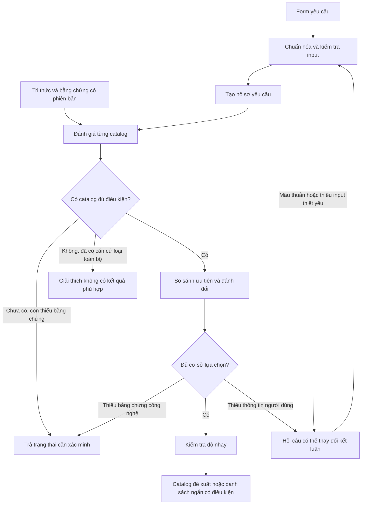

# Logic xử lý input để khuyến nghị catalog

Ngày: **15/10/2026**. Trạng thái: **đề xuất nghiên cứu, chưa triển khai hoặc kiểm chứng thực nghiệm**.

## 1. Quyết định thiết kế

Đề xuất một **hệ hỗ trợ lựa chọn dựa trên tri thức và ràng buộc**, có vòng hỏi bổ sung khi thông tin đó có thể thay đổi kết luận. Đầu ra chính vẫn là **công nghệ catalog**. Giải thích, điều kiện và trạng thái bằng chứng giúp người dùng hiểu kết quả; không mở rộng thành thiết kế triển khai.

“Tốt nhất” được hiểu là phù hợp nhất **trong tập catalog được xét, với yêu cầu, mô hình ưu tiên và bằng chứng tại thời điểm đánh giá**. Có thể chưa xác định được một lựa chọn duy nhất. Việc trả danh sách ngắn hoặc chưa đủ cơ sở kết luận là kết quả hợp lệ.

Kế thừa [framework v2](../catalog-selection-framework/README.md) và [thiết kế cơ sở tri thức](README.md): yêu cầu bắt buộc, ưu tiên và thông tin bối cảnh được xử lý riêng. Không tự biến thứ tự ưu tiên thành trọng số, không cộng số tính năng để xác định catalog tốt nhất.

## 2. Căn cứ nghiên cứu và giới hạn kế thừa

| Nguồn | Căn cứ dùng cho thiết kế | Giới hạn |
|---|---|---|
| [Felfernig & Burke, 2008](https://doi.org/10.1145/1409540.1409544) | Tách nhu cầu, thuộc tính sản phẩm và ràng buộc ánh xạ; có xử lý khi không có lời giải | Không kiểm chứng flow này trên catalog; xem phạm vi đọc tại [K01](sources.md#k01--constraint-based-recommender-systems-technologies-and-research-issues) |
| [Farshidi et al., 2018](https://slingerjansen.nl/wp-content/uploads/2018/05/a-decision-support-system-for-software-technology-selection.pdf) | Tiền lệ DSS chọn công nghệ dựa trên đặc tính và yêu cầu, sàng lọc rồi đánh giá lựa chọn | Nghiên cứu DBMS; không kế thừa mặc định công thức điểm hoặc bộ tiêu chí; xem [K02](sources.md#k02--a-decision-support-system-for-software-technology-selection) |
| [Roy & Słowiński, 2013](https://link.springer.com/article/10.1007/s40070-013-0004-7) | Lựa chọn phương pháp phải xét kiểu kết quả, thang đo, thông tin ưu tiên, bất định, khả năng bù trừ và tương tác tiêu chí | Bài hướng dẫn phương pháp, không chứng minh một thuật toán tối ưu cho mọi bài toán. Đối chiếu abstract và phần Q1d–Q1e, Q2a trong lượt nghiên cứu này; ghi chú rộng hơn ở [nghiên cứu MCDA](../catalog-method-review/group-2-mcda.md) |
| [Martin et al., IJCAI 2024](https://www.ijcai.org/proceedings/2024/0387.pdf) | Câu hỏi bổ sung nên phục vụ chất lượng quyết định cuối cùng; bài nghiên cứu chọn câu hỏi theo expected value of information | Đã đọc chọn lọc phần mở đầu và §§2,4–5. Phương pháp của bài cần mô hình hoặc dữ liệu phản hồi/utility; chưa đánh giá thực nghiệm của bài trong lượt này. Prototype này chỉ dùng heuristic minh bạch, không tuyên bố tính EVOI |

Flow bên dưới là **đề xuất tổng hợp cho đề tài**, không phải một thuật toán nguyên bản lấy trọn từ một bài báo. Chưa có dữ liệu chứng minh nó hiệu quả hơn phương pháp lựa chọn thủ công của người dùng.

## 3. Luồng tổng quan

Không bắt người dùng trả lời hết mọi câu hỏi trước khi xử lý. Có thể phân tích các phần đã rõ, nhưng kết luận phải nêu giới hạn nếu phần còn thiếu có khả năng thay đổi lựa chọn.

## 4. Các bước xử lý

### Bước 1 — Chuẩn hóa và kiểm tra input

Lưu câu trả lời gốc, giá trị chuẩn hóa, trường chưa biết và nguồn của từng yêu cầu. Phân biệt `không cần`, `không có ràng buộc`, `chưa biết`, `chưa trả lời`.

Ví dụ chọn hai engine cần làm rõ thao tác của mỗi engine; chọn nhiều định dạng cần làm rõ phải hỗ trợ tất cả hay chỉ một trong số đó. Không biến chọn AWS thành yêu cầu dùng catalog của AWS. Môi trường hiện có chỉ trở thành ràng buộc nếu người dùng xác nhận phải giữ nó.

Kiểm tra kiểu dữ liệu, đơn vị, khoảng giá trị, điều kiện AND/OR và mâu thuẫn trực tiếp. Nếu người dùng vừa bắt buộc tự quản lý dịch vụ vừa bắt buộc chỉ dùng dịch vụ do nhà cung cấp vận hành, hỏi lại ý nghĩa trước khi lọc. Không coi “chưa tìm thấy catalog đáp ứng” là bằng chứng rằng input tự mâu thuẫn.

### Bước 2 — Chuyển câu trả lời thành hồ sơ yêu cầu

Mỗi yêu cầu gồm: mã, phát biểu nguyên tử, mức bắt buộc/ưu tiên, điều kiện áp dụng, phép kiểm tra, ngưỡng nếu có, tiêu chuẩn bằng chứng và liên kết về câu trả lời. Quy tắc ánh xạ phải được biên soạn và duyệt; suy luận không chắc chắn phải được người dùng xác nhận.

| Nhóm input | Cách dùng trong quyết định |
|---|---|
| Xây mới, thay thế, mở rộng | Kích hoạt câu hỏi phù hợp; thay thế mới hỏi điều kiện di chuyển cần giữ |
| Hạ tầng, nơi lưu dữ liệu | Giới hạn môi trường được phép nếu đây là điều kiện bắt buộc |
| Định dạng bảng | Tạo yêu cầu hỗ trợ đúng định dạng và thao tác cần thiết |
| Engine | Tạo yêu cầu tương thích theo engine, thao tác và phạm vi được xét |
| Tự vận hành/managed | Ràng buộc hoặc ưu tiên tùy câu trả lời |
| OSS | Ràng buộc hoặc ưu tiên; không đồng nhất OSS với tổng chi phí thấp |
| Năng lực cần có | Tách thành tiêu chí cụ thể; chẳng hạn quyền ở cấp nào, branching phục vụ thao tác nào |
| Ngân sách, nhân lực, quy mô | Ngưỡng khả thi hoặc tiêu chí ưu tiên khi có cách đo và bằng chứng tương ứng |
| Thứ tự ưu tiên | Xác định điều cần hỏi về đánh đổi; chưa đủ để tính trọng số số học |

Ví dụ: “Trino cần đọc, Spark cần đọc và ghi trên Iceberg; tất cả bắt buộc” được tách thành ba phép kiểm tra thao tác và một điều kiện **cùng đáp ứng trong phạm vi tương thích**. Tránh đếm việc tách này thành ba lợi ích độc lập trong điểm ưu tiên.

### Bước 3 — Đánh giá catalog bằng tri thức có phạm vi

Với mỗi yêu cầu, truy xuất mệnh đề, nguồn và điều kiện áp dụng; tạo kết quả `PASS`, `FAIL`, `UNKNOWN`, hoặc `N/A` có lý do. `N/A` chỉ dùng khi điều kiện áp dụng thực sự không phát sinh; không được dùng để né một yêu cầu bắt buộc.

- `PASS`: đủ bằng chứng phù hợp với phép kiểm tra đã định nghĩa.
- `FAIL`: có căn cứ cho thấy không đáp ứng trong phạm vi đánh giá.
- `UNKNOWN`: thiếu dữ liệu, khác phạm vi, bằng chứng chưa đủ hoặc nguồn xung đột chưa giải quyết.

Không lấy khả năng ở edition thương mại gán sang OSS; không ghép các tính năng chỉ tồn tại ở các phiên bản/đường tích hợp không tương thích để kết luận cùng đáp ứng. Cần chứng minh có ít nhất một phạm vi áp dụng nhất quán thỏa tất cả yêu cầu bắt buộc. Đây là kiểm tra nội bộ phục vụ chọn catalog, không phải sinh phương án triển khai cho người dùng.

Một đường tích hợp thất bại chưa đủ loại toàn bộ catalog. Chỉ kết luận loại khi có căn cứ loại mọi phạm vi được phép trong mô hình đang xét; nếu chưa bao phủ, giữ trạng thái chưa xác minh. Toàn bộ kết luận đều giới hạn theo phạm vi nghiên cứu được công bố.

### Bước 4 — Sàng lọc điều kiện bắt buộc

Chia thành ba tập:

1. **Đủ điều kiện:** có căn cứ đáp ứng đồng thời mọi yêu cầu bắt buộc áp dụng.
2. **Chưa xác minh:** chưa chứng minh được đáp ứng, cũng chưa đủ căn cứ loại.
3. **Bị loại:** có căn cứ vi phạm điều kiện bắt buộc trong phạm vi đánh giá.

Nếu chưa có catalog đủ điều kiện nhưng còn tập chưa xác minh, trả “cần thêm bằng chứng”, không trả “không có catalog phù hợp”. Nếu toàn bộ bị loại, hiển thị yêu cầu gây loại từng ứng viên. Có thể tìm một tập con yêu cầu đủ làm tập khả thi rỗng; phải nói rõ đây là với các ứng viên và bằng chứng đang xét, không phải bất khả thi trên toàn thị trường.

Chỉ mô phỏng nới yêu cầu dưới nhãn giả định và áp dụng khi người dùng đồng ý sửa yêu cầu. Không tự chuyển bắt buộc thành ưu tiên để tạo kết quả. Form trống hoặc quá thiếu bối cảnh chỉ cho danh sách khám phá, không được gọi là khuyến nghị đã kiểm chứng phù hợp.

### Bước 5 — So sánh các ứng viên đủ điều kiện

Đề xuất prototype bắt đầu bằng **so sánh Pareto và làm rõ đánh đổi**. A trội B nếu A không kém trên mọi tiêu chí ưu tiên có liên quan và tốt hơn trên ít nhất một tiêu chí. Chỉ kết luận khi thang so sánh, chiều tốt/xấu và bằng chứng có thể so sánh đã rõ; nếu còn chiều quan trọng chưa biết, không tự suy ra trội hơn.

Nếu giá trị là khoảng, chỉ khẳng định quan hệ khi nó vẫn đúng với các giá trị khả dĩ đã xác định; khoảng chồng lấn có thể làm quan hệ chưa xác định. Không so chi phí hoặc hiệu năng lấy từ workload khác nhau như cùng điều kiện. Những catalog chưa chứng minh bị trội vẫn được giữ.

Nếu nhiều catalog còn lại, hệ thống xác định **đánh đổi đang ngăn kết luận**: ít công vận hành hơn nhưng tốn chi phí dịch vụ hơn, hoặc đáp ứng các ưu tiên khác nhau. Thứ tự ưu tiên giúp chọn vấn đề để hỏi; chưa cho biết người dùng chấp nhận đánh đổi bao nhiêu.

Có ba mức xử lý tùy dữ liệu ưu tiên đã thu thập:

| Mức | Điều kiện sử dụng | Kết quả |
|---|---|---|
| Pareto + quan hệ ưu tiên được xác nhận | Chưa có mô hình utility hợp lệ; người dùng có thể trả lời đánh đổi cụ thể | Lựa chọn theo quan hệ nhất quán hoặc danh sách chưa phân biệt được |
| Ưu tiên thứ bậc tuyệt đối | Người dùng xác nhận khác biệt ở tiêu chí đứng trước luôn quyết định, bất kể tiêu chí sau; thang đo/ngưỡng tương đương rõ | So lần lượt tiêu chí; giữ hòa khi chưa phân biệt được |
| Hàm giá trị có trọng số | Có thang giá trị, trọng số gắn với các mức thay đổi và giả định bù trừ phù hợp | Xếp hạng có kiểm tra độ nhạy |

Chọn mức đầu làm mặc định. Không tự đặt 40/30/20/10, không đổi “cao/vừa/thấp” thành 3/2/1 rồi cộng, không đếm một lợi ích nhiều lần qua các tiêu chí trùng nhau. Nếu quan hệ ưu tiên tạo vòng A > B > C > A, cần làm rõ hoặc giữ kết quả chưa phân định.

Catalog chưa xác minh có thể tốt hơn catalog đã đủ điều kiện; phải giữ cảnh báo về phạm vi này khi gọi một lựa chọn là tốt nhất trong tập đã kiểm chứng.

### Bước 6 — Chọn câu hỏi bổ sung và điều kiện dừng

Tách hai loại thiếu thông tin: **người dùng chưa nói rõ nhu cầu** thì hỏi người dùng; **KB chưa biết khả năng công nghệ** thì tạo việc cần xác minh nguồn/lab. Không yêu cầu người dùng tự biết catalog nào hỗ trợ tính năng nào để hệ thống làm nhiệm vụ của mình.

Heuristic đề xuất: xét các câu trả lời khả dĩ cho một câu hỏi, chạy lại phần quyết định liên quan, ưu tiên câu hỏi có thể thay đổi tính khả thi hoặc lựa chọn. Trong các câu hữu ích, ưu tiên câu rõ, ít tốn công trả lời. Đây là heuristic thử nhánh, không phải EVOI hay một xác suất độ tin cậy.

Dừng khi đã có cơ sở chọn theo mô hình đã chấp nhận, người dùng chọn dừng, không còn câu hỏi có khả năng giải quyết khác biệt, hoặc trở ngại nằm ở bằng chứng công nghệ. Nếu người dùng không trả lời, giữ kết quả có điều kiện; không mặc định câu trả lời thuận lợi cho catalog đang dẫn đầu.

### Bước 7 — Kiểm tra độ nhạy và sinh output

Trước kết luận, kiểm tra các thay đổi hợp lý đã khai báo: khoảng chi phí/effort, workload, bất định bằng chứng và ưu tiên còn chưa chốt. Phạm vi thay đổi phải có căn cứ; không mặc định ±10% hoặc tạo phân phối xác suất. Khi các yếu tố phụ thuộc nhau, dùng kịch bản kết hợp phù hợp.

Nếu lựa chọn giữ nguyên trong các kịch bản đã xét, mô tả đúng phạm vi kiểm tra. Nếu kết quả đổi, nêu điều kiện chuyển lựa chọn hoặc trả shortlist. Không chuyển tỷ lệ kịch bản thắng thành “xác suất catalog này là tốt nhất”. Những yêu cầu bắt buộc đã chốt vẫn giữ nguyên trong kết quả chính thức.

Output máy đọc nên chứa: trạng thái kết luận, catalog được đề xuất/danh sách ngắn, các tập đủ điều kiện/chưa xác minh/bị loại, lý do quyết định, điều kiện còn mở, câu hỏi tiếp theo hoặc bằng chứng cần bổ sung, cùng mã phiên bản KB/quy tắc và thời điểm đánh giá.

Chuỗi giải thích: **câu trả lời → yêu cầu → phép đánh giá → mệnh đề → nguồn**. Nếu dùng LLM, chỉ diễn đạt payload này; kiểm tra tên catalog, trạng thái và nguồn trước khi hiển thị. Khi kiểm tra thất bại, dùng mẫu giải thích cố định. LLM không sửa tập ứng viên hoặc tạo điểm phù hợp.

## 5. Ví dụ minh họa hoàn toàn giả định

Giả sử đã có đủ thông tin về các điều kiện bắt buộc. Các tên A–D không đại diện cho sản phẩm thật và các mô tả dưới đây không phải dữ liệu benchmark.

| Catalog | Kết quả ràng buộc | Ưu tiên còn khác biệt | Xử lý |
|---|---|---|---|
| A | Tất cả PASS trong cùng phạm vi | Ít công vận hành hơn B, chi phí cao hơn B | Giữ để so sánh |
| B | Tất cả PASS trong cùng phạm vi | Chi phí thấp hơn A, cần nhiều công vận hành hơn A | Giữ để so sánh |
| C | FAIL một yêu cầu bắt buộc | Có các tính năng ưu tiên khác | Loại; lợi ích khác không bù được yêu cầu bắt buộc |
| D | UNKNOWN một yêu cầu bắt buộc | Chưa thể kết luận | Chờ xác minh, không xếp ngang A/B như đã đủ điều kiện |

Chỉ biết “ưu tiên chi phí” chưa đủ kết luận B. Cần cho người dùng xem chênh lệch chi phí và công vận hành đã được xác minh trong cùng điều kiện, rồi hỏi đánh đổi đó có chấp nhận được không. Nếu người dùng xác nhận chọn B theo đánh đổi này, có thể đề xuất B trong tập đã kiểm chứng; nếu D còn có thể thay đổi kết quả, ghi điều kiện đó. Nếu dữ liệu chênh lệch chưa có thì cần bổ sung bằng chứng trước.

## 6. Cách kiểm chứng trong đồ án

So sánh prototype với phương pháp thủ công đã nghiên cứu trên bộ ca giữ riêng, không dùng chính những ca đã dùng để viết quy tắc làm toàn bộ đánh giá. Người duyệt xây kết quả tham chiếu từ cùng snapshot bằng chứng; kết quả tham chiếu có thể là một tập lựa chọn hoặc trạng thái chưa đủ cơ sở, không nhất thiết một nhãn duy nhất.

Các tình huống kiểm tra logic quan trọng:

- FAIL bắt buộc không được đề xuất như đủ điều kiện; UNKNOWN không tự chuyển PASS.
- Không ghép bằng chứng từ những phạm vi không thể đồng thời áp dụng.
- Không tìm được ứng viên vì thiếu bằng chứng khác với đã có căn cứ loại hết.
- Input mâu thuẫn, trống, nhiều lựa chọn AND/OR và ưu tiên tạo vòng được xử lý rõ.
- Trên cùng snapshot, phạm vi và quy tắc cố định, thêm ràng buộc bắt buộc không làm tập đủ điều kiện lớn hơn.
- Đổi thứ tự hiển thị hoặc lặp cùng yêu cầu không làm đổi kết luận; thêm ứng viên bị trội không tự làm đảo quan hệ của các ứng viên cũ khi thang đo cố định.
- Thay đổi nguồn hoặc ưu tiên có thể truy ra lý do kết quả thay đổi.

Đo riêng: vi phạm điều kiện bắt buộc, mức đồng thuận với kết quả tham chiếu có xử lý bất đồng chuyên gia, tính đúng của lý do/nguồn, số câu hỏi và thời gian đến kết luận, tỷ lệ phải dừng do thiếu bằng chứng, và độ ổn định trong tập kịch bản được định nghĩa trước. Báo cáo đồng thời khả năng đưa ra kết quả và lỗi: hệ luôn từ chối kết luận không được xem là tốt chỉ vì không chọn sai.

## 7. Thứ tự xây prototype

1. Lập bảng mapping **input → yêu cầu → phép kiểm tra → bằng chứng → hành động khi thiếu** từ phương pháp hiện có.
2. Biên soạn một tập tri thức nhỏ đã duyệt; dùng ca ví dụ để kiểm tra cách hiểu và phạm vi.
3. Xây chuẩn hóa, đánh giá ba trạng thái chính, sàng lọc và giải thích truy vết.
4. Bổ sung Pareto, câu hỏi đánh đổi và các trạng thái dừng.
5. Kiểm tra độ nhạy, đánh giá trên các ca giữ riêng rồi mới quyết định có cần mô hình điểm phức tạp hơn.

Cây quyết định phù hợp để điều hướng câu hỏi có điều kiện. Phần quyết định chính nên truy xuất tri thức và áp dụng quy tắc, để cập nhật một catalog không phải viết lại toàn bộ cây phân nhánh theo tên sản phẩm.
