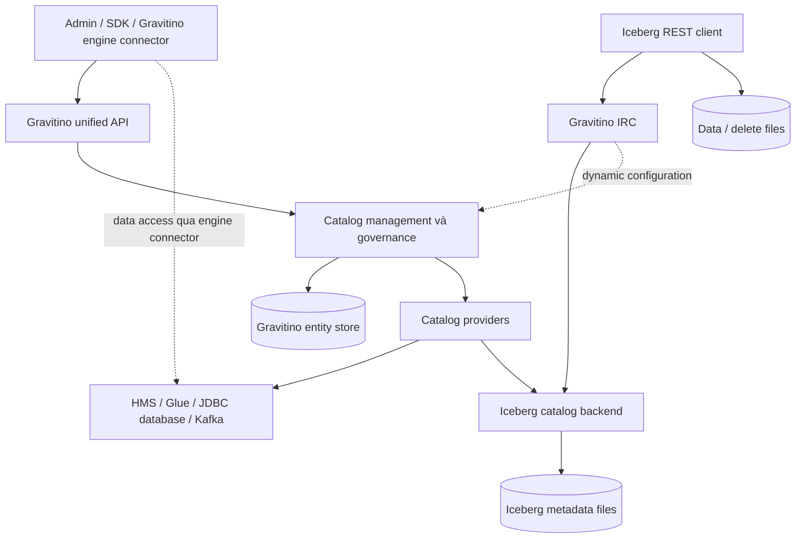
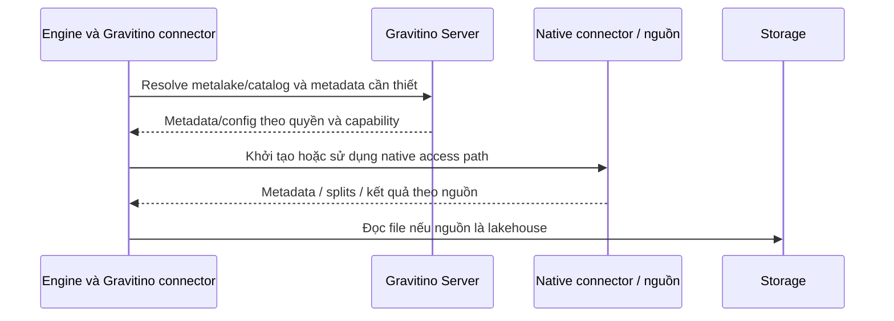
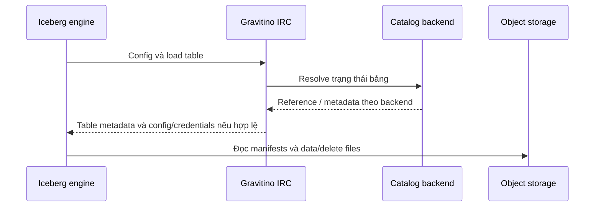
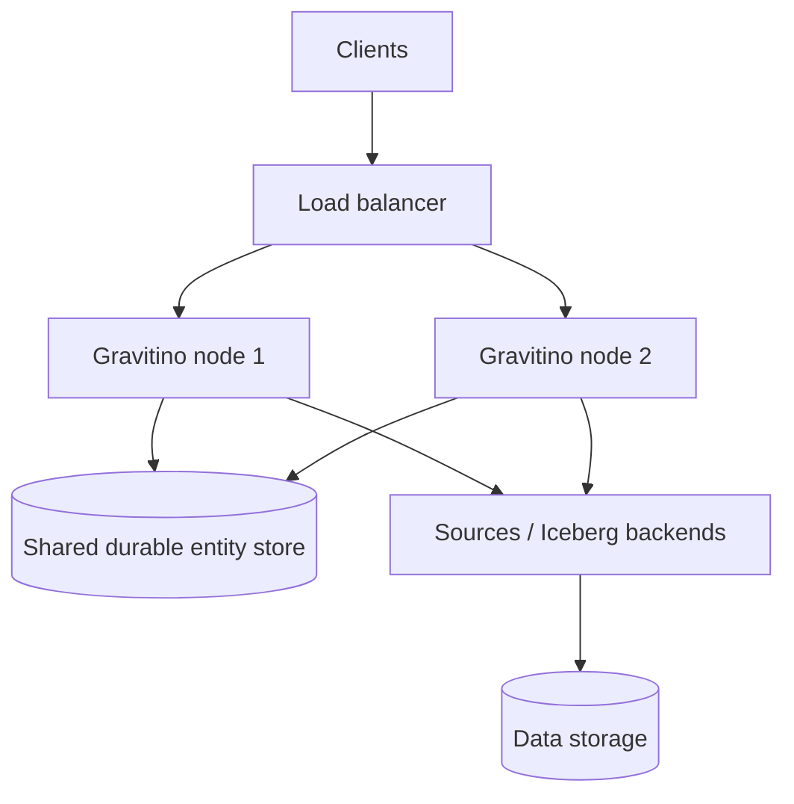

# Apache Gravitino: kiến trúc catalog liên kết, metadata và vận hành

> **Thực hành:** [Lab Gravitino 1.3.0 + PostgreSQL + Fileset](lab/README.md) gồm Docker Compose, 8 bài học tiếng Việt, sơ đồ kiến trúc, đáp án và kiểm tra tích hợp đã chạy. Phạm vi xác minh của lab được ghi riêng trong [VERIFICATION.md](lab/VERIFICATION.md).

*Đối tượng: Data Engineer thiết kế và vận hành nền tảng nhiều nguồn dữ liệu, nhiều engine. Mốc đối chiếu: Apache Gravitino 1.3.0; nghiên cứu ngày 14/09/2026. Báo cáo sử dụng tài liệu phiên bản, release notes và tài liệu trong repository chính thức. Các sơ đồ là tổng hợp kiến trúc; ví dụ cấu hình là minh họa, chưa được chạy trong môi trường thực nghiệm.*

## 0. Tổng quan cách Apache Gravitino hoạt động

Giả sử doanh nghiệp có bảng giao dịch trong PostgreSQL, bảng phân tích trong Iceberg, dữ liệu cũ qua Hive Metastore, topic Kafka và model artifacts trên object storage. Spark và Trino cần tìm đúng tài nguyên, lấy cấu hình truy cập và tuân thủ quyền, trong khi nhóm nền tảng phải quản lý nhiều hệ thống metadata khác nhau.

**Gravitino cung cấp một mô hình và giao diện quản lý chung trên các nguồn đó.** Nó tổ chức tài nguyên trong *metalake*, đăng ký từng nguồn thành catalog và dùng catalog provider để thao tác với nguồn tương ứng. Mục tiêu federation là thống nhất cách quản lý các hệ thống còn tồn tại riêng, không bắt buộc chuyển mọi metadata và dữ liệu vào một database duy nhất. [Overview][1]

Phải phân biệt hai đường sử dụng:

| Đường | Điểm vào | Công việc chính |
|---|---|---|
| Gravitino Server | Unified REST API, SDK, UI; engine connector tích hợp | Quản lý catalog và metadata của nhiều loại nguồn |
| Gravitino Iceberg REST Catalog service, viết tắt IRC | Iceberg REST API | Phục vụ Iceberg client qua catalog backend đã cấu hình |

Một Gravitino Iceberg catalog trong unified API và một IRC endpoint không phải cùng một giao diện. Provider của catalog có thể làm proxy tới Hive, JDBC hoặc REST backend; IRC là dịch vụ thực thi giao thức Iceberg REST. [Iceberg catalog][2], [IRC][3]



Một flow metadata tổng quát gồm: xác định metalake/catalog → kiểm tra identity và quyền theo cấu hình → chọn provider → truy cập metadata nguồn hoặc entity store → chuyển kết quả về mô hình API. Khi query thực thi, engine và connector đọc dữ liệu ở nguồn/storage. Gravitino không trở thành query engine chỉ vì nó quản lý metadata của nhiều nguồn.

## 1. Giới thiệu và bối cảnh ra đời

### 1.1. Từ một metastore đến nhiều hệ thống metadata

HMS giải quyết nhu cầu chia sẻ metadata trong hệ sinh thái Hive. Iceberg bổ sung mô hình metadata và snapshot phù hợp lakehouse. Tuy nhiên, một doanh nghiệp thường còn có database, message broker, file không cấu trúc và tài sản AI. Một Iceberg catalog riêng lẻ chưa giải quyết toàn bộ việc tổ chức và quản lý các nguồn này.

Gravitino tiếp cận bài toán bằng mô hình metadata chung và các provider kết nối nguồn. Vì vậy, có thể gọi nó là *catalog of catalogs* để diễn đạt vai trò, nhưng phải nhớ một số object được Gravitino quản lý trực tiếp, không phải mọi tài nguyên đều là catalog được proxy. [Metadata object types][4]

### 1.2. Mốc phiên bản của báo cáo

Release notes chính thức công bố 1.3.0 ngày 29/06/2026. Các thay đổi đáng chú ý gồm logical views, hierarchical namespaces, Glue integration, built-in IdP và các cải tiến IRC. Báo cáo dùng mốc này thay vì gộp tính năng từ `next` hoặc design proposal vào bản phát hành. [Release notes][5]

Tài liệu có thể chứa đoạn cũ hoặc mô tả không đồng nhất. Khi gặp mâu thuẫn, báo cáo ưu tiên bảng capability của chức năng cụ thể và cấu hình phiên bản; trường hợp cần PoC được ghi rõ. Chưa có kiểm thử runtime để xác nhận mọi tổ hợp provider, engine và security mode.

### 1.3. Vị trí trong kiến trúc dữ liệu

Gravitino nằm giữa người quản trị/engine integration và các hệ thống metadata, kèm governance và access integration. Nó có thể cùng tồn tại với HMS, Glue hoặc một Iceberg REST catalog khác. Triển khai Gravitino không tự thay thế table format, storage hay engine execution layer.

## 2. Bài toán giải quyết

### 2.1. Giảm phân mảnh giao diện quản lý

Một pipeline quản trị cần tạo namespace, tra schema hoặc cập nhật properties ở nhiều nguồn. Nếu thao tác trực tiếp, pipeline phải xử lý từng API riêng. Unified API cho phép dùng một mô hình gọi chung; provider ánh xạ xuống nguồn. Tuy nhiên, kiểu cột, partitioning và DDL support vẫn khác nhau. [Relational metadata][6]

Ví dụ, việc một API có thao tác rename không bảo đảm provider nào cũng hỗ trợ. Glue catalog phân biệt rename của Hive-format table với Iceberg-format table. Đây là lý do phải xây capability matrix trước khi dùng một pipeline DDL chung. [Glue catalog][7]

### 2.2. Chia sẻ cấu hình giữa engine

Catalog registration tập trung thông tin provider và endpoint. Engine integration có thể chuyển cấu hình đó thành cấu hình native connector. Với Spark Iceberg, các thuộc tính như backend, URI và warehouse được ánh xạ sang Iceberg catalog configuration. [Spark Iceberg connector][8]

Lợi ích thực hành là giảm cấu hình lặp lại; điều kiện là các engine cùng trỏ đúng backend và hiểu cùng table format. Cùng thấy tên `orders` không chứng minh đang đọc cùng một bảng.

### 2.3. Tổ chức tài sản ngoài table

Fileset quản lý tập file/directory theo tên logic; model metadata quản lý thông tin và các phiên bản artifact; topic biểu diễn tài nguyên messaging. Những mô hình này mở rộng phạm vi quản lý nhưng không biến file thường thành bảng ACID hoặc model version thành snapshot dữ liệu. [Filesets][9], [Models][10], [Object types][4]

### 2.4. Tập trung governance có điều kiện

Gravitino cung cấp ownership và role-based privileges; integration có thể đưa quyền xuống hệ thống nguồn. Giá trị nằm ở việc có mô hình quản trị chung. Hiệu lực thực tế vẫn phụ thuộc authentication, enforcement ở từng đường truy cập và khả năng ánh xạ quyền của provider. [Access control][11]

## 3. Kiến trúc và các thành phần

### 3.1. Mô hình đối tượng

```text
Metalake: company
├── Catalog: operational_pg
│   └── Schema: sales
│       └── Table: orders
├── Catalog: lakehouse_iceberg
│   └── Schema: analytics
│       ├── Table: orders_daily
│       └── View: revenue_summary
├── Catalog: raw_files
│   └── Schema: landing
│       └── Fileset: incoming_events
└── Catalog: model_registry
    └── Schema: fraud
        └── Model: classifier
```

Metalake là container/tenant logic; catalog gắn với nguồn/provider; schema nhóm object. Tên SQL mà engine nhìn thấy có thể đã được connector ánh xạ, không nhất thiết đưa toàn bộ metalake vào tên SQL. Namespace nhiều cấp phải theo capability provider và quy tắc encoding của API. [Overview][1], [Object types][4]

### 3.2. Phân công trách nhiệm

| Thành phần | Trách nhiệm | Không nên suy ra |
|---|---|---|
| Interface | REST, SDK, UI và giao tiếp client | Có REST nghĩa là mọi API đều là Iceberg REST |
| Management/governance | Catalog lifecycle, ownership, roles và metadata operations | Có quyền catalog nghĩa là có mọi quyền tại nguồn |
| Object model | Biểu diễn schema, table, fileset, model, topic… | Mọi nguồn hỗ trợ đủ mọi thuộc tính |
| Catalog provider | Chuyển thao tác chung thành thao tác nguồn | Tự thay thế transaction protocol của nguồn |
| Entity store | Persistence của object/relationship do Gravitino giữ | Bản sao đầy đủ của toàn bộ metadata nguồn |
| Engine connector | Nối engine với cấu hình và metadata Gravitino | Gravitino server thực thi SQL thay engine |
| IRC | Thực thi giao thức catalog Iceberg | Tự cung cấp transaction xuyên các nguồn |

Các khối trên là nhóm trách nhiệm, không nhất thiết là các service triển khai độc lập. [Architecture][1], [IRC][3]

### 3.3. Phân biệt hai nghĩa của connector

**Catalog provider phía server** biết cách quản lý nguồn, chẳng hạn HMS hay PostgreSQL. **Engine connector phía Spark/Trino** biết cách dùng thông tin Gravitino trong execution environment của engine. Cần kiểm tra cả hai: server hỗ trợ một provider không đủ chứng minh connector của engine hỗ trợ mọi thao tác trên provider đó. [Trino connector overview][12], [Spark Iceberg connector][8]

### 3.4. View và các subsystem bổ trợ

View có output schema và SQL representations theo dialect. Provider có native view API thì Gravitino thao tác với metadata native; không mặc định tạo một loại view riêng chỉ Gravitino hiểu. Khả năng create/alter/load và SQL dialect phụ thuộc provider. [View metadata][13]

Các module như metrics, audit, lineage và table maintenance hỗ trợ vận hành/quản trị. Phải cấu hình và xác minh integration cụ thể; việc đăng ký catalog không tự thu thập toàn bộ lineage hay tự chạy mọi tác vụ bảo trì. [Documentation index][14]

## 4. Mô hình triển khai và flow khởi tạo

### 4.1. Chọn đường triển khai theo nhu cầu

| Mục tiêu | Mô hình cần đánh giá |
|---|---|
| Quản lý nhiều nguồn | Gravitino Server + entity store + providers |
| Chỉ cần endpoint Iceberg REST | IRC standalone + catalog backend bền vững |
| IRC gắn với governance Gravitino | IRC auxiliary trong Gravitino Server |
| Quản lý cấu hình IRC qua Gravitino | Dynamic config provider, với ranh giới auth của từng mode |

Static config provider lấy cấu hình khi khởi động. Dynamic provider lấy cấu hình catalog từ Gravitino. **Dynamic configuration không tự đồng nghĩa có authorization của auxiliary mode.** IRC standalone và auxiliary phải được nghiệm thu riêng. [IRC][3]

### 4.2. Chuỗi khởi tạo đề xuất

1. Chốt version server, IRC, engine và connector; kiểm tra package tương thích.
2. Chuẩn bị entity-store database và schema nếu chạy Gravitino Server.
3. Chuẩn bị backend nguồn: HMS/Glue/database hoặc Iceberg catalog backend.
4. Thiết lập network, authentication, authorization và cách cung cấp secrets.
5. Khởi động service, kiểm tra endpoint và backend connectivity.
6. Tạo metalake, đăng ký catalog/provider và kiểm tra list/load nguồn.
7. Thiết lập owner/roles, kiểm tra bằng principal có quyền hạn chế.
8. Kết nối engine, kiểm thử đọc/ghi qua đúng integration dự kiến.
9. Thử restart, conflict, revoke và restore trước khi đưa vào production.

Đây là quy trình triển khai đề xuất, không phải chuỗi transaction nguyên tử của Gravitino.

### 4.3. Ví dụ metalake và catalog

Ví dụ request tạo metalake, gửi tới `POST /api/metalakes` bằng identity quản trị phù hợp:

```json
{
  "name": "company",
  "comment": "Metadata cho nền tảng dữ liệu",
  "properties": {}
}
```

Metalake có lifecycle enable/disable. Disable là kiểm soát truy cập nghiệp vụ đối với object bên dưới, không phải shutdown storage. [Manage metalakes][15]

Ví dụ các trường cấu hình cần xác định cho Iceberg provider: `catalog-backend`, `uri`, `warehouse`, `catalog-backend-name`; JDBC còn cần driver và thông tin kết nối. Nếu trỏ tới catalog JDBC đã có, backend name phải khớp để resolve đúng namespace/table. [Iceberg catalog][2]

### 4.4. Cấu hình Spark dùng IRC

Ví dụ minh họa sau giả định server đã cấu hình catalog `lakehouse`, authentication và storage access. Thay hostname và credential mechanism theo môi trường:

```properties
spark.sql.catalog.lake=org.apache.iceberg.spark.SparkCatalog
spark.sql.catalog.lake.type=rest
spark.sql.catalog.lake.uri=https://catalog.example/iceberg/
spark.sql.catalog.lake.warehouse=lakehouse
spark.sql.catalog.lake.header.X-Iceberg-Access-Delegation=vended-credentials
```

Trong đường IRC, `warehouse` phía client có thể chọn catalog; không mặc định đây là URI S3 của warehouse. Header chỉ yêu cầu delegation, không tự cấu hình provider hay cấp quyền. Client vẫn cần Iceberg runtime/FileIO tương thích. [Spark IRC][16]

## 5. Mô hình metadata và cơ chế lưu trữ

### 5.1. Ba miền persistence

```text
A. Gravitino entity store
   Metalake, catalog registration, identity/relationships,
   governance và metadata do Gravitino quản lý

B. Hệ thống nguồn / catalog backend
   HMS records, Glue resources, database schema,
   Iceberg JDBC references hoặc remote REST catalog state

C. Storage của tài nguyên
   Iceberg metadata JSON → manifests → data/delete files
   Fileset contents, model artifacts và file khác
```

Đây là phân loại logic: A và B có thể cùng dùng một database server nhưng vẫn có schema, lifecycle và trách nhiệm khác nhau. Backup một miền không tự bảo vệ hai miền còn lại.

### 5.2. Entity store của Gravitino

Tài liệu 1.3.0 nêu relational/JDBC entity store, mặc định H2 phục vụ phát triển/thử nghiệm; khuyến nghị MySQL và cũng có cấu hình PostgreSQL. Không dùng mặc định H2 để suy ra bảo đảm production. Các cấu hình version retention của entity store không phải lịch sử snapshot của bảng. [Server configuration][17]

### 5.3. Metadata nguồn vẫn có thẩm quyền

Với Hive provider, database/table/partition được quản lý trong HMS. Với JDBC provider, metadata schema/table thuộc database đích. Unified API chuẩn hóa cách biểu diễn và thao tác, không biến Gravitino thành nơi thay thế tất cả native metadata. [Hive catalog][18], [Relational metadata][6]

“Direct metadata management” không nên được diễn giải thành một pipeline sao chép hai chiều đồng bộ tuyệt đối. Một thay đổi ngoài Gravitino có thể được nhìn thấy qua provider, nhưng độ mới còn phụ thuộc cache, API và trạng thái nguồn. Ví dụ Doris có DDL schema bất đồng bộ, nên đọc ngay sau alter có thể chưa thấy schema cuối cùng. [Doris catalog][19]

### 5.4. Iceberg: hai database dễ nhầm

Gravitino entity store giữ registration/governance. Iceberg JDBC backend giữ metadata reference của Iceberg catalog. Dù cả hai đều dùng JDBC, chúng không phải cùng một chức năng.

```text
company.lakehouse.analytics.orders
        ↓ chọn catalog/backend
Iceberg backend: orders → metadata M42
        ↓
Storage: M42 → snapshot → manifest list → manifests → files
```

Iceberg định nghĩa table state. Metadata JSON có thể đổi mà snapshot dữ liệu không đổi, chẳng hạn cập nhật properties. Entity version, view version, model version và Iceberg snapshot ID đều phải được gọi đúng tên. [Iceberg specification][20]

### 5.5. Fileset và model

Fileset là tên logic gắn với locations và metadata liên quan; cần phân biệt managed/external lifecycle trước khi drop. Nó không phải danh sách snapshot của mọi file. Model metadata có thể mô tả versions và artifact locations; việc lưu artifact hoặc chạy inference thuộc hệ thống tương ứng. [Filesets][9], [Models][10]

### 5.6. Lifecycle và xóa

Xóa catalog registration, drop table, purge table và xóa metalake là các thao tác khác nhau. Theo tài liệu metalake, force drop xóa các sub-entities nhưng không mặc nhiên xóa external resources; managed resources có ngoại lệ. Không dùng quy tắc đó để suy ra một lệnh drop-table cũng an toàn như unregister catalog. [Manage metalakes][15]

## 6. API và khả năng tích hợp

### 6.1. API quản lý và API Iceberg

| Giao diện | Consumer | Công việc |
|---|---|---|
| `/api/metalakes/...` | SDK/UI/automation và Gravitino connectors | Metalake, catalog và metadata/governance |
| `/iceberg/...` | Iceberg REST clients | Load/commit và các operation Iceberg được hỗ trợ |
| Native source APIs | Provider hoặc native engine connector | Thực thi nghiệp vụ nguồn |

Ví dụ load table theo unified API thường có dạng `/api/metalakes/{metalake}/catalogs/{catalog}/schemas/{schema}/tables/{table}`. Namespace nhiều cấp cần dùng quy tắc của phiên bản, không tự nối dấu chấm rồi giả định mọi engine hiểu giống nhau. [Relational metadata][6]

### 6.2. Ba đường tích hợp engine

1. **Gravitino-specific connector:** lấy catalog/metadata/config qua Gravitino và sử dụng adapter phù hợp nguồn.
2. **Native Iceberg REST client:** gọi IRC, không cần Gravitino-specific connector chỉ để nói giao thức REST.
3. **Native connector gọi backend trực tiếp:** có thể cùng thấy bảng nếu trỏ đúng backend, nhưng security và visibility phải được kiểm chứng riêng.

Trino connector có package theo dải phiên bản Trino. Không chọn JAR chỉ theo version Gravitino. [Downloads][21], [Trino overview][12], [Trino IRC][22]

### 6.3. Capability matrix là yêu cầu thiết kế

Trước PoC, lập bảng theo provider × engine × operation: load/create/alter/rename/drop, partition, view, read/write, credential refresh và authorization. Một thao tác được hỗ trợ trong nguồn nhưng chưa được provider ánh xạ vẫn không sử dụng được qua unified API.

Ví dụ Glue provider chỉ hỗ trợ kiểu partition tương ứng mô hình Hive trong các partition APIs liên quan; Iceberg partition planning không dùng danh sách HMS-style partitions theo cùng cách. [Glue catalog][7]

## 7. Flow đọc

### 7.1. Đọc qua Gravitino engine connector



Sơ đồ là mô hình tổng quát, không khẳng định mọi connector dùng đúng một số RPC hoặc đi qua Gravitino cho từng metadata request. Với database, data path có thể là query/pushdown tại nguồn; với Iceberg là planning từ metadata/manifests và đọc files. Spark connector ánh xạ properties sang Iceberg runtime minh họa sự phân công này. [Spark Iceberg connector][8]

### 7.2. Đọc qua IRC



Engine sử dụng Iceberg metadata để chọn snapshot và prune files; không chọn file metadata có tên lớn nhất trong thư mục. Truy cập storage cần identity hoặc credential hợp lệ ngay cả khi load-table thành công. [Iceberg specification][20], [Trino IRC][22]

### 7.3. Đọc từ catalog federated

IRC cục bộ có thể chuyển yêu cầu sang IRC từ xa. Đây là metadata routing; không tự tạo bản sao dữ liệu tại region cục bộ. Suy luận vận hành: latency và availability đầu cuối phụ thuộc cả mạng liên vùng lẫn backend từ xa. Đặt proxy gần engine không tự xóa chi phí đọc dữ liệu ở region khác. [Overview][1]

### 7.4. Chẩn đoán read failure

| Biểu hiện | Điểm cần kiểm tra trước |
|---|---|
| Không thấy catalog | Metalake, registration, identity, connector discovery/cache |
| Thấy catalog nhưng không thấy table | Backend name/URI, namespace mapping, quyền nguồn |
| Load được metadata nhưng đọc file lỗi | FileIO, network, storage credential, KMS, file missing |
| Hai engine thấy schema khác nhau | Cùng backend/table UUID chưa, cache và connector versions |
| Proxy hoạt động nhưng query chậm | Vị trí dữ liệu, remote catalog latency, planning/file count |

Đây là bảng runbook đề xuất, không phải danh sách lỗi chỉ riêng Gravitino có.

## 8. Flow ghi và commit

### 8.1. DDL qua unified API

Client gửi create/alter/drop → server kiểm tra request/quyền → provider chuyển xuống nguồn → nguồn xử lý → Gravitino trả kết quả và quản lý metadata liên quan theo implementation.

Không suy ra thao tác ở source database và entity-store update cùng nằm trong một distributed transaction. Với DDL bất đồng bộ, thành công của request không nhất thiết có nghĩa mọi reader ngay lập tức quan sát trạng thái cuối. [Doris catalog][19]

### 8.2. Ghi dữ liệu qua native engine integration

Engine thực thi write bằng native connector/table-format library. Gravitino hỗ trợ discovery/config/governance theo đường tích hợp; không tự định nghĩa lại semantics của PostgreSQL, Hive ACID hay Iceberg.

Ví dụ Hive non-ACID có thể ghi vào partition đã đăng ký mà không cần thay pointer; Iceberg phải công bố metadata mới theo catalog protocol. Cả hai đi qua cùng hệ thống quản trị không làm commit trở thành tương đương.

### 8.3. Commit Iceberg qua IRC

```mermaid
sequenceDiagram
    participant W as Iceberg writer
    participant R as Gravitino IRC
    participant B as Iceberg backend
    participant S as Storage
    W->>R: Load base table state
    W->>S: Chuẩn bị data/delete files và manifests khi cần
    W->>R: Commit requirements + updates
    R->>R: Kiểm tra và áp dụng updates theo Iceberg
    R->>B: Commit qua backend implementation
    Note over R,S: Đường local ghi metadata mới; REST backend có thể chuyển tiếp
    alt Điều kiện commit còn hợp lệ
        B-->>R: Công bố state thành công
        R-->>W: Success
    else Xung đột
        B-->>R: Conflict
        R-->>W: Refresh / validate / retry hoặc abort
    end
```

Không cố định vị trí ghi final metadata JSON ở client: REST server/backend tham gia tùy implementation. Backend Hive, JDBC và remote REST có cách bảo vệ publication khác nhau. Data files được chuẩn bị trước; chỉ các files được state đã commit tham chiếu mới thuộc trạng thái bảng đó. [Iceberg reliability][23]

### 8.4. Thất bại và kết quả commit không rõ

Nếu writer timeout sau publication, retry mù có thể ghi lặp. Nếu commit thất bại trước publication, có thể còn orphan files. Runbook cần giữ run ID, operation context và kiểm tra table state trước cleanup; không xóa mọi file do job tạo chỉ vì HTTP request lỗi. [Iceberg reliability][23]

### 8.5. Drop và cleanup

Drop registration và purge dữ liệu phải được phân biệt trong runbook. Với async cleanup, cần theo dõi job đến khi hoàn tất, không xem response của bước loại table khỏi catalog là bằng chứng mọi file đã bị xóa. 1.3.0 có thay đổi về asynchronous hard deletion; đánh giá đúng mode/capability trước khi dùng. [Release notes][5]

## 9. Tính nhất quán và transaction

### 9.1. Bốn ranh giới

| Phạm vi | Thành phần chịu trách nhiệm | Giới hạn cần nhớ |
|---|---|---|
| Gravitino entity state | Entity-store implementation | Không bao trùm mọi hệ thống nguồn |
| Native metadata/data mutation | HMS, database, Glue hoặc provider/backend | Semantics khác nhau theo nguồn |
| Iceberg table commit | Iceberg + catalog backend | Công bố state của bảng theo protocol |
| Pipeline nhiều nguồn | Engine/orchestrator và thiết kế ứng dụng | Gravitino federation không tự tạo distributed transaction |

**IRC 1.3.0 liệt kê multi-table transactions là chưa triển khai.** Không dùng “hỗ trợ Iceberg REST” để suy ra mọi endpoint và transaction capability của đặc tả đều có. [IRC][3]

### 9.2. Không đồng nhất các loại version

Entity-store versions phục vụ metadata nội bộ; Iceberg snapshots mô tả dữ liệu; model versions và view versions thuộc object model tương ứng. Gravitino không vì có các versions đó mà cung cấp một commit hash toàn metalake kiểu Nessie.

### 9.3. Freshness và cache

Server và engine có thể cache nhiều lớp. Khi đánh giá consistency cần kiểm tra: cache catalog config, native metadata cache, table metadata cache, authorization cache và source-side propagation. Version validation hoặc invalidation chỉ bảo vệ đúng miền mà nó theo dõi; không thể suy ra mọi source external update lập tức invalidates mọi engine.

1.3.0 bổ sung entity change-log polling cho invalidation giữa các node. Đây là cơ chế vận hành cần theo dõi lag và retention, không phải synchronous replication của tất cả metadata nguồn. [Server configuration][17]

### 9.4. Federation và đọc nhất quán nhiều nguồn

Một query join PostgreSQL với Iceberg có thể nhìn hai mốc dữ liệu khác nhau. Unified namespace không tạo shared snapshot. Đề xuất cho pipeline báo cáo: publication marker, watermark hoặc version mapping ở orchestration layer; nếu cần atomic publication nhiều bảng, đánh giá catalog/engine có protocol phù hợp thay vì giả định federation giải quyết.

## 10. Bảo mật

### 10.1. Authentication

Tài liệu 1.3.0 mô tả simple, Basic với built-in IdP, OAuth và Kerberos. Simple không phải bằng chứng danh tính mạnh để dùng trên mạng không tin cậy. Basic phải đi cùng TLS; external token mode cần cấu hình issuer/audience/validation phù hợp. Authentication xác định người gọi, không tự cấp mọi quyền quản trị. [Authentication][24]

### 10.2. Authorization và ownership

Built-in authorization được bật bằng `gravitino.authorization.enable=true`; roles gắn privileges, ownership kiểm soát quản lý tài nguyên. Không bật kiểm tra quyền hoặc dùng pass-through authorizer thì không có cùng enforcement. [Access control][11]

Trang Access Control còn chứa một ghi chú cũ nói không kiểm tra metadata requests, mâu thuẫn với chính phần built-in authorization và bảng API requirements trên trang. Báo cáo không dùng ghi chú đó để kết luận hệ thống thiếu metadata authorization; khi triển khai cần thử allow/deny bằng principal riêng cho các API thực tế.

### 10.3. Ba điểm enforcement

```text
Identity client
   → Gravitino API authorization
   → Native source authorization / provider integration
   → Storage IAM, filesystem permissions, KMS
```

Thiết kế phải mô tả principal nào xuất hiện ở từng bước. Nếu engine gọi backend trực tiếp bằng service account rộng quyền, policy chỉ enforce tại Gravitino không tự chặn đường đó. Row/column filtering cần engine hoặc source thực thi; không suy ra chỉ từ sự tồn tại của RBAC.

### 10.4. Credential vending không luôn là token tạm thời

Gravitino credential provider có thể cung cấp **temporary hoặc static credentials**, tùy loại nguồn/provider. Đây là điểm quan trọng với JDBC user/password hoặc secret-key credentials: tên cơ chế “vending” không bảo đảm credential luôn được downscope theo table và hết hạn nhanh. [Credential vending][25]

Từ 1.3.0, sensitive catalog properties được ẩn khỏi load-catalog response mặc định. Client cần đường lấy credential được hỗ trợ. Không bật lại property backfill như giải pháp lâu dài để chữa connector cũ. [Release notes][5]

**Lưu ý chất lượng tài liệu:** trang Credential Vending gắn phiên bản 1.3.0 vẫn có đoạn ghi relational catalog vending bắt đầu từ 1.4.0, trong khi release notes 1.3.0 và các trang provider mô tả thay đổi này ở 1.3.0. Báo cáo theo release notes cho mốc thay đổi, nhưng không mặc định mọi hướng dẫn auto-detection/client integration trên trang đó đã đúng cho mọi binary 1.3.0. Khi nghiệm thu, kiểm tra endpoint credentials và đúng connector artifact thay vì chỉ dựa vào nhãn phiên bản trang.

### 10.5. IRC standalone, auxiliary và REST federation

IRC standalone có thể cấu hình authentication nhưng không có cùng built-in access-control integration của auxiliary mode. Với REST backend, tài liệu nêu mặc định IRC phía trước bỏ authorization và giao cho IRC phía sau; `disable-rest-authz=false` dùng để giữ kiểm tra phía trước trong cấu hình hỗ trợ. Phải xác định rõ server nào thực thi quyền. Remote signing vẫn được ghi là chưa hỗ trợ, dù có cấu hình liên quan trong tài liệu. [IRC][3]

### 10.6. Runbook security đề xuất

- Tách service admin, catalog operator, writer và reader.
- Kiểm thử revoke trên cả metadata API và data access path.
- Giới hạn quyền service account tại nguồn; kiểm soát các đường gọi trực tiếp.
- Bảo vệ config/DB backup chứa credential material, không chỉ che UI.
- Kiểm tra token refresh và lỗi hết hạn trong job dài.
- Correlate identity/request qua Gravitino, backend và storage audit.

## 11. Khả năng mở rộng, HA và vận hành

### 11.1. Mô hình HA đề xuất



Đây là mô hình triển khai cần nghiệm thu, không phải SLA của dự án. Node tăng lên kéo theo connections, cache và background work. Backend nguồn, entity database, network và credential service đều có thể là điểm nghẽn riêng.

### 11.2. Quan sát theo đường request

| Nhóm | Chỉ số đề xuất |
|---|---|
| API | Latency/error theo operation, queue và thread saturation |
| Entity store | Connection pool, slow query, lock contention, replication/backup health |
| Provider | Backend latency, timeouts, unsupported operations |
| Cache | Hit/miss, invalidation lag, stale-config incidents |
| Iceberg | Commit conflicts, metadata load latency, orphan/cleanup backlog |
| Security | Access denied, auth failure, credential expiry/refresh errors |
| Engine | Planning time, số files, network/scan throughput |

Gravitino có metrics reporting; metric cụ thể và exporter phải theo tài liệu cấu hình. Bảng trên là mục tiêu observability đề xuất, không khẳng định mọi chỉ số đều có sẵn một metric tương ứng. [Metrics][26]

### 11.3. Health check không thay thế query test

1.3.0 có liveness/readiness endpoints; readiness của Gravitino kiểm tra entity store. Endpoint trả healthy không chứng minh mọi HMS, catalog federated hoặc object store đều hoạt động. Bổ sung synthetic load-table, read nhỏ và commit canary theo các nguồn quan trọng. [Server configuration][17]

### 11.4. Backup và upgrade

Cần inventory riêng: entity database, Iceberg backend database/metastore, storage, secrets và server/connector configuration. Chụp backup theo recovery plan, chạy schema migration của đúng phiên bản và thử restore vào môi trường biệt lập. [Upgrade guide][27]

Release notes 1.3.0 nhấn mạnh backup riêng database của IRC khi có database riêng; Helm không tự thực hiện schema migration trong flow được mô tả. Đồng thời đường cài Docker đổi sang `/opt/gravitino`, nên kiểm tra mount/script khi upgrade. [Release notes][5]

### 11.5. Capacity và chi phí

Chi phí thực tế gồm Gravitino/IRC compute, entity DB, native backends, metadata API requests, cross-region traffic và vận hành. Federation có thể giảm tích hợp trùng lặp nhưng thêm dependency vào request path. Đo workload thật: nhiều catalog nhỏ, một catalog nhiều table, DDL churn và concurrent Iceberg writers tạo áp lực khác nhau.

### 11.6. Bài kiểm thử nghiệm thu đề xuất

1. Hai engine resolve cùng table UUID/backend sau restart.
2. Thay đổi metadata trực tiếp ở nguồn rồi đo thời gian engine thấy thay đổi.
3. Hai writer Iceberg cạnh tranh; không có lost update.
4. Ngắt response sau commit và xác minh recovery không ghi lặp.
5. Revoke quyền; kiểm tra API, vending và đường backend trực tiếp.
6. Dừng một node hoặc làm entity DB tạm không sẵn sàng; kiểm tra failover.
7. Restore metadata và file state rồi thực hiện query thực tế.

## 12. Ưu điểm, hạn chế và use case phù hợp

### 12.1. Ưu điểm

- Một mô hình quản lý cho nhiều nguồn và nhiều loại tài sản.
- Giữ hệ thống nguồn hiện có, thuận lợi cho migration từng bước.
- Kết nối engine qua plugin hoặc Iceberg REST tùy bài toán.
- Tập trung registration, governance và access configuration.
- Có thể tổ chức metadata routing qua nhiều vùng mà không buộc di chuyển dữ liệu.

### 12.2. Hạn chế và trade-off

- Unified API không xóa khác biệt capability và transaction semantics.
- Tăng số thành phần phải vận hành, đặc biệt khi có IRC và backend riêng.
- Connector/version mismatch có thể ảnh hưởng runtime và credential retrieval.
- Direct backend access có thể đi ngoài enforcement dự kiến.
- Federation không cung cấp shared snapshot hay transaction xuyên nguồn mặc định.
- Không có branch/merge toàn metalake tương đương Nessie chỉ từ entity versioning.

### 12.3. Use case phù hợp

**Phù hợp để đánh giá:** nền tảng có nhiều metastore/database; Spark/Trino cần chia sẻ catalog configuration; doanh nghiệp muốn quản lý cả table, fileset và model; hoặc cần Iceberg REST trước backend hiện hữu.

**Lợi ích có thể ít hơn chi phí:** chỉ một engine/một catalog ổn định, không có nhu cầu quản lý nhiều nguồn; hoặc yêu cầu chính là atomic publication nhiều bảng có versioned branches. Trường hợp sau cần đánh giá protocol chuyên biệt, không chọn chỉ vì Gravitino có federation.

### 12.4. So sánh với các báo cáo trước

| Công nghệ | Trục thiết kế chính | Quan hệ với Gravitino |
|---|---|---|
| HMS | Metadata Hive và backend cho Iceberg HiveCatalog | Có thể là nguồn/backend được Gravitino kết nối |
| Glue | Managed metadata service trong AWS | Có provider và engine integrations cần đối chiếu capability |
| Polaris | Iceberg REST catalog và quản trị truy cập | Có thể cùng nằm trong kiến trúc REST federation; cần PoC compatibility |
| Nessie | Catalog-level history, branch/tag/merge | Giải bài toán versioned publication khác federation |
| Gravitino | Quản lý thống nhất metadata nhiều nguồn/tài sản | Tập trung organization, providers và governance integrations |

Đây là so sánh mục tiêu thiết kế, không phải xếp hạng sản phẩm. Việc đặt thêm Gravitino trước một catalog khác cần có lợi ích cụ thể về quản trị hoặc routing để bù chi phí và độ phức tạp.

## Tài liệu tham khảo và phạm vi xác minh

Nguồn kỹ thuật chính là tài liệu Apache phiên bản 1.3.0. Release notes do maintainer công bố được dùng cho các thay đổi phiên bản. Báo cáo không dùng bài quảng bá hoặc design proposal làm bằng chứng tính năng đã phát hành. Các khuyến nghị triển khai, bảng chẩn đoán và bài nghiệm thu là tổng hợp kỹ thuật, chưa phải kết quả benchmark hoặc fault test thực tế.

1. [Architecture và định vị][1]; [metadata object model][4].
2. [Iceberg provider][2]; [IRC trong repository v1.3.0][3].
3. [Release notes 1.3.0][5]; [downloads và connector packages][21].
4. [Entity-store/server configuration][17]; [upgrade][27]; [metrics][26].
5. [Authentication][24]; [access control][11]; [credential vending][25].
6. [Relational API][6]; [Hive][18]; [Glue][7]; [Doris][19]; [views][13].
7. [Spark provider mapping][8]; [Spark IRC][16]; [Trino IRC][22].
8. [Iceberg specification][20] và [reliability][23] cho semantics table format.

[1]: https://gravitino.apache.org/docs/1.3.0/overview/
[2]: https://gravitino.apache.org/docs/1.3.0/lakehouse-iceberg-catalog/
[3]: https://raw.githubusercontent.com/apache/gravitino/v1.3.0/docs/iceberg-rest-service.md
[4]: https://gravitino.apache.org/docs/1.3.0/api/java/org/apache/gravitino/MetadataObject.Type.html
[5]: https://gravitino.apache.org/blog/gravitino-1-3-0-release-notes/
[6]: https://gravitino.apache.org/docs/1.3.0/manage-relational-metadata-using-gravitino/
[7]: https://gravitino.apache.org/docs/1.3.0/aws-glue-catalog/
[8]: https://gravitino.apache.org/docs/1.3.0/spark-connector/spark-catalog-iceberg/
[9]: https://gravitino.apache.org/docs/1.3.0/manage-fileset-metadata-using-gravitino/
[10]: https://gravitino.apache.org/docs/1.3.0/manage-model-metadata-using-gravitino/
[11]: https://gravitino.apache.org/docs/1.3.0/security/access-control/
[12]: https://gravitino.apache.org/docs/1.3.0/trino-connector/index/
[13]: https://gravitino.apache.org/docs/1.3.0/manage-view-metadata-using-gravitino/
[14]: https://gravitino.apache.org/docs/1.3.0/
[15]: https://gravitino.apache.org/docs/1.3.0/manage-metalake-using-gravitino/
[16]: https://gravitino.apache.org/docs/1.3.0/iceberg-rest-engine/spark/
[17]: https://gravitino.apache.org/docs/1.3.0/gravitino-server-config/
[18]: https://gravitino.apache.org/docs/1.3.0/apache-hive-catalog/
[19]: https://gravitino.apache.org/docs/1.3.0/jdbc-doris-catalog/
[20]: https://iceberg.apache.org/spec/
[21]: https://gravitino.apache.org/downloads/
[22]: https://gravitino.apache.org/docs/1.3.0/iceberg-rest-engine/trino/
[23]: https://iceberg.apache.org/docs/latest/reliability/
[24]: https://gravitino.apache.org/docs/1.3.0/security/how-to-authenticate/
[25]: https://gravitino.apache.org/docs/1.3.0/security/credential-vending/
[26]: https://gravitino.apache.org/docs/1.3.0/metrics/
[27]: https://gravitino.apache.org/docs/1.3.0/how-to-upgrade/

## Đối chiếu cuối báo cáo — Bảy câu hỏi cốt lõi

### 1. Nó quản lý loại metadata nào?

Gravitino quản lý metalake/catalog registration, governance và các mô hình table/view/fileset/topic/model theo provider. Với nguồn ngoài, native metadata vẫn được thao tác qua provider. Không phải mọi object đều là Iceberg table hay có `metadata_location`. Xem mục 3 và 5.

### 2. Metadata persistence nằm ở đâu?

Có ba miền: entity store Gravitino; metadata nguồn hoặc Iceberg catalog backend; và files/artifacts trên storage. Entity JDBC database và Iceberg JDBC database khác vai trò, dù có thể cùng hạ tầng. Cache không thay thế persistence, và backup Gravitino không tự backup HMS, Glue hoặc S3. Xem mục 5 và 11.

### 3. Engine resolve một table như thế nào?

Qua Gravitino connector: chọn metalake/catalog → lấy cấu hình/metadata → ánh xạ vào native connector. Qua IRC: chọn catalog trong REST context → load table qua backend → nhận Iceberg metadata. Cần xác minh source URI, backend catalog name và table identity, không chỉ tên SQL. Xem mục 6–7.

### 4. Read path và write/commit path như thế nào?

Read lấy metadata để engine truy cập nguồn/storage. DDL unified API đi qua provider. Data writes tuân theo native engine/source protocol; Iceberg REST commit gửi requirements/updates và công bố state qua Iceberg backend. Gravitino không tự đặt tất cả các đường đó vào một transaction chung. Xem mục 8–9.

### 5. Table state/version được quản lý bởi catalog hay table format?

Gravitino giữ state quản trị; nguồn và table format giữ semantics dữ liệu. Với Iceberg, format định nghĩa metadata/snapshot và backend bảo vệ publication; Gravitino IRC tham gia điều phối. Entity version không phải snapshot ID, và không phải commit hash toàn metalake. Snapshot, view version và model version cũng khác nhau. Xem mục 5.4 và 9.

### 6. Security và storage credential được xử lý ở đâu?

Authentication/authorization có ở Gravitino theo mode và cấu hình; provider/native source và storage tiếp tục thực thi quyền riêng. Credential vending có thể trả token tạm thời hoặc static credential, nên phải xem loại provider. IRC auxiliary và standalone có khác biệt authorization; REST federation cần xác định server thực sự enforce. Xem mục 10.

### 7. Điểm khác biệt cốt lõi của catalog này là gì?

**Gravitino thống nhất cách tổ chức và quản lý metadata của nhiều nguồn và nhiều loại tài sản, đồng thời cung cấp đường Iceberg REST.** Trọng tâm là federation và integration, không phải thay thế mọi metastore hay cung cấp versioned branch/merge toàn bộ dữ liệu. Data Engineer cần hiểu provider, nguồn có thẩm quyền, đường engine truy cập và điểm enforcement để đánh giá đúng lợi ích triển khai.
