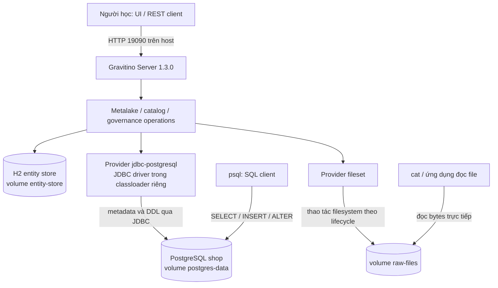
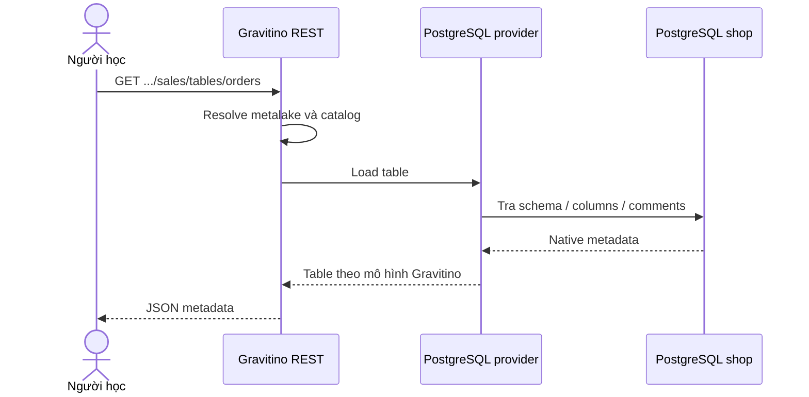

# Kiến trúc nhìn từ kết quả thực hành

## 1. Bản đồ của chính lab này

Trong container, server lắng nghe `8090`; Windows truy cập cổng `19090`. `postgres` là DNS service trong mạng Compose. URI `jdbc:postgresql://postgres:5432/shop` có nghĩa từ góc nhìn Gravitino container. `localhost` của container không phải Windows hay container PostgreSQL.

`pg_shop` là **tên đăng ký catalog trong Gravitino**; `shop` là **database tại PostgreSQL**. Metalake `learning` không tự tạo ra một database tên `learning` trong PostgreSQL.

Gravitino thống nhất cách quản lý metadata qua các provider. Nguồn vẫn giữ semantics và khả năng riêng; PostgreSQL provider chỉ ánh xạ những kiểu dữ liệu/thao tác nó hỗ trợ. [Overview](https://gravitino.apache.org/docs/1.3.0/overview/), [PostgreSQL provider](https://gravitino.apache.org/docs/1.3.0/jdbc-postgresql-catalog/).

## 2. Ba đường đi cần phân biệt

### Đọc metadata

Đây là sơ đồ giản lược; một request thực tế có thể còn qua lock, hook, cache, audit, entity lookup và authorization khi được bật. Bài 4 minh họa metadata nguồn có thể thay đổi bên ngoài Gravitino.

### Tạo bảng

Client gửi cấu trúc cột → Gravitino resolve catalog → provider kiểm tra/ánh xạ type → PostgreSQL thực thi DDL → response trả metadata. Bảng `workshop.notes` tồn tại thật tại nguồn nên SQL có thể INSERT ngay sau đó. Một thao tác DDL sai có thể gây tác động thật lên database; “metadata management” không đồng nghĩa thao tác chỉ tác động lên registry.

### Đọc/ghi dữ liệu

Trong lab: `psql` → PostgreSQL → kết quả SQL. Với fileset: ứng dụng đọc đường dẫn → filesystem → bytes. Unified REST API không thực hiện SQL query thay PostgreSQL.

Ở kiến trúc có Spark/Trino, connector tương thích có thể lấy catalog/metadata/credentials từ Gravitino rồi cấu hình native connector để engine đọc nguồn. Thí nghiệm `psql` chỉ chứng minh đường SQL trực tiếp, chưa chứng minh một connector engine cụ thể. [Trino integration](https://gravitino.apache.org/docs/1.3.0/trino-connector/index/).

## 3. Dữ liệu và metadata nằm ở đâu?

| Thông tin trong lab | Nơi giữ chính | Volume |
|---|---|---|
| Metalake, catalog registration và properties | Entity store Gravitino | `entity-store` |
| Tag và liên kết object–tag | Entity store Gravitino | `entity-store` |
| Fileset registration và storage location | Entity store Gravitino | `entity-store` |
| Schema, bảng, cột, constraint SQL | PostgreSQL nguồn | `postgres-data` |
| Rows trong `sales.orders` | PostgreSQL nguồn | `postgres-data` |
| Bytes của `events.jsonl` | Filesystem dùng trong lab | `raw-files` |
| JDBC JAR | Cache dependency, tải lại được | `jdbc-drivers` |

Gravitino có thể giữ thêm định danh và thông tin quản trị cho object nguồn; bảng trên không có nghĩa entity store tuyệt đối không giữ dấu vết về bảng. Điểm chính là H2 không trở thành bản sao dữ liệu PostgreSQL. Catalog configuration có thể chứa thông tin nhạy cảm nên cần bảo vệ cả entity store lẫn `.env`.

H2 `storagePath` là tiền tố file DB; lab dùng `/entity-store/gravitino` để file `gravitino.mv.db` nằm **bên trong** volume. Chỉ mount `/entity-store` nhưng cấu hình prefix `/entity-store` sẽ khiến H2 định tạo `/entity-store.mv.db` ở ngoài volume.

Tạo lại container còn dữ liệu nhờ volume. Điều đó khác backup, phục hồi sau hỏng storage hay HA. H2 được dùng để học trên một node; cần xem lựa chọn backend và quy trình vận hành phù hợp trước khi triển khai thật. [Entity storage configuration](https://gravitino.apache.org/docs/1.3.0/gravitino-server-config/).

## 4. Các đặc điểm cốt lõi và bằng chứng trong lab

| Đặc điểm | Bằng chứng | Giới hạn kết luận |
|---|---|---|
| Metadata federation | Bảng seed xuất hiện sau khi đăng ký nguồn | Không phải replication hoặc data migration |
| Mô hình chung có provider | Cùng REST hierarchy, hai catalog khác type | Capability/type mapping vẫn phụ thuộc nguồn |
| Nhiều loại tài sản | Table và fileset trong một metalake | Chưa chạy Kafka topic hay model catalog |
| Metadata governance | Tag gắn vào bảng PostgreSQL | Chưa có enforcement/masking trong lab |
| Tách metadata path và data path | SQL còn chạy khi Gravitino dừng | Client dùng Gravitino để resolve có thể bị ảnh hưởng |
| Persistence độc lập | Tạo lại container vẫn giữ object và dữ liệu | Chưa chứng minh HA/đa vùng/khôi phục thảm họa |

Geo-distributed là định hướng kiến trúc của dự án, không phải một đảm bảo mà một Compose đơn node có thể kiểm chứng. Cũng không có transaction chung bao trùm mọi provider hoặc cơ chế branch/merge toàn metalake được minh họa ở đây.

## 5. Managed và external fileset

Fileset đặt một tên logic lên một hoặc nhiều location để tổ chức dữ liệu dạng file. `MANAGED` cho Gravitino trách nhiệm quản lý vòng đời directory trong cấu hình của lab; `EXTERNAL` dùng dữ liệu có sẵn và giữ file khi drop fileset. Thuộc tính `disable-filesystem-ops` có thể thay đổi việc thao tác filesystem; lab giữ mặc định để quan sát tác động thật. [Fileset catalog](https://gravitino.apache.org/docs/1.3.0/fileset-catalog/).

Fileset không tự có SQL schema, transaction hay snapshot như table format. Một thư mục JSONL được đăng ký vẫn chỉ chứa JSONL. Muốn dùng file đó với engine, engine phải hiểu định dạng và có quyền đọc đường dẫn.

## 6. Authentication, authorization và tag

- **Authentication:** xác định caller là ai.
- **Authorization:** kiểm tra caller được làm hành động gì trên object nào.
- **Tag/classification:** mô tả tài sản, ví dụ `sensitive`, `finance`, `training`.

Lab chưa bật hai lớp đầu ở Gravitino, do đó audit có thể hiện `anonymous`. Tag `sensitive` không tự che cột hay chặn SELECT. PostgreSQL user `lab` là tài khoản local có quyền rộng do image khởi tạo; không dùng mô hình này làm mẫu phân quyền production.

Muốn kiểm chứng governance thực sự, cần thử cả đường qua Gravitino lẫn đường truy cập native/storage; tích hợp quyền ở provider nào phải kiểm tra capability của provider đó. [Access control](https://gravitino.apache.org/docs/1.3.0/security/access-control/), [Tag API](https://gravitino.apache.org/docs/1.3.0/manage-tags-in-gravitino/).

## 7. Gravitino Server và Iceberg REST service

| Giao diện | Đối tượng chính | Trong lab |
|---|---|---|
| Unified API `/api/metalakes/...` | Metalake, catalog, schema, table, fileset, governance… | Có, cổng host 19090 |
| Iceberg REST API `/v1/...` theo endpoint/service đã cấu hình | Iceberg namespaces, tables và commit protocol | Chưa bật |

Một Iceberg REST client không thể tùy tiện trỏ URI vào `/api/metalakes/...` rồi mong nó hiểu unified API. Một catalog provider `lakehouse-iceberg` và một Iceberg REST endpoint là hai khái niệm cần cấu hình đúng khi tích hợp.

Polaris lab thường nhấn mạnh đường Iceberg REST và quản trị Iceberg. Gravitino lab này nhấn mạnh quản lý thống nhất nhiều nguồn và loại tài sản. Nessie branch/tag/merge phục vụ versioned catalog state; tag phân loại trong bài 6 không phải reference đến một commit. Xem [Iceberg REST service](https://raw.githubusercontent.com/apache/gravitino/v1.3.0/docs/iceberg-rest-service.md) nếu muốn mở rộng.

## 8. Đáp án tự kiểm tra

1. `type` là nhóm mô hình; `provider` là implementation kết nối nguồn. Tên catalog có thể khác tên database.
2. Đăng ký `pg_shop` không copy rows vào H2. API load table trả metadata; SQL engine thực thi query.
3. DDL qua provider tạo/xóa đối tượng thật ở PostgreSQL. Kiểu chung phải nằm trong capability của provider.
4. ALTER tại nguồn được thấy qua GET trong lab. Native authorization vẫn cần PostgreSQL thực thi.
5. Metadata fileset và bytes nằm ở hai volume khác nhau. Drop managed có thể xóa bytes; drop external giữ file trong bài đã thử.
6. Gắn tag không tự bật authorization hoặc masking. Một quyền Gravitino không mặc nhiên chặn mọi đường native.
7. Readiness kiểm tra entity store; nguồn ngoài chết vẫn có thể thấy `up`. SQL trực tiếp không cần Gravitino đang chạy.
8. `down` giữ volume, `down -v` xóa volume. Backup đầy đủ phải tính entity store, nguồn dữ liệu, storage và cấu hình/credentials.

## 9. Hướng mở rộng sau khi hiểu phần cốt lõi

Đây là các bài thiết kế tiếp theo, chưa triển khai trong stack này:

1. Thêm Trino connector đúng phiên bản, tạo catalog động và chứng minh query truy cập đúng PostgreSQL.
2. Thêm Iceberg catalog/REST service và storage, phân biệt registration, Iceberg metadata files và data files.
3. Bật authentication/RBAC; dùng hai identity để chứng minh allow/deny, rồi thử đường native.
4. Thay H2 bằng relational backend ngoài, kiểm chứng restart/backup/restore trước khi nghiên cứu HA.
5. Thêm Kafka hoặc model catalog để thấy cùng object hierarchy nhưng lifecycle/capability khác nhau.

Đọc phần phân tích sâu ở [apache-gravitino.md](../apache-gravitino.md) để nối các kết quả lab vào kiến trúc rộng hơn.
