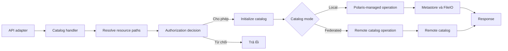
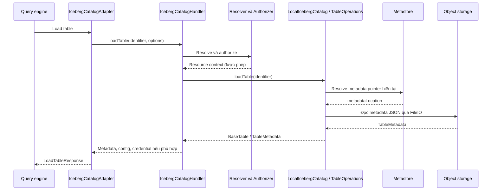

# Chương 3 — Catalog Service Layer trong kiến trúc Apache Polaris

*Ngày nghiên cứu: 07-09-2026. Mốc mã nguồn: Apache Polaris `apache-polaris-1.7.0`, commit `4ac2f059d1cce149453d0a5f1ff1dff980ec97cc`. Tài liệu đối chiếu: tài liệu chính thức Polaris 1.7.0 và đặc tả Apache Iceberg. Ngôn ngữ phân tích: Java; Iceberg dependency trong checkout: 1.11.0.*

## 1. Phạm vi và cơ sở của phân tích

**Catalog Service Layer là nơi Polaris biến yêu cầu quản lý tài nguyên thành một chuỗi thao tác nghiệp vụ có kiểm tra quyền, kiểm tra tính hợp lệ và kiểm soát cập nhật metadata.** Với bảng Iceberg do Polaris quản lý, tầng này phối hợp hai việc: xây dựng trạng thái metadata Iceberg mới và yêu cầu metastore công bố trạng thái đó bằng cách thay đổi con trỏ metadata một cách có điều kiện.

Nội dung tập trung vào bốn nhóm thành phần trong sơ đồ của bạn:

1. `CatalogHandler` và `IcebergCatalogHandler`.
2. `LocalIcebergCatalog`.
3. `BasePolarisTableOperations`, cùng nhánh tương ứng cho view.
4. Generic Table và Policy handlers, cùng các catalog implementation của chúng.

Các tầng Security, Metadata Management, Persistence và Storage được giải thích tại điểm giao với nghiệp vụ catalog. Thuật toán xác thực token, chi tiết SQL schema và SDK của từng cloud không thuộc trọng tâm chương này.

### 1.1 Mã nguồn được đọc

Thư mục làm việc ban đầu có các tài liệu nghiên cứu, chưa có checkout của Apache Polaris. Mã nguồn chính thức đã được lấy về thư mục `polaris-source-1.7.0`, với `HEAD` được đối chiếu đúng commit của release tag. Toàn bộ liên kết mã nguồn trong chương này ghim vào commit đó, để bạn có thể kiểm tra lại cùng một phiên bản. [Release chính thức][release], [cây mã nguồn][repo], [phiên bản Iceberg trong build][dependencies].

Hai chương trước sử dụng tài liệu 1.7.0 nhưng đọc một commit của nhánh `main`. Chương này chọn **mã phát hành 1.7.0** làm chuẩn triển khai. Vì vậy, nếu tên phương thức hoặc chi tiết hành vi khác chương trước, cần so sánh commit trước khi kết luận hệ thống mâu thuẫn.

Đặc biệt, checkout 1.7.0 được đọc ở đây **đã có** logic idempotency ở cấp entity cho create/update Iceberg table, nhưng mặc định chưa bật. Không nên mặc định coi mọi logic idempotency là tính năng chỉ có trên `main`. [Cấu hình idempotency][idempotency-config], [handler][iceberg-handler].

### 1.2 Cách hiểu thuật ngữ “layer”

“Catalog Service Layer” là cách phân nhóm trách nhiệm để phân tích kiến trúc. Không có nghĩa Polaris triển khai một service riêng hoặc một module Java mang đúng tên này.

Các lớp chính nằm trong `runtime/service/.../catalog`, còn nhiều interface, entity và persistence contract nằm trong `polaris-core`. Security cũng được gọi từ chính handler. Do đó, sơ đồ tầng biểu diễn **trách nhiệm và quan hệ phụ thuộc**, không phải mọi request đều đi qua các khối theo một đường thẳng duy nhất.

Những sơ đồ, ví dụ và cách phân nhóm trong chương là tổng hợp kiến trúc từ mã nguồn; các tên lớp, phương thức, cấu hình và giới hạn tính năng được dẫn về nguồn tương ứng.

## 2. Vai trò của Catalog Service Layer

### 2.1 Bài toán cần giải quyết

Giả sử Spark yêu cầu cập nhật bảng `lakehouse.sales.orders`. Polaris phải trả lời một chuỗi câu hỏi:

- `lakehouse` là catalog nào trong realm hiện tại?
- `sales.orders` tồn tại dưới loại tài nguyên nào?
- Principal có quyền thực hiện đúng loại cập nhật được yêu cầu không?
- Catalog do Polaris quản lý hay do hệ thống từ xa quản lý?
- Các điều kiện mà client đặt ra còn đúng với trạng thái hiện tại không?
- Metadata mới có hợp lệ, và các vị trí storage được tham chiếu có được chấp nhận không?
- Có request khác cập nhật bảng trong lúc xử lý không?
- Nếu metadata đã ghi ra storage nhưng cập nhật metastore thất bại, xử lý thế nào?

API layer xử lý hình thức của yêu cầu HTTP. Catalog Service Layer điều phối các câu hỏi nghiệp vụ trên bằng cách gọi authorizer, resolver, Iceberg library, metastore và storage services. [CatalogHandler][handler], [IcebergCatalogHandler][iceberg-handler], [LocalIcebergCatalog][local-catalog].

### 2.2 Trách nhiệm và ranh giới

| Thành phần | Trách nhiệm chính | Quan hệ với Catalog Service Layer |
|---|---|---|
| API / Protocol | Route, giải mã tham số, validation đầu vào, response/status/header | Chuyển request thành đối tượng nghiệp vụ và gọi handler |
| Authentication | Xác định principal của request | Cung cấp danh tính đã xác thực |
| Authorization | Đánh giá operation trên resource và role đang active | Handler dựng mục tiêu và ý định thao tác; authorizer quyết định cho phép |
| Catalog Service | Điều phối lifecycle và ngữ nghĩa catalog/table/view/policy | Là trọng tâm chương này |
| Metadata Management | Entity, hierarchy, resolution, grants, policy mappings, metastore contract | Cung cấp trạng thái quản trị và thao tác cập nhật có điều kiện |
| Persistence | Thực hiện lưu trữ và giao dịch theo backend | Hiện thực tính bền vững và các thao tác nguyên tử mà tầng catalog yêu cầu |
| Storage Integration | FileIO, cấu hình storage, cấp credential theo phạm vi | Đọc/ghi file metadata và hỗ trợ client truy cập storage |
| Query engine | Lập kế hoạch và thực thi truy vấn, đọc/ghi data files | Dùng metadata và quyền truy cập mà catalog cung cấp |

Đây là bảng phân công trách nhiệm, không phải sự cô lập tuyệt đối giữa các package. Ví dụ, adapter cũng kiểm tra properties, handler quyết định quyền cần có, và `LocalIcebergCatalog` kiểm tra location trước khi ghi metadata. [Adapter][adapter], [handler][iceberg-handler], [storage validation trong catalog][local-catalog].

### 2.3 Phân biệt hai loại metadata

Một bảng Iceberg được biểu diễn ở hai miền dữ liệu khác nhau:

| Miền | Ví dụ dữ liệu | Nơi xử lý/lưu trữ chính |
|---|---|---|
| Metadata quản trị của Polaris | Entity ID, catalog ID, parent ID, tên, subtype, properties, metadata location, phiên bản entity | Polaris metastore |
| Metadata của định dạng Iceberg | Schema, partition specs, sort orders, snapshots, refs, statistics references | Đối tượng `TableMetadata` và file metadata Iceberg trên storage |

Polaris cũng lưu **một số trường tóm tắt** của metadata Iceberg vào internal properties, như table UUID, current schema ID, current snapshot ID, format version và một số location. Vì vậy, phát biểu chính xác là: metastore lưu entity và con trỏ cùng một số thông tin trích xuất; toàn bộ cấu trúc metadata Iceberg không được thay thế bằng các bảng nghiệp vụ trong database của Polaris. Xem `buildTableMetadataPropertiesMap`. [Mã ánh xạ metadata][local-catalog].

Ví dụ khái niệm:

```text
Polaris metastore
  table entity: orders
    catalogId: ...
    parentId: ...
    subtype: ICEBERG_TABLE
    metadataLocation: s3://warehouse/sales/orders/metadata/00007-<uuid>.metadata.json

Object storage
  00007-<uuid>.metadata.json
    ├── schema / specs / sort orders
    ├── snapshots / refs
    └── references tới manifest lists và statistics
            └── manifest files → data files / delete files
```

Trong mô hình Iceberg, catalog công bố phiên bản bảng bằng con trỏ tới file metadata. Việc thay con trỏ nguyên tử là cơ sở để các writer không ghi đè âm thầm lên kết quả của nhau. [Đặc tả Iceberg][iceberg-spec].

### 2.4 Tổng quan cách Catalog Service Layer hoạt động

Trước khi xem từng class, có thể hiểu Catalog Service Layer như một **bộ điều phối trạng thái catalog** nằm giữa giao thức bên ngoài và các hệ thống lưu trữ bên dưới. Tầng này không trực tiếp thực thi câu lệnh SQL và cũng không giữ data rows của bảng. Công việc của nó là xác định tài nguyên mà request đề cập, kiểm tra request có được phép hay không, chọn catalog implementation phù hợp, thực hiện quy tắc nghiệp vụ của operation, rồi công bố trạng thái metadata mới theo cách có kiểm soát.

Ở mức tổng quát, một request đi qua sáu giai đoạn:

```text
1. Nhận yêu cầu đã được chuẩn hóa từ API adapter
   │
2. Xác định operation và các tài nguyên liên quan
   │
3. Resolve entity path, kiểm tra tồn tại, subtype và quyền
   │
4. Chọn nhánh thực thi: local catalog hoặc federated catalog
   │
5. Thực hiện nghiệp vụ
   ├── đọc metadata
   ├── tạo/cập nhật/đổi tên/xóa entity
   ├── ghi metadata file mới khi cần
   └── cấp cấu hình truy cập storage khi được yêu cầu
   │
6. Chuyển kết quả hoặc lỗi có ngữ nghĩa trở lại API adapter
```

Chuỗi trên là mô hình chung. Không phải operation nào cũng đọc object storage hoặc ghi metadata file. Ví dụ, list namespace chủ yếu làm việc với hierarchy trong metastore; load Iceberg table có thể phải đọc metadata JSON; update Iceberg table thường phải ghi một file metadata mới; generic table create chỉ tạo một entity mô tả; còn federated operation có thể được chuyển tiếp tới catalog từ xa. [CatalogHandler][handler], [IcebergCatalogHandler][iceberg-handler], [GenericTableCatalogHandler][generic-handler], [PolicyCatalogHandler][policy-handler].

#### 2.4.1 Đầu vào và đầu ra của tầng

Đầu vào của Catalog Service Layer không còn là HTTP thô. API adapter đã chuyển request thành các kiểu dữ liệu như `Namespace`, `TableIdentifier`, `CreateTableRequest` hoặc `UpdateTableRequest`, đồng thời cung cấp principal và call context của request.

Tầng catalog nhận bốn nhóm thông tin:

| Nhóm đầu vào | Ví dụ | Được dùng để làm gì |
|---|---|---|
| Ngữ cảnh gọi | realm, principal, cấu hình request | Cô lập tenant/realm và đánh giá quyền |
| Định danh tài nguyên | catalog, namespace, table/view/policy name | Resolve entity và hierarchy |
| Ý định nghiệp vụ | create, load, update, rename, drop, attach | Chọn operation, validation và đường thực thi |
| Nội dung thay đổi | schema, requirements, metadata updates, properties | Xây dựng trạng thái mới hoặc bản ghi mới |

Đầu ra có thể là metadata, danh sách identifier, entity đã tạo, credential/config truy cập storage hoặc xác nhận operation thành công. Nếu request không hợp lệ, tầng này phát sinh lỗi có ngữ nghĩa như tài nguyên không tồn tại, trùng tên, không đủ quyền, location không hợp lệ hoặc commit conflict; API layer sau đó ánh xạ lỗi sang response giao thức. [Adapter][adapter], [CatalogHandler][handler], [PolarisExceptionMapper][exception-mapper].

#### 2.4.2 Trục xử lý chung: resolve → authorize → execute

Ba động tác lặp lại trong gần như mọi operation là:

1. **Resolve:** biến tên logic thành entity path thực trong realm, đồng thời xác định loại tài nguyên. Ví dụ `lakehouse.sales.orders` phải được nhận diện thành catalog `lakehouse`, namespace `sales` và một table-like entity đúng subtype.
2. **Authorize:** đánh giá principal có được thực hiện operation trên target đó hay không. Với operation liên quan nhiều tài nguyên, như rename hoặc attach policy, phải đánh giá cả nguồn và đích.
3. **Execute:** chỉ sau khi resolve và authorize thành công, handler mới khởi tạo catalog implementation và thực hiện nghiệp vụ.



Thứ tự này có hai ý nghĩa. Thứ nhất, catalog implementation không được sử dụng như một đường truy cập metadata ngoài ngữ cảnh quyền của request. Thứ hai, handler có thể dùng kết quả resolution để cấu hình chính xác catalog, storage context và các bước kiểm tra tiếp theo. [CatalogHandler][handler], [initializeCatalog][iceberg-handler].

#### 2.4.3 Hai đường hoạt động chính: đọc và thay đổi trạng thái

**Đường đọc** bắt đầu từ định danh logic, resolve entity, kiểm tra quyền và lấy trạng thái hiện hành. Với Iceberg table local, entity trong metastore cung cấp `metadataLocation`; `TableOperations` dùng FileIO đọc file đó thành `TableMetadata`. Handler có thể bổ sung cấu hình hoặc credential theo quyền rồi trả response cho engine.

```text
TableIdentifier
  → entity path trong metastore
  → metadataLocation hiện hành
  → metadata JSON trên object storage
  → TableMetadata + access configuration
  → query engine
```

**Đường ghi** bắt đầu bằng một trạng thái cơ sở và yêu cầu thay đổi. Với Iceberg table local, Polaris kiểm tra requirements, dựng metadata mới, xác thực các location, ghi file metadata mới, rồi cập nhật entity trong metastore để con trỏ trỏ tới file mới. Việc cập nhật có điều kiện giúp phát hiện khi writer khác đã thay đổi bảng trong lúc request đang xử lý.

```text
Metadata hiện hành M7 + request updates
  → kiểm tra requirements và quyền
  → dựng metadata M8
  → ghi file M8 lên storage
  → compare-and-update entity pointer M7 → M8
  → thành công: M8 trở thành phiên bản hiện hành
  → xung đột: giữ pointer hiện hành và xử lý file M8 chưa được công bố
```

Điểm chuyển trạng thái logic của bảng là lúc metadata pointer được cập nhật thành công. Việc file M8 đã tồn tại trên storage chưa đủ để các client coi M8 là phiên bản hiện hành. Ngược lại, Polaris phải ghi hoặc xác nhận metadata file trước khi công bố pointer tới nó. [BasePolarisTableOperations][local-catalog], [Metastore contract][metastore].

#### 2.4.4 Cách hoạt động thay đổi theo loại tài nguyên

Catalog Service Layer dùng cùng khuôn resolve–authorize–execute, nhưng đối tượng trạng thái và mức bảo đảm khác nhau:

| Loại tài nguyên | Trạng thái cốt lõi | Cách xử lý chính |
|---|---|---|
| Namespace | Entity hierarchy và properties | Tạo, đọc, liệt kê, cập nhật hoặc xóa entity trong metastore |
| Iceberg table/view local | Entity pointer + file metadata Iceberg | Đọc/ghi metadata bằng FileIO và công bố pointer có điều kiện |
| Generic table | Entity mô tả format/location/properties | Quản lý bản ghi; không điều phối commit của định dạng dữ liệu |
| Policy | Policy entity + mapping tới target | Validate nội dung, quản lý version, attach/detach và tính policy có hiệu lực |
| Federated catalog | Trạng thái do remote catalog quản lý | Polaris kiểm tra quyền và chuyển operation được hỗ trợ tới remote implementation |

Vì thế, không có một thuật toán lưu trữ duy nhất cho toàn tầng. Phần dùng chung nằm ở ngữ cảnh request, resolution, authorization và dispatch; phần đặc thù nằm ở handler/catalog của từng loại tài nguyên. [LocalIcebergCatalog][local-catalog], [PolarisGenericTableCatalog][generic-catalog], [PolicyCatalog][policy-catalog], [REST federation factory][rest-factory].

#### 2.4.5 Bốn trạng thái cần phân biệt trong một request Iceberg

Để tránh nhầm lẫn khi đọc các phần sau, nên tách bốn trạng thái sau:

| Trạng thái | Phạm vi | Ví dụ |
|---|---|---|
| Trạng thái request | Chỉ tồn tại trong lần gọi hiện tại | principal, requested updates, resolution manifest |
| Trạng thái object xử lý | Bộ nhớ của catalog/table operations instance | `currentMetadata`, `currentMetadataLocation`, `shouldRefresh` |
| Trạng thái quản trị bền vững | Metastore | entity, hierarchy, version, metadata pointer, policy mappings |
| Trạng thái metadata vật lý | Object storage | Iceberg metadata JSON, manifests, statistics và data files |

Một commit thành công phải nối các trạng thái này theo đúng thứ tự, nhưng chúng không phải một đối tượng duy nhất. Ví dụ, `currentMetadata` trong một instance có thể cũ so với pointer trong metastore; vì vậy refresh và kiểm tra xung đột vẫn cần thiết. Tương tự, một metadata file có thể đã được ghi nhưng chưa được pointer nào công bố. [PolarisOperationsBase][local-catalog], [doRefresh/doCommit][local-catalog].

#### 2.4.6 Các invariant mà tầng cố gắng bảo vệ

Nhìn toàn cục, logic của Catalog Service Layer nhằm duy trì các điều kiện sau:

- Mỗi thao tác chỉ chạy trên tài nguyên đã resolve đúng path và đúng subtype.
- Principal phải có quyền phù hợp với operation và các target liên quan.
- Một tên table-like trong namespace không được tạo trùng với entity xung đột.
- Metadata location và các storage location phải đáp ứng cấu hình an toàn đang áp dụng.
- Một phiên bản metadata mới chỉ trở thành hiện hành khi cập nhật pointer thành công.
- Writer dựa trên trạng thái cũ không được âm thầm ghi đè writer đã commit trước.
- Trong commit nhiều bảng, các pointer được công bố theo một batch nguyên tử ở phạm vi metastore hỗ trợ.
- Generic table và policy không được nhận các bảo đảm Iceberg mà implementation của chúng không cung cấp.

Các invariant này là mục tiêu được hiện thực bằng nhiều cơ chế phối hợp, không phải do một class duy nhất bảo đảm. `CatalogHandler` bảo vệ context và quyền; catalog implementation bảo vệ ngữ nghĩa tài nguyên; `TableOperations` bảo vệ giao thức metadata; metastore bảo vệ conditional persistence; storage integration bảo vệ I/O và phạm vi location. Các phần tiếp theo phân rã chính xác từng trách nhiệm đó.

## 3. Cấu trúc thành phần chính xác hơn

Sơ đồ dưới đây mở rộng nhánh Catalog Service trong kiến trúc ban đầu:

```text
API / Protocol Layer
  ├── IcebergCatalogAdapter
  ├── GenericTableCatalogAdapter
  └── PolicyCatalogAdapter
             │
             ▼
Catalog Service Layer
  │
  ├── CatalogHandler                         [lớp nền trừu tượng]
  │     ├── dựng resolution manifest
  │     ├── phối hợp resolve + authorize
  │     └── initializeCatalog sau khi được phép
  │
  ├── IcebergCatalogHandler                   [kế thừa CatalogHandler]
  │     ├── CatalogHandlerUtils
  │     ├── nhánh local
  │     │     └── PolarisLocalCatalogFactory
  │     │           └── LocalIcebergCatalog
  │     │                 ├── BasePolarisTableOperations
  │     │                 └── BasePolarisViewOperations
  │     └── nhánh federation
  │           └── FederatedCatalogFactory
  │                 └── catalog implementation của hệ thống từ xa
  │
  ├── GenericTableCatalogHandler             [kế thừa CatalogHandler]
  │     └── PolarisGenericTableCatalog        [nhánh local]
  │
  └── PolicyCatalogHandler                   [kế thừa CatalogHandler]
        └── PolicyCatalog

Các dependency được gọi khi cần:
  ├── PolarisAuthorizer + ResolutionManifest
  ├── PolarisMetaStoreManager
  ├── FileIOFactory + StorageAccessConfigProvider
  └── Events + TaskExecutor + Metrics
```

Generic handler cũng có điểm mở rộng gọi `createGenericCatalog` của federated factory. Tuy nhiên, factory Iceberg REST của phiên bản này ném lỗi “unsupported” cho nhánh generic; sự tồn tại của điểm mở rộng không chứng minh tính năng đã được hiện thực. [Generic handler][generic-handler], [REST federation factory][rest-factory].

Ba quan hệ nên nhớ:

1. `CatalogHandler` là lớp nền, không phải một handler duy nhất xử lý mọi định dạng.
2. `IcebergCatalogHandler` **sử dụng** catalog; nó không kế thừa `LocalIcebergCatalog`.
3. `BasePolarisTableOperations` là lớp bên trong `LocalIcebergCatalog`. Ở commit này, nó `extends PolarisOperationsBase<TableMetadata>` và `implements TableOperations`; không trực tiếp kế thừa `BaseMetastoreTableOperations` của Iceberg. Một phần logic có nguồn gốc được sao chép từ lớp Iceberg đó. [Khai báo lớp và TableOperations][local-catalog].

## 4. CatalogHandler: nền tảng điều phối quyền và tài nguyên

### 4.1 Đầu vào của một handler

`CatalogHandler` làm việc với các dependency cốt lõi:

| Dependency | Ý nghĩa |
|---|---|
| `catalogName()` | Catalog logic mà request nhắm tới |
| `polarisPrincipal()` | Principal đã được nhận diện cho request |
| `callContext()` | Ngữ cảnh gọi, từ đó lấy realm và cấu hình |
| `metaStoreManager()` | Contract thao tác metadata quản trị |
| `resolutionManifestFactory()` | Tạo tập tài nguyên cần resolve cho operation |
| `authorizer()` | Resolve đầu vào phân quyền và đánh giá quyền |

Handler giữ trạng thái `resolutionManifest` của lần xử lý. Với nhánh Iceberg, factory tạo đối tượng handler cùng các dependency theo request; adapter sử dụng handler trong `try-with-resources`, và handler đóng catalog khi kết thúc nếu catalog hỗ trợ `Closeable`. Không nên hình dung handler là một singleton giữ chung trạng thái bảng cho mọi client. [CatalogHandler][handler], [HandlerFactory][handler-factory], [Adapter][adapter].

### 4.2 Resolution manifest giải quyết vấn đề gì?

Tên như `sales.orders` chưa đủ để phân quyền hay cập nhật an toàn. Hệ thống cần biết đường dẫn entity thực:

```text
catalog lakehouse → namespace sales → table orders
```

`PolarisResolutionManifest` mô tả những đường dẫn operation cần sử dụng. Qua resolver/authorizer, tên tài nguyên được ánh xạ thành entity, hierarchy và dữ liệu liên quan tới quyền.

Handler dùng hai kiểu truy cập cần phân biệt:

- **Resolved path:** tài nguyên đã được resolve cho ngữ cảnh operation; dùng để kiểm tra quyền, parent path và thông tin quản trị liên quan.
- **Passthrough resolved path:** cho phép catalog lấy trạng thái mới của đường dẫn được khai báo khi cần kiểm tra tồn tại hoặc chạy refresh/commit.

Ví dụ khi tạo bảng, đối tượng cần phân quyền là namespace cha. Bảng con chưa tồn tại nên được thêm thành một đường dẫn passthrough **optional**, để catalog có thể kiểm tra xung đột tên. Ví dụ khi commit bảng đã tồn tại, catalog cần đọc lại metadata pointer mới nhất để phát hiện writer cạnh tranh. [Các hàm authorize create/table][handler], [CatalogView contract][manifest-view], [doRefresh/doCommit][local-catalog].

Không nên dịch “passthrough” thành “bỏ qua bảo mật”. Ở đây nó là cơ chế đọc trạng thái qua manifest của operation; quyền thực hiện operation vẫn do handler và authorizer kiểm soát.

### 4.3 Chuỗi xử lý điển hình

```text
Xác định operation và resource
  → tạo resolution manifest
  → khai báo các path cần resolve
  → dựng AuthorizationRequest / AuthorizationIntent
  → authorizer.resolveAuthorizationInputs(...)
  → kiểm tra tài nguyên cần thiết đã resolve được
  → authorizer.authorizeOrThrow(...)
  → initializeCatalog()
  → thực thi nghiệp vụ catalog
```

Các phương thức trong `CatalogHandler` hiện thực nhiều biến thể của chuỗi này. Một số operation mới tách riêng bước resolve và bước authorize để đọc cấu hình catalog trước khi xác định tập operation cuối cùng. Ví dụ `updateTable` cần biết có bật quyền cập nhật chi tiết theo từng `MetadataUpdate` hay không. [CatalogHandler][handler], [updateTable][iceberg-handler].

### 4.4 Vì sao không thể dùng một phép kiểm tra quyền chung?

| Nghiệp vụ | Tài nguyên phải xem xét |
|---|---|
| Tạo namespace | Namespace cha hoặc catalog ở mức gốc |
| Tạo bảng | Namespace chứa bảng; đường dẫn bảng mới để phát hiện trùng tên |
| Đọc/cập nhật/xóa bảng | Bảng hiện có, đúng subtype |
| Đổi tên/chuyển namespace | Bảng nguồn và namespace đích |
| Commit nhiều bảng | Tập bảng tham gia giao dịch |
| Gắn policy | Policy và tài nguyên đích |

Do đó, Security Layer cung cấp cơ chế đánh giá quyền, còn Catalog Service Layer cung cấp **ngữ cảnh nghiệp vụ của việc cần đánh giá**. Đổi tên bảng là ví dụ dễ thấy: quyền trên bảng nguồn không tự chứng minh quyền tạo tên mới dưới namespace đích. [Rename authorization][handler], [Policy attachment authorization][policy-handler].

## 5. IcebergCatalogHandler: điều phối nghiệp vụ Iceberg

### 5.1 Chọn implementation phù hợp

Sau authorization, `initializeCatalog()` lấy `CatalogEntity` đã resolve và kiểm tra `ConnectionConfigInfoDpo`:

- Có connection config: kiểm tra tính năng federation, chọn `FederatedCatalogFactory` theo connection type, rồi tạo catalog tới hệ thống từ xa.
- Không có connection config: gọi `LocalCatalogFactory.createCatalog(resolutionManifest)`; implementation mặc định tạo `LocalIcebergCatalog`.

Handler giữ `baseCatalog` dưới interface Iceberg `Catalog`. Nếu implementation hỗ trợ `SupportsNamespaces` hoặc `ViewCatalog`, handler giữ thêm các interface tương ứng. Đây là cách cùng một tập operation có thể chạy trên nhiều implementation, nhưng khả năng hỗ trợ thực tế vẫn khác nhau. [initializeCatalog][iceberg-handler], [LocalCatalogFactory implementation][local-factory].

Từ “Local” nghĩa là nhánh catalog dùng metadata do Polaris quản lý tại phía server. Nó không có nghĩa storage là ổ đĩa local; FileIO vẫn có thể truy cập S3, Azure hoặc GCS.

### 5.2 Các nhóm nghiệp vụ

| Nhóm | Phương thức tiêu biểu | Nội dung xử lý |
|---|---|---|
| Namespace | `createNamespace`, `listNamespaces`, `loadNamespaceMetadata`, `updateNamespaceProperties`, `dropNamespace` | Phân cấp namespace, properties và lifecycle |
| Tạo bảng | `createTableDirect`, `createTableStaged` | Tạo ngay hoặc chuẩn bị metadata cho commit sau |
| Đăng ký | `registerTable` | Đưa một bảng Iceberg từ metadata file hiện có vào catalog |
| Đọc bảng | `loadTable`, `loadCredentials`, `tableExists` | Metadata, ETag, lọc snapshot và access delegation theo trường hợp |
| Cập nhật | `updateTable`, `updateTableForStagedCreate` | Xử lý requirements/updates và quyền tương ứng |
| Lifecycle khác | `renameTable`, `dropTableWithoutPurge`, `dropTableWithPurge` | Đổi định danh, bỏ đăng ký, hoặc yêu cầu cleanup dữ liệu |
| Nhiều bảng | `commitTransaction` | Tập cập nhật metadata được công bố nguyên tử qua metastore |
| View | `createView`, `registerView`, `loadView`, `replaceView`, `renameView`, `dropView` | Lifecycle của Iceberg view |
| Tích hợp | `sendNotification`, `reportMetrics` | Nhận thông tin đồng bộ hoặc báo cáo từ client |

Các tên trên là phương thức Java; không nên suy ra trực tiếp đường dẫn HTTP hoặc HTTP method chỉ từ tên hàm. Adapter và OpenAPI mới là nguồn để xác định giao thức. [Handler][iceberg-handler], [Adapter][adapter].

### 5.3 CatalogHandlerUtils có vai trò riêng

`CatalogHandlerUtils` chứa logic xử lý request/response và thao tác trên các interface Iceberg. Với update, nó:

1. Phân biệt update thông thường với commit tạo bảng thông qua `AssertTableDoesNotExist`.
2. Lấy `TableOperations` từ bảng hoặc transaction phù hợp.
3. Kiểm tra `UpdateRequirement`.
4. Áp dụng `MetadataUpdate` lên `TableMetadata.Builder`.
5. Gọi commit, với retry có giới hạn trong nhánh cập nhật phù hợp.
6. Dựng `LoadTableResponse` từ trạng thái kết quả.

Phân công này giúp đọc code rõ hơn: handler quyết định quyền và nhánh nghiệp vụ; utility hiện thực cách áp dụng request Iceberg; table operations nối metadata Iceberg với metastore và FileIO. [CatalogHandlerUtils][handler-utils].

### 5.4 Cập nhật một bảng có thể cần nhiều loại quyền

Khi `ENABLE_FINE_GRAINED_UPDATE_TABLE_PRIVILEGES` được bật, handler ánh xạ từng loại update thành operation tương ứng, ví dụ:

| Metadata update | Operation được đưa tới authorizer |
|---|---|
| `AddSchema` | `ADD_TABLE_SCHEMA` |
| `AddSnapshot` | `ADD_TABLE_SNAPSHOT` |
| `SetSnapshotRef` | `SET_TABLE_SNAPSHOT_REF` |
| `SetLocation` | `SET_TABLE_LOCATION` |
| `SetProperties` | `SET_TABLE_PROPERTIES` |

Đây là **operation nghiệp vụ**, không nhất thiết là tên privilege grant cho role. Việc ánh xạ operation sang yêu cầu RBAC thuộc security semantics. Request có nhiều loại update phải thỏa tập operation được suy ra; kiểu update chưa được ánh xạ riêng dùng fallback `UPDATE_TABLE`. [getUpdateTableAuthorizableOperations][iceberg-handler], [RBAC operation semantics][rbac-semantics].

## 6. LocalIcebergCatalog: hiện thực catalog Iceberg trên mô hình Polaris

### 6.1 Vị trí trong mô hình đối tượng

`LocalIcebergCatalog` kế thừa `BaseMetastoreViewCatalog` của Iceberg và triển khai `SupportsNamespaces`, `SupportsNotifications`, `Closeable`. Lớp này định nghĩa quan hệ giữa đối tượng nghiệp vụ Iceberg và entity của Polaris.

Ví dụ, với `TableIdentifier.of("sales", "orders")`, nó phải xác định namespace cha, catalog ID, entity subtype, vị trí storage và metadata pointer. Khi cần tải hay commit nội dung Iceberg, nó tạo `BasePolarisTableOperations`.

```text
Iceberg-facing objects                  Polaris-facing objects
──────────────────────                 ──────────────────────
Namespace                         ↔    namespace entity + parent path
TableIdentifier                   ↔    table-like name + hierarchy
Table / TableMetadata             ↔    ICEBERG_TABLE + metadata pointer
View / ViewMetadata               ↔    ICEBERG_VIEW + metadata pointer
Catalog operation                 →    PolarisMetaStoreManager operation
```

Đây là ánh xạ khái niệm, không phải việc mọi trường Iceberg đều được sao chép một-một vào entity. [LocalIcebergCatalog][local-catalog].

### 6.2 Khởi tạo theo catalog và request

`PolarisLocalCatalogFactory` lấy catalog đã resolve, tạo `LocalIcebergCatalog` với principal, call context, manifest, metastore, FileIO factory và các dịch vụ hỗ trợ. Factory chuyển base location của catalog sang thuộc tính warehouse mà Iceberg sử dụng, rồi gọi `initialize`.

Điều này đảm bảo cùng một tiến trình Polaris có thể xử lý nhiều catalog với cấu hình khác nhau. Việc lựa chọn quyền và storage context gắn với tài nguyên của request, không phải một cấu hình warehouse toàn cục duy nhất. [PolarisLocalCatalogFactory][local-factory].

### 6.3 Namespace là entity logic

Các thao tác namespace quản lý hierarchy và properties trong metastore. `dropNamespace` phải xử lý trường hợp namespace còn tài nguyên con. `renameTableLike` có thể thay parent và identifier của entity; nó không thực hiện sao chép toàn bộ data files sang một thư mục mới.

Vì vậy, cần tách:

- **Tên logic:** catalog, namespace và tên bảng dùng để định vị entity.
- **Vị trí vật lý:** URI của table root, data path và metadata path.

Đổi tên logic không mặc nhiên tương đương di chuyển dữ liệu vật lý. [Namespace operations và renameTableLike][local-catalog].

### 6.4 Sinh và kiểm tra location

Ở dạng cấu hình truyền thống, vị trí mặc định của bảng được suy ra từ location của namespace và tên bảng. Phiên bản được đọc còn có các lựa chọn sinh prefix object storage hoặc thêm hậu tố duy nhất cho location tự sinh. Vì vậy, không nên xem công thức `<namespace>/<table-name>` là đúng với mọi deployment. [defaultWarehouseLocation và transformTableLikeLocation][local-catalog].

Các nhóm kiểm tra liên quan gồm:

1. Client có được phép chỉ định location hoặc các properties chỉ định data/metadata path hay không.
2. Các URI có thuộc phạm vi storage được cấu hình cho tài nguyên không.
3. Cấu trúc table/namespace location có đáp ứng các ràng buộc đang bật không.
4. Location có chồng lấn với những tài nguyên liên quan không.
5. Metadata file và các tham chiếu trực tiếp được kiểm tra có nằm ở vị trí hợp lệ không.

Trong `doCommit`, các tham chiếu trực tiếp được kiểm tra gồm manifest-list locations và statistics-file locations; đây không phải bằng chứng rằng mỗi commit quét đệ quy toàn bộ manifests và data files. Việc phân biệt này quan trọng để đánh giá cả chi phí lẫn phạm vi validation. [getDirectMetadataFileReferences, doCommit][local-catalog].

Ví dụ, nếu `orders` sử dụng một prefix chồng lên prefix của bảng khác, credential cấp theo location có thể vượt phạm vi mong muốn của bảng. Kiểm tra location vì vậy vừa là ràng buộc tổ chức dữ liệu, vừa hỗ trợ thực thi ranh giới truy cập storage. Tuy nhiên, hành vi cụ thể phụ thuộc feature flags; không nên trình bày mọi kiểm tra overlap là một invariant vô điều kiện của mọi cấu hình. [Location validation][local-catalog], [FeatureConfiguration][features].

### 6.5 Interface với metastore

| Tình huống | Lời gọi tiêu biểu |
|---|---|
| Tạo entity bảng | `createEntityIfNotExists` |
| Cập nhật entity đã đọc | `updateEntityPropertiesIfNotChanged` |
| Công bố nhiều entity cùng lúc | `updateEntitiesPropertiesIfNotChanged` |
| Đổi tên/chuyển parent | `renameEntity` |
| Xóa entity và có thể tạo cleanup task | `dropEntityIfExists` |
| Liệt kê tài nguyên | `listEntities` |

Tầng catalog yêu cầu các ngữ nghĩa này thông qua `PolarisMetaStoreManager`. Cách lưu chúng bằng relational JDBC, in-memory hoặc NoSQL thuộc các implementation thấp hơn. Backend persistence của Polaris cũng cần được phân biệt với catalog từ xa như Hive hay một Iceberg REST catalog: chúng là hai hướng mở rộng khác nhau. [Metastore contract][metastore], [LocalIcebergCatalog][local-catalog].

## 7. BasePolarisTableOperations: đọc và công bố phiên bản metadata

### 7.1 Vai trò và trạng thái nội bộ

`BasePolarisTableOperations` triển khai interface `TableOperations` của Iceberg cho một `TableIdentifier`. Nó là nơi tập trung giao thức refresh/commit của một bảng.

Các trạng thái quan trọng, được kế thừa từ `PolarisOperationsBase`, gồm:

| Trường | Ý nghĩa |
|---|---|
| `currentMetadata` | Metadata đang được instance sử dụng |
| `currentMetadataLocation` | File metadata tương ứng |
| `shouldRefresh` | Lần truy cập tiếp theo có cần refresh hay không |
| `version` | Phiên bản suy ra từ tên file metadata; không phải snapshot ID |

Instance còn giữ identifier, FileIO cho bảng và tùy chọn cập nhật metadata trong bộ nhớ ngay sau commit. Đây là trạng thái cục bộ của đối tượng xử lý, cần phân biệt với **entity cache** ở tầng metadata và cache ở client. [BasePolarisTableOperations và PolarisOperationsBase][local-catalog].

### 7.2 `current()` và `refresh()`

`current()` trả metadata hiện có nếu không cần refresh; ngược lại gọi `refresh()`. `refresh()` chạy `doRefresh()` và xử lý việc reset trạng thái nếu phát sinh `NoSuchTableException`.

Chuỗi chính của `doRefresh()`:

```text
TableIdentifier
  → getPassthroughResolvedPath(..., ICEBERG_TABLE)
  → IcebergTableLikeEntity
  → latest metadataLocation
  → nếu location đã thay đổi: tạo FileIO phù hợp
  → TableMetadataParser.read(...)
  → cập nhật currentMetadata / location / version
```

`refreshFromMetadataLocation` chỉ đọc lại file nếu metadata location khác location đang giữ. Với một instance đã có metadata, hàm còn đối chiếu UUID để tránh coi một bảng khác là phiên bản tiếp theo của cùng bảng. Retry khi đọc storage có predicate phân loại lỗi và exponential backoff; các lỗi như không tìm thấy, bị cấm hoặc input không hợp lệ không được coi đồng loạt là lỗi tạm thời. [doRefresh và refreshFromMetadataLocation][local-catalog].

Điểm thiết kế đáng chú ý là **đọc metadata pointer mới qua passthrough**, thay vì dùng mãi entity đã resolve ở đầu bước phân quyền. Nếu một writer khác vừa commit, việc đọc lại này giúp phát hiện phiên bản đã thay đổi.

### 7.3 `commit(base, metadata)`

Hai đối số có ý nghĩa:

- `base`: trạng thái mà thao tác cập nhật dựa vào; bằng `null` trong trường hợp tạo mới.
- `metadata`: trạng thái mới muốn công bố.

Trước khi gọi `doCommit`, code kiểm tra `base` có đúng đối tượng metadata hiện tại của instance không. Nếu khác, thao tác bị từ chối vì stale metadata hoặc vì đang tạo một bảng đã tồn tại. Nếu `base == metadata`, không có việc cần commit.

Đây chỉ là kiểm tra nhất quán trong instance. Nó **không thay thế** kiểm tra concurrent modification với metastore, vì một server khác vẫn có thể cập nhật bảng sau lần instance này đọc metadata. [commit][local-catalog].

### 7.4 Các bước trong `doCommit`

Với đường cập nhật Iceberg thông thường, thứ tự xử lý có thể mô tả như sau:

1. **Kiểm tra namespace và đọc trạng thái entity cần thiết.** Với create, namespace phải tồn tại. Với update, lấy entity bảng hiện tại qua passthrough.
2. **Xác định storage context.** Nếu bảng chưa có entity, sử dụng context từ namespace/catalog; nếu đã có, dùng hierarchy của bảng.
3. **Kiểm tra location.** Xác định table/data/metadata locations và các tham chiếu trực tiếp cần validation; kiểm tra overlap khi location thay đổi.
4. **Tạo FileIO phù hợp.** Chuẩn bị quyền thao tác storage cần cho quá trình ghi metadata.
5. **Ghi metadata file mới.** `writeNewMetadataIfRequired` trả cả location và cờ cho biết thao tác này có thực sự tạo file không.
6. **Đọc lại entity và so sánh metadata pointer.** Pointer hiện tại phải bằng pointer của `base`.
7. **Tạo/cập nhật entity có điều kiện.** Gọi `createEntityIfNotExists` hoặc `updateEntityPropertiesIfNotChanged`.
8. **Chỉ cập nhật trạng thái bộ nhớ sau khi thao tác metastore thành công**, nếu behavior setting tương ứng yêu cầu điều đó.
9. **Xử lý cleanup.** Nếu commit thất bại sau khi chính thao tác đã ghi file mới, cố gắng xóa file đó. Nếu commit thành công, xử lý metadata files cũ theo cơ chế cleanup tương ứng và yêu cầu refresh.

Trong trường hợp đăng ký bảng mới bằng metadata file đã có sẵn, không phải lúc nào bước 5 cũng tạo file mới. Cờ `written` giúp tránh xóa nhầm một metadata file không do thao tác commit này tạo ra. [doCommit và MetadataWriteResult][local-catalog].

### 7.5 Vì sao ghi file trước, cập nhật con trỏ sau?

Một file metadata mới chưa được catalog tham chiếu chưa trở thành phiên bản hiện hành của bảng. Điều kiện công bố là metastore chuyển pointer sang file đó thành công.

```text
Trước commit:
  orders → M7

Sau khi ghi M8 nhưng chưa cập nhật metastore:
  orders → M7
  storage có M7 và M8

Sau khi cập nhật metastore thành công:
  orders → M8
```

Trình tự này tránh công bố pointer trước khi có file metadata để đọc. Nếu bước cập nhật pointer thất bại, bảng vẫn tham chiếu phiên bản cũ; file mới có thể cần cleanup. Đây là suy luận từ thứ tự thao tác trong `doCommit`, phù hợp mô hình metadata bất biến và thay pointer của Iceberg. [doCommit][local-catalog], [đặc tả Iceberg][iceberg-spec].

Tên metadata file được tạo có UUID, nên mỗi lần ghi thường sử dụng một đường dẫn mới. Việc code gọi `TableMetadataParser.overwrite` không có nghĩa nó ghi đè lên file metadata hiện hành của mọi writer; lời gọi được dùng với tên file mới duy nhất. [writeNewMetadata và newTableMetadataFilePath][local-catalog].

### 7.6 Kiểm soát cạnh tranh: nhiều bước bảo vệ

Có thể tách cơ chế kiểm soát thành ba mức:

| Mức | Kiểm tra | Mục đích |
|---|---|---|
| Ngữ nghĩa request | Các `UpdateRequirement` còn đúng không | Ngăn áp dụng update khi giả định của client đã sai |
| Metadata pointer | Pointer hiện tại có bằng pointer của `base` không | Phát hiện bảng thay đổi từ sau lần đọc metadata |
| Entity persistence | Entity/path có còn đáp ứng điều kiện cập nhật không | Phát hiện thay đổi giữa lần kiểm tra pointer và lần ghi thực tế |

Hai mức cuối tương ứng với nhận xét “two-layer CAS” trong mã nguồn. CAS là *compare-and-swap*: chỉ thay trạng thái khi trạng thái cũ vẫn bằng giá trị kỳ vọng. Trong triển khai Polaris, không phải cả hai mức đều là một instruction CAS độc lập của database: một mức là so sánh location trong service; mức còn lại là lời gọi cập nhật có điều kiện xuống metastore. [doCommit, updateTableLike][local-catalog], [metastore contract][metastore].

Ví dụ minh họa:

| Thời điểm | Writer A | Writer B | Pointer của bảng |
|---|---|---|---|
| t0 | Đọc M7 | Đọc M7 | M7 |
| t1 | Chuẩn bị M8-A | Chuẩn bị M8-B | M7 |
| t2 | Cập nhật entity thành công | Chưa công bố | M8-A |
| t3 | Hoàn tất | Kỳ vọng M7, gặp M8-A hoặc entity version đã đổi | M8-A |

Kết quả mong đợi là B không âm thầm thay M8-A bằng metadata dựng từ M7. B phải đi qua đường xử lý conflict; khả năng retry phụ thuộc loại lỗi và việc requirements còn có thể thỏa hay không. Ví dụ này minh họa cơ chế, không phải log của một lần chạy test trong nghiên cứu này.

### 7.7 Retry phải bảo toàn ý nghĩa request

`CatalogHandlerUtils.commit` có vòng retry cho `CommitFailedException`, refresh metadata khi thử lại và áp dụng exponential backoff. Tuy nhiên, khi requirement validation thất bại ở cấu hình thông thường, code bọc lỗi để thoát vòng retry: đọc lại cùng một trạng thái đã vi phạm giả định của client không tự giải quyết được nghiệp vụ.

Ví dụ client yêu cầu “chỉ cập nhật ref `main` nếu snapshot hiện tại là S10”, nhưng một writer khác đã chuyển sang S11. Server không được tự bỏ điều kiện S10 chỉ để làm request thành công.

Ngoài ra, `CommitConflictException` của Polaris và `CommitFailedException` của Iceberg là hai loại khác nhau. `updateTableLike` có thể phát sinh loại thứ nhất ở xung đột entity; exception mapper chuyển nó thành HTTP 409. Vì vậy, không nên viết “mọi conflict đều được server tự retry”. [CatalogHandlerUtils.commit][handler-utils], [updateTableLike][local-catalog], [PolarisExceptionMapper][exception-mapper].

Có một nhánh nâng cao `ICEBERG_ROLLBACK_COMPACTION_ON_CONFLICTS`, mặc định tắt. Nó chỉ xử lý một số chuỗi replace snapshot đáp ứng điều kiện đặc biệt; không phải cơ chế hợp nhất tự động mọi xung đột ghi. [FeatureConfiguration][features], [CatalogHandlerUtils][handler-utils].

### 7.8 Cleanup và giới hạn của tính nguyên tử

Trong commit một bảng, nếu metastore write chưa thành công và file mới do chính thao tác tạo, `finally` gọi cleanup cho file đó. Cleanup bắt lỗi và ghi log nếu xóa thất bại. Sau commit thành công, metadata files cũ được xử lý qua `CatalogUtil.deleteRemovedMetadataFiles`, theo cấu hình và metadata liên quan.

Do metastore và object storage là hai hệ thống riêng, không nên gọi toàn bộ thao tác này là một giao dịch ACID phân tán bao trùm tất cả file. **Bảo đảm công bố metadata pointer** và **bảo đảm mọi file dư thừa đã được dọn sạch** là hai vấn đề khác nhau. Process crash, lỗi storage hoặc lỗi ở giữa chuỗi thao tác vẫn có thể để lại file cần xử lý sau. [commit/doCommit][local-catalog], [cleanupWrittenMetadataFiles][iceberg-handler].

## 8. Các luồng nghiệp vụ điển hình

### 8.1 Load table: từ định danh đến metadata cho engine



Sơ đồ mô tả nhánh local cần tải metadata; có thể bỏ qua một số I/O khi state hoặc cache phù hợp. Hai tối ưu/ngữ nghĩa response cần biết:

- Với `If-None-Match`, handler kiểm tra ETag suy ra từ metadata location sau authorization; nếu trùng có thể trả kết quả “không đổi”, để adapter tạo response tương ứng.
- Với `snapshots=refs`, handler lọc historical snapshots không được tham chiếu khỏi response; đây là lọc dữ liệu trả về, không phải thao tác xóa snapshot khỏi bảng.

Nếu yêu cầu access delegation, handler xác định các storage actions được phép và phối hợp `StorageAccessConfigProvider`. Trước khi cấp credential trong đường load, nó còn kiểm tra table locations với phạm vi hiện hành, nhằm xử lý cả trường hợp allowed locations đã được thu hẹp sau ngày tạo bảng. [loadTable và response builder][iceberg-handler], [Adapter][adapter].

Sau đó query engine dùng metadata để lập kế hoạch và đọc data files trên storage. Dữ liệu của câu `SELECT` không được luân chuyển qua handler như một result set SQL.

### 8.2 Create table trực tiếp

`createTableDirect` thực hiện:

1. Kiểm tra quyền tạo bảng trên namespace, với biến thể thích hợp khi cần write delegation.
2. Kiểm tra chế độ catalog, trùng tên và yêu cầu location.
3. Loại các reserved properties không được đưa vào bảng từ input.
4. Dùng `baseCatalog.buildTable(...)` với schema, partition spec, sort order, location và properties.
5. Gọi `create()`, dẫn tới commit metadata và tạo entity đối với nhánh local.
6. Trả metadata và cấu hình truy cập phù hợp.

**Khi thao tác tạo đã được commit thành công, bảng có entity chính thức trong catalog.** Những file data đầu tiên có thể được engine ghi trong các operation sau; không cần bảng có dữ liệu mới được đăng ký. [createTableDirect][iceberg-handler], [doCommit/createTableLike][local-catalog].

### 8.3 Staged create

Staged create phục vụ tình huống engine cần chuẩn bị dữ liệu trước khi công bố bảng, chẳng hạn workflow tạo bảng kèm dữ liệu.

Ở bước stage, handler dựng `TableMetadata`, xác định location, kiểm tra staged location và trả thông tin cùng quyền cần thiết nếu có delegation. Nó chưa gọi đường tạo entity chính thức như direct create.

```text
Stage request
  → nhận metadata và location để chuẩn bị bảng
  → engine có thể ghi các file cần thiết
  → gửi commit tạo bảng với AssertTableDoesNotExist
  → server kiểm tra điều kiện và công bố entity/pointer
```

Stage không phải một khóa giữ tên bảng. Một request khác có thể tạo cùng tên trước final commit; điều kiện “table does not exist” phải được kiểm tra lại khi công bố. Nếu engine đã ghi file nhưng không hoàn tất commit, file chưa được tham chiếu cần được xử lý theo workflow bảo trì phù hợp. [createTableStaged][iceberg-handler], [CatalogHandlerUtils.isCreate/create][handler-utils].

### 8.4 Update/commit bảng hiện có

Request Iceberg sử dụng hai phần:

- `requirements`: những giả định phải đúng đối với trạng thái hiện tại.
- `updates`: các biến đổi metadata cần áp dụng.

Ví dụ khái niệm, không phải payload hoàn chỉnh để gửi API:

```text
requirements:
  table UUID vẫn là U
  ref main vẫn ở snapshot S10

updates:
  thêm snapshot S11
  đặt ref main tới S11
```

Handler xác định quyền, lọc/kiểm tra input cần thiết và chuyển tới `CatalogHandlerUtils`. Utility kiểm tra requirements, dựng metadata mới, rồi `BasePolarisTableOperations` thực hiện giao thức commit ở mục 7. Các thay đổi schema hoặc properties cũng đi qua mô hình requirements/updates phù hợp, không chỉ thao tác thêm dữ liệu. [updateTable][iceberg-handler], [commit utility][handler-utils], [REST Catalog specification][iceberg-rest-spec].

### 8.5 Register table

`registerTable` đưa một bảng Iceberg đã có metadata file vào danh mục Polaris. Nó không chuyển đổi dữ liệu CSV/Delta thành Iceberg và không tự sao chép toàn bộ data files.

Nhánh local đọc metadata file được chỉ định, kiểm tra location và thông tin cần thiết, rồi tạo hoặc cập nhật entity. Phiên bản này có `overwrite=true`, nhưng handler giới hạn overwrite registration cho **internal Polaris catalogs**. Nếu bảng đã tồn tại, quyền trên bảng và các điều kiện overwrite phải được đánh giá; không thể chỉ kiểm tra quyền tạo bảng trong namespace rồi thay pointer tùy ý. [registerTable/authorizeRegisterTable][iceberg-handler], [registerNewTable/overwriteRegisteredTable][local-catalog].

### 8.6 Rename và drop

| Thao tác | Tác động chính |
|---|---|
| Rename table | Cập nhật định danh entity, và parent nếu chuyển namespace |
| Drop không purge | Bỏ bảng khỏi catalog mà không yêu cầu xóa data files |
| Drop với purge | Bỏ entity và tạo/yêu cầu xử lý cleanup phù hợp |

`dropTableWithPurge` có operation phân quyền riêng. Ở nhánh local còn phải bật `DROP_WITH_PURGE_ENABLED`, mặc định `false`. Khi kết quả drop có cleanup task ID, catalog chuyển context cho `TaskExecutor` để task có thể xử lý tiếp.

Do cleanup được giao cho task, response drop thành công không đồng nghĩa mọi object vật lý đã bị xóa ngay tại thời điểm response. [Drop handler][iceberg-handler], [dropTable/dropTableLike][local-catalog], [feature flag][features].

### 8.7 Idempotency: retry sau khi mất response

Một tình huống khác với concurrent writer là server đã commit nhưng client không nhận được response. Nếu client gửi lại create/update, việc thực thi thêm lần nữa có thể dẫn tới conflict hoặc lặp lại thao tác.

Khi bật `polaris.idempotency.enabled` và request mang key hợp lệ, đường create/update được hỗ trợ ghi key vào internal properties của table entity **trong cùng lần cập nhật entity**. Nếu retry gặp key còn hiệu lực, handler có thể dựng lại response từ trạng thái hiện tại thay vì áp dụng update thêm lần nữa.

Các giới hạn cần giữ trong mô tả:

- Mặc định tính năng tắt; TTL mặc định là 5 phút.
- Phân tích này xác nhận đường direct create và update table; không suy rộng thành mọi endpoint đều có cùng bảo đảm.
- Response replay được dựng từ trạng thái catalog hiện tại, không nhất thiết là bản sao byte-for-byte của response đầu tiên.
- Key có thời hạn; đây không phải bằng chứng về “exactly-once” vĩnh viễn cho toàn hệ thống.

[IdempotencyConfiguration][idempotency-config], [IdempotencyRequestContext][idempotency-context], [create/update replay trong handler][iceberg-handler].

## 9. Giao dịch nhiều bảng

### 9.1 Vì sao không thể gọi lần lượt các commit độc lập?

Giả sử cần công bố đồng thời phiên bản mới của `orders` và `order_summary`. Nếu commit bảng đầu thành công còn bảng sau thất bại, catalog sẽ ở trạng thái cập nhật một phần.

`IcebergCatalogHandler.commitTransaction` giải quyết việc công bố tập cập nhật bằng một **transaction workspace** và một lời gọi cập nhật hàng loạt xuống metastore. [commitTransaction][iceberg-handler].

### 9.2 TransactionWorkspaceMetaStoreManager

Handler thay metastore manager của `LocalIcebergCatalog` bằng `TransactionWorkspaceMetaStoreManager` trong quá trình chuẩn bị. Khi table operations yêu cầu `updateEntityPropertiesIfNotChanged`, workspace chỉ lưu `EntityWithPath` vào `pendingUpdates` và trả kết quả chuẩn bị thành công.

Workspace này không phải một database transaction session tổng quát. Nhiều phương thức không được hỗ trợ, không có cơ chế read-your-writes tổng quát và instance không được dùng chung giữa các request. Đọc trạng thái catalog vẫn đi theo các đường đọc/resolve của quá trình xử lý. [TransactionWorkspaceMetaStoreManager][transaction-workspace].

### 9.3 Thuật toán xử lý

1. Resolve và authorize tập bảng tham gia.
2. Từ chối static-facade catalog và nhánh federation.
3. Tạo workspace; chuyển cleanup metadata cũ sang chế độ thu thập để trì hoãn.
4. Nhóm các `UpdateTableRequest` theo identifier, giữ thứ tự xử lý.
5. Với từng bảng, kiểm tra requirements và áp dụng updates tuần tự lên metadata đang biến đổi trong bộ nhớ.
6. Gộp các thay đổi của cùng bảng thành một lần `tableOps.commit` nếu có thay đổi; file metadata mới được ghi, entity update được giữ trong workspace.
7. Gọi metastore thật: `updateEntitiesPropertiesIfNotChanged(pendingUpdates)`.
8. Nếu công bố thành công, mới xử lý cleanup metadata cũ đã trì hoãn. Nếu final batch update trả trạng thái thất bại, cố gắng xóa các metadata file mới được theo dõi và trả lỗi commit.

Đặc biệt, nếu request có hai phần thay đổi cùng một bảng, requirements của phần thứ hai được kiểm tra trên metadata đã áp dụng phần thứ nhất. Không nên xem chúng như hai update độc lập cùng dựa vào bản gốc. [commitTransaction][iceberg-handler].

### 9.4 Tính nguyên tử nằm ở đâu?

Đối với transactional persistence, implementation cập nhật nhiều entity trong `runInTransaction`; nếu một update thất bại, gọi rollback. Đây là điểm metastore hiện thực công bố tập pointer theo tính chất tất cả hoặc không có gì. Với backend khác, implementation của metastore chịu trách nhiệm đáp ứng contract tương ứng; không phải handler tự tạo một JDBC transaction cho mọi backend. [TransactionalMetaStoreManagerImpl][transactional-metastore], [NoSqlMetaStoreManager][nosql-metastore].

Có hai giới hạn về cách diễn đạt:

- Atomic multi-table **commit** không có nghĩa mọi client thực hiện hai request load riêng ở hai thời điểm khác nhau đều nhận một snapshot chung của toàn catalog. Một client có thể đọc bảng A trước commit và bảng B sau commit.
- Batch commit không biến các lần ghi object storage thành một transaction phân tán với metastore. Các file mới được chuẩn bị trước khi pointer được công bố.

Đây là các hệ quả kiến trúc của phạm vi giao dịch quan sát được trong code, không phải tuyên bố bổ sung về một cơ chế global read snapshot chưa được chứng minh.

### 9.5 Giới hạn triển khai cần biết

Ở commit được nghiên cứu:

| Giới hạn | Hành vi thấy trong code |
|---|---|
| Federation | `commitTransaction` bị từ chối |
| Tạo bảng trong transaction này | Update chứa `AssertTableDoesNotExist` bị từ chối |
| Đổi location | Có kiểm tra và hạn chế riêng; thay location bị từ chối khi điều kiện cấu hình trong code không cho phép |
| Retry toàn transaction | Nhánh final failure còn ghi TODO về retries |
| Cleanup sau final failure | Có đường xóa các file mới được theo dõi; xóa là best effort |
| Cleanup khi lỗi xảy ra sớm | Không có một khối rollback-file tổng quát bao toàn bộ quá trình chuẩn bị trong phương thức này |

Dòng cuối có nghĩa không nên suy ra rằng **mọi** kiểu thất bại, ở **mọi** thời điểm, đều dọn sạch toàn bộ file của các bảng đã chuẩn bị trước đó. Đây là giới hạn rút ra từ cấu trúc điều khiển của phương thức. Test `CommitTransactionMetadataCleanupTest` kiểm chứng một trường hợp cụ thể: final atomic update thất bại và các metadata file mới được cleanup. [Source transaction][iceberg-handler], [test cleanup][transaction-cleanup-test].

## 10. Iceberg View trong Catalog Service Layer

Sơ đồ ban đầu chỉ liệt kê table operations, nhưng một mô tả đầy đủ cần thêm view. `LocalIcebergCatalog` có `BasePolarisViewOperations`, triển khai `ViewOperations` với `ViewMetadata`.

View cũng có lifecycle: create, register, load, replace, rename, drop. Với nhánh local, metadata view được đọc/ghi qua FileIO, entity mang subtype `ICEBERG_VIEW`, và commit sử dụng kiểm tra pointer cùng cập nhật entity có điều kiện tương tự về cấu trúc với bảng.

Điểm khác là đối tượng được quản lý là định nghĩa và các phiên bản metadata của view. Catalog không vì lưu view mà trở thành bộ máy thực thi SQL, cũng không mặc nhiên materialize kết quả của view thành data files. [View methods trong handler][iceberg-handler], [BasePolarisViewOperations][local-catalog].

Table, view và generic table sử dụng nhóm entity table-like, nên các đường create/register/rename cần phát hiện trùng tên với subtype khác. Việc load cũng phải kiểm tra đúng subtype; có tên giống một đối tượng khác loại không đồng nghĩa đã tìm đúng tài nguyên mà endpoint yêu cầu. [Kiểm tra subtype trong catalog][local-catalog], [generic catalog][generic-catalog].

## 11. Generic Table: quản lý tài nguyên ngoài Iceberg

### 11.1 Mục đích

Generic Table cung cấp một bản ghi catalog cho dữ liệu có định dạng ngoài Iceberg, ví dụ Delta hoặc CSV. Tài liệu 1.7.0 vẫn đánh dấu tính năng này là beta và nêu rõ giới hạn về commit, update và credential vending. [Tài liệu Generic Table][generic-doc].

Một generic table có các trường nghiệp vụ:

| Trường | Ý nghĩa |
|---|---|
| `name` | Tên bảng trong namespace |
| `format` | Nhãn định dạng như `delta`, `csv` |
| `base-location` | URI gốc nếu được khai báo |
| `doc` | Mô tả bảng |
| `properties` | Thuộc tính do client/engine diễn giải |

Khác với Iceberg table, đối tượng này không có một `TableMetadata` Iceberg để Polaris áp dụng schema, partition và snapshot updates. Tầng catalog biết bản ghi mô tả và vị trí được cung cấp, không trở thành transaction coordinator của định dạng đó. [PolarisGenericTableCatalog][generic-catalog], [Generic API contract][generic-spec].

### 11.2 Chuỗi xử lý

```text
GenericTableCatalogAdapter
  → GenericTableCatalogHandler
  → resolve + authorize qua CatalogHandler
  → PolarisGenericTableCatalog
  → GenericTableEntity
  → PolarisMetaStoreManager
```

`GenericTableCatalogHandler` có bốn operation chính: create, load, list, drop. Nhánh local:

- Create: resolve namespace cha, kiểm tra tên bảng chưa bị một table-like entity sử dụng, dựng `GenericTableEntity`, gọi `createEntityIfNotExists`.
- Load: lấy đúng subtype `GENERIC_TABLE`, chuyển entity thành response.
- List: liệt kê các entity `TABLE_LIKE` với subtype `GENERIC_TABLE`.
- Drop: gọi `dropEntityIfExists` với cleanup `false`.

Không có bước `TableMetadataParser.read` hoặc `BasePolarisTableOperations.commit` trong đường xử lý này. [Generic handler][generic-handler], [generic catalog implementation][generic-catalog].

### 11.3 So sánh với Iceberg Table

| Khả năng | Iceberg Table do Polaris quản lý | Generic Table trong 1.7.0 |
|---|---|---|
| Đăng ký tên trong namespace | Có | Có |
| Catalog quản lý schema/partition/snapshot theo Iceberg | Có | Không |
| Commit metadata có requirements và updates | Có | Không |
| Cập nhật bản ghi qua update API riêng | Có đường update Iceberg | Chưa có; tài liệu yêu cầu drop/create |
| Credential vending qua table API | Có khi quyền và cấu hình đáp ứng | Không hỗ trợ |
| Coordinator cho giao dịch của định dạng dữ liệu | Có với metadata Iceberg trong phạm vi đã phân tích | Engine/định dạng phải tự đảm nhiệm |
| Drop tự yêu cầu purge dữ liệu | Có biến thể purge riêng, có điều kiện | Không trong đường drop generic này |

[Iceberg operations][iceberg-handler], [Generic implementation][generic-catalog], [Generic API][generic-spec].

Ví dụ, tạo một generic table với `format=delta` và URI trỏ tới thư mục Delta không có nghĩa các writer Delta sẽ tự chuyển sang dùng CAS của Polaris. Protocol commit của dữ liệu Delta vẫn phải được engine và hệ thống tương ứng thực hiện. Đây là hệ quả của việc generic catalog chỉ lưu entity mô tả và không có đường commit metadata của định dạng.

### 11.4 Những giới hạn dễ bỏ sót

Generic table dùng chung namespace và miền tên table-like với Iceberg table/view; khác endpoint không tạo ra quyền dùng lại cùng tên tùy ý. Load/drop qua endpoint sai loại có thể bị báo không tìm thấy đúng subtype.

Tài liệu yêu cầu base location, nếu sử dụng, bao trùm các file của bảng; nhiều vị trí rời rạc nằm ngoài base location không thuộc mô hình hỗ trợ hiện tại. Nếu không khai báo location, client/người quản lý phải tự quản lý nó. [Generic Table documentation][generic-doc].

Việc `ENABLE_GENERIC_TABLES=true` mặc định chỉ bật surface API. Nó không bổ sung những khả năng còn thiếu của định dạng. Đường list generic local hiện dùng `PageToken.readEverything()`, nên cũng không nên suy ra nó có đầy đủ cơ chế pagination giống mọi đường list Iceberg chỉ vì response model có trường liên quan. [Generic catalog][generic-catalog], [FeatureConfiguration][features].

## 12. Policy: quản lý quy tắc áp dụng lên tài nguyên

### 12.1 Policy trong chương này là gì?

Policy là entity lưu một quy tắc có cấu trúc, có type, nội dung và phiên bản; policy được gắn vào tài nguyên để xác định quy tắc áp dụng. Các type dựng sẵn trong commit này tập trung vào hoạt động bảo trì:

| Type | Nội dung quy tắc |
|---|---|
| `system.data-compaction` | Gom/viết lại data files |
| `system.metadata-compaction` | Tối ưu metadata files |
| `system.orphan-file-removal` | Xử lý file không còn được tham chiếu |
| `system.snapshot-expiry` | Quy tắc hết hạn snapshot |

Cả bốn type dựng sẵn đều có thuộc tính inheritable. [PredefinedPolicyTypes][policy-types].

Cần phân biệt hai khái niệm:

- **RBAC/authorization policy:** ai được thực hiện thao tác nào.
- **Policy entity ở Policy Catalog:** quy tắc nghiệp vụ/bảo trì nào áp dụng cho tài nguyên.

Ví dụ, `system.snapshot-expiry` mô tả cách giữ hoặc hết hạn snapshot. Nó không tự cấp cho principal quyền đọc bảng, và không phải mặc nhiên là một quy tắc row-level security. Những API quản lý policy vẫn được bảo vệ bởi authorization riêng. [Policy handler][policy-handler], [Policy types][policy-types].

### 12.2 Phân công giữa handler, catalog và metastore

```text
PolicyCatalogAdapter
  → PolicyCatalogHandler
      ├── resolve policy và target
      └── authorize operation
  → PolicyCatalog
      ├── validate type/content/version
      ├── create/load/update/drop policy
      ├── attach/detach
      └── tính effective policies theo hierarchy
  → PolarisMetaStoreManager
      ├── entity persistence
      └── policy mapping operations
```

`PolicyCatalogHandler.initializeCatalog()` dựng `PolicyCatalog` dùng metastore và manifest. Nó không dùng `BasePolarisTableOperations`; nội dung policy được lưu dưới mô hình entity/policy của Polaris. [PolicyCatalogHandler][policy-handler], [PolicyCatalog][policy-catalog].

### 12.3 Vòng đời một policy

**Create.** Policy có tên trong namespace. Catalog kiểm tra chưa tồn tại, kiểm tra type hợp lệ, dựng `PolicyEntity`, validate content, rồi tạo entity có điều kiện.

**Load/list.** Đọc policy theo identifier hoặc liệt kê theo namespace, có thể lọc theo type.

**Update.** Client cung cấp `currentPolicyVersion`. Catalog so sánh với version đang có, validate nội dung mới và tăng policy version nếu thực sự thay đổi; sau đó cập nhật entity bằng `updateEntityPropertiesIfNotChanged`.

**Drop.** Nếu policy đang gắn với tài nguyên và không yêu cầu `detachAll`, thao tác có thể trả `PolicyInUseException`. Điều này ngăn bỏ policy đang có mapping theo cách không rõ ràng.

Policy version là phiên bản nội dung chính sách ở tầng nghiệp vụ; entity concurrency của metastore vẫn là kiểm tra bổ sung khi lưu. [createPolicy/updatePolicy/dropPolicy][policy-catalog].

### 12.4 Validate nội dung và tài nguyên đích

`PolicyValidators` phân loại type rồi gọi parser của lớp content tương ứng, như `SnapshotExpiryPolicyContent`. `PolicyContentUtil` cấu hình Jackson để từ chối thiếu trường bắt buộc, trường bắt buộc có giá trị null và trường không được nhận diện.

Ở bước attach, validator kiểm tra policy type có được gắn vào entity type/subtype đích không. Việc JSON đọc được không có nghĩa policy hợp lệ với mọi loại tài nguyên. [PolicyValidators][policy-validators], [PolicyContentUtil][policy-content-util], [PolicyMappingUtil][policy-mapping-util].

Tài liệu có các JSON schema công bố theo type; khi mô tả triển khai Java của commit này, nên nói “validate qua content parser/validator theo type”, thay vì khẳng định service chạy một JSON Schema engine ở mọi lời gọi. [Tài liệu Policy][policy-doc], [validator implementation][policy-validators].

### 12.5 Attach/detach là quan hệ giữa hai tài nguyên

Tạo policy mới chưa làm policy áp dụng lên bảng. Cần một mapping từ policy tới target:

```text
Policy entity: retention_standard
  type: system.snapshot-expiry
           │
           └── policy mapping → catalog / namespace / Iceberg table
```

Handler phải resolve policy và target, tạo `PolicyAttachmentAuthorizationIntent`, rồi kiểm tra quyền trên cả ngữ cảnh liên quan. `PolicyCatalog` validate attach và gọi `attachPolicyToEntity`; detach gọi `detachPolicyFromEntity`.

Contract của mapping manager quy định: với policy inheritable, một target chỉ nhận một policy của cùng type; framework có cách biểu diễn non-inheritable cho phép nhiều policy cùng type, nhưng bốn type dựng sẵn của phiên bản này đều inheritable. [Policy handler][policy-handler], [PolicyCatalog][policy-catalog], [PolarisPolicyMappingManager][policy-mapping-manager].

### 12.6 Tính policy có hiệu lực

`getEffectivePolicies` duyệt hierarchy từ catalog xuống tài nguyên đích. Với policy inheritable, một map được đánh khóa theo **policy type**; policy ở mức sâu hơn thay policy cùng type đã gặp ở mức cao hơn. Với non-inheritable, chỉ policy gắn trực tiếp vào tài nguyên cuối được đưa vào kết quả.

Ví dụ minh họa:

| Mức gắn | Snapshot-expiry | Data-compaction |
|---|---|---|
| Catalog `lakehouse` | Policy A | Policy C |
| Namespace `sales` | Policy B | Không khai báo |
| Table `orders` | Policy D | Không khai báo |

Khi truy vấn applicable policies của `orders`, kết quả chọn **D** cho snapshot-expiry và kế thừa **C** cho data-compaction.

Ở đây D thay toàn bộ policy cùng type ở các mức trên. Thuật toán không merge từng trường JSON của A, B và D. Cũng không phải policy nào có tên giống nhau mới override; khóa chọn trong thuật toán là type. [getEffectivePolicies][policy-catalog], [testPolicyInheritance/testPolicyOverwrite][policy-tests].

Có thể mô tả hình thức cho một type inheritable `τ` như sau:

```text
Effective(target, τ)
  = policy loại τ tại mức sâu nhất có attachment
    trên đường catalog → ... → target
```

Công thức là cách diễn đạt lại thuật toán trong code, không phải một API của Polaris.

### 12.7 Phạm vi thực tế hẹp hơn cây tài nguyên tổng quát

Tài liệu giới thiệu cây có Iceberg table, view và generic table. Tuy nhiên, implementation 1.7.0 được nghiên cứu có các giới hạn cụ thể:

- `PolicyMappingUtil` chỉ chấp nhận table-like target nếu subtype là `ICEBERG_TABLE`.
- Các maintenance policy validators dựng sẵn sử dụng quy tắc đó.
- `PolicyCatalogHandler.authorizeGetApplicablePoliciesOperationOrThrow` và `PolicyCatalog.getFullPath` chỉ xử lý đối tượng bảng ở subtype `ICEBERG_TABLE`.

Vì vậy, phạm vi được code xác nhận cho bốn maintenance policy dựng sẵn là **catalog, namespace và Iceberg table**. Không nên khẳng định chúng đã áp dụng trực tiếp đầy đủ cho Iceberg view hoặc generic table chỉ dựa vào hình hierarchy tổng quát. [PolicyMappingUtil][policy-mapping-util], [PolicyValidators][policy-validators], [handler][policy-handler], [catalog][policy-catalog].

### 12.8 Lưu policy không đồng nghĩa tự thực thi maintenance

`PolicyCatalog` tạo, validate, lưu, gắn và trả policy có hiệu lực. Các phương thức này không trực tiếp khởi chạy một Spark job compact data hoặc một scheduler tự động expire snapshots.

Một quy trình vận hành đầy đủ cần thành phần thực thi đọc policy rồi thực hiện action với quyền và điều kiện phù hợp. Vì thế, nên tách **policy definition**, **policy attachment/effective-policy resolution** và **policy execution** khi mô tả hệ thống. Việc Polaris có `TaskExecutor` cho cleanup sau drop không đủ để suy ra mọi policy đều có executor tự động tương ứng. Đây là kết luận về phạm vi các đường gọi đã đọc, không phủ nhận khả năng xây thêm tích hợp hoặc executor ngoài các lớp này. [PolicyCatalog][policy-catalog], [drop cleanup trong LocalIcebergCatalog][local-catalog].

## 13. Catalog local và federation

### 13.1 Ba trường hợp cần phân biệt

| Chế độ | Nguồn metadata chính | Đường xử lý và giới hạn tiêu biểu |
|---|---|---|
| Internal catalog | Polaris quản lý entity và pointer | Nhánh `LocalIcebergCatalog`; hỗ trợ các commit local đã phân tích |
| External static facade | Metadata do hệ thống ngoài quản lý, Polaris giữ thông tin đồng bộ | Không có connection để forward operation; nhiều write operation bị handler từ chối bằng `isStaticFacade()` |
| External có connection / federation | Catalog từ xa | Handler dựng implementation qua federated factory và chuyển operation phù hợp |

`CatalogEntity.isStaticFacade()` là external nhưng không phải passthrough facade. Việc chọn local/federated trong handler dựa vào connection config, không chỉ dựa vào chữ `EXTERNAL`. Đây là lý do không thể giản lược “external = luôn chỉ đọc” cho mọi chế độ federation. [CatalogEntity][catalog-entity], [initializeCatalog và các write guards][iceberg-handler].

### 13.2 Luồng Iceberg REST federation

```text
Engine
  → Polaris API
  → resolve / authorize ở Polaris
  → IcebergCatalogHandler
  → IcebergRESTFederatedCatalogFactory
  → Iceberg RESTCatalog client
  → Remote Iceberg REST catalog
```

Factory tạo `RESTCatalog` của Iceberg, hợp nhất catalog properties với connection configuration và khởi tạo kết nối. Authentication outbound được lấy từ cấu hình connection; không nên mặc định hiểu rằng token inbound của người dùng được gửi nguyên vẹn sang remote. [REST federation factory][rest-factory], [tài liệu federation][federation-doc].

### 13.3 Khả năng hỗ trợ phụ thuộc implementation

Một operation tồn tại trong `IcebergCatalogHandler` không chứng minh mọi remote catalog hỗ trợ nó. Ví dụ:

- Handler từ chối multi-table `commitTransaction` ở nhánh federation.
- Register với overwrite bị giới hạn cho internal catalogs.
- Generic federation qua Iceberg REST factory chưa được triển khai.
- Namespace/view operations còn phụ thuộc các interface mà remote implementation hỗ trợ.

Với federation, quyền trong Polaris và khả năng/quyền phía remote đều ảnh hưởng kết quả. Catalog Service Layer giữ một surface chung cho client, đồng thời phải giữ các khác biệt về capability. [Handler][iceberg-handler], [REST factory][rest-factory].

## 14. Điểm giao với các tầng lân cận

### 14.1 Với Security Layer

Handler dùng principal đã xác thực để đặt câu hỏi authorization cụ thể cho nghiệp vụ. Với load có delegation, handler thử quyền write delegation trước rồi có thể fallback sang read delegation; storage actions nhận được khác nhau tương ứng.

Vì vậy, “đọc được metadata bảng” và “được cấp credential ghi dữ liệu của bảng” là hai khả năng khác nhau. Catalog handler không chỉ kiểm tra một boolean cho toàn request. [authorizeLoadTable][iceberg-handler].

### 14.2 Với Metadata Management và Persistence

Catalog code cần entity hiện tại, parent path và metadata pointer. Resolver/manifest cung cấp cách truy cập chúng trong ngữ cảnh request; metastore cung cấp thao tác đọc/ghi có điều kiện; backend thực hiện persistence.

Các chữ “atomic” trong phân tích phải gắn với phạm vi cụ thể: tạo entity nếu chưa tồn tại, cập nhật entity nếu chưa đổi, hoặc cập nhật tập entity trong batch transaction. Không nên suy ra tất cả các bước authorization, đọc object storage và xây response cùng nằm trong một database transaction kéo dài. [Metastore contract][metastore], [transactional implementation][transactional-metastore].

### 14.3 Với Storage Integration

Có hai hướng sử dụng storage khác nhau:

| Hướng | Bên dùng credential/FileIO | Ví dụ |
|---|---|---|
| Server-side metadata I/O | Polaris | Đọc metadata JSON hiện tại; ghi metadata JSON mới |
| Client-side data access | Query engine | Đọc/ghi data files bằng cơ chế truy cập đã cấu hình hoặc credential được cấp |

`LocalIcebergCatalog` dùng `FileIOFactory` và storage context cho hướng thứ nhất. `IcebergCatalogHandler` phối hợp `StorageAccessConfigProvider` khi dựng response/access delegation cho hướng thứ hai. Hai hướng này cần được giải thích riêng khi đánh giá quyền và hiệu năng. [Local catalog][local-catalog], [Handler][iceberg-handler].

Phiên bản này còn có đường `loadCredentials` sử dụng location trích xuất trong internal properties để tránh full metadata load khi phù hợp, và fallback khi không đủ thông tin hoặc implementation không thuộc nhánh local. Đây là lý do việc metastore giữ một số trường tóm tắt của Iceberg metadata có giá trị vận hành. [loadCredentials][iceberg-handler].

### 14.4 Với Events, Metrics và Background Tasks

- Event delegator bao quanh các operation ở API/service; local table operations cũng có điểm phát event trước/sau refresh.
- `reportMetrics` nhận báo cáo từ client; không biến catalog thành query execution engine.
- Drop với purge có thể sinh cleanup task; cleanup metadata sau commit có cơ chế riêng.

Các subsystem này hỗ trợ quan sát hoặc xử lý hậu kỳ. Sự có mặt của chúng không thay đổi nơi quyết định commit pointer thành công: lời gọi persistence tương ứng. [Event delegator][event-delegator], [Handler][iceberg-handler], [Local catalog][local-catalog].

## 15. Các đặc tính và giới hạn nên nêu trong mô tả kiến trúc

### 15.1 Tính đúng đắn

Từ các đường xử lý đã phân tích, có thể nhận diện những nguyên tắc thiết kế sau:

1. **Operation phải có đúng ngữ cảnh quyền.** Tạo, đổi tên, gắn policy và đọc có delegation không dùng chung một mô hình target đơn giản.
2. **Định danh phải đi kèm subtype.** Một table-like entity cùng tên chưa chắc là Iceberg table mà endpoint cần.
3. **Metadata pointer phải trỏ tới phiên bản đã chuẩn bị.** Công bố pointer diễn ra sau khi file metadata được ghi hoặc xác nhận dùng file sẵn có.
4. **Cập nhật cần phát hiện cạnh tranh.** Requirements, pointer comparison và conditional entity update bảo vệ các thời điểm khác nhau.
5. **Location validation theo cấu hình phải được áp dụng trước các tác động liên quan.** Cấp credential và ghi metadata đều có các bước kiểm tra riêng.
6. **Cleanup không được phá hủy metadata cũ khi batch chưa commit.** Multi-table transaction trì hoãn bước xóa metadata cũ tới sau final success.

Đây là tổng hợp nguyên tắc từ implementation, không phải một chứng minh hình thức rằng mọi cấu hình hoặc mọi failure mode đều được bao phủ tuyệt đối. [Các đường authorize][handler], [commit][local-catalog], [multi-table transaction][iceberg-handler].

### 15.2 Hiệu năng

Chi phí một request có thể gồm resolve/authorization, metastore access, object-storage I/O và credential provisioning. Không phải mọi operation đều chịu đủ các khoản đó: generic create chủ yếu thao tác entity; table load có thể phải đọc JSON; update thường cần ghi metadata; federation thêm chi phí remote request.

Một số đặc điểm thấy trong code:

| Cơ chế | Tác động có thể suy ra |
|---|---|
| ETag / `If-None-Match` | Có thể tránh trả/tải lại metadata trong đường hỗ trợ |
| Chỉ refresh file khi pointer thay đổi | Tránh đọc lại cùng file trong state của instance |
| `snapshots=refs` | Giảm lượng lịch sử snapshot đưa vào response |
| Credential load từ internal properties | Có thể tránh đọc toàn bộ metadata JSON |
| Pagination Iceberg local | Kiểm soát kích thước list khi cấu hình phù hợp |
| Duyệt policy theo hierarchy | Số lần tra policy tăng theo các mức cần duyệt |
| Conflict/retry | Tăng latency và có thể tạo thêm metadata file tạm |

Không có benchmark được chạy trong nghiên cứu này, nên bảng trên là phân tích chi phí từ đường gọi, không phải số đo throughput hoặc latency. [Handler][iceberg-handler], [Local catalog][local-catalog], [getEffectivePolicies][policy-catalog].

### 15.3 Những cách hiểu cần tránh

| Cách hiểu thiếu chính xác | Cách diễn đạt phù hợp với code |
|---|---|
| Catalog Service là SQL engine | Nó điều phối metadata/catalog operations; engine thực thi truy vấn |
| `LocalIcebergCatalog` chỉ dùng ổ đĩa local | “Local” phân biệt với catalog từ xa; storage có thể là cloud |
| `CatalogHandler` xử lý toàn bộ nghiệp vụ Iceberg | Đây là lớp nền; `IcebergCatalogHandler` xử lý nhánh Iceberg |
| `BasePolarisTableOperations` trực tiếp kế thừa Iceberg `BaseMetastoreTableOperations` | Ở commit này nó kế thừa `PolarisOperationsBase` và triển khai `TableOperations` |
| Metastore chỉ lưu một URI duy nhất | Nó còn lưu entity/hierarchy/properties và một số trường metadata trích xuất |
| Mọi commit conflict được retry tự động | Loại lỗi, requirements và đường xử lý quyết định khả năng retry |
| Multi-table commit là transaction storage toàn cục | Phạm vi nguyên tử nằm ở công bố tập entity/pointer; file I/O có lifecycle riêng |
| Drop thành công là mọi file đã bị xóa | Purge có cấu hình và cleanup task; completion có thể đến sau |
| Generic Table có đủ khả năng Iceberg | Generic là bản ghi mô tả, có các giới hạn rõ về commit/update/credential |
| Có policy compaction là server sẽ tự compact | Policy store và maintenance executor là hai trách nhiệm khác nhau |
| Policy ở cấp dưới merge JSON với cấp trên | Policy inheritable cùng type ở mức sâu hơn thay thế policy ở trên |
| Có tên view/generic trong hierarchy là policy hỗ trợ đầy đủ | Phải kiểm tra validator và subtype thực tế của phiên bản |

## 16. Bản đồ đọc mã nguồn và mức độ kiểm chứng

### 16.1 Thứ tự đọc được đề xuất

| Bước | File / phương thức | Câu hỏi được giải đáp |
|---|---|---|
| 1 | [IcebergCatalogAdapter][adapter] | Request HTTP được chuyển thành lời gọi handler thế nào? |
| 2 | [CatalogHandler][handler] | Resolve và authorization được phối hợp thế nào? |
| 3 | [IcebergCatalogHandler.initializeCatalog][iceberg-handler] | Khi nào dùng local, khi nào federation? |
| 4 | [PolarisLocalCatalogFactory][local-factory] | Catalog instance nhận context và dependency nào? |
| 5 | [CatalogHandlerUtils.updateTable/commit][handler-utils] | Requirements/updates được áp dụng thế nào? |
| 6 | [LocalIcebergCatalog.BasePolarisTableOperations][local-catalog] | Đọc metadata, ghi file và cập nhật pointer ra sao? |
| 7 | [PolarisMetaStoreManager][metastore] | Service yêu cầu contract persistence nào? |
| 8 | [commitTransaction][iceberg-handler] và [workspace][transaction-workspace] | Công bố nhiều bảng được chuẩn bị và commit thế nào? |
| 9 | [GenericTableCatalogHandler][generic-handler] và [PolarisGenericTableCatalog][generic-catalog] | Generic khác Iceberg ở đâu? |
| 10 | [PolicyCatalogHandler][policy-handler] và [PolicyCatalog][policy-catalog] | Lifecycle, attachment và inheritance của policy ra sao? |
| 11 | [PolicyValidators][policy-validators] và [PolicyMappingUtil][policy-mapping-util] | Type và target nào thật sự được hỗ trợ? |
| 12 | [IcebergRESTFederatedCatalogFactory][rest-factory] | Polaris khởi tạo client tới remote catalog thế nào? |

### 16.2 Kiểm chứng bằng mã test có sẵn

Các test sau cung cấp ví dụ cụ thể về hành vi mong đợi:

- [CommitTransactionMetadataCleanupTest][transaction-cleanup-test]: cleanup file metadata mới khi final atomic update thất bại.
- [EntityIdempotencyCreateTableTest][idempotency-create-test]: retry cùng key, không có key, khác key và bảng đã tồn tại.
- [EntityIdempotencyUpdateTableTest][idempotency-update-test]: retry cùng key không áp dụng lại update; khác key không replay.
- [AbstractPolicyCatalogTest][policy-tests]: content không hợp lệ, version không khớp, policy đang được sử dụng, attachment conflict và inheritance/override.

Nghiên cứu đã đọc implementation và các đoạn test liên quan; **không build hoặc chạy bộ test của Polaris**. Không có thay đổi vào mã nguồn server. Do đó, nội dung là phân tích source có đối chiếu tài liệu và test source, không phải báo cáo kiểm thử thực nghiệm của một deployment.

### 16.3 Định nghĩa có thể dùng trong tài liệu kiến trúc

> Catalog Service Layer của Apache Polaris điều phối các thao tác quản lý namespace, table, view và policy trong ngữ cảnh principal và catalog đã xác định. Tầng này kết hợp resolution và authorization với ngữ nghĩa của từng loại tài nguyên; đối với Iceberg local catalog, nó xây dựng metadata mới, thực hiện I/O metadata và yêu cầu metastore công bố metadata pointer bằng các cập nhật có điều kiện. Các nhánh generic table, policy và federation tái sử dụng những cơ chế quản trị chung nhưng có phạm vi chức năng và bảo đảm riêng.

Đoạn định nghĩa trên là tổng hợp của chương. Khi đưa vào luận văn hoặc báo cáo, nên ghi kèm mốc Polaris 1.7.0 và dẫn các nguồn implementation cốt lõi ở bảng đọc mã nguồn.

<!-- Nguồn web và mã nguồn được ghim để có thể tái kiểm tra. -->

[release]: https://github.com/apache/polaris/releases/tag/apache-polaris-1.7.0
[repo]: https://github.com/apache/polaris/tree/4ac2f059d1cce149453d0a5f1ff1dff980ec97cc
[dependencies]: https://github.com/apache/polaris/blob/4ac2f059d1cce149453d0a5f1ff1dff980ec97cc/gradle/libs.versions.toml#L23
[iceberg-spec]: https://iceberg.apache.org/spec/
[iceberg-rest-spec]: https://iceberg.apache.org/rest-catalog-spec/
[generic-doc]: https://polaris.apache.org/releases/1.7.0/generic-table/
[policy-doc]: https://polaris.apache.org/releases/1.7.0/policy/
[federation-doc]: https://polaris.apache.org/releases/1.7.0/federation/iceberg-rest-federation/
[handler]: https://github.com/apache/polaris/blob/4ac2f059d1cce149453d0a5f1ff1dff980ec97cc/runtime/service/src/main/java/org/apache/polaris/service/catalog/common/CatalogHandler.java
[iceberg-handler]: https://github.com/apache/polaris/blob/4ac2f059d1cce149453d0a5f1ff1dff980ec97cc/runtime/service/src/main/java/org/apache/polaris/service/catalog/iceberg/IcebergCatalogHandler.java
[handler-factory]: https://github.com/apache/polaris/blob/4ac2f059d1cce149453d0a5f1ff1dff980ec97cc/runtime/service/src/main/java/org/apache/polaris/service/catalog/iceberg/IcebergCatalogHandlerFactory.java
[adapter]: https://github.com/apache/polaris/blob/4ac2f059d1cce149453d0a5f1ff1dff980ec97cc/runtime/service/src/main/java/org/apache/polaris/service/catalog/iceberg/IcebergCatalogAdapter.java
[local-catalog]: https://github.com/apache/polaris/blob/4ac2f059d1cce149453d0a5f1ff1dff980ec97cc/runtime/service/src/main/java/org/apache/polaris/service/catalog/iceberg/LocalIcebergCatalog.java
[local-factory]: https://github.com/apache/polaris/blob/4ac2f059d1cce149453d0a5f1ff1dff980ec97cc/runtime/service/src/main/java/org/apache/polaris/service/context/catalog/PolarisLocalCatalogFactory.java
[handler-utils]: https://github.com/apache/polaris/blob/4ac2f059d1cce149453d0a5f1ff1dff980ec97cc/runtime/service/src/main/java/org/apache/polaris/service/catalog/iceberg/CatalogHandlerUtils.java
[manifest-view]: https://github.com/apache/polaris/blob/4ac2f059d1cce149453d0a5f1ff1dff980ec97cc/polaris-core/src/main/java/org/apache/polaris/core/persistence/resolver/PolarisResolutionManifestCatalogView.java
[metastore]: https://github.com/apache/polaris/blob/4ac2f059d1cce149453d0a5f1ff1dff980ec97cc/polaris-core/src/main/java/org/apache/polaris/core/persistence/PolarisMetaStoreManager.java
[transaction-workspace]: https://github.com/apache/polaris/blob/4ac2f059d1cce149453d0a5f1ff1dff980ec97cc/polaris-core/src/main/java/org/apache/polaris/core/persistence/TransactionWorkspaceMetaStoreManager.java
[transactional-metastore]: https://github.com/apache/polaris/blob/4ac2f059d1cce149453d0a5f1ff1dff980ec97cc/polaris-core/src/main/java/org/apache/polaris/core/persistence/transactional/TransactionalMetaStoreManagerImpl.java#L1131
[nosql-metastore]: https://github.com/apache/polaris/blob/4ac2f059d1cce149453d0a5f1ff1dff980ec97cc/persistence/nosql/persistence/metastore/src/main/java/org/apache/polaris/persistence/nosql/metastore/NoSqlMetaStoreManager.java#L143
[exception-mapper]: https://github.com/apache/polaris/blob/4ac2f059d1cce149453d0a5f1ff1dff980ec97cc/runtime/service/src/main/java/org/apache/polaris/service/exception/PolarisExceptionMapper.java
[features]: https://github.com/apache/polaris/blob/4ac2f059d1cce149453d0a5f1ff1dff980ec97cc/polaris-core/src/main/java/org/apache/polaris/core/config/FeatureConfiguration.java
[rbac-semantics]: https://github.com/apache/polaris/blob/4ac2f059d1cce149453d0a5f1ff1dff980ec97cc/polaris-core/src/main/java/org/apache/polaris/core/auth/RbacOperationSemantics.java
[idempotency-config]: https://github.com/apache/polaris/blob/4ac2f059d1cce149453d0a5f1ff1dff980ec97cc/runtime/service/src/main/java/org/apache/polaris/service/idempotency/IdempotencyConfiguration.java
[idempotency-context]: https://github.com/apache/polaris/blob/4ac2f059d1cce149453d0a5f1ff1dff980ec97cc/runtime/service/src/main/java/org/apache/polaris/service/idempotency/IdempotencyRequestContext.java
[generic-handler]: https://github.com/apache/polaris/blob/4ac2f059d1cce149453d0a5f1ff1dff980ec97cc/runtime/service/src/main/java/org/apache/polaris/service/catalog/generic/GenericTableCatalogHandler.java
[generic-catalog]: https://github.com/apache/polaris/blob/4ac2f059d1cce149453d0a5f1ff1dff980ec97cc/runtime/service/src/main/java/org/apache/polaris/service/catalog/generic/PolarisGenericTableCatalog.java
[generic-spec]: https://github.com/apache/polaris/blob/4ac2f059d1cce149453d0a5f1ff1dff980ec97cc/spec/polaris-catalog-apis/generic-tables-api.yaml
[policy-handler]: https://github.com/apache/polaris/blob/4ac2f059d1cce149453d0a5f1ff1dff980ec97cc/runtime/service/src/main/java/org/apache/polaris/service/catalog/policy/PolicyCatalogHandler.java
[policy-catalog]: https://github.com/apache/polaris/blob/4ac2f059d1cce149453d0a5f1ff1dff980ec97cc/runtime/service/src/main/java/org/apache/polaris/service/catalog/policy/PolicyCatalog.java
[policy-types]: https://github.com/apache/polaris/blob/4ac2f059d1cce149453d0a5f1ff1dff980ec97cc/polaris-core/src/main/java/org/apache/polaris/core/policy/PredefinedPolicyTypes.java
[policy-validators]: https://github.com/apache/polaris/blob/4ac2f059d1cce149453d0a5f1ff1dff980ec97cc/polaris-core/src/main/java/org/apache/polaris/core/policy/validator/PolicyValidators.java
[policy-content-util]: https://github.com/apache/polaris/blob/4ac2f059d1cce149453d0a5f1ff1dff980ec97cc/polaris-core/src/main/java/org/apache/polaris/core/policy/content/PolicyContentUtil.java
[policy-mapping-util]: https://github.com/apache/polaris/blob/4ac2f059d1cce149453d0a5f1ff1dff980ec97cc/polaris-core/src/main/java/org/apache/polaris/core/policy/PolicyMappingUtil.java
[policy-mapping-manager]: https://github.com/apache/polaris/blob/4ac2f059d1cce149453d0a5f1ff1dff980ec97cc/polaris-core/src/main/java/org/apache/polaris/core/policy/PolarisPolicyMappingManager.java
[catalog-entity]: https://github.com/apache/polaris/blob/4ac2f059d1cce149453d0a5f1ff1dff980ec97cc/polaris-core/src/main/java/org/apache/polaris/core/entity/CatalogEntity.java
[rest-factory]: https://github.com/apache/polaris/blob/4ac2f059d1cce149453d0a5f1ff1dff980ec97cc/runtime/service/src/main/java/org/apache/polaris/service/catalog/iceberg/IcebergRESTFederatedCatalogFactory.java
[event-delegator]: https://github.com/apache/polaris/blob/4ac2f059d1cce149453d0a5f1ff1dff980ec97cc/runtime/service/src/main/java/org/apache/polaris/service/catalog/iceberg/IcebergRestCatalogEventServiceDelegator.java
[transaction-cleanup-test]: https://github.com/apache/polaris/blob/4ac2f059d1cce149453d0a5f1ff1dff980ec97cc/runtime/service/src/test/java/org/apache/polaris/service/catalog/iceberg/CommitTransactionMetadataCleanupTest.java
[idempotency-create-test]: https://github.com/apache/polaris/blob/4ac2f059d1cce149453d0a5f1ff1dff980ec97cc/runtime/service/src/test/java/org/apache/polaris/service/idempotency/EntityIdempotencyCreateTableTest.java
[idempotency-update-test]: https://github.com/apache/polaris/blob/4ac2f059d1cce149453d0a5f1ff1dff980ec97cc/runtime/service/src/test/java/org/apache/polaris/service/catalog/iceberg/EntityIdempotencyUpdateTableTest.java
[policy-tests]: https://github.com/apache/polaris/blob/4ac2f059d1cce149453d0a5f1ff1dff980ec97cc/runtime/service/src/test/java/org/apache/polaris/service/catalog/policy/AbstractPolicyCatalogTest.java

## Đối chiếu cuối báo cáo — Bảy câu hỏi cốt lõi

Phần này trả lời về **Polaris 1.7.0 từ Catalog Service Layer**. Các bảo đảm bên dưới cần phân biệt catalog local và federation; tầng dịch vụ không phải backend persistence riêng.

### 1. Nó quản lý loại metadata nào?

Tầng này điều phối lifecycle của namespace, Iceberg table/view, generic table và policy. Nó làm việc với cả **metadata quản trị Polaris** (entity, hierarchy, properties, metadata reference) và **metadata định dạng Iceberg** (schema/spec/snapshot/refs).

Generic table là record mô tả theo contract riêng; đăng ký generic table không có nghĩa Polaris tự triển khai commit protocol của mọi table format. Policy handler quản lý nội dung/attachment, không đồng nghĩa tự chạy compaction hay snapshot expiry. Xem mục 2.3 và các phần Generic Table/Policy. [Local catalog][local-catalog], [Generic table][generic-doc], [Policy][policy-doc]

### 2. Metadata persistence nằm ở đâu?

Catalog Service gọi `PolarisMetaStoreManager` để lưu entity và reference qua backend persistence. Khi xử lý Iceberg, nó dùng FileIO để đọc/ghi metadata JSON trên storage; manifests và data/delete files cũng nằm trên storage của bảng. Các đối tượng `TableMetadata` trong bộ nhớ chỉ là trạng thái phục vụ xử lý.

Với federation, catalog từ xa có thể giữ metadata có thẩm quyền và thực hiện commit; không thể mặc định database Polaris chứa toàn bộ trạng thái bảng federated. [Metastore contract][metastore], [Federation][federation-doc]

### 3. Engine resolve một table như thế nào?

Request từ engine được adapter chuyển thành identifier và call context. Handler resolve realm/catalog/namespace/table entity, kiểm tra subtype và authorization, rồi chọn implementation:

- **Local:** `LocalIcebergCatalog` dùng entity reference để load Iceberg metadata.
- **Federated:** operation được chuyển tới catalog phù hợp ở phía sau, theo capability.

Engine nhận metadata qua API; quá trình resolve name → entity khác bước load entity reference → Iceberg metadata file. Xem mục 2.4. [Handler][handler], [Iceberg handler][iceberg-handler]

### 4. Read path và write/commit path như thế nào?

**Read local:** handler resolve/authorize → local catalog/table operations load metadata qua FileIO → trả metadata/config → engine lập kế hoạch và đọc data files.

**Commit local:** nhận requirements/updates → validate và dựng metadata mới → ghi metadata JSON → yêu cầu metastore cập nhật entity/reference có điều kiện → trả kết quả. Việc ghi file trước không công bố bảng; publication xảy ra ở bước cập nhật catalog được chấp nhận. Nếu xảy ra conflict hoặc timeout, cần phân biệt failure chắc chắn với trạng thái chưa rõ để retry/cleanup đúng.

Không phải operation nào cũng ghi file: list namespace, generic entity mutation và Iceberg commit có các đường khác nhau. [Commit utilities][handler-utils], [Local catalog][local-catalog]

### 5. Table state/version được quản lý bởi catalog hay table format?

**Iceberg định nghĩa state; Polaris điều phối và công bố state.** Iceberg library xử lý metadata evolution và validation; Catalog Service kết nối các quy tắc đó với reference và concurrency contract của metastore.

Polaris entity version, metadata JSON version và snapshot ID có mục đích khác nhau. Một metadata-only update không nhất thiết tạo snapshot. Policy version hay generic entity update cũng không mặc nhiên là Iceberg table commit. Bảo đảm multi-table phải xét đường manager/backend và capability, không suy ra chỉ từ tên endpoint. [Iceberg specification][iceberg-spec], [Metastore contract][metastore]

### 6. Security và storage credential được xử lý ở đâu?

Handler dựng operation/intents và gọi authorizer; Security quyết định quyền. Catalog Service phối hợp validation location và xác định data access cần thiết, rồi Storage Integration cấp credential nếu request/capability cho phép. FileIO dùng cấu hình truy cập storage tương ứng; engine dùng credential được trả hoặc credential riêng.

Handler là nơi nối các bước, không phải nơi tự thay thế IdP, RBAC engine hay cloud IAM. Cho phép đọc metadata chưa đủ để cấp credential ghi dữ liệu. [Iceberg handler][iceberg-handler], [RBAC semantics][rbac-semantics]

### 7. Điểm khác biệt cốt lõi của catalog này là gì?

Trong Polaris, tầng này là **bộ điều phối nghiệp vụ giữa REST, Security, metastore và storage**. Nó giúp engine dùng một API trong khi server xử lý lifecycle, kiểm tra location, chọn local/federated implementation và công bố thay đổi đúng contract. Điểm cần nắm là ranh giới trách nhiệm: handler điều phối, table format định nghĩa ngữ nghĩa bảng, persistence thực hiện durability/concurrency, storage giữ files.
