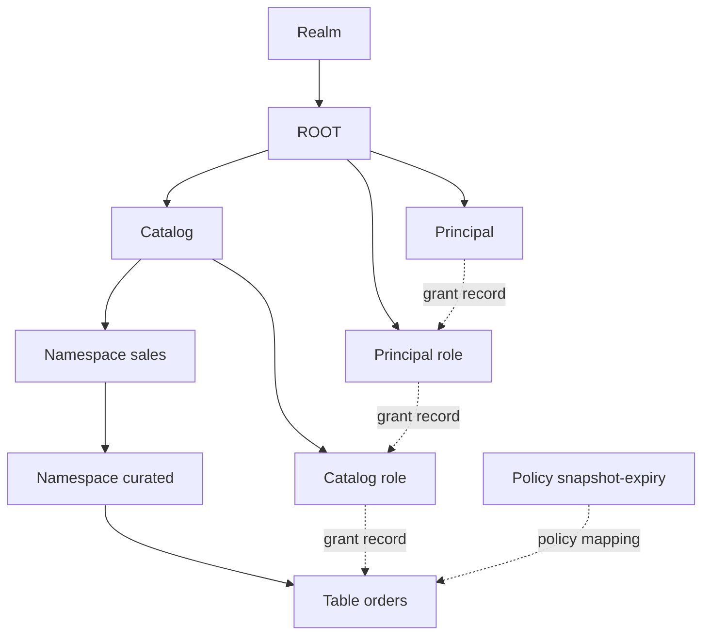

# Chương 4 — Metadata Management Layer trong kiến trúc Apache Polaris

*Ngày nghiên cứu: 08-09-2026. Mốc mã nguồn: Apache Polaris `apache-polaris-1.7.0`, commit `4ac2f059d1cce149453d0a5f1ff1dff980ec97cc`. Tài liệu đối chiếu: tài liệu chính thức Apache Polaris 1.7.0.*

## 1. Vai trò, phạm vi và cách hoạt động tổng thể

### 1.1 Metadata Management giải quyết bài toán gì?

Metadata Management Layer là lõi quản lý **trạng thái control plane** của Polaris. Lớp này trả lời năm câu hỏi:

1. Tài nguyên đang được nói tới là entity nào?
2. Entity nằm ở đâu trong cây catalog?
3. Trạng thái và các quan hệ metadata hiện tại của entity là gì?
4. Trạng thái mà request đã đọc còn mới hay đã bị request khác thay đổi?
5. Làm thế nào cung cấp một snapshot entity đủ nhất quán cho Catalog Service và Security sử dụng?

Polaris biểu diễn catalog, namespace, table, view, principal, role và policy bằng các entity có ID, parent, type, properties và version. Metadata Management resolve tên logic thành entity, quản lý state transition, tải grant/policy mapping, theo dõi thay đổi và điều phối cache. `PolarisMetaStoreManager` là cổng nghiệp vụ chính của lớp này.

> Có thể tóm tắt phạm vi bằng chuỗi:  
> **Entity → Hierarchy → Resolution → State Management → Version → Cache → Relationship Records.**

### 1.2 Ranh giới với các layer khác

| Layer | Câu hỏi mà layer chịu trách nhiệm |
|---|---|
| API / Protocol | Request HTTP mang operation và tham số nào? |
| Security | Người gọi là ai và operation có được phép không? |
| Catalog Service | Create, load, commit, rename hoặc drop phải tuân theo quy tắc nghiệp vụ nào? |
| **Metadata Management** | Entity nào được quản lý, nằm ở đâu, state/version nào và liên kết với grants/policies nào? |
| Persistence | Các bản ghi được lưu, truy vấn và cập nhật atomically trên backend cụ thể thế nào? |
| Storage Integration | File metadata được đọc/ghi và credential storage được cấp thế nào? |
| Supporting Subsystems | Task, cleanup, event và metrics được thực thi thế nào? |

Các layer vẫn giao nhau. Metadata Management cần biết grant record để cung cấp dữ liệu cho Security, nhưng không tự quyết định allow/deny. Nó cập nhật metadata pointer của table entity, nhưng không xây dựng toàn bộ Iceberg `TableMetadata`. Nó yêu cầu persistence thực hiện conditional write, nhưng không định nghĩa SQL cụ thể trong handler.

### 1.3 Metastore lưu gì?

Tài liệu chính thức định nghĩa metastore là backend lưu:

- Polaris entities: catalog, namespace, table, view, principal, role;
- dữ liệu RBAC khi dùng built-in authorizer;
- policy và policy mappings.

Với Iceberg table, cần phân biệt hai miền:

| Miền | Ví dụ | Nơi lưu chính |
|---|---|---|
| Metadata quản trị Polaris | Entity ID, parent ID, name, subtype, properties, metadata location, entity version, grants | Polaris metastore |
| Metadata định dạng Iceberg | Schema, partition spec, snapshots, refs, manifests, statistics references | Metadata files và các file liên quan trên object storage |

Metastore giữ con trỏ và một số thuộc tính tóm tắt; nó không thay thế file metadata Iceberg. Vì vậy, backup database mà mất bucket hoặc backup bucket mà mất database đều không tạo thành một bản phục hồi hoàn chỉnh. [Metastores][metastores-doc], [Entities][entities-doc]

### 1.4 Mô hình hoạt động

Có thể xem Metadata Management như một đồ thị trạng thái có version:

- **nút:** entity;
- **cạnh cấu trúc:** `parentId`;
- **cạnh quyền:** `PolarisGrantRecord`;
- **cạnh governance:** `PolarisPolicyMappingRecord`;
- **nhãn trạng thái:** type, subtype, properties, internal properties và versions.



Một request đi qua lớp này theo trục chung:

```text
Realm + principal + logical path
              │
              ▼
     Resolution manifest
              │ đăng ký entity/path cần dùng
              ▼
           Resolver
          /        \
   cache hit      cache miss
       │              │
       └─ version ─► MetaStoreManager
          validation       │
              └──────┬─────┘
                     ▼
       Entity + grants + resolved path
                     │
          ┌──────────┴──────────┐
          ▼                     ▼
      Security             Catalog Service
```

Ba nguyên tắc vận hành:

1. **Tên được resolve thành ID qua hierarchy.**
2. **Cache hit vẫn phải được kiểm chứng bằng version.**
3. **Write chỉ được chấp nhận nếu path và version quan sát trước đó còn hợp lệ.**

## 2. Mô hình entity

### 2.1 `PolarisEntityCore`

`PolarisEntityCore` là snapshot định danh tối thiểu được truyền giữa resolver, authorizer, catalog service và metastore manager.

| Trường | Ý nghĩa |
|---|---|
| `catalogId` | Catalog chứa entity; entity top-level dùng sentinel/null catalog ID |
| `id` | ID ổn định của logical entity |
| `parentId` | ID của parent |
| `typeCode` | Loại entity |
| `name` | Tên tại thời điểm resolve |
| `entityVersion` | Version tại thời điểm resolve |

Tên có thể đổi nhưng ID tiếp tục xác định logical entity. Vì vậy, validation path phải so cả active lookup và ID; so tên đơn thuần không phát hiện trường hợp entity cũ bị xóa rồi entity mới được tạo lại cùng tên. [Entity core][entity-core]

### 2.2 Entity đầy đủ

`PolarisBaseEntity` mở rộng phần core bằng subtype, timestamps, payload và grant version. `PolarisEntity` là facade/builder hướng đến cách sử dụng immutable. Source 1.7.0 vẫn ghi nhận một số code cũ thao tác trực tiếp với base entity và có TODO hợp nhất hai lớp. [Base entity][base-entity], [Entity facade][entity]

| Nhóm | Trường | Vai trò |
|---|---|---|
| Identity | `id`, `catalogId`, `parentId` | Xác định entity và vị trí trong cây |
| Classification | `typeCode`, `subTypeCode` | Xác định loại tài nguyên |
| Naming | `name` | Lookup entity trong parent |
| Payload | `properties` | Thuộc tính nghiệp vụ hoặc client-visible tùy loại entity |
| Internal payload | `internalProperties` | Trạng thái Polaris dùng nội bộ |
| Concurrency | `entityVersion` | Theo dõi thay đổi state của entity |
| Grant freshness | `grantRecordsVersion` | Theo dõi thay đổi grant liên quan |
| Lifecycle/diagnostics | các timestamp | Tạo, cập nhật và các trạng thái drop/purge trong mô hình tổng quát |

`properties` và `internalProperties` được serialize thành JSON map. Cách lưu này linh hoạt nhưng không thay thế validation của entity wrapper và service logic.

Tài liệu chính thức cảnh báo catalog, table và view properties là metadata có thể được client đọc. Không được dùng chúng làm nơi lưu password, token hoặc access key. [Entities][entities-doc]

### 2.3 Type và subtype

`PolarisEntityType` tại release 1.7.0 gồm:

| Type | Parent logic | Nội dung |
|---|---|---|
| `ROOT` | không có | Pseudo root trong realm |
| `PRINCIPAL` | root | Danh tính |
| `PRINCIPAL_ROLE` | root | Nhóm principal |
| `CATALOG` | root | Catalog top-level |
| `CATALOG_ROLE` | catalog | Role thuộc catalog |
| `NAMESPACE` | catalog hoặc namespace | Schema/database logic, hỗ trợ lồng nhau |
| `TABLE_LIKE` | namespace | Table, view hoặc generic table |
| `TASK` | root | Bản ghi công việc nền |
| `FILE` | table-like | Kiểu file nội bộ |
| `POLICY` | namespace | Policy governance |

`TABLE_LIKE` có các subtype `ICEBERG_TABLE`, `ICEBERG_VIEW` và `GENERIC_TABLE`. `ANY_SUBTYPE` chỉ dùng cho lookup/list, không phải subtype của một entity được lưu. [Entity types][entity-type], [Entity subtypes][entity-subtype]

### 2.4 Entity hierarchy

Hierarchy của dữ liệu catalog:

```text
Realm
└── ROOT
    └── Catalog
        ├── Catalog role
        └── Namespace
            ├── Namespace
            ├── Iceberg table
            ├── Iceberg view
            ├── Generic table
            └── Policy
```

Principal và principal role nằm dưới root, không nằm trong một catalog. Catalog role thuộc một catalog. Namespace có thể tự lồng; tài liệu chính thức xác nhận path như `a.b.c.d` là hợp lệ. [Entities][entities-doc]

Một active-name lookup có dạng khái niệm:

```text
(realm, catalogId, parentId, typeCode, name) → entity ID
```

`subType` không nằm trong `EntityCacheByNameKey`. Service resolve một `TABLE_LIKE` rồi kiểm tra subtype theo operation.

### 2.5 Properties và internal properties

Không có một schema JSON chung cho mọi entity. Wrapper chuyên biệt diễn giải payload theo type:

- catalog entity chứa catalog type, storage configuration và connection-related state;
- table/view entity giữ metadata location và các thông tin định dạng cần thiết;
- principal giữ client-related state;
- policy entity giữ policy type, content và revision;
- task entity giữ task type và task payload.

Quy tắc kiến trúc:

- `properties` dành cho dữ liệu thuộc contract hoặc có thể được trình bày ra ngoài;
- `internalProperties` dành cho state Polaris cần để điều phối;
- secret phải đi qua secret/integration persistence, không được nhét vào properties;
- thay đổi một trong hai map là thay đổi entity state và phải đi qua versioned update.

### 2.6 Realm scope

`RealmContext` xác định miền dữ liệu độc lập. `PolarisCallContext` được tạo cho request và giữ realm, persistence session cùng cấu hình theo realm. Hai catalog cùng tên trong hai realm là hai tập entity độc lập. Với JDBC, `realm_id` tham gia schema/query để cô lập dữ liệu. [Realm][realm-doc], [Call context][call-context]

Chi tiết cách request header được resolve thành realm và cách principal được xác thực thuộc Security Layer. Điều Metadata Management cần bảo đảm là mọi lookup, ID, cache và mutation được thực hiện trong đúng realm.

## 3. Entity resolution

### 3.1 Từ logical path tới entity ID

Với `lakehouse.sales.curated.orders`, resolver không tìm một chuỗi phẳng duy nhất. Nó đi từng segment:

```text
CATALOG lakehouse
  → catalogId
  → NAMESPACE sales, parentId = catalogId
  → NAMESPACE curated, parentId = sales.id
  → TABLE_LIKE orders, parentId = curated.id
```

Kết quả segment trước cung cấp parent cho segment sau. Nếu `sales` không tồn tại, resolver không được bỏ qua rồi tìm `curated.orders` ở nơi khác.

### 3.2 `PolarisResolutionManifest`

Manifest là danh sách khai báo những entity/path một request cần. Handler có thể đăng ký:

- entity top-level theo tên;
- catalog role;
- namespace, table-like hoặc policy path;
- path bắt buộc hoặc optional;
- một tập `Resolvable` cụ thể thay vì resolve mọi thứ.

Sau `resolveAll()` hoặc `resolveSelections()`, caller mới đọc status và kết quả. Manifest ánh xạ `ResolvedPathKey` tới path đã resolve, để nhiều bước trong cùng request sử dụng cùng snapshot. [Resolution manifest][resolution-manifest]

`ResolvedPathKey` chuẩn hóa khóa thành:

```text
(List<String> entityNames, PolarisEntityType entityType)
```

Các factory method chuyển `Namespace`, `TableIdentifier`, policy identifier hoặc catalog role về dạng đó. [Resolved path key][resolved-path-key]

Manifest có phạm vi request. Nó không phải cache dùng chung giữa các request.

### 3.3 Resolver tải những gì?

`ResolvedPolarisEntity` chứa:

- một bản copy entity;
- các grant mà entity là grantee;
- các grant mà entity là securable.

Resolver có thể cần principal, roles, reference catalog và requested paths vì downstream Security cần chúng. Trong phạm vi chương này, điểm quan trọng là **resolver tạo snapshot entity cùng relationship records**; thuật toán suy ra effective privilege và quyết định allow/deny thuộc Chương 2. [Resolved entity][resolved-entity], [RBAC][rbac-doc]

### 3.4 Status và optional path

Các trạng thái chính:

- `SUCCESS`;
- `CALLER_PRINCIPAL_DOES_NOT_EXIST`;
- `PATH_COULD_NOT_BE_FULLY_RESOLVED`;
- `ENTITY_COULD_NOT_BE_RESOLVED`.

Path failure mang index segment lỗi. Path optional cho phép operation như create biết parent nào đã tồn tại mà không biến leaf chưa tồn tại thành lỗi toàn bộ. Caller vẫn phải diễn giải kết quả đúng theo operation. [Resolver][resolver], [Resolver status][resolver-status]

### 3.5 Snapshot trong request và kiểm tra lại khi ghi

Resolution ban đầu thường xảy ra trước mutation. Giữa lúc resolve và lúc write, request khác có thể rename, move, delete hoặc thay thế entity.

Trong nhánh transactional, `persistence/transactional/PolarisEntityResolver` nhận `PolarisEntityCore` đã resolve, dựng active key rồi lookup batch trong transaction:

```text
observed: key(catalog, parent, type, name) → id 421
current:  key(catalog, parent, type, name) → id 421  ⇒ hợp lệ
current:  key(...) → null hoặc id 793                    ⇒ thất bại
```

Nó kiểm tra path vẫn dẫn tới cùng ID. Đây là biện pháp chống TOCTOU giữa bước kiểm tra và sử dụng state. Nhánh atomic phải bảo toàn cùng ý nghĩa bằng conditional primitives của persistence contract. [Transactional entity resolver][transactional-entity-resolver]

### 3.6 Passthrough/federated entity

Manifest có đường passthrough resolution dùng resolver riêng cho path cần tra ở facade/federated context. Metadata Management vẫn tạo representation đủ để routing và authorization sử dụng.

Phần chuyển operation tới remote catalog, nguồn metadata cuối cùng và capability của federation thuộc Chương 3. Trong chương này chỉ cần ghi nhận rằng một resolved entity cục bộ không mặc nhiên là bản sao đầy đủ của remote metadata.

## 4. Quản lý trạng thái qua `PolarisMetaStoreManager`

### 4.1 Vai trò của manager

`PolarisMetaStoreManager` là cổng nghiệp vụ của metadata state, không phải DAO CRUD thuần. Nó nối entity model, hierarchy, version, grants, policy mappings và persistence contract. [Metastore manager][metastore-manager]

| Nhóm | Method tiêu biểu | Trách nhiệm metadata |
|---|---|---|
| Bootstrap | `bootstrapPolarisService`, `purge` | Khởi tạo hoặc xóa state theo realm |
| Lookup/list | `readEntityByName`, `loadEntity`, `listEntities` | Đọc active/full entity |
| ID/create | `generateNewEntityId`, `createEntityIfNotExists` | Sinh ID và tạo entity |
| Update | `updateEntityPropertiesIfNotChanged` | Conditional state update |
| Structural change | `renameEntity`, `dropEntityIfExists` | Thay đổi path hoặc loại entity khỏi active state |
| Resolution support | `loadResolvedEntityById/Name`, `refreshResolvedEntity` | Tải entity cùng grants |
| Change tracking | `loadEntitiesChangeTracking` | Đọc cặp version theo batch |
| Relationships | grant/revoke, attach/detach policy | Duy trì các cạnh metadata |

### 4.2 Create

Luồng metadata tổng quát:

1. sinh ID;
2. dựng entity với catalog, parent, type, subtype, name và creation timestamp;
3. kiểm tra parent path;
4. kiểm tra active name chưa bị chiếm;
5. chuẩn hóa timestamp/version ban đầu;
6. ghi entity và active-name lookup.

Catalog Service quyết định operation nào được phép tạo loại entity nào. Metadata Management bảo toàn identity, hierarchy và uniqueness.

### 4.3 Update properties

`updateEntityPropertiesIfNotChanged` nhận entity đã resolve. Manager kiểm tra path, tải state hiện tại và so `entityVersion`.

```text
Điều kiện:
current.id = observed.id
∧ current.path = observed.path
∧ current.entityVersion = observed.entityVersion

Đúng  → ghi properties/internalProperties mới, version + 1
Sai   → TARGET_ENTITY_CONCURRENTLY_MODIFIED
```

Đây là optimistic concurrency ở cấp entity. Nó không khóa table trong toàn bộ thời gian Spark hoặc Trino tạo data files.

### 4.4 Rename và re-parent

Manager kiểm tra source path, destination parent, name conflict và protected entity. Nếu hợp lệ:

- ID giữ nguyên;
- name và/hoặc parent ID thay đổi;
- active-name lookup cũ bị loại;
- active-name lookup mới được tạo;
- `entityVersion` tăng.

Consumer giữ path cũ phải resolve lại. Consumer giữ ID vẫn nói về cùng logical entity, nhưng cũng phải kiểm tra version/path trước khi mutation.

### 4.5 Drop/delete state

Manager kiểm tra container có child, protected role, grant và policy mapping liên quan trước khi gọi persistence delete. Việc xóa **entity record** khác với việc xóa file metadata/data trên object storage.

Entity model có các trường `dropTimestamp`, `toPurgeTimestamp` và `purgeTimestamp`; một số comment trong manager còn mô tả active/dropped state. Tuy nhiên, source thực tế của release 1.7.0 cho thấy:

- `AbstractTransactionalPersistence.deleteEntityInCurrentTxn` xóa active lookup, entity record và change-tracking record;
- `JdbcBasePersistenceImpl.deleteEntity` phát lệnh `DELETE`;
- factory `relational-jdbc` tạo `AtomicOperationMetaStoreManager`.

Vì vậy không được suy ra JDBC 1.7.0 luôn giữ tombstone để undrop chỉ từ các field lifecycle hoặc comment cũ. Đây là khác biệt giữa **mô hình tổng quát** và **implementation đang được dùng**. [Transactional delete][transactional-delete], [JDBC persistence][jdbc-persistence], [JDBC factory][jdbc-factory]

### 4.6 Grant record dưới góc nhìn metadata

`PolarisGrantRecord` là cạnh giữa securable và grantee:

```text
(securableCatalogId, securableId,
 granteeCatalogId, granteeId,
 privilegeCode)
```

Metadata manager:

- lookup grant theo khóa;
- tải grants theo hướng securable hoặc grantee;
- tạo/xóa record;
- tăng `grantRecordsVersion` của hai đầu liên quan;
- dọn grants khi entity bị xóa.

Chương này không tính effective privilege. Cách principal role, catalog role và privilege dẫn tới quyết định authorization được trình bày trong Chương 2. [Grant record][grant-record], [RBAC][rbac-doc]

### 4.7 Policy mapping dưới góc nhìn metadata

`PolarisPolicyMappingRecord` nối policy với target:

| Trường | Ý nghĩa |
|---|---|
| `targetCatalogId`, `targetId` | Entity nhận policy |
| `policyCatalogId`, `policyId` | Policy entity |
| `policyTypeCode` | Loại policy |
| `parameters` | Tham số attachment dạng JSON map |

Manager tái resolve policy và target, kiểm tra mapping constraint, attach/detach rồi tải mappings theo target/type. Việc tính inheritance/override và nghiệp vụ tạo policy thuộc Catalog Service; việc chạy compaction hoặc snapshot expiry thuộc subsystem thực thi khác. [Policy mapping][policy-mapping-record], [Policy][policy-doc]

### 4.8 Boundary ở mức hợp đồng

Có hai họ manager chính:

1. `TransactionalMetaStoreManagerImpl` dùng `TransactionalPersistence` và outer read/write transaction.
2. `AtomicOperationMetaStoreManager` dùng one-shot atomic/compare-and-swap primitives của `BasePersistence`.

Metadata Management định nghĩa điều kiện logic cần giữ: identity, path, uniqueness, versions và relationship consistency. Persistence Layer hiện thực các primitive trên backend cụ thể. Chi tiết SQL, database index và connection pool thuộc chương Persistence. [Transactional manager][transactional-manager], [Atomic manager][atomic-manager], [Base persistence][base-persistence]

## 5. Version và tính nhất quán

### 5.1 Hai trục version

Mỗi resolved entity có vector:

```text
V(entity) = (entityVersion, grantRecordsVersion)
```

| Version | Thay đổi khi | Mục đích |
|---|---|---|
| `entityVersion` | Properties, internal properties, name, parent hoặc state entity đổi | Optimistic concurrency và freshness của entity |
| `grantRecordsVersion` | Grant liên quan tới entity đổi | Freshness của relationship records phục vụ authorization |

Tách hai version cho phép cache biết cần tải lại toàn entity hay chủ yếu tải lại grants.

### 5.2 `entityVersion`

`prepareToPersistEntityAfterChange` kiểm tra invariant, cập nhật `lastUpdateTimestamp` và tăng `entityVersion`. Conditional update so version observed với current version. Mismatch là concurrent modification, không phải lỗi kết nối. [Base manager][base-manager]

Ví dụ:

```text
Job A đọc version 12
Job B đọc version 12

A: update 12 → 13 thành công
B: expected 12, current 13 → conflict
```

Catalog Service quyết định cách refresh và áp lại Iceberg requirements. Metadata Management chỉ bảo đảm stale entity state không ghi đè state mới.

### 5.3 `grantRecordsVersion`

Khi grant được thêm hoặc thu hồi, implementation tăng grant version của:

- grantee;
- securable.

Khi xóa entity, grants liên quan được xóa và các entity ở đầu còn lại được bump version. Nếu chỉ ghi grant record mà không đổi version, cache có thể tiếp tục phục vụ relationship snapshot cũ. Vì vậy version bump là một phần correctness.

### 5.4 Change tracking

`loadEntitiesChangeTracking` trả:

```text
PolarisChangeTrackingVersions(
    entityVersion,
    grantRecordsVersion
)
```

theo batch entity IDs. Cache so cả hai giá trị bằng equality. Nếu change-tracking entry không còn, entity được xem là đã bị purge/không còn trong backing state tương ứng.

### 5.5 Conditional update và CAS

Mô hình contract:

```text
read state S(v)
compute S'
compare current version with v
if equal:
    publish S'(v + 1)
else:
    reject
```

Với manager transactional, validation và write có thể nằm trong outer transaction. Với manager atomic, persistence primitive phải thực hiện điều kiện trong một thao tác durable. Không được tách compare và update thành hai lời gọi không có bảo vệ.

### 5.6 Phân biệt version

| Khái niệm | Phạm vi |
|---|---|
| Polaris `entityVersion` | Version của entity record |
| `grantRecordsVersion` | Version của grants gắn với entity |
| Iceberg snapshot ID | Trạng thái dữ liệu logic trong table metadata |
| Metadata location | Địa chỉ file JSON mô tả table |
| Policy revision/version | Nội dung policy |

Các giá trị có thể cùng thay đổi trong một nghiệp vụ nhưng không thay thế nhau.

## 6. Entity cache

### 6.1 Cache chứa gì?

`InMemoryEntityCache` lưu `ResolvedPolarisEntity`: entity cùng các grants hai chiều. Nó có:

- `byId`: Caffeine cache chính;
- `byName`: `ConcurrentHashMap<EntityCacheByNameKey, ResolvedPolarisEntity>`.

Index by-name chỉ nhận entity chưa dropped. Khi by-ID entry bị remove, removal listener xóa mapping by-name. Khi entity rename, key tên cũ được dọn. [Entity cache][entity-cache], [Cache key][cache-key]

### 6.2 Hit, miss và refresh

```text
resolve entity
    │
    ├─ miss → load entity + grants từ MetaStoreManager → cache
    │
    └─ hit  → đưa vào tập cần validate
                    │
                    ▼
          load change-tracking versions
                    │
          ┌─────────┴─────────┐
          │ equal             │ different
          ▼                   ▼
       dùng entry       refresh entity/grants
```

Cache hit không đồng nghĩa chấp nhận entry ngay. Resolver kiểm chứng version trước khi dùng snapshot cho request.

### 6.3 Batch validation

Với nhiều entity, cache:

1. tải version batch;
2. xác định IDs thiếu hoặc lệch version;
3. tải lại các entry cần thiết;
4. kiểm tra lại với change-tracking snapshot;
5. lặp hữu hạn nếu concurrent writes xảy ra;
6. fail có kiểm soát nếu không tạo được tập ổn định.

So sánh equality giúp tránh một batch mà một số entry đứng trước và một số entry đứng sau cùng lần đọc change tracking.

### 6.4 Capacity và expiry

Code 1.7.0 dùng:

- maximum weight từ `ENTITY_CACHE_WEIGHER_TARGET`;
- `EntityWeigher`;
- expire after một giờ không được truy cập;
- optional soft values qua `ENTITY_CACHE_SOFT_VALUES`.

Comment class còn nói giới hạn 100k entity, nhưng implementation thực tế dùng weight. Khi comment và code khác nhau, capacity planning phải theo feature config và weigher. [Configuration reference][config-doc], [Entity cache][entity-cache]

TTL một giờ là thời gian giữ entry không được truy cập, không phải thời gian cho phép quyền hoặc metadata cũ tồn tại trong resolution path.

### 6.5 Negative lookup và delete

Lookup không tìm thấy trả `null`; cache không giữ negative entry dài hạn trong by-name map. Sau create, request không phải chờ một negative TTL.

Với JDBC 1.7.0, delete làm change-tracking record biến mất. Batch validation loại entry cũ khỏi cache. Mất cache chỉ làm tăng số lần đọc metastore; mất in-memory persistence backend làm mất metadata thật. Hai trường hợp không tương đương.

### 6.6 Bốn loại cache dễ bị nhầm

1. Core entity cache phục vụ resolver.
2. Backend-specific cache/invalidation trong NoSQL module.
3. Storage credential cache.
4. Iceberg client/engine metadata cache.

Chúng có payload, TTL và consistency contract khác nhau.

## 7. Vòng đời metadata entity

### 7.1 State transition ở mức logic

```text
create
  → active
  → update / rename / re-parent
  → delete khỏi active metadata state
  → optional file cleanup do subsystem khác xử lý
```

Với một số abstraction/backend, entity model còn biểu diễn dropped/purge timestamps. Với JDBC 1.7.0, đường đã xác minh xóa entity record. Vì vậy lifecycle phải được mô tả theo manager/backend, không ép mọi implementation vào một state machine tombstone.

### 7.2 Những gì Metadata Management làm khi delete

- kiểm tra path và container constraints;
- kiểm tra protected entity;
- kiểm tra hoặc dọn grant/policy mappings;
- yêu cầu persistence loại entity khỏi active state;
- có thể tạo task record nếu caller yêu cầu cleanup.

Metadata Management không trực tiếp duyệt S3/Azure/GCS để xóa file.

### 7.3 Cleanup task và giới hạn atomicity

`TASK` cũng là entity. Khi `cleanup=true`, manager có thể tạo task `ENTITY_CLEANUP_SCHEDULER` chứa payload của entity đã xóa.

- Với `TransactionalMetaStoreManagerImpl`, delete và task creation nằm trong outer transaction.
- Với `AtomicOperationMetaStoreManager`, source có TODO về cách tạo task atomically cùng delete.
- JDBC 1.7.0 dùng atomic manager.

Chương Supporting Subsystems phải giải thích task được lease, thực thi, retry và quan sát thế nào. Chương này chỉ xác định task record là state metadata được tạo ở boundary nào.

### 7.4 Các nghĩa khác nhau của “purge”

Trong Polaris, “purge” có thể chỉ:

- lifecycle field trong entity model;
- drop-with-purge để yêu cầu dọn file;
- admin purge xóa state của realm;
- eviction cache trong comment/code.

Tài liệu kỹ thuật phải nêu rõ đang xóa entity record, file storage, realm state hay cache entry.

## 8. Metadata Management tham gia vào request

### 8.1 Load table

```text
1. Nhận realm, principal và logical path.
2. Manifest đăng ký catalog/path/entity cần resolve.
3. Resolver lấy entity từ cache hoặc metastore.
4. Cache hit được kiểm tra bằng entity/grant versions.
5. Manifest trả resolved path và relationship snapshot.
6. Security dùng snapshot để authorize.
7. Catalog Service dùng table entity để tiếp tục load metadata.
```

Phạm vi của Metadata Management kết thúc ở bước cung cấp entity state đã resolve. Đọc metadata JSON và tạo response Iceberg thuộc Catalog Service/Storage Integration.

### 8.2 Conditional update table entity

```text
1. Nhận table entity đã resolve và expected entityVersion.
2. Kiểm tra path vẫn dẫn tới cùng entity ID.
3. Đọc current state.
4. So current entityVersion với expected version.
5. Nếu khớp, cập nhật internal properties/metadata location.
6. Tăng entityVersion và cập nhật change tracking.
7. Nếu không khớp, trả concurrently modified.
```

Việc kiểm tra Iceberg requirements, tạo metadata JSON, ghi object storage và rebase retry thuộc Chương 3.

## 9. Các bất biến và failure semantics

### 9.1 Bất biến

1. ID xác định logical entity; name chỉ là lookup key có thể đổi.
2. Path phải liên tục từ catalog qua từng parent.
3. Active key không được trỏ tới hai entity cùng lúc.
4. Write không được dùng stale `entityVersion`.
5. Grant mutation phải làm thay đổi `grantRecordsVersion`.
6. Cache entry chỉ hợp lệ khi vector version khớp backing state.
7. Mọi operation phải giữ realm isolation.
8. Backend implementation phải bảo toàn conditional semantics của manager contract.

### 9.2 Nhóm lỗi

| Lỗi | Ý nghĩa ở Metadata Management | Phản ứng phù hợp |
|---|---|---|
| Path cannot be resolved | Một segment không còn active hoặc ID đã thay đổi | Resolve lại hierarchy |
| Entity already exists | Active-name key đã bị chiếm | Đổi target hoặc đọc entity hiện có |
| Concurrently modified | Expected entity version đã cũ | Refresh rồi tính lại mutation |
| Entity not found | Entity bị xóa, sai realm/path/type hoặc chưa tồn tại | Kiểm tra identity và lifecycle |
| Cache validation failure | Không tạo được snapshot ổn định sau số lần thử giới hạn | Xem write contention và backend |
| Backend exception | Persistence primitive không hoàn tất | Chỉ retry khi operation có idempotency phù hợp |

### 9.3 Consistency qua ba miền

| Miền | Cơ chế |
|---|---|
| Manager state | Path validation và conditional update |
| Cache ↔ metastore | Change tracking và vector version |
| Metastore ↔ object storage | Pointer publication và quy trình bù trừ/cleanup ở layer khác |

Không có một distributed transaction chung bao phủ database và object storage. Đây là lý do file metadata có thể được ghi nhưng không trở thành current pointer khi conditional update thất bại.

## 10. Điều Data Engineer cần quan sát

Các tín hiệu liên quan trực tiếp đến Metadata Management:

- lookup by-name/by-ID latency;
- batch change-tracking latency và error;
- entity cache hit, miss, eviction và refresh;
- số `TARGET_ENTITY_CONCURRENTLY_MODIFIED`;
- create/rename conflict theo active key;
- grant version hoặc relationship reload failure;
- policy mapping constraint error;
- task record không được tạo sau delete khi backend atomic gặp lỗi giữa các bước;
- realm mismatch hoặc cardinality tăng bất thường.

Runbook “table không tồn tại”:

1. xác nhận realm;
2. resolve từng namespace segment;
3. kiểm tra type/subtype;
4. kiểm tra rename, re-parent hoặc delete gần thời điểm lỗi;
5. kiểm tra change-tracking/cache refresh;
6. sau khi entity hợp lệ mới kiểm tra metadata location và object storage.

Runbook “concurrent modification tăng cao”:

1. xác định writers cùng entity;
2. đo thời gian giữa resolve và conditional update;
3. kiểm tra client có tiếp tục gửi stale expected version;
4. tìm maintenance automation cùng sửa entity;
5. phân biệt conflict hợp lệ với backend timeout/deadlock;
6. chuyển sang Chương 3 để kiểm tra retry/rebase của Iceberg operation.

## 11. Những ngộ nhận cần tránh

| Ngộ nhận | Cách hiểu đúng |
|---|---|
| Metastore chứa toàn bộ metadata Iceberg | Nó giữ entity, pointer và control-plane state; metadata Iceberg đầy đủ nằm trên storage |
| Resolver là authorizer | Resolver tạo entity/relationship snapshot; authorizer quyết định allow/deny |
| Cache TTL một giờ cho phép quyền cũ tồn tại một giờ | Cache hit được kiểm tra bằng versions |
| `entityVersion` là Iceberg snapshot ID | Đây là version của entity record |
| Name là định danh ổn định | ID mới là identity; name có thể đổi và tái sử dụng |
| Policy mapping là RBAC grant | Đây là hai loại relationship record có semantics khác nhau |
| Drop luôn tạo tombstone có thể undrop | JDBC 1.7.0 xóa entity record theo đường code đã xác minh |
| Xóa entity đồng nghĩa xóa file | File cleanup là bước khác |
| Mọi JDBC composite operation nằm trong một transaction | JDBC factory 1.7.0 dùng atomic manager; phải xét từng contract |
| Entity cache là persistence | Cache có thể mất và tải lại; in-memory backend mất là mất state |

## 12. Bản đồ class

| Thành phần | Trách nhiệm |
|---|---|
| `PolarisEntityCore` | Identity/path snapshot tối thiểu |
| `PolarisBaseEntity`, `PolarisEntity` | Entity state đầy đủ |
| `PolarisEntityType`, `PolarisEntitySubType` | Phân loại và hierarchy rules |
| `PolarisMetaStoreManager` | Contract quản lý metadata state |
| `Resolver` | Resolve entity/path và relationship snapshot |
| `PolarisResolutionManifest` | Đăng ký và tra resolution trong request |
| transactional `PolarisEntityResolver` | Tái xác thực path trong write transaction |
| `ResolvedPolarisEntity` | Entity cùng grants hai chiều |
| `PolarisChangeTrackingVersions` | Vector version gọn cho validation |
| `InMemoryEntityCache` | Cache có version validation |
| `PolarisGrantRecord` | Quan hệ securable–grantee |
| `PolarisPolicyMappingRecord` | Quan hệ policy–target |

## Phụ lục A — Implementation và backend-specific behavior

### A.1 In-memory

Factory `in-memory` dùng `TreeMapMetaStore` và transactional persistence. Nó thích hợp cho development/test; dữ liệu mất khi process/pod restart và không phải shared durable state cho nhiều replicas. Tài liệu chính thức xếp backend này ở mức test only. [Metastores][metastores-doc]

### A.2 Relational JDBC

Tài liệu 1.7.0 khuyến nghị PostgreSQL/JDBC cho production. Schema có entities, grant records, policy mappings, versions và `realm_id`. Chi tiết cần nhớ trong release này là factory tạo `AtomicOperationMetaStoreManager`; JDBC persistence cung cấp các primitive conditional/durable cho manager đó. [JDBC metastore][jdbc-doc], [JDBC factory][jdbc-factory]

Thiết kế schema, index, SQL transaction, connection pool, backup và migration thuộc Persistence Layer. Chương này chỉ dựa vào chúng để xác định bảo đảm mà Metadata Management yêu cầu.

### A.3 NoSQL

MongoDB/NoSQL là beta/experimental trong 1.7.0. NoSQL manager có kiến trúc cache/invalidation và reload riêng. Không nên mặc định áp bảo đảm hoặc số round trip của JDBC cho NoSQL. Cần kiểm chứng create/rename race, read-after-write, batch version validation, grant version bump và policy mapping bằng workload/fault test. [NoSQL metastore][nosql-doc], [NoSQL manager][nosql-manager]

### A.4 Contract tối thiểu của backend

Backend phải bảo toàn:

- ID không collision trong realm;
- unique active-name lookup;
- conditional write không mất update;
- version/change tracking phản ánh committed state;
- grant/policy relationship không tạo state trái constraint;
- delete không để active index trỏ tới entity không tồn tại;
- realm isolation;
- pagination và batch lookup đúng contract.

Thay backend không chỉ là đổi database driver.

## Phụ lục B — Ranh giới dẫn chiếu sang các chương khác

| Nội dung | Chương sở hữu |
|---|---|
| Principal/role graph tạo effective privilege thế nào | Chương 2 — Security Layer |
| Allow/deny và privilege semantics | Chương 2 |
| Iceberg requirements, metadata JSON và commit retry | Chương 3 — Catalog Service Layer |
| Federation forwarding | Chương 3 |
| Policy lifecycle và effective policy nghiệp vụ | Chương 3 |
| SQL schema, index, DB transaction, connection pool | Chương Persistence |
| Task leasing, cleanup execution, events và metrics | Chương Supporting Subsystems |

Chương 04 chỉ mô tả dữ liệu và contract mà các chương đó sử dụng.

## Phụ lục C — Checklist kiến thức

Sau khi đọc, Data Engineer nên trả lời được:

- Realm, catalog ID, parent ID và entity ID phối hợp thế nào?
- Tại sao resolve path phải so ID, không chỉ so name?
- `entityVersion` và `grantRecordsVersion` đổi trong trường hợp nào?
- Manifest khác entity cache thế nào?
- Vì sao cache hit vẫn cần change tracking?
- Conditional update ngăn lost update thế nào?
- Grant record khác policy mapping record ở đâu?
- Xóa entity record khác dọn file storage thế nào?
- Vì sao lifecycle phải xét manager/backend cụ thể?
- Metadata Management kết thúc ở đâu trong load và commit table?

## 13. Phạm vi xác minh

Các field, method, version bump, cache validation và delete behavior được đối chiếu trực tiếp với source release 1.7.0. Support level của backend, entity hierarchy, RBAC và policy được đối chiếu với tài liệu chính thức cùng phiên bản.

Các giới hạn cần giữ khi dùng tài liệu:

- NoSQL là beta/experimental trong 1.7.0;
- JDBC factory 1.7.0 dùng atomic manager;
- comment lifecycle/cache cũ không phải lúc nào cũng phản ánh đúng implementation;
- một số composite operation của atomic manager có TODO về atomicity;
- bảo đảm cuối cùng phụ thuộc persistence implementation và deployment configuration.

Khi nâng cấp Polaris, cần diff entity model, manager, resolver, cache, persistence factory và schema migration trước khi áp nguyên các kết luận này.

## Tài liệu tham khảo

### Tài liệu chính thức

- [Apache Polaris 1.7.0 — Entities][entities-doc]
- [Apache Polaris 1.7.0 — Metastores][metastores-doc]
- [Apache Polaris 1.7.0 — Relational JDBC][jdbc-doc]
- [Apache Polaris 1.7.0 — NoSQL MongoDB][nosql-doc]
- [Apache Polaris 1.7.0 — Role-Based Access Control][rbac-doc]
- [Apache Polaris 1.7.0 — Policy][policy-doc]
- [Apache Polaris 1.7.0 — Realm][realm-doc]
- [Apache Polaris 1.7.0 — Configuration Reference][config-doc]

### Mã nguồn ghim tại commit release 1.7.0

- [`PolarisMetaStoreManager`][metastore-manager]
- [`PolarisEntityCore`][entity-core], [`PolarisBaseEntity`][base-entity], [`PolarisEntity`][entity]
- [`Resolver`][resolver], [`PolarisResolutionManifest`][resolution-manifest]
- [`InMemoryEntityCache`][entity-cache]
- [`PolarisGrantRecord`][grant-record]
- [`PolarisPolicyMappingRecord`][policy-mapping-record]
- [`TransactionalMetaStoreManagerImpl`][transactional-manager]
- [`AtomicOperationMetaStoreManager`][atomic-manager]

[entities-doc]: https://polaris.apache.org/releases/1.7.0/entities/
[metastores-doc]: https://polaris.apache.org/releases/1.7.0/metastores/
[jdbc-doc]: https://polaris.apache.org/releases/1.7.0/metastores/relational-jdbc/
[nosql-doc]: https://polaris.apache.org/releases/1.7.0/metastores/nosql-mongodb/
[rbac-doc]: https://polaris.apache.org/releases/1.7.0/managing-security/access-control/
[policy-doc]: https://polaris.apache.org/releases/1.7.0/policy/
[realm-doc]: https://polaris.apache.org/releases/1.7.0/realm/
[config-doc]: https://polaris.apache.org/releases/1.7.0/configuration/configuration-reference/

[entity-core]: https://github.com/apache/polaris/blob/4ac2f059d1cce149453d0a5f1ff1dff980ec97cc/polaris-core/src/main/java/org/apache/polaris/core/entity/PolarisEntityCore.java
[base-entity]: https://github.com/apache/polaris/blob/4ac2f059d1cce149453d0a5f1ff1dff980ec97cc/polaris-core/src/main/java/org/apache/polaris/core/entity/PolarisBaseEntity.java
[entity]: https://github.com/apache/polaris/blob/4ac2f059d1cce149453d0a5f1ff1dff980ec97cc/polaris-core/src/main/java/org/apache/polaris/core/entity/PolarisEntity.java
[entity-type]: https://github.com/apache/polaris/blob/4ac2f059d1cce149453d0a5f1ff1dff980ec97cc/polaris-core/src/main/java/org/apache/polaris/core/entity/PolarisEntityType.java
[entity-subtype]: https://github.com/apache/polaris/blob/4ac2f059d1cce149453d0a5f1ff1dff980ec97cc/polaris-core/src/main/java/org/apache/polaris/core/entity/PolarisEntitySubType.java
[grant-record]: https://github.com/apache/polaris/blob/4ac2f059d1cce149453d0a5f1ff1dff980ec97cc/polaris-core/src/main/java/org/apache/polaris/core/entity/PolarisGrantRecord.java
[metastore-manager]: https://github.com/apache/polaris/blob/4ac2f059d1cce149453d0a5f1ff1dff980ec97cc/polaris-core/src/main/java/org/apache/polaris/core/persistence/PolarisMetaStoreManager.java
[base-manager]: https://github.com/apache/polaris/blob/4ac2f059d1cce149453d0a5f1ff1dff980ec97cc/polaris-core/src/main/java/org/apache/polaris/core/persistence/BaseMetaStoreManager.java
[transactional-manager]: https://github.com/apache/polaris/blob/4ac2f059d1cce149453d0a5f1ff1dff980ec97cc/polaris-core/src/main/java/org/apache/polaris/core/persistence/transactional/TransactionalMetaStoreManagerImpl.java
[atomic-manager]: https://github.com/apache/polaris/blob/4ac2f059d1cce149453d0a5f1ff1dff980ec97cc/polaris-core/src/main/java/org/apache/polaris/core/persistence/AtomicOperationMetaStoreManager.java
[base-persistence]: https://github.com/apache/polaris/blob/4ac2f059d1cce149453d0a5f1ff1dff980ec97cc/polaris-core/src/main/java/org/apache/polaris/core/persistence/BasePersistence.java
[nosql-manager]: https://github.com/apache/polaris/blob/4ac2f059d1cce149453d0a5f1ff1dff980ec97cc/persistence/nosql/persistence/metastore/src/main/java/org/apache/polaris/persistence/nosql/metastore/NoSqlMetaStoreManager.java
[resolver]: https://github.com/apache/polaris/blob/4ac2f059d1cce149453d0a5f1ff1dff980ec97cc/polaris-core/src/main/java/org/apache/polaris/core/persistence/resolver/Resolver.java
[resolver-status]: https://github.com/apache/polaris/blob/4ac2f059d1cce149453d0a5f1ff1dff980ec97cc/polaris-core/src/main/java/org/apache/polaris/core/persistence/resolver/ResolverStatus.java
[resolution-manifest]: https://github.com/apache/polaris/blob/4ac2f059d1cce149453d0a5f1ff1dff980ec97cc/polaris-core/src/main/java/org/apache/polaris/core/persistence/resolver/PolarisResolutionManifest.java
[resolved-path-key]: https://github.com/apache/polaris/blob/4ac2f059d1cce149453d0a5f1ff1dff980ec97cc/polaris-core/src/main/java/org/apache/polaris/core/persistence/resolver/ResolvedPathKey.java
[resolved-entity]: https://github.com/apache/polaris/blob/4ac2f059d1cce149453d0a5f1ff1dff980ec97cc/polaris-core/src/main/java/org/apache/polaris/core/persistence/ResolvedPolarisEntity.java
[transactional-entity-resolver]: https://github.com/apache/polaris/blob/4ac2f059d1cce149453d0a5f1ff1dff980ec97cc/polaris-core/src/main/java/org/apache/polaris/core/persistence/transactional/PolarisEntityResolver.java
[entity-cache]: https://github.com/apache/polaris/blob/4ac2f059d1cce149453d0a5f1ff1dff980ec97cc/polaris-core/src/main/java/org/apache/polaris/core/persistence/cache/InMemoryEntityCache.java
[cache-key]: https://github.com/apache/polaris/blob/4ac2f059d1cce149453d0a5f1ff1dff980ec97cc/polaris-core/src/main/java/org/apache/polaris/core/persistence/cache/EntityCacheByNameKey.java
[policy-mapping-record]: https://github.com/apache/polaris/blob/4ac2f059d1cce149453d0a5f1ff1dff980ec97cc/polaris-core/src/main/java/org/apache/polaris/core/policy/PolarisPolicyMappingRecord.java
[call-context]: https://github.com/apache/polaris/blob/4ac2f059d1cce149453d0a5f1ff1dff980ec97cc/polaris-core/src/main/java/org/apache/polaris/core/PolarisCallContext.java
[transactional-delete]: https://github.com/apache/polaris/blob/4ac2f059d1cce149453d0a5f1ff1dff980ec97cc/polaris-core/src/main/java/org/apache/polaris/core/persistence/transactional/AbstractTransactionalPersistence.java
[jdbc-persistence]: https://github.com/apache/polaris/blob/4ac2f059d1cce149453d0a5f1ff1dff980ec97cc/persistence/relational-jdbc/src/main/java/org/apache/polaris/persistence/relational/jdbc/JdbcBasePersistenceImpl.java
[jdbc-factory]: https://github.com/apache/polaris/blob/4ac2f059d1cce149453d0a5f1ff1dff980ec97cc/persistence/relational-jdbc/src/main/java/org/apache/polaris/persistence/relational/jdbc/JdbcMetaStoreManagerFactory.java

## Đối chiếu cuối báo cáo — Bảy câu hỏi cốt lõi

Phần này trả lời về **Polaris 1.7.0 từ Metadata Management Layer**. Trọng tâm là entity state, resolution và relationship records; ngữ nghĩa commit Iceberg và cấp credential chỉ được nhắc tại điểm giao.

### 1. Nó quản lý loại metadata nào?

Đó là **metadata quản trị của Polaris**: identity/type/subtype của entity, tên và hierarchy, properties/internal properties, principal/role entities, grant records, policy mappings, version và các trường lifecycle tương ứng. Với Iceberg table entity, internal properties có metadata location và một số trường trích xuất phục vụ xử lý.

Tầng này không thay thế toàn bộ schema/spec/snapshot/manifests Iceberg bằng schema database Polaris. Nó cung cấp entity và relationships cho Catalog Service/Security sử dụng. Xem mục 1–2. [Entities][entities-doc], [Entity model][entity]

### 2. Metadata persistence nằm ở đâu?

`PolarisMetaStoreManager` là contract truy cập/cập nhật metadata; dữ liệu bền vững nằm ở **persistence backend được cấu hình**. Mốc 1.7.0 có đường relational JDBC, in-memory và NoSQL/MongoDB beta với đặc tính khác nhau. In-memory persistence mất dữ liệu khi mất tiến trình; entity cache chỉ là bản sao của dữ liệu ở backend.

Metadata Iceberg và data files nằm ở storage ngoài metastore. Với JDBC, không suy ra mọi composite operation chạy trong một SQL transaction: factory của mốc nghiên cứu dùng atomic manager và phải xét từng contract. [Metastores][metastores-doc], [JDBC factory][jdbc-factory], [NoSQL][nosql-doc]

### 3. Engine resolve một table như thế nào?

Engine gửi logical identifier qua API; nó không gọi resolver hay database trực tiếp. Handler tạo yêu cầu resolution, rồi `Resolver` đi theo realm/catalog/parent hierarchy để xác định entity path, subtype và relationships cần thiết.

Resolver có thể dùng cache nhưng phải kiểm chứng version/freshness trước khi trả resolution manifest. Security dùng kết quả để authorize; Catalog Service dùng table entity/reference để load metadata định dạng. **Resolution manifest của Polaris không phải manifest file của Iceberg.** Xem mục 3 và 6. [Resolver][resolver], [Resolution manifest][resolution-manifest]

### 4. Read path và write/commit path như thế nào?

**Read ở tầng này:** resolve path → lấy entity/relationships qua cache được kiểm chứng hoặc manager → trả trạng thái cho caller. Đọc metadata JSON, manifests và business data thuộc các bước tiếp theo ở Catalog Service/storage/engine.

**Write ở tầng này:** nhận mutation cùng expected state → kiểm tra entity/path/invariants → persistence thực hiện update có điều kiện → cập nhật version/change tracking thích hợp → trả kết quả hoặc conflict. Với Iceberg commit, tầng này nhận phần thay đổi entity/reference sau khi tầng catalog chuẩn bị metadata; nó không tự xây snapshot hay ghi data files. Xem mục 4, 5 và 8. [Metastore manager][metastore-manager], [Atomic manager][atomic-manager]

### 5. Table state/version được quản lý bởi catalog hay table format?

Phải phân biệt ít nhất bốn định danh/trạng thái:

| Loại | Ý nghĩa |
|---|---|
| `entityVersion` | Concurrency/freshness của entity Polaris |
| `grantRecordsVersion` | Freshness của grant relationships liên quan |
| Iceberg metadata version/reference | Trạng thái mô tả bảng mà catalog đang công bố |
| Iceberg snapshot ID | Trạng thái dữ liệu theo mô hình Iceberg |

Tầng này quản lý hai loại version đầu và giữ reference liên quan; Iceberg định nghĩa hai loại state phía table format, còn Catalog Service phối hợp công bố. Không có ánh xạ một-một giữa tăng entity version và tạo snapshot dữ liệu. Xem mục 5. [Entity core][entity-core], [Grant record][grant-record]

### 6. Security và storage credential được xử lý ở đâu?

Metadata Management lưu/cung cấp principal, roles, grants và hierarchy; **Security diễn giải chúng để quyết định quyền**. Quản lý policy attachment cũng không đồng nghĩa tự thi hành mọi policy.

Storage credential được xử lý tại authentication/secret/storage integration phù hợp, không phải do entity cache cấp ra. Catalog Service phối hợp authorization và validation trước vending. Không lưu password/token/access key trong table/catalog properties vì chúng có thể được client đọc. Quyền cloud/IAM/KMS vẫn được thực thi tại storage. [Entities][entities-doc], [RBAC][rbac-doc], [Policy][policy-doc]

### 7. Điểm khác biệt cốt lõi của catalog này là gì?

Ở góc độ metadata, Polaris kết hợp **entity hierarchy theo realm, relationship records cho governance, conditional mutations và cache có kiểm chứng version**. Mô hình này phục vụ cả Catalog Service lẫn Security mà không đồng nhất entity version với lịch sử bảng Iceberg. Khi chẩn đoán, cần xác định lỗi nằm ở resolution, freshness, conflict hay backend durability; gọi chung tất cả là “metadata lỗi” sẽ bỏ mất nguyên nhân thực tế.
