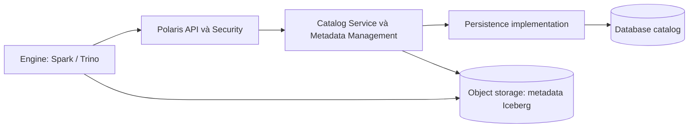
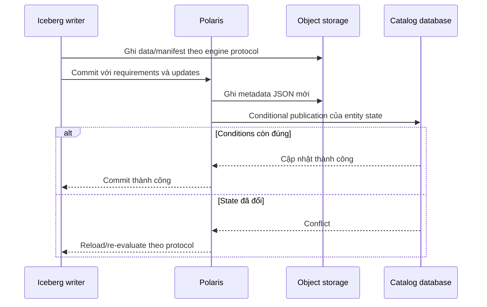

# Chương 5 — Persistence Layer: lưu trữ, tính nhất quán và khôi phục Apache Polaris

*Ngày nghiên cứu: 20/09/2026. Phạm vi: Apache Polaris 1.7.0, commit `4ac2f059d1cce149453d0a5f1ff1dff980ec97cc`. Chương này nối tiếp Metadata Management, tập trung vào quyết định triển khai và vận hành; không thay thế tài liệu quản trị database. Nội dung đã đối chiếu tài liệu chính thức và source, chưa chạy benchmark, failover hoặc restore trong lần nghiên cứu này.*

## 1. Bắt đầu từ một sự cố

Spark vừa ghi bảng `lake.sales.orders`. Object storage vẫn còn Parquet, manifest và metadata JSON, nhưng sau khi pod Polaris khởi động lại, catalog biến mất. Nếu server dùng metastore `in-memory`, đây là hành vi dự kiến: file dữ liệu tồn tại không làm database catalog tự phục hồi. [Metastore][metastores]

Persistence Layer giải quyết ba bài toán: **giữ state qua restart; bảo vệ cập nhật đồng thời; cung cấp nền tảng phục hồi**. Nó không phải nơi lưu toàn bộ dữ liệu lakehouse và cũng không làm cho mọi thao tác cloud trở thành một database transaction.

**Kết luận lựa chọn:** với phạm vi 1.7.0, lấy PostgreSQL/JDBC làm baseline production. MongoDB/NoSQL là phương án cần PoC riêng do mức hỗ trợ beta; `in-memory` chỉ dùng thử nghiệm. Đây là mức hỗ trợ của Polaris, không phải đánh giá chất lượng của PostgreSQL hay MongoDB nói chung. [Metastore][metastores]

## 2. Persistence nằm ở đâu trong hệ thống?



| Miền state | Ví dụ | Cách bảo vệ |
|---|---|---|
| Catalog và identity | Catalog, namespace, table ID, principal, role, grants | Database backup, access control, transaction/conditional write |
| Vị trí và phiên bản entity | Metadata location, `entityVersion`, `grantRecordsVersion` | Kiểm tra version và consistency của backend |
| Table format | Schema, snapshot, manifest list, manifest, delete/data files | Iceberg protocol, object storage và retention phù hợp |
| Deployment | Realm config, signing keys, database credentials, cloud identity | Quản lý cấu hình và secrets ngoài database catalog |
| Telemetry tùy tính năng bật | Events, scan/commit reports | Storage/retention riêng hoặc các bảng tương ứng trong backend |

Một bản backup database không chứa tất cả các miền trên. Ngược lại, khôi phục bucket không tự tái tạo owner, grants, principal hoặc đúng con trỏ metadata mà catalog đã công bố. [Schema JDBC][schema], [Production configuration][production]

## 3. Các backend: hỗ trợ và đánh đổi

| Backend | Cấu hình | Mức hỗ trợ trong 1.7.0 | Ý nghĩa vận hành |
|---|---|---|---|
| In-memory | `polaris.persistence.type=in-memory` | Test only | State mất khi restart; các pod không chia sẻ metastore |
| PostgreSQL/JDBC | `relational-jdbc` | Được khuyến nghị production | Cần vận hành SQL database, pool, index, backup và schema |
| MongoDB/NoSQL | `nosql`, backend `MongoDb` | Experimental/beta | Mô hình persistence khác JDBC; cần test consistency, cache và maintenance |

Source có dialect/schema cho H2 và CockroachDB; điều này **không đồng nghĩa mọi database nói JDBC đều được hỗ trợ ngang nhau**. H2 còn bị production-readiness check đánh dấu dành cho test. Báo cáo chọn PostgreSQL để nhất quán với support matrix công khai. [Metastore][metastores], [JDBC configuration source][jdbc-config], [Readiness check][jdbc-readiness]

### 3.1. JDBC lưu gì?

Schema v5 gồm các nhóm chính:

- `entities`: identity, hierarchy, version, properties và internal properties; có khóa theo realm/ID và unique constraint theo tên trong scope.
- `grant_records`, `policy_mapping_record`: quan hệ cấp quyền và gắn policy.
- `principal_authentication_data`: client ID, hash/salt của secret; không phải bản sao secret gốc để lấy lại tùy ý.
- `version`: phiên bản schema database.
- `events`, `scan_metrics_report`, `commit_metrics_report`: bảng phục vụ tính năng telemetry tương ứng; có bảng không có nghĩa listener/reporting đã được bật.

Không sửa trực tiếp `entities` để “chữa nhanh” một location hoặc grant. Việc đó có thể bỏ qua validation, version bump, cache coherence và quan hệ liên quan. SQL đọc chỉ dùng cho chẩn đoán dưới quyền hạn phù hợp; thay đổi nghiệp vụ đi qua API/admin workflow. [Schema v5][schema]

### 3.2. NoSQL khác gì về kiến trúc?

NoSQL của Polaris không đơn giản là chuyển mỗi hàng SQL thành một document. Interface dùng objects phần lớn bất biến, named references và conditional update của reference pointer; có index, cache và maintenance riêng. Một primitive cập nhật reference có tính nguyên tử không làm mọi batch hoặc toàn bộ request trở thành atomic. [NoSQL persistence contract][nosql-api]

Cần kiểm chứng replica-set configuration, read/write behavior, failover, cache invalidation và cleanup của **chính implementation Polaris**. Không chép số round trip, isolation hay quy trình sửa chữa của JDBC sang MongoDB. Tài liệu yêu cầu NoSQL maintenance định kỳ để dọn state cũ; việc này không phải dọn Parquet trên bucket. [MongoDB guide][mongodb]

## 4. Tính nhất quán: bảo đảm nằm ở đâu?

### 4.1. Database transaction không bao trùm cả request

Factory JDBC của 1.7.0 tạo `AtomicOperationMetaStoreManager`. Manager dựa vào các thao tác persistence nguyên tử, thay vì duy trì một transaction SQL mở xuyên suốt mọi bước nghiệp vụ. Ở phía JDBC, một số primitive như `writeEntities` nhóm nhiều thay đổi trong một transaction; những thao tác khác có ranh giới riêng. [Factory][factory], [Atomic manager][atomic-manager], [JDBC persistence][jdbc-impl]

Vì vậy, phải phân biệt:

1. **Atomicity của câu SQL/primitive:** database áp dụng hoặc rollback nhóm thay đổi đó.
2. **Consistency của nghiệp vụ:** manager kiểm tra state, version và quan hệ.
3. **Atomic publication của Iceberg:** catalog công bố metadata mới theo contract commit.
4. **Exactly-once pipeline:** còn phụ thuộc engine, source offset, checkpoint và retry của job.

Tên class có chữ `Atomic` không chứng minh cả bốn lớp là một transaction duy nhất. Một số composite operation của manager còn có TODO về quan hệ giữa entities/grants/secrets; cần fault test nếu workload phụ thuộc tính nguyên tử của các thao tác quản trị đó. [Atomic manager][atomic-manager]

### 4.2. Ví dụ hai writer cùng ghi

Giả sử entity của bảng đang ở version 20. A và B cùng đọc state này. Khi cập nhật entity hiện có, JDBC dùng điều kiện kiểm tra cả `entity_version` và `grant_records_version` cùng identity/realm. A cập nhật trước; điều kiện của B không còn đúng và cần đi qua xử lý conflict/retry, thay vì ghi đè im lặng. [Conditional update][jdbc-impl]

`entityVersion` là version entity Polaris, **không phải Iceberg snapshot ID**. Snapshot ID, sequence number và metadata-file location thuộc state Iceberg. Client không được tự tăng một số bất kỳ để vượt conflict.



Đây là luồng logic rút gọn cho bảng local Iceberg; chi tiết đã có ở [chương Catalog Service](<03-catalog-service-layer-apache-polaris.md>). Ghi object và commit database là hai miền riêng. File đã ghi nhưng chưa được tham chiếu có thể trở thành orphan; mất response sau DB commit tạo kết quả chưa rõ với client, không phải bằng chứng commit thất bại.

### 4.3. Retry có nhiều tầng

JDBC helper nhận diện SQLState `40001` là retryable; không được suy rằng mọi deadlock, network failure hoặc unique violation đều tự retry. Khi SQLState có giá trị khác, nhánh đó không được xử lý như `40001`. Mặc định nội bộ của `max-retries` là `1`, nhưng vòng lặp dùng nó như số lần thử tối đa, nên không nên đọc tên cấu hình thành “một lần retry thêm”. [Datasource operations][datasource]

Khuyến nghị vận hành: thu SQLState thực tế; đặt retry budget tổng cho client → HTTP → manager → JDBC; dùng backoff và giới hạn thời gian. Tăng retry không chữa được thiếu index, hết connection hoặc writer liên tục tranh cùng bảng. Không retry mù một commit mà chưa biết có được công bố hay không.

## 5. Cấu hình baseline PostgreSQL

Ví dụ `application.properties` sau minh họa đúng nhóm key; hostname, CA và secret phải do môi trường cung cấp:

```properties
polaris.persistence.type=relational-jdbc
quarkus.datasource.db-kind=postgresql
quarkus.datasource.jdbc.url=jdbc:postgresql://db.internal:5432/polaris?sslmode=verify-full
quarkus.datasource.username=${POLARIS_DB_USER}
quarkus.datasource.password=${POLARIS_DB_PASSWORD}

# Gia tri khoi dau de PoC, khong phai sizing chuan cho moi workload
quarkus.datasource.jdbc.min-size=2
quarkus.datasource.jdbc.max-size=20
quarkus.datasource.jdbc.acquisition-timeout=10S
```

`verify-full` cần trust/CA và hostname khớp certificate. Các tên key username/password/URL ở trên bám cấu hình Quarkus và ví dụ bootstrap/Helm. Trang JDBC có một đoạn properties dùng tên key khác; không chép chúng mà bỏ qua cấu hình thực được runtime nhận. [JDBC guide tại tag][jdbc-guide], [Helm persistence][helm-persistence], [Quarkus datasource][quarkus-datasource], [PostgreSQL JDBC TLS][pgjdbc-tls]

Trình tự triển khai:

1. Tạo database và đường kết nối TLS; chuẩn bị account bootstrap/migration có quyền cần thiết.
2. Bootstrap realm bằng **admin tool cùng phiên bản server**, trỏ đúng database.
3. Cất root credentials trong secret store; không in chúng vào CI logs hoặc commit vào Git.
4. Chạy server với realm allowlist, signing keys và database config nhất quán.
5. Tạo catalog/namespace/bảng thử, restart server, rồi kiểm tra identity và dữ liệu vẫn đúng.

Bootstrap có thể được gọi lại theo hành vi idempotent được tài liệu mô tả; **nó không phải công cụ reset secret hay trình tự upgrade schema tự động**. Dùng `bootstrap --help` của artifact ghim version để chọn input file/secret phù hợp, không dùng credentials mẫu `admin/admin`. [Admin tool][admin]

## 6. Schema migration và upgrade database

### 6.1. Ba version cần ghi riêng

| Version | Ví dụ | Không được nhầm với |
|---|---|---|
| Server | Polaris `1.7.0` | Schema database |
| Persistence schema | `polaris_schema.version`, schema v5 | Version của từng entity |
| Table format/features | Iceberg format version, snapshot | Server release hoặc DB schema |

Tài liệu và source 1.7.0 mô tả bootstrap bằng full schema script; **không có automated schema migration tổng quát**. Schema v5 làm `events.catalog_id` nullable, và có hướng dẫn riêng cho đường v3/v4 → v5. Không dùng một script dành cho đường đó để nâng mọi database cũ. [Schema upgrades][jdbc-guide], [Bootstrap source][bootstrap]

Kiểm tra đọc trước khi lập kế hoạch:

```sql
SELECT version_key, version_value
FROM polaris_schema.version;

SELECT table_name
FROM information_schema.tables
WHERE table_schema = 'polaris_schema'
ORDER BY table_name;
```

Không chạy lại `schema-v5.sql` lên database đang có dữ liệu như một phép migration: `CREATE TABLE IF NOT EXISTS` không tự biến cấu trúc bảng cũ thành cấu trúc mới, trong khi script có thể cập nhật version record. [Full schema script][schema]

### 6.2. Quy trình upgrade đề xuất

1. Chụp inventory server/schema/config/features, kiểm tra release notes và migration path.
2. Backup; restore ra môi trường cô lập để chứng minh bản backup dùng được.
3. Chạy migration cần thiết trên bản sao; kiểm tra constraints, query và quyền.
4. Test server cũ/mới với schema đích nếu dự định rolling upgrade.
5. Lên maintenance window khi chưa chứng minh được mixed-version compatibility; hạn chế writers theo kế hoạch.
6. Áp migration có phê duyệt, nâng server và restart theo yêu cầu của thay đổi.
7. Chạy smoke test và kiểm tra lỗi/latency trước khi mở lại toàn bộ workload.

Factory JDBC cache schema version theo realm. Hướng dẫn v5 yêu cầu restart, nên “DDL đã chạy xong” chưa đủ để kết luận mọi process đã dùng cùng cách xử lý schema. [Factory][factory], [Schema upgrades][jdbc-guide]

**Rollback image không rollback database.** Chỉ rollback binary khi schema còn tương thích. Khôi phục DB cũ sau khi đã có writes mới có thể làm mất publication và quyền mới; phải có cutover boundary và quy trình đối soát.

Đổi JDBC sang NoSQL là migration persistence, không phải rolling upgrade thông thường. Chính sách tiến hóa Polaris nói cần dự kiến downtime khi đổi loại persistence. [Evolution][evolution]

## 7. Hiệu năng và sizing

Số request catalog không bằng số row được engine xử lý. Những workload đáng đo gồm burst khởi động Spark jobs, nhiều lần load/refresh, listing lớn, grants dày, nhiều writer cùng bảng và telemetry ghi vào cùng DB.

### 7.1. Connection budget

Ước lượng bảo thủ cho một datasource mỗi pod:

```text
Connection budget >=
  (so pod toi da + pod surge khi rollout) × pool max-size
  + admin/maintenance/monitoring connections
  + phan du phong
```

Ví dụ giả định 4 pod thường trực, rollout thêm 1 pod, pool tối đa 20 → riêng server có thể cần tới 100 connections. Đây là phép tính capacity, **không phải số đo hay sizing được Polaris chứng nhận**. HPA có thể làm DB hết connection dù CPU từng pod thấp.

### 7.2. Thứ tự tối ưu

| Triệu chứng | Đo trước | Hướng xử lý |
|---|---|---|
| Chờ connection | Pool active/pending, DB connections | Giới hạn concurrency, xem query giữ connection lâu; không tăng pool ngay |
| DB CPU/I/O tăng | Slow queries, plans, index use, table growth | Tối ưu theo workload; kiểm tra chi phí events/reports |
| Conflict tập trung một bảng | Writer concurrency, commit retry rate | Điều tiết writers, kiểm tra batch/commit cadence |
| Latency tăng sau deploy | Cache warm-up, pool setup, JVM/GC, config diff | So sánh cùng workload và cùng percentile |
| Listing chậm | Quy mô entity, pagination, predicate/index | Đo query plan trên môi trường phù hợp |

Không tắt version validation hoặc tự chuyển catalog reads sang read replica trễ chỉ để giảm latency. Cache phải phục vụ correctness của catalog và authorization, không chỉ tăng hit rate. Chương 4 đã mô tả entity cache; ở đây cần đo chi phí xác minh version và test grant/revoke giữa replicas. [Factory/cache wiring][factory]

## 8. Backup và phục hồi

### 8.1. Recovery set

Giữ phối hợp: **database + các object được tham chiếu + deployment/secrets/identity configuration**. Với PostgreSQL, physical backup và WAL archive là cơ sở cho PITR nếu được vận hành đầy đủ; khả năng restore phải được thử, không chỉ dựa vào trạng thái backup job. [PostgreSQL PITR][pitr]

RPO là mức dữ liệu/state có thể mất theo thời gian; RTO là thời gian cần để dịch vụ dùng lại được. RPO database, object storage và secret store có thể khác nhau. Không thể lấy con số thấp nhất làm RPO chung của lakehouse.

### 8.2. Quy trình restore đề xuất

1. Chặn writers và các job cleanup của hệ thống bị sự cố theo runbook; bảo toàn bằng chứng.
2. Chọn mốc phục hồi, xác định commits sau mốc đó có thể mất.
3. Restore database vào endpoint cô lập; triển khai đúng server/schema/config tương thích.
4. Đối soát catalog/table identity và metadata locations; bảo đảm metadata → manifest → data/delete files còn truy cập được.
5. Khôi phục secret references, keys, IAM/IdP mapping; kiểm tra cả allow và deny.
6. Dùng identity read-only để kiểm tra snapshot, row count và tổng kiểm nghiệp vụ.
7. Trước cutover, xác nhận chỉ một deployment được quyền nhận writes; sau đó mở writers từng nhóm.

DB phục hồi về hôm qua có thể trỏ tới snapshot mà cleanup hôm nay đã xóa. Vì thế retention của files phải tương thích recovery window; snapshot history của Iceberg không thay database backup. Không tự chọn metadata JSON có timestamp lớn nhất để “đoán” commit đã được công bố.

## 9. Failure matrix cho người vận hành

| Sự cố | Rủi ro | Hành động an toàn đầu tiên |
|---|---|---|
| Pod restart, state mất | Đang dùng in-memory hoặc sai DB endpoint | Kiểm tra effective config; không bootstrap lại để che sự cố |
| DB failover | Request đang bay có kết quả chưa rõ | Theo dõi reconnect; reconcile writes theo protocol |
| Unique/CAS conflict | Có thao tác cạnh tranh | Giữ log identity/version; reload thay vì sửa SQL trực tiếp |
| Migration lỗi giữa chừng | Schema/state không đồng nhất | Dừng rollout; đánh giá transaction/migration đã áp dụng, dùng phương án restore đã thử |
| Pool exhaustion | Hàng đợi request và retry khuếch đại | Giảm tải có kiểm soát; kiểm tra DB saturation trước scale pod |
| Database sống nhưng metadata file thiếu | Recovery set không đầy đủ hoặc cleanup sai | Tạm dừng ghi/cleanup liên quan; phục hồi object đúng reference |
| Grant/revoke thấy khác giữa replicas | Cache/config/state cần kiểm tra | Test trực tiếp từng replica; giữ deny-by-default cho đường rủi ro |

## 10. Có thể cấu hình, tối ưu, mở rộng hoặc thay thế gì?

| Mức thay đổi | Ví dụ | Điều kiện trước khi áp dụng |
|---|---|---|
| Cấu hình | Datasource, TLS, pool, retry | Có connection budget và timeout budget |
| Tối ưu | Index theo query, pool/concurrency, retention telemetry | Có baseline và phép đo trước/sau |
| Mở rộng | Backend/persistence implementation tùy biến | Chứng minh unique identity, conditional writes, atomicity và cache semantics |
| Thay thế | PostgreSQL deployment khác; JDBC → NoSQL | Phân biệt đổi DB endpoint với đổi persistence model; có migration/rollback |

Java SPI là điểm mở rộng, **không phải cam kết tương thích binary lâu dài**. Polaris nêu Java classes có thể thay đổi giữa releases; custom implementation cần ghim version và regression tests. [Evolution][evolution]

## 11. Checklist review và nghiệm thu

- [ ] Backend và mức hỗ trợ đã được ghi rõ; restart không làm mất catalog.
- [ ] Bootstrap/migration account, runtime account và quyền DB đã được thiết kế.
- [ ] Biết server version, schema version, table-format version khác nhau thế nào.
- [ ] Hai writer không làm mất update; client xử lý đúng unknown outcome.
- [ ] Tổng connections khi HPA/rollout nằm trong ngân sách DB.
- [ ] Failover, timeout và cache/grant consistency được kiểm thử.
- [ ] Backup đã restore thành công; kiểm tra được cả references lẫn files.
- [ ] Rollback có xét writes mới và schema, không chỉ đổi image.

**Ba câu hỏi tự kiểm tra:** Vì sao có Parquet vẫn có thể mất catalog? Vì sao transaction SQL không bao hết commit lakehouse? Vì sao tăng replica có thể làm hệ thống chậm hơn? Nếu trả lời được bằng state, transaction boundary và connection budget ở trên, bạn đã nắm phần cốt lõi của Persistence Layer.

## Nguồn và phạm vi kiểm chứng

Nguồn source/docs trong repository được ghim tại commit release; thư mục có tên `in-dev/unreleased` là đường dẫn tài liệu **bên trong checkout 1.7.0**, không phải lấy hành vi từ nhánh `main` hiện tại. Quy trình sizing/DR ở chương này là khuyến nghị thiết kế; checklist chưa được đánh dấu thành kết quả test.

[metastores]: https://polaris.apache.org/releases/1.7.0/metastores/
[schema]: https://github.com/apache/polaris/blob/4ac2f059d1cce149453d0a5f1ff1dff980ec97cc/persistence/relational-jdbc/src/main/resources/postgres/schema-v5.sql
[jdbc-config]: https://github.com/apache/polaris/blob/4ac2f059d1cce149453d0a5f1ff1dff980ec97cc/persistence/relational-jdbc/src/main/java/org/apache/polaris/persistence/relational/jdbc/RelationalJdbcConfiguration.java
[jdbc-readiness]: https://github.com/apache/polaris/blob/4ac2f059d1cce149453d0a5f1ff1dff980ec97cc/persistence/relational-jdbc/src/main/java/org/apache/polaris/persistence/relational/jdbc/RelationalJdbcProductionReadinessChecks.java
[factory]: https://github.com/apache/polaris/blob/4ac2f059d1cce149453d0a5f1ff1dff980ec97cc/persistence/relational-jdbc/src/main/java/org/apache/polaris/persistence/relational/jdbc/JdbcMetaStoreManagerFactory.java
[atomic-manager]: https://github.com/apache/polaris/blob/4ac2f059d1cce149453d0a5f1ff1dff980ec97cc/polaris-core/src/main/java/org/apache/polaris/core/persistence/AtomicOperationMetaStoreManager.java
[jdbc-impl]: https://github.com/apache/polaris/blob/4ac2f059d1cce149453d0a5f1ff1dff980ec97cc/persistence/relational-jdbc/src/main/java/org/apache/polaris/persistence/relational/jdbc/JdbcBasePersistenceImpl.java
[datasource]: https://github.com/apache/polaris/blob/4ac2f059d1cce149453d0a5f1ff1dff980ec97cc/persistence/relational-jdbc/src/main/java/org/apache/polaris/persistence/relational/jdbc/DatasourceOperations.java
[jdbc-guide]: https://github.com/apache/polaris/blob/4ac2f059d1cce149453d0a5f1ff1dff980ec97cc/site/content/in-dev/unreleased/metastores/relational-jdbc.md
[nosql-api]: https://github.com/apache/polaris/blob/4ac2f059d1cce149453d0a5f1ff1dff980ec97cc/persistence/nosql/persistence/api/src/main/java/org/apache/polaris/persistence/nosql/api/Persistence.java
[mongodb]: https://github.com/apache/polaris/blob/4ac2f059d1cce149453d0a5f1ff1dff980ec97cc/site/content/in-dev/unreleased/metastores/nosql-mongodb.md
[helm-persistence]: https://github.com/apache/polaris/blob/4ac2f059d1cce149453d0a5f1ff1dff980ec97cc/site/content/in-dev/unreleased/helm-chart/persistence.md
[production]: https://github.com/apache/polaris/blob/4ac2f059d1cce149453d0a5f1ff1dff980ec97cc/site/content/in-dev/unreleased/configuration/configuring-polaris-for-production/_index.md
[bootstrap]: https://github.com/apache/polaris/blob/4ac2f059d1cce149453d0a5f1ff1dff980ec97cc/persistence/relational-jdbc/src/main/java/org/apache/polaris/persistence/relational/jdbc/JdbcBootstrapUtils.java
[admin]: https://github.com/apache/polaris/blob/4ac2f059d1cce149453d0a5f1ff1dff980ec97cc/site/content/in-dev/unreleased/admin-tool.md
[evolution]: https://github.com/apache/polaris/blob/4ac2f059d1cce149453d0a5f1ff1dff980ec97cc/site/content/in-dev/unreleased/evolution.md
[quarkus-datasource]: https://quarkus.io/guides/datasource
[pgjdbc-tls]: https://jdbc.postgresql.org/documentation/ssl/
[pitr]: https://www.postgresql.org/docs/18/continuous-archiving.html
