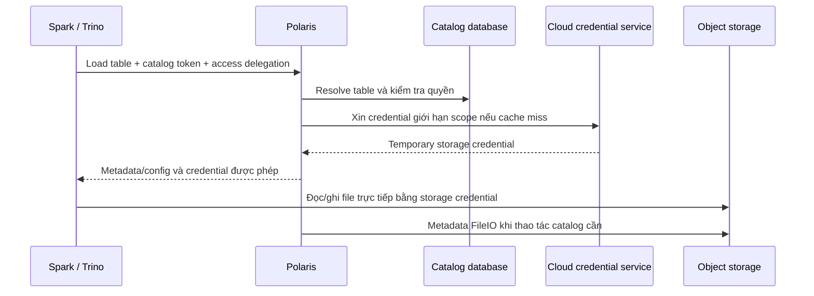

# Chương 6 — Storage Integration: cloud storage, credentials và ranh giới bảo mật

*Ngày nghiên cứu: 20/09/2026. Phạm vi: Apache Polaris 1.7.0, commit `4ac2f059d1cce149453d0a5f1ff1dff980ec97cc`. Chương này tiếp nối Security Layer và Persistence Layer; đi sâu vào đường truy cập file, không lặp lại toàn bộ mô hình RBAC. Các cấu hình là ví dụ để review/PoC, chưa được triển khai trong lần nghiên cứu này.*

## 1. Bắt đầu từ một lỗi dễ hiểu nhầm

Trino load được bảng `sales.orders` từ Polaris nhưng đọc Parquet bị `403`. Điều đó không mâu thuẫn: **được phép truy cập catalog chưa chắc được phép truy cập object storage**. Request thứ nhất được Polaris kiểm soát; request đọc file còn chịu IAM, credential, encryption policy và mạng của storage.

Storage Integration nối hai miền quyền này: Polaris xác định vị trí và thao tác được phép, sau đó sử dụng cơ chế cloud để cấp quyền truy cập phù hợp. Dữ liệu không nhất thiết đi xuyên qua server Polaris. [Vended credentials][vending]

Ví dụ xuyên suốt chương: một catalog Polaris tên `warehouse_s3`; Spark đăng ký nó dưới alias `lake` và ghi `lake.sales.orders`; Trino đăng ký cùng catalog để đọc. **Alias engine, tên catalog Polaris và URI bucket là ba khái niệm khác nhau.**

## 2. Control plane và data plane



Đây là luồng rút gọn cho catalog local và client hỗ trợ credential vending. Nó có hai đường mạng độc lập: Polaris → storage và engine → storage. Server truy cập được bucket không chứng minh executor Spark cũng truy cập được.

### 2.1. Bốn loại identity/credential

| Thành phần | Dùng để làm gì? | Không thay thế được |
|---|---|---|
| Principal và token catalog của engine | Xác thực với Polaris; chọn principal roles | IAM của cloud |
| Cloud identity của server | Polaris gọi cloud API, assume/impersonate hoặc lấy delegation key | Quyền nghiệp vụ của người dùng trong catalog |
| Temporary storage credential cấp cho engine | Đọc/ghi các tài nguyên được cấp trong thời hạn cụ thể | Token đăng nhập Polaris |
| Credential database của Polaris | Truy cập persistence backend | Quyền đọc Parquet/metadata trên bucket |

Hai token có thể hết hạn vào hai thời điểm khác nhau. Đổi secret của principal không đồng nghĩa mọi storage credential đã phát hành đều biến mất; restart pod cũng không thu hồi các token đang nằm trong engine.

### 2.2. Ai chịu trách nhiệm gì?

Polaris chịu trách nhiệm catalog authorization, location validation và tạo storage access config. Cloud chịu trách nhiệm thực thi quyền khi nhận request file. Engine chịu trách nhiệm dùng đúng FileIO, truyền và refresh credentials. Đội platform chịu trách nhiệm IAM, networking, TLS, secrets và cấu hình nhất quán giữa các bên.

Không mặc định credential vending là cơ chế row filtering hoặc column masking. Khi một credential cho phép đọc nguyên file, bảo vệ từng hàng/cột cần cơ chế enforcement bổ sung phù hợp với engine và kiến trúc dữ liệu.

## 3. Location là một phần của mô hình bảo mật

| Thuộc tính | Vai trò | Hiểu nhầm cần tránh |
|---|---|---|
| `default-base-location` | Vị trí gốc mặc định để tạo dữ liệu trong catalog | Không tự tạo bucket hay cấp IAM |
| `allowedLocations` | Giới hạn các vùng storage được cấu hình cho catalog | Không phải policy được cloud tự nhận từ Polaris |
| Table location | Thư mục/tập đường dẫn của bảng | Không nên chồng lấn tùy tiện giữa các bảng |
| Metadata location | Con trỏ đến metadata JSON của bảng | Không đại diện toàn bộ data files và không phải credential |

Thiết kế đề xuất: tách prefix theo môi trường và catalog, ví dụ `s3://example-lake-prod/warehouse/`; cấp IAM tương ứng và kiểm tra cả đường dẫn do client đề xuất. Location validation và IAM phải bổ trợ nhau: chỉ có một trong hai không đủ chống đọc/ghi ngoài phạm vi dự kiến. [Production configuration][production], [Management API schema][management-spec]

Các feature như `ALLOW_UNSTRUCTURED_TABLE_LOCATION`, `ALLOW_EXTERNAL_METADATA_FILE_LOCATION` và `ALLOW_TABLE_LOCATION_OVERLAP` nới quy tắc location. Chỉ bật khi có use case rõ, ownership rõ và negative tests. Không coi bật toàn bộ feature là cách tăng interoperability miễn phí. Không bật loại storage `FILE` trong môi trường cloud production chỉ để vượt lỗi cấu hình. [Production configuration][production]

## 4. AWS S3: hiểu chuỗi quyền trước khi cấu hình

### 4.1. Chuỗi cấp quyền

```text
Cloud identity của Polaris
  → STS AssumeRole vào role của catalog
  → session policy giới hạn locations/operations
  → temporary access key + secret key + session token
  → engine gọi S3/KMS
```

Các điều kiện cần khớp: identity gọi được STS; role trust policy chấp nhận đúng principal và `externalId` nếu sử dụng; IAM role có quyền S3/KMS cần thiết; resource policy và network policy không từ chối request. Session policy giới hạn quyền phiên, không tự cấp quyền vượt IAM role. [AWS integration source][aws-source], [AWS AssumeRole][aws-sts]

Ưu tiên identity của workload thay vì lưu access key dài hạn trong image hoặc notebook. Nếu tổ chức buộc dùng secret, cấp qua secret manager và có rotation; không đưa secret vào URL, Git hay báo cáo.

### 4.2. Ví dụ cấu hình catalog

Body dưới đây dùng cho `POST /api/management/v1/catalogs`, sau khi bootstrap, xác thực admin và chọn realm đúng. Account, bucket, role và external ID là **placeholder**, phải thay bằng tài nguyên đã được phê duyệt. Đây không phải lệnh đã chạy:

```json
{
  "catalog": {
    "name": "warehouse_s3",
    "type": "INTERNAL",
    "properties": {
      "default-base-location": "s3://example-lake-prod/warehouse/"
    },
    "storageConfigInfo": {
      "storageType": "S3",
      "roleArn": "arn:aws:iam::123456789012:role/polaris-warehouse-access",
      "externalId": "replace-with-deployment-specific-external-id",
      "region": "us-east-1",
      "allowedLocations": ["s3://example-lake-prod/warehouse/"]
    }
  }
}
```

API path ở trên theo OpenAPI 1.7.0. Một số ví dụ prose trong cloud guide thiếu tiền tố `/api`; khi triển khai cần đối chiếu OpenAPI và ingress routing thực tế, không sửa server để khớp ví dụ thiếu prefix. [Management API schema][management-spec], [AWS guide][aws-guide]

### 4.3. Encryption và KMS

SSE-KMS thêm một miền quyền ngoài S3. `currentKmsKey` chọn key cho writes; `allowedKmsKeys` liệt kê keys cần đọc. Hai trường được xử lý riêng: muốn đọc dữ liệu vừa ghi thì write key cũng cần nằm trong tập read keys thích hợp. IAM và key policy vẫn phải cho phép các thao tác tương ứng. [AWS guide][aws-guide], [AWS implementation][aws-source]

Khi rotate key, không gỡ key cũ chỉ vì writes mới đã dùng key mới. Snapshot cũ, backup và files chưa rewrite có thể vẫn phụ thuộc key cũ. Đây là yêu cầu phối hợp retention và key lifecycle, không chỉ đổi một thuộc tính catalog.

### 4.4. S3-compatible không đồng nghĩa STS-compatible

| Cấu hình | Ý nghĩa |
|---|---|
| `endpoint` | Endpoint storage để cung cấp cho client và sử dụng theo cấu hình |
| `endpointInternal` | Endpoint riêng phía server khi khác đường truy cập của client |
| `pathStyleAccess` | Cách định địa chỉ phù hợp backend |
| `stsEndpoint` | Điểm cấp temporary credentials |
| `stsUnavailable` | Backend không cung cấp cơ chế STS cần thiết |

Với backend không có STS, tài liệu hướng dẫn bỏ yêu cầu `vended-credentials` và để client xác thực storage trực tiếp. Trường hợp đó **không còn cùng bảo đảm cấp quyền theo bảng qua vending**; phải thiết kế IAM/credential của engine và chấp nhận ranh giới kiểm soát khác. Test cả API S3 lẫn STS, policy downscoping, TLS và access từ executors, không chỉ thử `ListBuckets`. [S3-compatible guide][aws-guide]

## 5. Azure và GCS: cùng mục tiêu, khác cơ chế

| Khía cạnh | AWS S3 | Azure Blob/ADLS | Google Cloud Storage |
|---|---|---|---|
| Cơ chế chính của integration | STS AssumeRole + session policy | User delegation SAS | Downscoped credentials + Credential Access Boundary |
| Credential engine nhận | Access key, secret, session token | SAS token và thông tin account | OAuth access token và expiry |
| Điểm cần PoC | Trust, KMS, bucket/prefix policy | HNS, scope directory/container, FileIO hỗ trợ SAS | IAM, access boundary, impersonation nếu bật |
| Không được suy luận | S3-compatible đều có STS | Mọi Blob account đều có scope tới directory | GCS HNS có cùng ACL model với ADLS |

Các cơ chế trên được xác nhận trong implementations tại tag 1.7.0; không phải tuyên bố mọi engine/version đều hỗ trợ tương đương. [AWS][aws-source], [Azure][azure-source], [GCS][gcs-source]

### 5.1. Azure: chú ý phạm vi thực của SAS

Polaris dùng Azure credential chain để truy cập dịch vụ và tạo **user delegation SAS**, thay vì buộc phát account key cho engine. Cloud identity cần quyền lấy delegation key và quyền dữ liệu tương ứng. SAS giới hạn thao tác, phạm vi và thời hạn; phải bảo vệ token như secret. [Azure source][azure-source], [Microsoft SAS overview][azure-sas]

Với hierarchical namespace được cấu hình đúng, implementation có nhánh tạo SAS cho directory. Với nhánh Blob không HNS, scope có thể ở mức container, rộng hơn một table directory. Code cũng kiểm tra account/container và có giới hạn số location ở nhánh hierarchical. Vì vậy, phải kiểm tra “credential của bảng A có đọc được file bảng B không”, không chỉ nhìn tên bảng trong response. [Azure source][azure-source]

URI ADLS thường có dạng `abfss://container@account.dfs.core.windows.net/path`. Phiên bản Iceberg/FileIO của client phải hiểu credential properties do Polaris trả về; cài đúng thư viện ở cả driver và executors. Dùng được OAuth với Polaris không chứng minh dùng được SAS với ADLS. [Azure guide][azure-guide]

### 5.2. GCS: IAM và Credential Access Boundary

Implementation lấy source credentials, có nhánh service-account impersonation, sau đó xây dựng Credential Access Boundary theo locations và operations để tạo downscoped token. Token này không tạo thêm quyền vượt source identity. Engine phải dùng GCS FileIO tương thích và xử lý expiry. [GCS source][gcs-source], [Google downscoping][gcs-cab]

**Điểm cần sửa khi đọc tài liệu:** cloud guide ngắn của Polaris có nhắc “HNS ACLs” cho GCS. Tài liệu Google xác định HNS yêu cầu uniform bucket-level access và không hỗ trợ object ACLs; quyền folder được quản lý qua IAM trên managed folders liên quan. Vì thế không bê mô hình ACL của Azure sang GCS; thiết kế theo IAM/CAB và kiểm tra scope thực tế. [Polaris GCS guide][gcs-guide], [Google HNS][gcs-hns]

## 6. Credential lifetime, cache và thu hồi quyền

### 6.1. Các mốc thời gian cần phân biệt

| Cơ chế | Ý nghĩa trong 1.7.0 | Việc cần kiểm tra |
|---|---|---|
| Catalog access-token lifetime | Thời hạn gọi API Polaris | Cơ chế refresh của client/IdP |
| `STORAGE_CREDENTIAL_DURATION_SECONDS` | Giá trị yêu cầu mặc định 3.600 giây; còn bị provider giới hạn; **GCS không áp dụng giá trị này** | Expiry thực trong credential, không chỉ giá trị config |
| `STORAGE_CREDENTIAL_CACHE_DURATION_SECONDS` | Mặc định 1.800 giây; phải nhỏ hơn giá trị trên | Đừng nhầm cache TTL với token lifetime |
| Expiry của cache entry | Không quá nửa thời gian credential còn hiệu lực, đồng thời bị chặn bởi cache duration | Hit/miss, tải lên dịch vụ cấp credential |

[Feature configuration][features], [Credential cache implementation][credential-cache]

Cache này ở từng process; một lần load table có thể dùng credential đã cache, không nhất thiết gọi STS/delegation API mới. Tăng replica có thể tăng cache misses và tải cấp credential. Tăng lifetime giảm tần suất refresh nhưng kéo dài thời gian credential bị lộ còn có thể dùng; giảm quá mạnh gây refresh churn và dễ lộ lỗi client chạy lâu.

### 6.2. Revoke grant không đồng nghĩa revoke file access tức thì

Sau khi thu hồi quyền trong Polaris, request xin quyền mới phải bị kiểm tra theo state hiện hành. Nhưng engine đã giữ storage credential có thể tiếp tục truy cập cho đến khi cloud không còn chấp nhận credential đó. Thời điểm này phụ thuộc expiry, cloud policy và cơ chế thu hồi của provider — không chỉ catalog token TTL.

Runbook khi lộ credential phải xử lý cả hai miền: ngừng cấp quyền mới trong catalog và đánh giá biện pháp chặn ở cloud. Không giả định restart tất cả pod Polaris sẽ vô hiệu hóa token đang được dùng ở nơi khác. Đây là hệ quả kiến trúc của direct storage access, cần đo bằng revoke tests trong PoC.

## 7. Tích hợp engine: cần kiểm chứng những gì?

| Thành phần cấu hình | Giá trị/ý nghĩa cho ví dụ |
|---|---|
| REST catalog URI | `https://<polaris-host>/api/catalog` |
| Warehouse | `warehouse_s3`: tên catalog Polaris, không phải URI bucket |
| Authentication | Internal OAuth hoặc IdP theo deployment; secret lấy từ cơ chế quản lý của engine |
| Realm | Header realm đúng nếu server bắt buộc; ví dụ `Polaris-Realm: POLARIS` |
| Access delegation | `X-Iceberg-Access-Delegation: vended-credentials` khi cả storage và client hỗ trợ |
| FileIO/runtime | Đúng bản Iceberg connector, cloud library, Spark/Scala hoặc Trino tương ứng |
| Refresh | Catalog token và storage credentials đều phải refresh được khi job chạy lâu |

Không chép nguyên cấu hình OAuth internal vào deployment dùng external IdP. Không tắt token refresh chỉ vì một ví dụ quickstart dùng job ngắn. Các property cụ thể khác nhau giữa engines; ghi **version matrix đã test** trong hồ sơ triển khai. [AWS client guide][aws-guide], [Azure client guide][azure-guide], [Vending][vending]

Đừng nhầm `vended-credentials` với `remote-signing`: code `resolveAccessDelegationModes` ở Polaris 1.7.0 từ chối remote signing. Một chế độ có tên trong Iceberg protocol chưa chắc server này đã hỗ trợ. [Catalog handler][handler]

Smoke test dữ liệu có thể dùng bảng nhỏ, không đụng dữ liệu thật:

```sql
-- Spark: lake la alias engine cua catalog Polaris warehouse_s3
CREATE NAMESPACE IF NOT EXISTS lake.sales;
CREATE TABLE lake.sales.orders (order_id BIGINT, amount DECIMAL(12,2)) USING iceberg;
INSERT INTO lake.sales.orders VALUES (1, 100.00), (2, 250.00);
SELECT COUNT(*), SUM(amount) FROM lake.sales.orders;
```

Sau đó dùng Trino đã cấu hình cùng catalog, với alias riêng của Trino, kiểm tra kết quả kỳ vọng `2` và `350.00`. Đây mới là kiểm tra happy path. Cần thêm refresh, grant/revoke, truy cập ngoài prefix và concurrent writes trước khi kết luận tích hợp hoàn chỉnh.

## 8. Quản lý secrets: một điểm cần chú ý trong production

Không gộp tất cả secrets thành một loại. Signing keys, database password, cloud identity và secret mà ứng dụng lưu qua `UserSecretsManager` có vòng đời và backend khác nhau.

Runtime 1.7.0 mặc định `polaris.secrets-manager.type=in-memory`; implementation `UnsafeInMemorySecretsManager` ghi rõ dành cho test/development. Nếu workflow, chẳng hạn một integration/federation, cần lưu secret qua interface này thì **chọn PostgreSQL cho metastore không tự làm secret store trở nên bền vững hoặc an toàn**. Cần xác định implementation thực được đóng gói, thử restart/multi-replica và có giải pháp production được kiểm chứng. Không mặc định đã có built-in Vault chỉ vì có SPI. [Runtime defaults][defaults], [Secrets implementation][secrets]

Secret do Kubernetes/secret manager cấp vào cloud SDK là vấn đề riêng với secret được Polaris lưu qua interface trên. Khi thay hoặc mở rộng implementation, phải test mã hóa, IAM, rotation, failover và upgrade compatibility; không chỉ thay tên config.

## 9. Troubleshooting và security acceptance tests

| Triệu chứng | Kiểm tra theo thứ tự |
|---|---|
| Polaris trả `401` | Token expiry, issuer/audience, auth mode, realm, clock; không bắt đầu bằng sửa IAM bucket |
| Polaris trả `403` | Principal roles, catalog roles, grants và phạm vi object |
| Load table thành công nhưng file `403` | Credential engine đang dùng, scope, IAM/resource policy, KMS, endpoint restriction |
| Credential vending lỗi | Identity server, trust/impersonation/delegation permissions, quota và mạng tới provider |
| Chạy được vài phút rồi lỗi | Expiry thực, refresh support, clock skew, đường mạng tới token endpoint |
| Server đọc được, executor không đọc được | DNS/TLS/proxy, external endpoint, FileIO dependencies và identity executor |
| Revoke nhưng vẫn đọc file được | Credential cũ còn hiệu lực hoặc engine dùng ambient IAM rộng hơn |

Checklist tối thiểu cho mỗi cặp engine–cloud:

- [ ] Reader đọc được bảng cho phép nhưng không ghi/xóa được.
- [ ] Credential của bảng/prefix A không truy cập được B ngoài phạm vi thiết kế.
- [ ] Không có static/ambient engine credential rộng làm phép thử “thành công giả”.
- [ ] Job chạy qua ít nhất một chu kỳ token expiry vẫn hoạt động đúng.
- [ ] Đo được khác biệt giữa revoke tại catalog và thu hồi access tại cloud.
- [ ] Test encrypted files và snapshot dùng key cũ sau rotation.
- [ ] Logs không chứa bearer token, SAS, secret key hoặc toàn bộ load-table response có credential.

## 10. Cấu hình, tối ưu, mở rộng và thay thế

| Mức can thiệp | Ví dụ | Điều kiện chấp nhận |
|---|---|---|
| Cấu hình | Locations, role, endpoint, KMS, cloud identity | Allow/deny tests đúng trên server lẫn engine |
| Tối ưu | Cache/lifetime, reuse clients, network locality | Không mở rộng scope; đo refresh failure và quota |
| Mở rộng | Storage integration hoặc secret-store implementation | Contract tests, threat review, restart/HA tests |
| Thay thế | Cloud provider, S3-compatible backend, cách phân phối credential | Xem như thay security boundary; không chỉ đổi URI |

**Ba câu hỏi tự kiểm tra:** Vì sao `SELECT` bị 403 dù load table thành công? Vì sao revoke trong catalog chưa chắc chặn file access ngay? Vì sao một hệ thống S3-compatible có thể cần kiến trúc quyền khác AWS S3? Câu trả lời nằm ở hai miền authorization, lifetime và khả năng cấp credential thực tế.

## Nguồn và phạm vi kiểm chứng

Source và tài liệu Polaris dưới đây được ghim cùng commit 1.7.0. Các khuyến nghị security tests, rotation và thiết kế prefix là đề xuất vận hành; không phải chứng nhận kết quả kiểm thử. Tài liệu cloud mô tả cơ chế provider, không tự chứng minh support của mọi connector.

[vending]: https://github.com/apache/polaris/blob/4ac2f059d1cce149453d0a5f1ff1dff980ec97cc/site/content/in-dev/unreleased/vended-credentials.md
[production]: https://github.com/apache/polaris/blob/4ac2f059d1cce149453d0a5f1ff1dff980ec97cc/site/content/in-dev/unreleased/configuration/configuring-polaris-for-production/_index.md
[management-spec]: https://github.com/apache/polaris/blob/4ac2f059d1cce149453d0a5f1ff1dff980ec97cc/spec/polaris-management-service.yml
[aws-guide]: https://github.com/apache/polaris/blob/4ac2f059d1cce149453d0a5f1ff1dff980ec97cc/site/content/in-dev/unreleased/configuration/configuring-polaris-for-production/configuring-aws-s3-cloud-storage-specific.md
[azure-guide]: https://github.com/apache/polaris/blob/4ac2f059d1cce149453d0a5f1ff1dff980ec97cc/site/content/in-dev/unreleased/configuration/configuring-polaris-for-production/configuring-azure-blob-cloud-storage-specific.md
[gcs-guide]: https://github.com/apache/polaris/blob/4ac2f059d1cce149453d0a5f1ff1dff980ec97cc/site/content/in-dev/unreleased/configuration/configuring-polaris-for-production/configuring-gcs-cloud-storage-specific.md
[aws-source]: https://github.com/apache/polaris/blob/4ac2f059d1cce149453d0a5f1ff1dff980ec97cc/polaris-core/src/main/java/org/apache/polaris/core/storage/aws/AwsCredentialsStorageIntegration.java
[azure-source]: https://github.com/apache/polaris/blob/4ac2f059d1cce149453d0a5f1ff1dff980ec97cc/polaris-core/src/main/java/org/apache/polaris/core/storage/azure/AzureCredentialsStorageIntegration.java
[gcs-source]: https://github.com/apache/polaris/blob/4ac2f059d1cce149453d0a5f1ff1dff980ec97cc/polaris-core/src/main/java/org/apache/polaris/core/storage/gcp/GcpCredentialsStorageIntegration.java
[features]: https://github.com/apache/polaris/blob/4ac2f059d1cce149453d0a5f1ff1dff980ec97cc/polaris-core/src/main/java/org/apache/polaris/core/config/FeatureConfiguration.java
[credential-cache]: https://github.com/apache/polaris/blob/4ac2f059d1cce149453d0a5f1ff1dff980ec97cc/polaris-core/src/main/java/org/apache/polaris/core/storage/cache/StorageCredentialCache.java
[handler]: https://github.com/apache/polaris/blob/4ac2f059d1cce149453d0a5f1ff1dff980ec97cc/runtime/service/src/main/java/org/apache/polaris/service/catalog/iceberg/IcebergCatalogHandler.java
[defaults]: https://github.com/apache/polaris/blob/4ac2f059d1cce149453d0a5f1ff1dff980ec97cc/runtime/defaults/src/main/resources/application.properties
[secrets]: https://github.com/apache/polaris/blob/4ac2f059d1cce149453d0a5f1ff1dff980ec97cc/polaris-core/src/main/java/org/apache/polaris/core/secrets/UnsafeInMemorySecretsManager.java
[aws-sts]: https://docs.aws.amazon.com/STS/latest/APIReference/API_AssumeRole.html
[azure-sas]: https://learn.microsoft.com/en-us/azure/storage/common/storage-sas-overview
[gcs-cab]: https://docs.cloud.google.com/iam/docs/downscoping-short-lived-credentials
[gcs-hns]: https://docs.cloud.google.com/storage/docs/hns-overview
