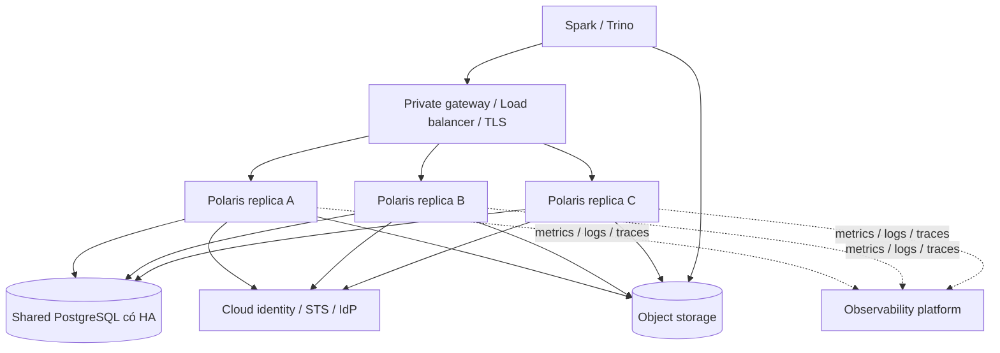

# Chương 7 — Production Operations: triển khai, quan sát, bảo trì và phục hồi Polaris

*Ngày nghiên cứu: 20/09/2026. Phạm vi: Apache Polaris 1.7.0, commit `4ac2f059d1cce149453d0a5f1ff1dff980ec97cc`; Helm chart 1.7.0. Baseline: Kubernetes, PostgreSQL/JDBC, object storage và nhiều engine. Các topology, SLO, quy trình và tiêu chí nghiệm thu là đề xuất để review/PoC; chưa có kết quả load test, Helm render hay diễn tập failover trong lần nghiên cứu này.*

## 1. Production-ready nghĩa là gì?

Một pod `Running`, một request `200` hay một lần Spark đọc thành công chưa chứng minh hệ thống vận hành được. Câu hỏi cần trả lời là: **khi pod, database, identity provider hoặc storage gặp lỗi, dữ liệu và quyền còn đúng không; ai biết sự cố; khôi phục bằng cách nào?**

Chương này chuyển kiến trúc ở các chương trước thành bốn sản phẩm vận hành: deployment baseline, dashboard/alerts, maintenance policy và recovery runbook. Phần database được dẫn lại ở [chương Persistence](<05-persistence-layer-apache-polaris.md>), phần cloud credentials ở [chương Storage Integration](<06-storage-integration-apache-polaris.md>).

## 2. Topology và điều kiện để có HA



Ba replicas là **ví dụ thiết kế**, không phải số tối thiểu được Polaris bảo đảm. Tách pod theo failure domains và dùng durable shared metastore. Các pod không tự nhân bản database cho nhau. In-memory metastore không phù hợp topology này. [Helm production][helm-production], [Metastore support][metastores]

### 2.1. Các điều kiện phải đồng thời thỏa mãn

| Miền | Điều kiện | Nếu thiếu |
|---|---|---|
| Server | Đủ replicas, phân tán node/zone, load balancing đúng | Một node có thể làm mất toàn bộ API |
| Persistence | DB HA, backup, reconnect và connection budget đã test | Nhiều pod vẫn cùng mất catalog access |
| Authentication | Cùng auth mode/trust; internal token broker dùng keys nhất quán | Token do pod A cấp có thể bị pod B từ chối |
| Configuration | Cùng realm, feature flags, locations và integrations | Hành vi thay đổi tùy pod nhận request |
| Cloud/network | Mỗi replica và engine có đúng identity/đường mạng | API còn sống nhưng load/commit/read file lỗi |
| Operations | Alerts, owner, runbook và restore drill | Có HA trên sơ đồ nhưng không khôi phục được khi sự cố |

Pod gần như stateless ở lớp phục vụ request không có nghĩa toàn hệ thống không có state: còn database, local caches, credential lifetime và asynchronous work. Hệ thống active-active nhiều vùng với database replication không được suy ra chỉ từ khả năng tăng replica; cần kiểm chứng consistency, writer fencing và latency riêng.

### 2.2. API và management surface

Runtime mặc định dùng `8181` cho HTTP API và `8182` cho management. Health và metrics thuộc management interface; không nên đưa cổng này ra Internet chung với API. Với TLS/proxy, phải cấu hình trusted headers đúng; không tin `X-Forwarded-*` từ mọi client. [Runtime defaults][defaults], [Chart values][values]

Đề xuất network policy: chỉ engine/gateway được gọi API; chỉ monitoring/kubelet theo thiết kế được gọi management; server chỉ đi tới DB, IdP, credential service, storage và telemetry endpoints cần thiết. Bảo vệ cả kết nối đông–tây, không chỉ TLS phía ngoài ingress.

## 3. Deployment baseline có thể review

### 3.1. Trình tự đưa một môi trường mới lên

1. **Ghim artifacts:** server, admin tool, Helm chart, engine connectors và image digest đã phê duyệt; tránh `latest`.
2. **Chuẩn bị state:** database, TLS, backup; bootstrap đúng realm bằng admin tool cùng version.
3. **Chuẩn bị identity:** signing keys hoặc external IdP; cloud workload identity; accounts và secrets được phân quyền.
4. **Triển khai hạn chế truy cập:** cấu hình probes, resource budgets, network policy và logging trước khi nhận workloads thật.
5. **Khởi tạo nghiệp vụ:** catalog, locations, principals và grants tối thiểu; không dùng root làm identity chạy ETL.
6. **Nghiệm thu:** Spark ghi–Trino đọc, deny tests, restart/rollout, token refresh và restore drill; sau đó mở tải từng nhóm.

Bootstrap là bước quản trị state, không phải init command được chạy mù ở mỗi pod. Tách quyền và log của bootstrap/migration khỏi runtime; không phát root secret vào CI output. [Admin tool][admin], [Production configuration][production]

### 3.2. Helm values minh họa

Đoạn sau khớp tên trường của chart 1.7.0 và minh họa **internal authentication + PostgreSQL**. Hai Secrets được tham chiếu phải có sẵn; nội dung secret không nằm trong báo cáo. Đây là cấu hình lõi, chưa phải bộ values hoàn chỉnh để áp vào mọi cluster:

```yaml
replicaCount: 3
image:
  repository: apache/polaris
  tag: "1.7.0"

persistence:
  type: relational-jdbc
  relationalJdbc:
    secret:
      name: polaris-persistence
      username: username
      password: password
      jdbcUrl: jdbcUrl

authentication:
  type: internal
  tokenBroker:
    type: rsa-key-pair
    secret:
      name: polaris-token-keys
      rsaKeyPair:
        publicKey: public.pem
        privateKey: private.pem

realmContext:
  type: default
  realms: [POLARIS]
  requireHeader: true

features:
  SUPPORTED_CATALOG_STORAGE_TYPES: [S3, AZURE, GCS]

podDisruptionBudget:
  enabled: true
  minAvailable: 2

topologySpreadConstraints:
  - maxSkew: 1
    topologyKey: topology.kubernetes.io/zone
    whenUnsatisfiable: DoNotSchedule

advancedConfig:
  quarkus.datasource.jdbc.min-size: "2"
  quarkus.datasource.jdbc.max-size: "20"
  quarkus.datasource.jdbc.acquisition-timeout: "10S"
  quarkus.log.console.json.enabled: "true"
  polaris.metrics.tags.environment: "prod"
```

`jdbcUrl` phải trỏ tới DB endpoint/TLS đã kiểm tra ở chương 5. Pool `2/20` chỉ là điểm bắt đầu PoC. `DoNotSchedule` cần cluster có đủ zones/capacity; PDB chỉ giúp kiểm soát voluntary disruptions, không ngăn mọi lỗi node/zone và không thay rollout strategy. [Kubernetes disruptions][k8s-disruptions]

Trước triển khai, bổ sung resources, cloud service account, ingress/TLS, network policies, termination budget, scrape configuration và secret delivery của môi trường. External/mixed authentication cần bộ cấu hình IdP riêng, không chỉ đổi một chữ `internal`. `advancedConfig` có thể ghi đè cấu hình sinh bởi chart: phải kiểm tra **rendered manifests và effective config đã che secrets**. [Chart values][values], [Chart deployment][deployment], [Helm production][helm-production]

Chart không mặc định làm tất cả lựa chọn production thay người vận hành: defaults vẫn có replica đơn, persistence in-memory và cơ chế tạo signing keys nếu không cung cấp key secret. Không dùng defaults làm bằng chứng đã có HA. [Chart values][values]

## 4. Health checks, rollout và autoscaling

### 4.1. Phân biệt ba loại probe

| Probe | Câu hỏi | Hành vi Kubernetes |
|---|---|---|
| Liveness | Process còn hoạt động đúng để tiếp tục chạy không? | Thất bại kéo dài có thể dẫn tới restart container |
| Readiness | Pod sẵn sàng nhận traffic chưa? | Pod không ready bị loại khỏi Service endpoints phù hợp |
| Startup | Ứng dụng đã qua giai đoạn khởi động chưa? | Trì hoãn liveness/readiness cho đến khi startup thành công |

[Kubernetes probes][k8s-probes]

Chart 1.7.0 render liveness `/q/health/live` và readiness `/q/health/ready` trên management port bằng HTTP. **Chart này chưa có trường/render `startupProbe`**; muốn thêm phải có tùy biến manifest/chart được quản lý và kiểm thử, không tự thêm một key rồi giả định nó có tác dụng. Nếu đổi management sang HTTPS, phải rà lại probe template. [Deployment template][deployment]

Production-readiness checks giúp phát hiện cấu hình nguy hiểm. Không vô hiệu hóa severe checks để pod chuyển xanh mà chưa xử lý nguyên nhân. Đồng thời, health endpoint không thay end-to-end test Spark/Trino: một probe không xác nhận toàn bộ IAM, KMS và snapshot files của từng bảng đều đúng. [Production guide][production], [Readiness checks][readiness]

### 4.2. Kiểm tra chỉ đọc tại endpoint nội bộ

Ví dụ sau chỉ thích hợp khi management endpoint đã được truy cập an toàn ở máy kiểm tra, chẳng hạn qua tunnel nội bộ được phê duyệt:

```powershell
Invoke-RestMethod -Uri 'http://localhost:8182/q/health/live'
Invoke-RestMethod -Uri 'http://localhost:8182/q/health/ready'
```

Không tạo ingress công khai chỉ để chạy được các lệnh trên.

### 4.3. Scale theo bottleneck, không theo số lượng dữ liệu

Polaris xử lý catalog/metadata requests; engine xử lý phần lớn data scan. Sizing theo request rate, concurrent commits, số entities/grants, metadata size và burst load. Dataset tăng từ 10 TB lên 100 TB chưa đủ để suy ra Polaris cần tăng CPU gấp mười.

Trước HPA, giới hạn số pod tối đa dựa trên DB connections, STS/IdP quota và capacity của storage. Tính cả pod surge khi rollout. Khi DB chậm, tăng pod có thể khuếch đại connection pressure và retries; CPU thấp cũng không chứng minh catalog còn capacity.

Đặt requests/limits sau load test; chừa memory cho heap, direct buffers, threads, caches và native overhead. Khi rollout, bảo đảm thời gian drain/shutdown phù hợp request đang bay; client phải xử lý kết quả commit chưa rõ nếu mất kết nối giữa chừng. Không hứa “zero downtime” trước khi test cả migration path lẫn workload.

## 5. Observability: từ số liệu tới quyết định

### 5.1. Ba loại dữ liệu khác nhau

| Loại | Trả lời câu hỏi | Không thay thế |
|---|---|---|
| Runtime metrics/logs/traces | Dịch vụ nhanh/chậm/lỗi ở đâu? | Hồ sơ audit đầy đủ |
| Iceberg scan/commit reports | Engine đã scan/commit như thế nào? | CPU, pool và health của server |
| Catalog events/audit pipeline | Ai thao tác gì trên catalog, kết quả/sự kiện liên quan? | Cloud data-access logs hoặc bằng chứng đọc từng file |

API events không mặc nhiên ghi lại mọi file access, vì engine đọc trực tiếp storage. Cần ghép catalog events với engine identity và cloud audit logs theo nhu cầu quản trị; không khẳng định tự có end-to-end lineage/audit chỉ vì đã bật event listener.

### 5.2. Metrics và percentile

Polaris cung cấp Prometheus metrics ở `/q/metrics`. HTTP timer mặc định có count/sum/max, **chưa có histogram buckets để tính p95/p99 gộp giữa replicas**. Nếu cần percentile, bật buckets phù hợp SLO:

```properties
# Bucket minh hoa; dieu chinh theo latency budget thuc
polaris.metrics.http-server-requests.histogram-slos=10ms,50ms,100ms,1s,5s
polaris.metrics.tags.environment=prod
polaris.metrics.tags.region=primary
```

Percentile từ histogram là ước lượng, độ chính xác tùy bucket boundaries; không lấy trung bình p99 của từng pod làm p99 toàn hệ thống. Realm tags mặc định tắt để tránh cardinality cao. Chỉ bật khi có nhu cầu và budget; tránh dùng table ID, raw path hoặc principal tùy ý làm metric labels. [Telemetry][telemetry]

### 5.3. Logs và traces

```properties
quarkus.log.console.json.enabled=true
quarkus.otel.sdk.disabled=false
quarkus.otel.exporter.otlp.traces.endpoint=http://otel-collector:4317
```

OTel SDK mặc định tắt; chỉ bật khi collector, network và export policy đã sẵn sàng. Ví dụ dùng OTLP gRPC nội bộ; bổ sung bảo mật transport theo môi trường. Có thể dùng `X-Request-ID` để tương quan request với MDC `requestId`, `realmId` và trace/span IDs khi có traced context. Tránh bật DEBUG toàn hệ thống kéo dài; ưu tiên package cần chẩn đoán và giới hạn thời gian. [Telemetry][telemetry], [Runtime defaults][defaults]

Không log Authorization header, SAS, access keys hay toàn bộ response chứa vended credentials. Đặt retention và quyền đọc log; bật JSON không tự che secrets. Telemetry failure cũng cần cảnh báo: dashboard yên lặng có thể là mất dữ liệu quan sát, không phải hệ thống khỏe.

### 5.4. Dashboard tối thiểu và tín hiệu cảnh báo

| Miền | Chỉ số/tín hiệu cần thu | Quyết định hỗ trợ |
|---|---|---|
| API | Throughput, latency theo operation, 5xx, 401/403, conflict/429 nếu phát sinh | Phân biệt downtime, auth issue và writer contention |
| JVM/pod | CPU, memory, GC, restarts, readiness transitions | Tìm saturation, OOM, rollout lỗi |
| DB | Pool active/pending, connections, query latency, locks, replication lag | Scale/tune ở server hay database |
| Credential/storage | Vending latency/errors, expiry/refresh failure, STS throttling, storage/KMS denials | Phân biệt IAM, quota và network |
| Async/maintenance | Queue/backlog hoặc logs tương ứng, task failures, last successful run | Phát hiện cleanup bị bỏ lại |
| Recovery | Backup age, WAL/archive health, restore drill gần nhất | Đánh giá có đáp ứng recovery objective không |

Không phải mọi hàng trên đều có metric Polaris built-in. Một số cần DB exporter, Kubernetes/cloud metrics hoặc instrumentation bổ sung. Khi dựng dashboard phải map sang **series thực thấy ở `/q/metrics`**, không bịa metric name để viết PromQL.

SLO nên tách availability/latency của load-table và commit khỏi scan latency của engine. Ví dụ thảo luận: availability 99,9% trong 30 ngày tương đương khoảng 43,2 phút error budget; đây là phép tính minh họa, **không phải SLA hay benchmark của Polaris**. Chốt error definition và exclusions; theo dõi auth/conflict riêng để không che lỗi quyền hoặc contention dưới một tỷ lệ 5xx thấp.

## 6. Event listeners và độ bền của audit

Dùng `polaris.event-listener.types`; key số ít `.type` đã deprecated từ 1.5.0. Listener phải tồn tại trong distribution/extension đang chạy; chọn sink không bảo đảm mọi image đều đóng gói đúng plugin. [Event listener configuration][events]

Có ba giới hạn cần đánh giá:

1. Executor queue và per-listener backlog mặc định có thể không giới hạn; sink chậm gây memory pressure.
2. Khi giới hạn backlog, tài liệu mô tả best-effort delivery và drop/log khi đầy; phải theo dõi mất events.
3. Listener `persistence-in-memory-buffer` có buffer trong RAM. Process chết trước khi flush có nguy cơ mất phần chưa persist; đây là suy luận từ cơ chế buffer, cần xác nhận qua fault test. [Event queues][events], [Buffer configuration][event-buffer]

Có bảng `events` trong DB không chứng minh event và catalog commit được ghi cùng một transaction. Đừng mô tả audit là exactly-once/lossless nếu chưa có contract và test crash, sink outage, retry, duplicates, ordering và replay.

Với yêu cầu compliance, cần xác định coverage của từng event, identity, timestamp, kết quả, retention và chống chỉnh sửa tại sink; kiểm chứng event pipeline dưới lỗi. Nếu yêu cầu không chấp nhận mất event mà implementation chưa đáp ứng, ghi rõ khoảng trống kiến trúc cần xử lý, không chỉ tăng queue size.

## 7. Maintenance: ba phạm vi không được gộp

| Phạm vi | Ai/thành phần nào thực hiện? | Đối tượng và lưu ý |
|---|---|---|
| Persistence maintenance | DBA với JDBC; admin tool với NoSQL | SQL health, index/statistics/backup hoặc stale objects của NoSQL |
| Iceberg table maintenance | Engine/scheduler thích hợp | Expire snapshots, orphan cleanup, rewrite/compaction theo nhu cầu |
| Polaris asynchronous cleanup | Task executor và handlers | Công việc hậu xử lý/xóa file khi operation và policy tương ứng yêu cầu |

### 7.1. Database và NoSQL

Với PostgreSQL, vận hành backup/WAL, vacuum/analyze, index health, connection budget và dung lượng events/reports như một workload database quan trọng. Không tự xóa rows trong các bảng nghiệp vụ vì thấy “cũ”; cần retention workflow được hỗ trợ và hiểu quan hệ state.

Với NoSQL, admin tool có `nosql maintenance-info`, `nosql maintenance-log`, `nosql maintenance-run`; tài liệu khuyến nghị chạy định kỳ, ví dụ hằng ngày, để dọn stale database entries. Đây không phải job xóa orphan Parquet. Khi run trước chưa kết thúc, tool từ chối chạy mới; chỉ dùng `--supersede-run` nếu đã xác minh run đó thật sự bị bỏ dở. [Admin maintenance][admin]

Chart có CronJob `maintenance.jobs.nosql-maintenance`, mặc định disabled, dùng admin-tool image và có concurrency policy. Maintenance pods **không tự kế thừa toàn bộ server env/volumes/resources**; phải cấu hình riêng quyền và kết nối DB cần thiết. Không bật NoSQL maintenance cho baseline JDBC chỉ vì thấy có sẵn một CronJob. [Chart maintenance values][values]

### 7.2. Bảo trì bảng Iceberg

Expire snapshots giảm lịch sử còn giữ; remove-orphan-files dọn files không được tham chiếu theo điều kiện; compaction/rewrite tối ưu bố trí dữ liệu/metadata. Đây là các bài toán khác nhau và cần engine/scheduler thực hiện, không mặc định Polaris tự tối ưu tất cả bảng. [Iceberg maintenance][iceberg-maintenance]

Retention phải lớn hơn cửa sổ cần cho jobs đang chạy, time travel, đối soát và database recovery. Đặt orphan age quá ngắn có thể đụng file đang được writer chuẩn bị nhưng chưa commit. Không đặt bucket lifecycle xóa theo tuổi một cách độc lập với references, snapshot retention và recovery window. Chạy thử trên dữ liệu kiểm thử, review candidates khi công cụ hỗ trợ, rồi mới áp production.

### 7.3. Async cleanup không phải lời hứa xóa tức thì

Source có task executor và handlers cho table cleanup, manifest files và batch files. Khi operation đi qua async cleanup, response API và thời điểm xóa hết objects có thể khác nhau. File deletion còn phụ thuộc cloud permissions, network và retries. [Task executor][tasks]

Task entity được persist không đủ để kết luận có một durable distributed queue tự phục hồi mọi task sau crash. Cần test kill pod giữa cleanup, khởi động lại, kiểm tra xử lý còn dang dở và quy trình reconcile. Feature `POLARIS_TASK_TIMEOUT_MILLIS` cũng mô tả rằng unfinished tasks quá cũ có thể không được xử lý; không chỉ nhìn task count rồi kết luận dữ liệu đã xóa hết. [Task executor][tasks], [Feature configuration][features]

Drop/purge, snapshot expiration và recovery có thể xung đột nhau. Với dữ liệu quan trọng, phê duyệt rõ hành vi xóa, delay/retention và khả năng khôi phục; không giả định “drop luôn undo được”.

## 8. Upgrade, migration và rollback

### 8.1. Tách bốn loại thay đổi

| Loại thay đổi | Câu hỏi cần trả lời trước rollout |
|---|---|
| Image/server | Old/new replicas có cùng API và persistence compatibility không? |
| DB schema/backend | Migration path nào được hỗ trợ; cần restart hay downtime? |
| Engine/connector | REST, auth, credential refresh và table features còn tương thích không? |
| Security/features | Grant mapping, location checks, flags và key rotation có đổi behavior không? |

Chính sách evolution hướng tới hỗ trợ rolling trong phạm vi persistence phù hợp, nhưng không bảo đảm mọi cặp phiên bản/cấu hình. Chuyển loại persistence cần dự kiến downtime; SPI extensions không có bảo đảm binary compatibility chung. [Evolution policy][evolution]

### 8.2. Release gate đề xuất

1. Chụp inventory và diff cấu hình; đọc release notes, migration notes và known limitations của đích nâng cấp.
2. Restore backup vào staging, chạy đúng đường schema migration và test workloads tiêu biểu.
3. Nếu cần rolling, test mixed versions, shared keys, cache/grant propagation và concurrent commits; nếu chưa chứng minh được thì dùng maintenance window.
4. Chốt tiêu chí dừng/rollback: errors, latency, authorization regressions, snapshot mismatch và migration failures.
5. Áp dụng theo từng bước có thể kiểm tra; canary chỉ phù hợp khi schema và config còn tương thích.
6. Smoke test allow/deny, metadata và dữ liệu; đối soát async tasks/events, rồi mới mở hết traffic.

**Rollback image không undo DDL và không xóa writes đã nhận.** Backup cũ cũng không thể được restore tùy tiện trong lúc writers vẫn ghi. Chi tiết transaction boundary, migration v5 và recovery set nằm ở chương 5. Mọi schema migration hoặc destructive cleanup cần phê duyệt riêng ở môi trường thật.

## 9. Incident runbook: nhận diện, khoanh vùng, khôi phục

Quy tắc chung: giữ request ID, thời điểm, realm/table và version/config; không xuất secrets. Giảm tác động có kiểm soát, tránh retry storm; chỉ sửa sau khi phân biệt control plane, database và data plane.

| Sự cố | Khoanh vùng đầu tiên | Hướng khôi phục và điều kiện xác nhận |
|---|---|---|
| API 5xx/readiness fail | DB reachability/pool, dependency errors, rollout diff | Khôi phục dependency hoặc rollback tương thích; smoke test load + commit |
| DB failover giữa commit | DB logs, client result chưa rõ, published snapshot | Reconcile theo Iceberg/client protocol; không append lại mù |
| 401 ngẫu nhiên theo pod | Shared signing keys, auth/realm config, clock | Đồng bộ config/key plan; test token qua nhiều replicas |
| 403 ở storage | Credential, IAM/trust, KMS, endpoint, refresh | Sửa đúng miền quyền; test cả allow và deny, không cấp wildcard tạm thời vô hạn |
| Conflict tăng mạnh | Writers cùng bảng, retry depth, commit cadence | Điều tiết concurrency/backoff; kiểm tra không mất/nhân đôi nghiệp vụ |
| OOM hoặc latency tăng | Heap/GC, queue growth, cache, sink/DB chậm | Giảm nguồn áp lực, giới hạn có tính toán; xác nhận audit/task loss nếu có |
| Metadata/data file không còn | Cleanup/lifecycle logs, backup mốc nào còn files | Bảo toàn state, dừng cleanup có liên quan; restore có đối soát references |
| Async cleanup không tiến triển | Task logs, expiry, IAM Delete, pod crash | Xác định tác vụ còn sống hay bỏ dở; reconcile được phê duyệt, kiểm tra objects thực |
| Backup job xanh nhưng restore lỗi | Backup/WAL continuity, keys và server/schema | Không coi đã có DR; sửa chuỗi backup, lặp restore drill trước nghiệm thu |

### 9.1. Disaster recovery

Phục hồi phải phối hợp **DB + referenced objects + keys/config/identity**. Chọn recovery point, cô lập DB restore, kiểm tra references và dữ liệu, kiểm tra quyền, rồi cutover. Fencing deployment cũ/writers cũ là điều kiện trước mở writes ở deployment phục hồi; tránh hai nơi cùng nhận ghi không kiểm soát.

RPO/RTO phải đo từ drill thực tế. Có backup hằng ngày không tự chứng minh RPO 0; DB synchronous replication không tự bảo vệ khỏi xóa nhầm files hoặc key loss. Nếu cần failover liên vùng, kiểm tra thêm replication lag của từng miền state, endpoint cutover, IAM/KMS và data locality.

## 10. Kế hoạch PoC và bằng chứng nghiệm thu

Mỗi test cần ghi: phiên bản/config, dữ liệu đầu vào, injection, kỳ vọng, kết quả thật, log/request IDs và hạn chế. Bảng dưới là **kế hoạch**, không phải kết quả đã đạt:

| Test | Thực hiện trên môi trường thử | Tiêu chí đạt |
|---|---|---|
| Tính bền vững | Tạo bảng/grants, restart replicas | Identity, grants và snapshot vẫn đúng |
| Liên vận hành | Spark ghi, Trino đọc; đổi vai nếu workload cần | Cùng dữ liệu và semantics đã thống nhất |
| Concurrency | Hai writers cùng bảng | Conflict/retry đúng protocol; đối soát không mất dữ liệu |
| Replica failure | Kill một pod khi có tải | Client phục hồi trong mục tiêu; điều tra mọi commit chưa rõ |
| DB failure | Failover DB hoặc gián đoạn có kiểm soát | Reconnect đúng, không silent overwrite; RTO được đo |
| Token lifecycle | Job chạy qua expiry, revoke và rotation | Refresh đúng; phạm vi và độ trễ thu hồi được ghi nhận |
| Isolation | Reader/writer khác role, truy cập ngoài prefix/realm | Deny đúng; không có ambient credentials che lỗi |
| Audit/task fault | Sink chậm, queue pressure, kill giữa cleanup | Đo loss/duplicates và khả năng reconcile; đáp ứng policy đã chốt |
| Upgrade | Restore staging rồi nâng schema/server/client | Smoke/negative tests đạt; rollback plan có thể thực hiện |
| DR | Restore DB, kiểm tra metadata→files, keys/grants | RPO/RTO, snapshot và tổng kiểm nghiệp vụ đạt mục tiêu |

### 10.1. Phân công vận hành đề xuất

- **Data platform:** Polaris deployment, cấu hình, release, API SLO và incident coordination.
- **DBA/platform database:** DB HA, backup/PITR, capacity, schema change review.
- **Security/cloud:** IAM/IdP, signing/cloud keys, secret lifecycle, audit policy.
- **Data engineers/owners:** Connector versions, pipeline retries, table maintenance, data reconciliation.

Cần một owner quyết định cutover và mở lại writes; chia trách nhiệm không được làm runbook mất người chịu trách nhiệm cuối cùng.

### 10.2. Checklist trước khi gọi là production-ready

- [ ] Không dùng metastore/secret workflow test-only cho state production cần bền vững.
- [ ] Shared DB, keys, realm và features nhất quán giữa replicas.
- [ ] TLS/network boundaries và least privilege đã có negative tests.
- [ ] Connection budget tính cả autoscaling, surge và maintenance.
- [ ] Dashboard, alerts, on-call và runbooks hoạt động; biết rõ audit delivery guarantees.
- [ ] Cleanup retention tương thích jobs, snapshot history và recovery window.
- [ ] Upgrade path và restore drill đã có bằng chứng; RPO/RTO không chỉ là con số đề xuất.

**Ba câu hỏi tự kiểm tra:** Vì sao ba replicas chưa đủ tạo HA? Vì sao `/q/health/ready` xanh vẫn có thể đọc bảng thất bại? Vì sao expire snapshots có thể làm kế hoạch DB restore mất tác dụng? Hiểu được ba câu này là đã nối được deployment, data plane và recovery thành một hệ thống.

## Nguồn và phạm vi kiểm chứng

Các liên kết source/docs Polaris được ghim ở release commit; cấu hình đã đối chiếu source và chart, không thay cho rendered-manifest review hoặc runtime testing. Topology, sizing workflow, runbooks và PoC là tổng hợp đề xuất của báo cáo. Không có benchmark, SLA, HA certification hoặc kết quả diễn tập được bịa thêm.

**Lưu ý khi ghép báo cáo:** [chương Security hiện có](<02-security-layer-apache-polaris.md>) dùng tài liệu 1.7.0 nhưng có phân tích source `main` tại commit khác. Giữ nhãn phiên bản khi trích lại; không mặc định tính năng phân tích từ `main` đều có trong release. Ba chương bổ sung này thống nhất ở commit 1.7.0 nêu đầu chương.

[helm-production]: https://github.com/apache/polaris/blob/4ac2f059d1cce149453d0a5f1ff1dff980ec97cc/site/content/in-dev/unreleased/helm-chart/production.md
[metastores]: https://polaris.apache.org/releases/1.7.0/metastores/
[defaults]: https://github.com/apache/polaris/blob/4ac2f059d1cce149453d0a5f1ff1dff980ec97cc/runtime/defaults/src/main/resources/application.properties
[values]: https://github.com/apache/polaris/blob/4ac2f059d1cce149453d0a5f1ff1dff980ec97cc/helm/polaris/values.yaml
[deployment]: https://github.com/apache/polaris/blob/4ac2f059d1cce149453d0a5f1ff1dff980ec97cc/helm/polaris/templates/deployment.yaml
[production]: https://github.com/apache/polaris/blob/4ac2f059d1cce149453d0a5f1ff1dff980ec97cc/site/content/in-dev/unreleased/configuration/configuring-polaris-for-production/_index.md
[admin]: https://github.com/apache/polaris/blob/4ac2f059d1cce149453d0a5f1ff1dff980ec97cc/site/content/in-dev/unreleased/admin-tool.md
[readiness]: https://github.com/apache/polaris/blob/4ac2f059d1cce149453d0a5f1ff1dff980ec97cc/persistence/relational-jdbc/src/main/java/org/apache/polaris/persistence/relational/jdbc/RelationalJdbcProductionReadinessChecks.java
[telemetry]: https://github.com/apache/polaris/blob/4ac2f059d1cce149453d0a5f1ff1dff980ec97cc/site/content/in-dev/unreleased/telemetry.md
[events]: https://github.com/apache/polaris/blob/4ac2f059d1cce149453d0a5f1ff1dff980ec97cc/site/content/in-dev/unreleased/configuration/config-sections/smallrye-polaris_event_listener.md
[event-buffer]: https://github.com/apache/polaris/blob/4ac2f059d1cce149453d0a5f1ff1dff980ec97cc/site/content/in-dev/unreleased/configuration/config-sections/smallrye-polaris_event_listener_persistence_in_memory_buffer.md
[tasks]: https://github.com/apache/polaris/blob/4ac2f059d1cce149453d0a5f1ff1dff980ec97cc/runtime/service/src/main/java/org/apache/polaris/service/task/TaskExecutorImpl.java
[features]: https://github.com/apache/polaris/blob/4ac2f059d1cce149453d0a5f1ff1dff980ec97cc/polaris-core/src/main/java/org/apache/polaris/core/config/FeatureConfiguration.java
[evolution]: https://github.com/apache/polaris/blob/4ac2f059d1cce149453d0a5f1ff1dff980ec97cc/site/content/in-dev/unreleased/evolution.md
[k8s-probes]: https://kubernetes.io/docs/tasks/configure-pod-container/configure-liveness-readiness-startup-probes/
[k8s-disruptions]: https://kubernetes.io/docs/concepts/workloads/pods/disruptions/
[iceberg-maintenance]: https://iceberg.apache.org/docs/1.10.1/maintenance/
