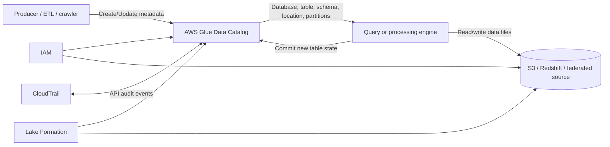
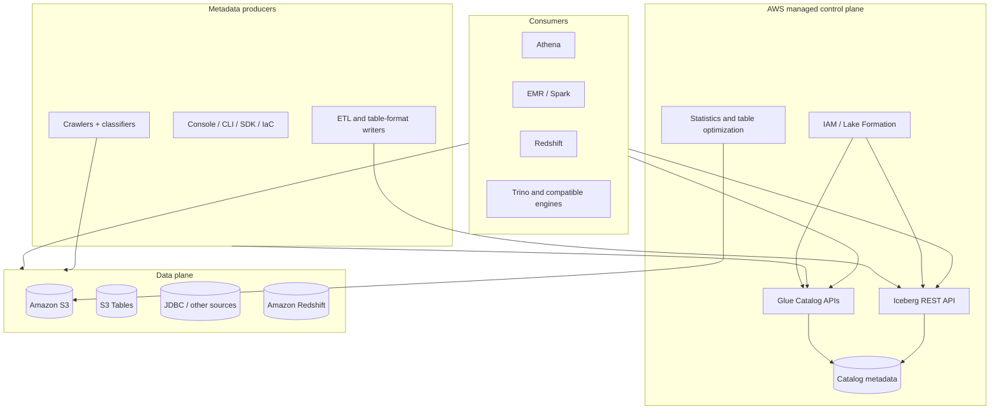
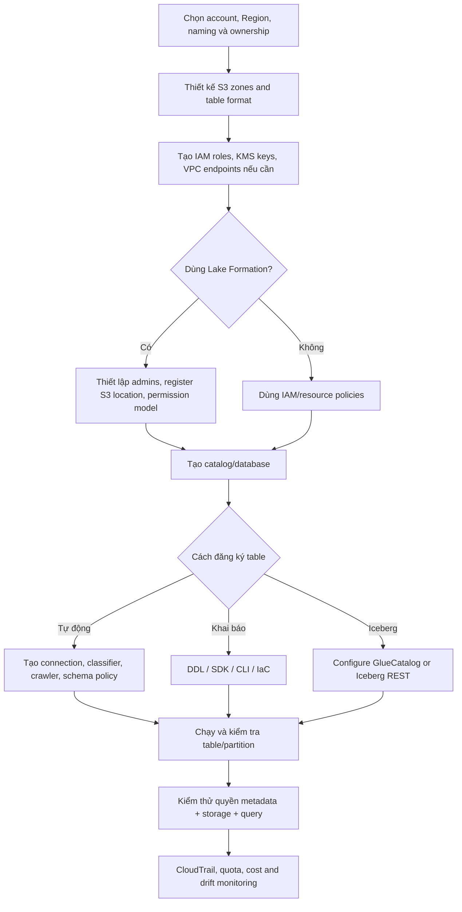
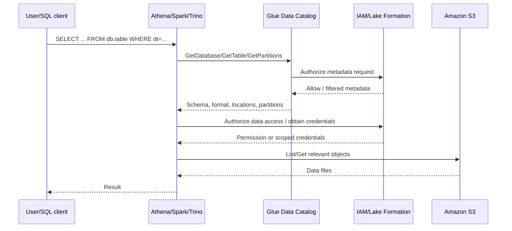
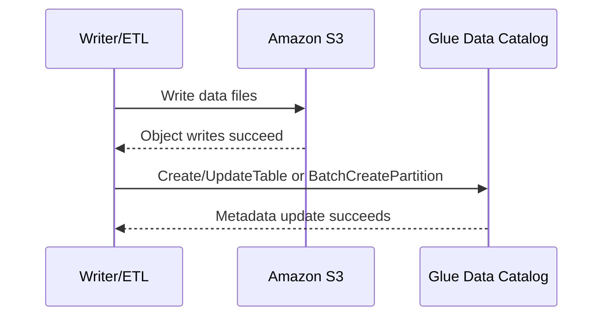
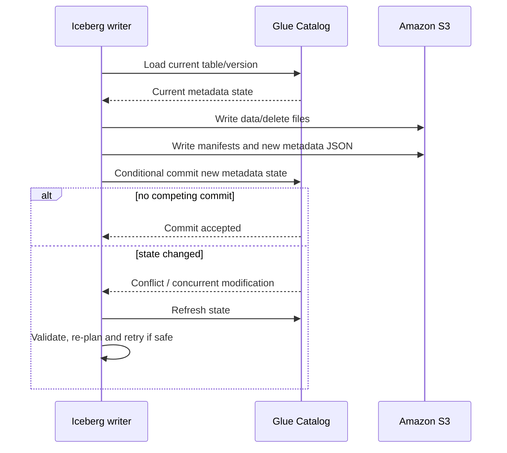

# AWS Glue Data Catalog: kiến trúc, metadata, luồng đọc/ghi và vận hành

*Phạm vi nghiên cứu: AWS Glue Data Catalog dưới góc nhìn của Data Engineer, đối chiếu tài liệu chính thức AWS, Apache Iceberg và các bài viết kỹ thuật của AWS đến ngày 14/09/2026. AWS liên tục bổ sung loại catalog, table format và API; các hạn mức, vùng hỗ trợ và chi phí cần được kiểm tra lại trước khi thiết kế production.*

## 0. Tổng quan cách hệ thống hoạt động

**AWS Glue Data Catalog là dịch vụ metastore được AWS quản lý, dùng để lưu và cung cấp metadata kỹ thuật về dữ liệu.** Nó giúp engine trả lời các câu hỏi như: bảng nào tồn tại, schema là gì, dữ liệu nằm ở đâu, được phân vùng thế nào, dùng định dạng nào và ai được phép truy cập. Data Catalog không phải nơi mặc định chứa các dòng dữ liệu của bảng; dữ liệu có thể vẫn nằm trong Amazon S3, Amazon Redshift hoặc một nguồn được liên kết/federate. [1], [2]

Mỗi tài khoản AWS có một **default Data Catalog trong từng Region**. ID của default catalog thường là AWS account ID. Mô hình cơ bản là `catalog → database → table → partition`. Các khả năng mới còn cho phép tạo catalog con hoặc federated catalog để biểu diễn nguồn khác như Amazon Redshift và Amazon S3 Tables. Vì vậy, “mỗi Region chỉ có một không gian tên phẳng” không còn là mô tả đầy đủ của Data Catalog hiện đại. [1], [8], [9]

### 0.1. Chu trình tổng quát



Một vòng đời điển hình gồm sáu bước:

1. **Đăng ký metadata:** người dùng, crawler, ETL job hoặc table-format client tạo database/table trong Data Catalog.
2. **Phân giải tên:** engine nhận tên như `catalog.database.table` và gọi Glue API, Hive-compatible client hoặc Iceberg REST API.
3. **Kiểm tra quyền:** IAM quyết định quyền gọi API; Lake Formation có thể bổ sung quyền ở catalog, database, table, cột, hàng hoặc ô dữ liệu.
4. **Lấy kế hoạch truy cập:** engine nhận schema, location, partition metadata, statistics hoặc con trỏ tới metadata hiện tại của Iceberg.
5. **Truy cập data plane:** engine đọc/ghi dữ liệu trực tiếp tại S3 hay nguồn đích. Data Catalog không nằm trên đường truyền từng bản ghi.
6. **Công bố trạng thái mới:** thao tác DDL, partition registration hoặc commit table format cập nhật Data Catalog. Semantics của bước này phụ thuộc loại bảng.

Điểm quan trọng nhất là ranh giới **control plane – data plane**:

| Mặt phẳng | Chứa gì | Ai thao tác |
|---|---|---|
| Metadata/control plane | Catalog, database, table, schema, location, partition, version, statistics, quyền liên quan | Glue API, crawler, Lake Formation, engine catalog client |
| Data plane | File Parquet/ORC/Avro, Iceberg manifests/metadata files, dữ liệu Redshift hoặc nguồn ngoài | Spark, Athena, EMR, Redshift, Trino và storage service |

Phân biệt này giải thích vì sao cấp quyền `glue:GetTable` chưa đủ để đọc file S3, và vì sao ghi file thành công chưa có nghĩa bảng đã commit thành công.

## 1. Giới thiệu và bối cảnh ra đời

AWS Glue được công bố khả dụng rộng rãi ngày 14/08/2017 như một dịch vụ ETL được quản lý. Ngay từ thời điểm ra mắt, crawler đã có nhiệm vụ suy luận schema và lưu kết quả vào một catalog trung tâm để ETL job và dịch vụ phân tích sử dụng. [3], [4]

Data lake thời kỳ đầu thường lưu file theo prefix S3. Cách tổ chức này rẻ và linh hoạt, nhưng file tự thân không cung cấp một namespace thống nhất cho SQL engine. Mỗi engine có thể phải duy trì định nghĩa bảng riêng, dẫn đến trùng lặp schema, lệch partition và khó kiểm soát quyền. Data Catalog giải bài toán đó bằng một metastore dùng chung, có API tương thích với hệ sinh thái Hive và tích hợp sẵn với nhiều dịch vụ AWS. [1], [2]

Các kiến trúc data lake tham khảo của AWS đặt Glue ở lớp discovery/catalog và tách nó khỏi lớp object storage và compute. Tài liệu Prescriptive Guidance cũng tổ chức Data Catalog thành database và table, trong đó mỗi table thuộc một database. Cách phân lớp này là cơ sở cho mô hình control plane – data plane dùng xuyên suốt báo cáo. [25], [26]

Vai trò của Data Catalog đã mở rộng theo tiến trình từ **data lake kiểu Hive** sang **lakehouse**:

- Giai đoạn ban đầu tập trung vào database, external table, schema, location và partition.
- Crawler tự động phát hiện dữ liệu và cập nhật metadata.
- Lake Formation dùng chung Data Catalog để quản trị quyền chi tiết và chia sẻ liên tài khoản.
- Apache Iceberg, Apache Hudi và Delta Lake được tích hợp ở các mức độ khác nhau; Glue có Iceberg REST Catalog endpoint và API cho open table format.
- Catalog/federation hiện có thể biểu diễn thêm Redshift, S3 Tables và nguồn bên thứ ba. [8], [9], [15]

Data Catalog vẫn chủ yếu là **technical catalog/metastore phục vụ engine**. Nó không tự thay thế toàn bộ khả năng của một enterprise data catalog về glossary nghiệp vụ, ownership workflow, data product lifecycle hay lineage đa nền tảng. Những nhu cầu đó cần các dịch vụ quản trị bổ sung hoặc công cụ khác.

## 2. Bài toán giải quyết

### 2.1. Tạo abstraction bảng trên dữ liệu vật lý

Một prefix như `s3://lake-prod/orders/dt=2026-09-14/` chưa nói đầy đủ cho engine biết kiểu cột, định dạng file, partition key hoặc SerDe. Data Catalog gắn địa chỉ vật lý đó với một đối tượng table có thể được truy vấn bằng tên.

| Bài toán | Metadata/cơ chế cung cấp | Giá trị cho Data Engineer |
|---|---|---|
| Phân giải tên | Catalog, database, table | Dùng tên ổn định thay cho hard-code URI |
| Hiểu dữ liệu | Columns, types, `StorageDescriptor`, table parameters | Engine lập kế hoạch đọc đúng format |
| Partition pruning | Partition keys, partition objects, partition indexes | Giảm số file/prefix phải quét |
| Tối ưu truy vấn | Column statistics và runtime metrics có liên quan | Hỗ trợ cost-based optimization ở dịch vụ tích hợp |
| Khám phá schema | Crawler và classifier | Giảm công việc đăng ký thủ công |
| Chia sẻ metadata | API, Hive compatibility, Iceberg REST | Nhiều engine dùng cùng một định nghĩa |
| Quản trị | IAM, Lake Formation, resource policy | Kiểm soát ai thấy và thao tác tài sản dữ liệu |
| Quản lý thay đổi | Table versions, conditional update, open table format APIs | Theo dõi/công bố trạng thái metadata mới |

### 2.2. Giảm vận hành metastore

Với một Hive Metastore tự quản lý, đội dữ liệu phải triển khai service, database backend, connection pool, backup, upgrade và HA. Glue Data Catalog chuyển phần control plane này sang một dịch vụ regional/serverless. AWS không công bố storage engine hay topology replica nội bộ; kiến trúc ứng dụng chỉ nên dựa vào API, quota và SLA công khai, không giả định Glue dùng một database cụ thể bên dưới.

### 2.3. Tạo điểm hội tụ giữa discovery, compute và governance

Athena, EMR, Redshift Spectrum, Glue ETL và Lake Formation có thể cùng tham chiếu Data Catalog. Tuy nhiên, “cùng thấy metadata” không bảo đảm mọi engine có cùng khả năng. Connector vẫn phải hỗ trợ file format, table format version, DDL và semantics ghi tương ứng.

## 3. Kiến trúc và các thành phần

### 3.1. Kiến trúc logic



### 3.2. Các thành phần cốt lõi

#### Catalog, database, table và partition

- **Catalog** là nhóm logic chứa database hoặc ánh xạ tới nguồn federated. Default catalog là điểm vào quen thuộc nhất.
- **Database** là namespace cho table; không phải database engine chứa dữ liệu hàng/cột.
- **Table** mô tả dataset: tên, schema, loại bảng, location, partition keys, format/SerDe, parameters và thông tin mở rộng.
- **Partition** biểu diễn một lát dữ liệu theo giá trị partition key, có thể có location và `StorageDescriptor` riêng.

#### Crawler

Crawler kết nối nguồn dữ liệu, gọi classifier, gom các object có cấu trúc tương đồng thành table/partition rồi tạo hoặc cập nhật metadata theo schema change policy. Nó là **metadata producer chạy bất đồng bộ**, không phải đường đọc bắt buộc. Có thể bỏ crawler và tạo table hoàn toàn bằng API, DDL hay IaC. [5], [6]

Khi cần discovery theo sự kiện ở nhiều nguồn, crawler thường được đặt trong workflow EventBridge/Lambda thay vì chạy vô điều kiện với tần suất cao; kiến trúc mẫu của AWS minh họa chính cách phối hợp này. [24]

#### Classifier

Classifier nhận diện định dạng và schema. Crawler thử custom classifiers trước rồi mới đến built-in classifiers; kết quả có độ chắc chắn cao nhất được chọn nếu chưa có classifier trả về mức chắc chắn tuyệt đối. Thay đổi classifier không tự tái phân loại toàn bộ dữ liệu cũ. [6]

#### Connections

Connection lưu cấu hình kết nối kỹ thuật và network cho JDBC, MongoDB hoặc nguồn khác; thông tin bí mật nên đặt trong AWS Secrets Manager khi khả dụng. Connection không phải bản thân table và cũng không sao chép dữ liệu vào catalog.

#### Statistics và partition indexes

Column statistics giúp engine tích hợp ước lượng cardinality và chi phí. Partition index giảm công việc lọc metadata ở các bảng có rất nhiều partition. Hai cơ chế này tối ưu giai đoạn lập kế hoạch; chúng không thay partitioning vật lý hoặc file layout tốt.

#### Table optimization

Data Catalog cung cấp managed compaction cho Iceberg và các tác vụ như retention/orphan-file deletion ở những cấu hình được hỗ trợ. Đây là compute phụ trợ có chi phí riêng, không phải thuộc tính “miễn phí và tự động” của mọi table. [2], [8], [27]

#### IAM và Lake Formation

IAM bảo vệ AWS Glue API và resource ARN. Lake Formation dùng chung Data Catalog và bổ sung mô hình quyền dữ liệu chi tiết, tag-based access control, cross-account sharing và credential vending cho các dịch vụ tích hợp. [15], [16]

### 3.3. Các khái niệm dễ nhầm

| Khái niệm | Quan hệ đúng |
|---|---|
| AWS Glue | Dịch vụ rộng gồm Data Catalog, ETL, crawler, Data Quality và các tính năng khác |
| Glue Data Catalog | Metastore/metadata control plane; không đồng nghĩa toàn bộ AWS Glue |
| Glue Schema Registry | Registry schema cho streaming/event payload; tách biệt table metadata trong Data Catalog |
| Lake Formation | Lớp governance dùng chung Data Catalog; không phải một bản sao catalog khác |
| Hive compatibility | Tương thích API/metastore cho nhiều workload; không bảo đảm mọi tính năng Hive đều tương đương |
| Iceberg table | Trạng thái bảng còn nằm trong metadata files/manifests ở object storage; catalog giữ điểm đăng ký/trạng thái cần thiết |

## 4. Mô hình triển khai và flow khởi tạo

### 4.1. Mô hình triển khai

Không có Glue Catalog server để đội dữ liệu cài đặt. Client gọi regional endpoint của AWS Glue; AWS vận hành service. Phần đội dữ liệu phải triển khai gồm IAM/Lake Formation, database/table, crawler/connection, S3 layout, KMS key, network endpoint và công cụ quan sát.

Các mô hình thường gặp:

| Mô hình | Đặc điểm | Phù hợp |
|---|---|---|
| Một account, một Region | Default catalog và S3 cùng Region | Nhóm nhỏ, workload tập trung |
| Multi-account data lake | Producer/consumer account, LF grants/resource links | Tách domain, môi trường hoặc security boundary |
| Nhiều Region | Catalog và dữ liệu theo Region, có pipeline sao chép metadata | DR, data residency, workload địa lý |
| Federated catalog | Metadata đại diện nguồn khác qua catalog/connection | Truy cập thống nhất Redshift, S3 Tables hoặc nguồn hỗ trợ |
| Hybrid/open engine | Spark/Trino dùng Glue client hoặc Iceberg REST | Compute ngoài dịch vụ Glue nhưng metadata ở AWS |

### 4.2. Flow khởi tạo khuyến nghị



#### Bước 1: xác định boundary

Chọn account, Region, catalog hierarchy, database naming, owner và lifecycle. Vì default Data Catalog là regional, quyết định Region ảnh hưởng endpoint, ARN, quota, DR và nơi vận hành crawler.

#### Bước 2: chọn table model trước khi crawl

Xác định bảng là external Hive-style hay Iceberg/Hudi/Delta. Crawler phù hợp cho discovery file-based, nhưng không nên được dùng như công cụ tự quyết định contract schema của dữ liệu quan trọng. Với curated zone, DDL/IaC hoặc table-format writer thường cho khả năng kiểm soát tốt hơn.

#### Bước 3: thiết lập security

Tạo role cho crawler/job/consumer theo least privilege. Nếu dùng Lake Formation, đăng ký S3 location, xác định data lake admin và chọn named-resource hoặc LF-tag permissions. Quyền metadata và quyền đọc object phải được kiểm thử riêng.

#### Bước 4: tạo và nạp metadata

- **Crawler:** cấu hình target, classifier, recrawl và schema change policy.
- **Khai báo:** dùng `CreateDatabase`, `CreateTable`, Athena DDL, CloudFormation/Terraform hoặc SDK.
- **Iceberg:** cấu hình `GlueCatalog` hoặc endpoint `https://glue.<region>.amazonaws.com/iceberg`, warehouse/catalog ID và SigV4. [10], [11]

#### Bước 5: nghiệm thu bằng consumer thật

Kiểm tra `GetTable`, partition pruning, query mẫu, đọc/ghi và quyền Lake Formation bằng đúng execution role của Athena/EMR/Glue. Chỉ kiểm tra table xuất hiện trong console là chưa đủ.

## 5. Mô hình metadata và cơ chế lưu trữ

### 5.1. Mô hình đối tượng

```text
Account + Region
└── Catalog (default hoặc catalog/federated catalog)
    └── Database
        ├── Table
        │   ├── Columns / schema
        │   ├── StorageDescriptor
        │   │   ├── Location
        │   │   ├── InputFormat / OutputFormat
        │   │   ├── SerDeInfo
        │   │   └── Bucket/sort/compression properties
        │   ├── PartitionKeys
        │   ├── Parameters / TableType
        │   ├── TableVersions
        │   ├── ColumnStatistics
        │   └── Partitions
        │       ├── Values
        │       └── StorageDescriptor / location
        ├── Views / supported open-table objects
        └── User-defined functions
```

`StorageDescriptor` là cấu trúc trung tâm cho bảng file kiểu Hive: nó mô tả cột và cách tìm/giải mã dữ liệu. `Table.Parameters` thường mang thuộc tính do engine hoặc table format quy ước. Không nên để ứng dụng tự do ghi đè các key mà connector dùng nội bộ. [7]

### 5.2. Metadata được lưu ở đâu?

AWS lưu metadata catalog trong control plane do AWS quản lý. Khách hàng thao tác qua API và không quản trị database backend. Metadata được tính theo đối tượng catalog; dữ liệu bảng vẫn được tính phí/lưu ở storage tương ứng. [27]

Với Iceberg cần phân biệt hai lớp:

1. **Catalog record:** định danh table và thông tin cần để tìm trạng thái hiện tại.
2. **Iceberg metadata tree trong S3:** metadata JSON, manifest list, manifest files, snapshots và data/delete files.

Catalog không thay thế metadata graph của Iceberg. Khi commit, writer tạo metadata mới trong S3 rồi công bố trạng thái mới qua catalog bằng kiểm soát cạnh tranh.

Đặc tả Iceberg định nghĩa snapshot và metadata tree tạo nên trạng thái logic của table; tài liệu AWS integration của Iceberg mô tả `GlueCatalog` là catalog implementation dùng Glue làm nơi đăng ký và commit trạng thái đó. [28], [29]

### 5.3. Versioning

Theo API hiện tại, `UpdateTable` mặc định lưu phiên bản table trước khi cập nhật; `SkipArchive=true` tắt hành vi này. `GetTableVersion(s)` cho phép đọc version metadata. Đây là **version của catalog object**, không tự động là lịch sử dữ liệu hay snapshot có thể time travel. Với Iceberg, time travel dựa vào snapshot graph của Iceberg. [12]

### 5.4. Partition metadata và scale

Mỗi partition có thể là một metadata object. Với partition granularity quá nhỏ, số object, API calls và planning latency tăng nhanh. Biện pháp thực tế:

- tránh partition theo thuộc tính cardinality rất cao;
- dùng batch APIs khi đăng ký/lấy partition;
- tạo partition index cho filter thường dùng;
- dùng partition projection ở engine hỗ trợ nếu phù hợp;
- cân nhắc hidden partitioning của Iceberg;
- theo dõi quota table/partition và số version.

## 6. API và khả năng tích hợp

### 6.1. Các bề mặt API

| Bề mặt | Ví dụ | Mục đích |
|---|---|---|
| AWS Glue API | `GetTable`, `CreateTable`, `UpdateTable`, `GetPartitions`, batch APIs | Quản lý metadata native |
| AWS SDK / CLI | Boto3, AWS SDK for Java, `aws glue ...` | Tự động hóa và tích hợp ứng dụng |
| Console | Glue/Lake Formation/Athena console | Quản trị tương tác |
| Hive-compatible metastore client | Cấu hình engine dùng Glue làm metastore | Tái sử dụng hệ sinh thái Hive |
| Iceberg REST Catalog | Namespace/table CRUD và commit theo REST spec | Client Iceberg đa engine |
| AWS Glue Iceberg extensions | Tính năng AWS bổ sung quanh Iceberg | Khả năng quản lý mở rộng |
| IaC | CloudFormation/CDK/Terraform provider | Tạo resource có kiểm soát và review |

Iceberg REST endpoint dùng SigV4; `warehouse` ánh xạ tới Glue catalog ID và caller cần quyền catalog tương ứng. Glue hỗ trợ Iceberg spec v1 và v2, mặc định v2 trong hướng dẫn kết nối hiện tại. [10], [11]

### 6.2. Tích hợp chính

- **Athena:** dùng database/table/partition và Lake Formation permissions để truy vấn S3 hoặc nguồn hỗ trợ.
- **Amazon EMR/Spark:** có thể dùng Glue làm Hive Metastore; với Iceberg dùng `org.apache.iceberg.aws.glue.GlueCatalog` hoặc REST catalog.
- **AWS Glue ETL:** đọc/ghi qua `GlueContext`, DynamicFrame/DataFrame và catalog integrations.
- **Amazon Redshift:** Redshift Spectrum và các khả năng lakehouse/federation dùng metadata catalog theo tính năng hỗ trợ.
- **Lake Formation:** dùng chung catalog và áp quyền chi tiết/cross-account.
- **Open-source engines:** phụ thuộc connector, IAM/SigV4, format version và feature matrix cụ thể.

### 6.3. Ví dụ API tối thiểu

```python
import boto3

glue = boto3.client("glue", region_name="ap-southeast-1")

table = glue.get_table(
    CatalogId="123456789012",
    DatabaseName="curated_sales",
    Name="orders",
)["Table"]

print(table["StorageDescriptor"]["Location"])
print([(c["Name"], c["Type"]) for c in table["StorageDescriptor"]["Columns"]])
```

Execution role còn cần quyền tại storage để dùng `Location`. Nếu table do Lake Formation quản lý, luồng cấp quyền/credential của Lake Formation cũng phải thành công.

### 6.4. Giới hạn tương thích cần kiểm tra

Một integration được ghi là “hỗ trợ Glue Catalog” chưa đủ để kết luận hỗ trợ production. Cần kiểm tra:

- đọc và ghi hay chỉ đọc;
- Hive-style hay Iceberg/Hudi/Delta;
- table format/spec version;
- rename, schema evolution, partition evolution, row-level delete/update;
- Lake Formation fine-grained access;
- cross-account/cross-Region;
- optimistic locking và retry behavior.

## 7. Flow đọc

### 7.1. Bảng external kiểu Hive



Luồng chi tiết:

1. Parser phân giải `database.table` trong catalog được cấu hình.
2. Engine lấy table metadata và partition phù hợp predicate.
3. IAM/Lake Formation kiểm tra quyền. Lake Formation có thể lọc metadata mà principal không được phép thấy. [16]
4. Engine dùng schema, SerDe/file format, location và statistics để lập kế hoạch.
5. Worker đọc dữ liệu trực tiếp từ S3. Catalog không proxy nội dung file.
6. Engine áp filter, projection, join và trả kết quả.

Partition index chỉ tối ưu việc tìm partition metadata; nó không phải index trên từng row trong data file.

### 7.2. Bảng Iceberg

Flow Iceberg có thêm tầng metadata của table format:

1. Engine gọi GlueCatalog hoặc Iceberg REST để `loadTable`.
2. Catalog trả trạng thái/địa chỉ metadata hiện tại.
3. Engine đọc Iceberg metadata JSON, snapshot, manifest list và manifests từ S3.
4. Engine chọn data/delete files theo partition statistics và column metrics.
5. Worker đọc các file được chọn và áp delete semantics.

Do đó, một lỗi `GetTable` là lỗi control plane; lỗi đọc manifest/data file thường thuộc data plane, quyền S3/KMS hoặc consistency của table format.

### 7.3. Các điểm nghẽn đọc phổ biến

- Hàng triệu partition nhưng gọi `GetPartitions` không có expression/index phù hợp.
- Crawler tạo quá nhiều table do layout S3 không đồng nhất.
- Schema trong catalog lệch schema thực tế.
- Caller có `glue:GetTable` nhưng thiếu `s3:GetObject`/`kms:Decrypt`.
- Lake Formation grant đúng ở table nhưng S3 location chưa đăng ký hoặc engine chưa tích hợp LF.
- Iceberg connector không tương thích spec/version hoặc không đọc được metadata files.

## 8. Flow ghi và commit

Không có một “flow commit Glue” áp dụng cho mọi loại bảng. Cần phân biệt ba trường hợp.

### 8.1. Ghi bảng file/external kiểu Hive



Writer thường ghi file trước rồi đăng ký table/partition. Hai bước không nằm trong một distributed transaction chung. Nếu ghi S3 thành công nhưng cập nhật catalog thất bại, file có thể bị orphan hoặc chưa nhìn thấy qua table. Nếu catalog được cập nhật trước khi file hoàn tất, query có thể thấy partition chưa đầy đủ.

Biện pháp:

- ghi vào staging prefix rồi công bố partition sau khi dữ liệu hoàn tất;
- làm job idempotent và có reconciliation;
- dùng batch partition API;
- không cho crawler cạnh tranh cập nhật schema với deployment pipeline;
- dùng open table format khi cần atomic snapshot publication và concurrent writers.

### 8.2. Crawler cập nhật catalog

1. Crawler liệt kê/đọc mẫu dữ liệu từ target.
2. Classifier xác định format và schema.
3. Crawler gom object vào table/partition.
4. Schema change policy quyết định update, add hay log-only.
5. Crawler gọi Data Catalog để ghi metadata.

Crawler không biến một tập file đang được ghi thành transaction. Hãy chạy crawler sau completion signal hoặc dùng event/schedule có độ trễ phù hợp.

### 8.3. Commit Iceberg



AWS Glue 4.0 trở lên dùng optimistic locking mặc định cho Iceberg integration; Glue 3.0 với Iceberg 0.13.1 cần DynamoDB lock manager theo hướng dẫn AWS. [13]

Atomicity ở đây nằm tại bước **đổi trạng thái metadata hiện hành**: reader thấy snapshot cũ hoặc snapshot mới đã commit. Các file được ghi trước commit nhưng không được tham chiếu sau một commit thất bại có thể trở thành orphan và cần cleanup. Optimistic locking cũng không loại bỏ nhu cầu xử lý conflict: writer phải refresh, kiểm tra thay đổi cạnh tranh rồi retry khi thao tác còn hợp lệ.

## 9. Tính nhất quán và transaction

### 9.1. Bốn ranh giới cần tách biệt

| Ranh giới | Điều được bảo đảm/thực hiện | Điều không nên suy ra |
|---|---|---|
| Một Glue API mutation | Cập nhật một catalog resource; API có lỗi concurrent modification và precondition theo version ở thao tác hỗ trợ | Atomic trên nhiều table và S3 objects |
| Table version | Lưu phiên bản định nghĩa metadata | Snapshot dữ liệu hoặc time travel đầy đủ |
| Iceberg commit | Công bố snapshot/table state bằng optimistic concurrency | File chưa tham chiếu tự biến mất ngay |
| Lake Formation transaction API | Transaction dành cho mô hình/tính năng Lake Formation tương ứng | General-purpose transaction cho mọi Glue table |

`UpdateTable` hỗ trợ `VersionId` và có thể trả `ConcurrentModificationException` khi hai tiến trình sửa cùng tài nguyên. Đây là nền tảng kiểm soát lost update, nhưng Data Catalog không phải cơ sở dữ liệu ACID cho transaction tùy ý trên nhiều bảng. [12]

### 9.2. Nhất quán giữa catalog và S3

S3 và Data Catalog là hai hệ thống riêng. Không có two-phase commit chung cho chuỗi “ghi N file rồi tạo partition” của bảng Hive-style. Pipeline phải thiết kế publication protocol, idempotency và repair. Với Iceberg, table-format protocol giải quyết việc công bố snapshot nguyên tử, nhưng vẫn cần dọn orphan file và kiểm soát retention.

### 9.3. Concurrent writers

- **Hive-style:** tránh nhiều writer cùng quản lý một partition nếu không có coordinator ngoài.
- **Iceberg:** dùng optimistic locking; không vô hiệu hóa version validation. Retry cần giới hạn và có backoff.
- **Crawler và IaC:** không để cả hai cùng là source of truth cho schema; schema change policy `LOG` hoặc phân vùng trách nhiệm rõ ràng.
- **Cross-Region replica:** replication tự xây thường hội tụ bất đồng bộ; không coi secondary catalog là synchronous replica.

### 9.4. ACID đến từ đâu?

Data Catalog cung cấp catalog state và concurrency primitives. Row-level ACID, snapshot isolation, schema/partition evolution và time travel của lakehouse đến chủ yếu từ **table format** như Iceberg, Hudi hoặc Delta cùng implementation của engine. Khi đánh giá transaction, luôn ghi rõ ba lớp: storage, table-format protocol và catalog.

## 10. Bảo mật

### 10.1. Authentication và authorization

Client AWS dùng AWS credentials và SigV4. IAM identity policy cho phép/không cho phép Glue actions. Data Catalog resource policy hỗ trợ chia sẻ/cross-account ở phạm vi catalog resources; AWS nêu mỗi catalog có một resource policy với kích thước tối đa 10 KB. [14]

Quyền Data Catalog có tính phân cấp: thao tác trên table thường cần quyền thích hợp trên table và các ancestor như database/catalog. Cần dùng đúng ARN pattern thay vì chỉ cấp table ARN. [17]

Lake Formation có thể áp:

- quyền catalog/database/table;
- column-, row- và cell-level controls theo engine/tính năng hỗ trợ;
- LF-tags để cấp quyền theo thuộc tính;
- cross-account grants và resource links;
- credential vending tới storage cho integrated services. [15], [16]

### 10.2. Quyền metadata khác quyền dữ liệu

Một principal có thể nhìn thấy table nhưng không đọc được S3 object. Ngược lại, có quyền đọc S3 trực tiếp có thể bypass catalog-level discovery và, tùy kiến trúc, bypass kỳ vọng governance. Mô hình bảo mật phải đồng bộ:

1. Glue/IAM permissions cho metadata APIs;
2. Lake Formation permissions nếu bật governance;
3. S3 bucket/access point policy;
4. KMS key policy/grants;
5. trust policy của role và `iam:PassRole` cho service role.

### 10.3. Mã hóa

Data Catalog hỗ trợ mã hóa metadata at rest bằng AWS KMS, với AWS managed key hoặc symmetric customer managed key. Phạm vi tài liệu hiện tại bao gồm database, table, partition, table version, column statistics, UDF, view và các catalog assets khác. Encryption context dùng catalog ID. Mã hóa catalog không tự mã hóa data files; S3/table-format encryption phải cấu hình riêng. [18], [13]

### 10.4. Network và audit

AWS Glue hỗ trợ interface VPC endpoint qua AWS PrivateLink để gọi Glue APIs mà không cần đi qua public internet; endpoint policy có thể giới hạn actions/resources. [19]

CloudTrail ghi nhận Glue API calls từ console và code, cho phép xác định principal, thời điểm, source IP và request. Đối với production, nên đưa management events vào trail tập trung và tạo cảnh báo cho `DeleteTable`, `UpdateTable`, resource-policy/KMS changes. [20]

### 10.5. Checklist bảo mật production

- Tách crawler role, ETL writer role và query reader role.
- Không cấp `glue:*` hoặc S3 wildcard ở account production nếu không có lý do.
- Kiểm tra quyền trên ancestor ARN.
- Bật KMS encryption cho catalog và bucket theo phân loại dữ liệu.
- Dùng Secrets Manager cho credential nguồn; không ghi secret trong job argument/log.
- Ghi CloudTrail, theo dõi thay đổi policy/table và test cross-account grants.
- Ngăn truy cập S3 trực tiếp nếu governance yêu cầu mọi truy cập đi qua Lake Formation.

## 11. Khả năng mở rộng, HA và vận hành

### 11.1. Scale

Data Catalog là managed service và scale theo quota của từng account/Region. Một số quota mặc định được AWS General Reference công bố tại thời điểm đối chiếu:

| Resource | Quota mặc định tham khảo |
|---|---:|
| Databases trên mỗi catalog | 10.000 |
| Tables trên mỗi database | 200.000 |
| Tables trên mỗi account | 1.000.000 |
| Partitions trên mỗi table | 10.000.000 |
| Partitions trên mỗi account | 20.000.000 |
| Table versions trên mỗi table | 100.000 |
| Crawlers trên mỗi account | 1.000 |
| Crawlers chạy đồng thời | 150 |

Các quota có thể điều chỉnh và có thể thay đổi; phải kiểm tra Service Quotas/General Reference tại Region triển khai. [21]

Scale thực tế không chỉ là “chưa chạm quota”. Planning latency, request rate, số partition trả về, số table versions và chi phí metadata đều phải được theo dõi.

### 11.2. HA và disaster recovery

AWS vận hành managed service trên hạ tầng regional; khách hàng không triển khai replica của Data Catalog. Tài liệu resiliency của Glue đặt dịch vụ trong mô hình AWS Region/Availability Zone, nhưng không công bố storage topology để ứng dụng phụ thuộc vào chi tiết nội bộ. SLA của AWS Glue hiện liệt kê Data Catalog trong nhóm dịch vụ được bao phủ và cam kết Monthly Uptime Percentage tối thiểu 99,9% cho từng Region, theo đầy đủ điều kiện của SLA. [30], [31]

Data Catalog là **Region-scoped**. Multi-Region DR không đồng nghĩa catalog tự động xuất hiện ở Region khác. AWS trình bày kiến trúc tham khảo dùng CloudTrail/EventBridge/Lambda/Glue cùng state tracking để sao chép catalog và Lake Formation permissions sang Region đích. Đây là pipeline replication do khách hàng thiết kế, có độ trễ và conflict policy riêng. [22]

Kế hoạch DR cần bao gồm:

- bản sao dữ liệu S3 hoặc chiến lược multi-Region access;
- export/replication database, table, partition, resource links và permissions;
- KMS keys và key policies ở Region đích;
- IaC cho crawler, connection, role và endpoint;
- thứ tự failover giữa metadata và data;
- kiểm thử catalog ID/ARN/location sau failover.

### 11.3. Vận hành hằng ngày

| Mục tiêu | Chỉ số/tín hiệu cần theo dõi |
|---|---|
| Metadata health | số table/partition/version, schema drift, invalid location |
| Crawler health | run status, duration, DPU, tables added/updated, classifier errors |
| API health | throttling, latency, access denied, concurrent modification |
| Governance | failed grants, unexpected public/cross-account policy, LF audit events |
| Iceberg health | snapshot count, small files, orphan files, manifest growth, compaction |
| Cost | metadata objects/requests, crawler DPU, statistics/optimization DPU |
| DR | replication lag, failed objects, restore-query test |

AWS có bài viết mẫu xây collector định kỳ để tổng hợp quy mô catalog, S3 file statistics và dashboard vận hành. Đây là mẫu tham khảo, không phải monitoring tự động có sẵn cho mọi metric. [23]

### 11.4. Backup, export và source of truth

Không nên coi console là source of truth. Database/table định nghĩa ổn định nên được quản lý bằng IaC hoặc có job export định kỳ. Với crawler-managed raw zone, lưu crawler configuration và schema policy; với Iceberg, bảo vệ cả catalog record lẫn metadata/data files ở S3. Chỉ backup catalog không đủ khôi phục dữ liệu, và chỉ replicate S3 không đủ khôi phục namespace/quyền.

### 11.5. Chi phí

Data Catalog tính phí lưu và truy cập metadata sau free tier; crawler, statistics, compaction và materialized-view refresh dùng compute tính riêng. Trang giá tại thời điểm nghiên cứu nêu một triệu metadata objects đầu tiên và một triệu metadata requests đầu tiên mỗi tháng thuộc free tier, nhưng giá khác nhau theo Region và có thể thay đổi. Hãy dùng AWS Pricing Calculator/trang giá chính thức thay cho hard-code con số vào capacity plan. [27]

## 12. Ưu điểm, hạn chế và use case phù hợp

### 12.1. Ưu điểm

- Không phải vận hành metastore server và relational backend.
- Tích hợp sâu với Athena, EMR, Glue ETL, Redshift và Lake Formation.
- Hive compatibility giúp chuyển nhiều workload data lake hiện hữu.
- API/SDK/IaC phong phú và có Iceberg REST endpoint.
- IAM, KMS, CloudTrail, PrivateLink và Lake Formation phù hợp môi trường AWS có kiểm soát.
- Quota lớn, partition index và batch APIs hỗ trợ catalog quy mô lớn.
- Hỗ trợ table version, statistics và managed optimization cho một số lakehouse workloads.

### 12.2. Hạn chế và trade-off

- Phụ thuộc AWS account/Region, IAM model và service quotas.
- Không có transaction chung giữa Data Catalog và S3 cho bảng file kiểu Hive.
- Multi-Region metadata replication cần thiết kế thêm.
- Crawler suy luận schema có thể tạo drift hoặc grouping không mong muốn.
- Nhiều partition làm tăng metadata volume, planning latency và chi phí.
- Feature parity khác nhau giữa Athena, EMR, Glue, Redshift và open-source connectors.
- Là technical metastore; glossary, stewardship workflow và end-to-end lineage cần lớp khác.
- Chi tiết storage/replication nội bộ là opaque, hạn chế khả năng tự tinh chỉnh như HMS tự quản.

### 12.3. Use case phù hợp

**Phù hợp cao:**

- Data lake trên S3 với Athena, EMR hoặc Glue ETL.
- Lakehouse Iceberg cần managed AWS catalog và Lake Formation governance.
- Multi-account AWS data platform cần chia sẻ metadata/quyền có kiểm soát.
- Đội muốn thay Hive Metastore tự quản và chấp nhận AWS regional service.
- Raw/discovery zone cần crawler phát hiện file schema.

**Cần đánh giá kỹ:**

- Multi-cloud/on-prem là yêu cầu chính và cần catalog trung lập hạ tầng.
- Cần synchronous active-active catalog giữa nhiều Region.
- Workload có hàng chục triệu partition thiết kế kém hoặc API pattern liệt kê toàn bộ.
- Cần multi-table transaction hay distributed transaction giữa metadata và object storage.
- Cần business catalog/lineage/workflow hoàn chỉnh hơn technical metadata.

### 12.4. Ma trận quyết định nhanh

| Câu hỏi | Nếu “có” | Hướng xử lý |
|---|---|---|
| Compute chủ yếu ở AWS? | Glue có lợi thế tích hợp | Ưu tiên PoC với Data Catalog |
| Cần ACID/time travel? | Metastore đơn thuần không đủ | Dùng Iceberg/Hudi/Delta và kiểm tra engine matrix |
| Cần row/column governance? | IAM đơn thuần có thể thiếu | Thiết kế Lake Formation từ đầu |
| Có nhiều writer đồng thời? | Dễ lost update ở flow tự chế | Dùng table-format commit và optimistic locking |
| Cần DR đa Region? | Catalog là regional | Xây và kiểm thử metadata replication |
| Partition tăng rất nhanh? | Planning/cost có thể suy giảm | Thiết kế lại partition, index/projection/Iceberg |

## 13. Mẫu tư duy chẩn đoán cho Data Engineer

Khi một query hoặc commit lỗi, phân loại theo thứ tự:

1. **Name resolution:** đúng account, Region, catalog, database và table chưa?
2. **Metadata:** schema, location, partition và table parameters có đúng không?
3. **Authorization:** IAM, Lake Formation, S3 và KMS đều cho phép chưa?
4. **Connector:** engine có hỗ trợ table format/spec/operation đó không?
5. **Data plane:** object có tồn tại, file có hợp lệ, network có thông không?
6. **Concurrency:** table version/snapshot đã đổi trong lúc ghi không?
7. **Operations:** throttling, quota, crawler lag, replication lag hoặc compaction có gây tác động không?

Mô hình này tránh gộp mọi lỗi dưới nhãn “Glue lỗi”. Phần lớn sự cố data lake nằm ở ranh giới giữa metadata, quyền, connector và file state.

## 14. Kết luận kỹ thuật

AWS Glue Data Catalog là regional managed metastore và metadata control plane cho hệ sinh thái dữ liệu AWS. Giá trị cốt lõi của nó là cung cấp namespace và metadata dùng chung cho discovery, query, ETL và governance. Với bảng external kiểu Hive, Data Catalog lưu schema/location/partition nhưng không tạo transaction với S3. Với Iceberg, catalog tham gia công bố table state theo optimistic concurrency, còn snapshot graph và file metadata nằm trong object storage. Lake Formation bổ sung governance; IAM, S3 và KMS vẫn là các lớp quyền cần thiết.

Đối với Data Engineer, thiết kế tốt phụ thuộc vào việc chọn đúng table format, xác định một source of truth cho schema, kiểm soát partition cardinality, phân tách metadata permission với data permission, và chuẩn bị DR ở cấp Region. Khi các ranh giới này rõ ràng, Data Catalog giảm đáng kể gánh nặng vận hành metastore và tạo điểm tích hợp nhất quán cho data platform trên AWS.

## Tài liệu tham khảo

### Tài liệu chính thức AWS

[1]: https://docs.aws.amazon.com/glue/latest/dg/components-overview.html "AWS Glue components"
[2]: https://docs.aws.amazon.com/glue/latest/dg/catalog-and-crawler.html "Data discovery and cataloging in AWS Glue"
[3]: https://aws.amazon.com/blogs/aws/launch-aws-glue-now-generally-available/ "Launch: AWS Glue Now Generally Available"
[4]: https://aws.amazon.com/about-aws/whats-new/2017/08/introducing-aws-glue-a-simple-flexible-and-cost-effective-extract-transfer-and-load-etl-service/ "Introducing AWS Glue"
[5]: https://docs.aws.amazon.com/glue/latest/dg/add-crawler.html "Defining crawlers in AWS Glue"
[6]: https://docs.aws.amazon.com/glue/latest/dg/add-classifier.html "Adding classifiers to a crawler"
[7]: https://docs.aws.amazon.com/glue/latest/dg/tables-described.html "Creating tables in the Data Catalog"
[8]: https://docs.aws.amazon.com/en_en/glue/latest/dg/aws-glue-api-catalog-catalogs.html "AWS Glue Catalog API"
[9]: https://docs.aws.amazon.com/en_en/glue/latest/dg/glue-federation-s3tables.html "Amazon S3 Tables integration with AWS Glue Data Catalog"
[10]: https://docs.aws.amazon.com/glue/latest/dg/iceberg-rest-apis.html "AWS Glue Iceberg REST APIs"
[11]: https://docs.aws.amazon.com/glue/latest/dg/connect-glu-iceberg-rest.html "Connecting to the Iceberg REST endpoint"
[12]: https://docs.aws.amazon.com/glue/latest/webapi/API_UpdateTable.html "AWS Glue UpdateTable API"
[13]: https://docs.aws.amazon.com/en_en/glue/latest/dg/aws-glue-programming-etl-format-iceberg.html "Using the Iceberg framework in AWS Glue"
[14]: https://docs.aws.amazon.com/glue/latest/dg/security_iam_service-with-iam.html "How AWS Glue works with IAM"
[15]: https://docs.aws.amazon.com/lake-formation/latest/dg/glue-features-lf.html "AWS Glue features supported by Lake Formation"
[16]: https://docs.aws.amazon.com/lake-formation/latest/dg/metadata-permissions.html "Data Catalog metadata permissions"
[17]: https://docs.aws.amazon.com/en_en/glue/latest/dg/glue-specifying-resource-arns.html "Data Catalog resource ARNs"
[18]: https://docs.aws.amazon.com/glue/latest/dg/encrypt-glue-data-catalog.html "Encrypting the Data Catalog"
[19]: https://docs.aws.amazon.com/glue/latest/dg/vpc-interface-endpoints.html "AWS Glue interface VPC endpoints"
[20]: https://docs.aws.amazon.com/glue/latest/dg/monitor-cloudtrail.html "Logging AWS Glue API calls with CloudTrail"
[21]: https://docs.aws.amazon.com/general/latest/gr/glue.html "AWS Glue endpoints and quotas"

### Kiến trúc tham khảo và bài viết kỹ thuật AWS

[22]: https://aws.amazon.com/blogs/big-data/build-a-multi-region-and-highly-resilient-modern-data-architecture-using-aws-glue-and-aws-lake-formation/ "Multi-Region resilient architecture with AWS Glue and Lake Formation"
[23]: https://aws.amazon.com/blogs/big-data/build-operational-metrics-for-your-enterprise-aws-glue-data-catalog-at-scale/ "Operational metrics for AWS Glue Data Catalog at scale"
[24]: https://aws.amazon.com/blogs/big-data/automate-data-discovery-and-centralized-management-with-aws-glue-data-catalog/ "Automate discovery and centralized management with AWS Glue Data Catalog"
[25]: https://docs.aws.amazon.com/pdfs/prescriptive-guidance/latest/serverless-etl-aws-glue/serverless-etl-aws-glue.pdf "AWS Prescriptive Guidance: Getting started with serverless ETL on AWS Glue"
[26]: https://docs.aws.amazon.com/pdfs/whitepapers/latest/building-data-lakes/building-data-lakes.pdf "AWS whitepaper: Building Data Lakes on AWS"
[27]: https://aws.amazon.com/glue/pricing/ "AWS Glue pricing"

### Chuẩn và tài liệu hệ sinh thái

[28]: https://iceberg.apache.org/docs/latest/aws/ "Apache Iceberg AWS integrations"
[29]: https://iceberg.apache.org/spec/ "Apache Iceberg table specification"
[30]: https://docs.aws.amazon.com/glue/latest/dg/disaster-recovery-resiliency.html "Resilience in AWS Glue"
[31]: https://aws.amazon.com/glue/sla/ "AWS Glue Service Level Agreement"

## Đối chiếu cuối báo cáo — Bảy câu hỏi cốt lõi

### 1. Nó quản lý loại metadata nào?

**Glue Data Catalog quản lý metadata kỹ thuật dùng chung cho các dịch vụ và engine.** Với bảng kiểu Hive, đó là catalog/database/table, schema, StorageDescriptor, location, partitions, parameters, statistics và table-definition versions. Crawler là một cách phát hiện/cập nhật metadata, không phải thành phần bắt buộc trong mọi commit.

Với Iceberg qua `GlueCatalog`, table record giữ điểm tham chiếu metadata Iceberg và thông tin tích hợp; schema/spec/snapshot/manifests chi tiết vẫn theo mô hình Iceberg. Không nên suy rộng cách lưu này cho mọi federated catalog hoặc loại bảng Glue hỗ trợ. Xem mục 3 và 5. [Data discovery and cataloging][2], [Iceberg AWS integration][28]

### 2. Metadata persistence nằm ở đâu?

Catalog resources được lưu trong **dịch vụ AWS Glue Data Catalog do AWS vận hành, theo phạm vi account/Region và catalog tương ứng**. Người dùng không triển khai RDBMS cho Glue và không nên khẳng định backend nội bộ là DynamoDB, Aurora hay một database cụ thể nếu AWS không công bố.

Trong mô hình Iceberg trên S3 được phân tích ở đây, metadata JSON, manifests và data/delete files nằm ở S3. Glue table versions là bản lưu định nghĩa catalog resource, không phải bản sao dữ liệu S3. Với federation, metadata gốc có thể thuộc hệ thống nguồn; cần xác định nguồn có thẩm quyền trước khi thiết kế backup. [Catalog API][8], [S3 Tables integration][9], [Resilience][30]

### 3. Engine resolve một table như thế nào?

Engine chọn account/Region/catalog, database và table. Connector gọi Glue APIs như `GetTable`, hoặc đi qua Glue Iceberg REST endpoint.

- **Hive-style:** engine nhận schema/location và lấy partitions cần thiết, trừ trường hợp connector sử dụng cơ chế như partition projection.
- **Iceberg GlueCatalog:** engine lấy `metadata_location`, tải metadata Iceberg rồi chọn snapshot.
- **Iceberg REST:** client load table theo giao thức REST để nhận metadata/config; không cần tự gọi Glue SDK như đường GlueCatalog.

Tên logic giống nhau chỉ có ý nghĩa khi cùng account/Region/catalog context. [Creating tables][7], [Glue Iceberg REST][10], [Iceberg AWS integration][28]

### 4. Read path và write/commit path như thế nào?

**Read:** engine lấy metadata qua Glue, sau đó đọc file trực tiếp ở storage bằng quyền phù hợp. Với Iceberg, planning dựa trên snapshot/manifests; với Hive-style, planning dựa trên schema/partition/location và connector.

**Write Hive-style:** job ghi và công bố file, rồi cập nhật table/partition khi cần. Không có transaction chung mặc định giữa S3 và bước đăng ký metadata.

**Write Iceberg:** qua GlueCatalog, writer chuẩn bị file và metadata mới rồi công bố tham chiếu bằng optimistic locking dựa trên Glue table version. Qua REST, client gửi requirements/updates để server thực hiện commit theo protocol. Conflict cần refresh/validate/retry; timeout cần xác minh kết quả trước khi ghi lại hoặc cleanup. [UpdateTable][12], [Iceberg AWS integration][28]

### 5. Table state/version được quản lý bởi catalog hay table format?

Glue quản lý **catalog resource state và version phục vụ cập nhật metadata**. Iceberg quản lý **table-format state**, gồm schema/spec, snapshot và quan hệ tới files; catalog tham gia công bố state đó có điều kiện.

Glue `VersionId`, bản archive định nghĩa table, phiên bản metadata JSON và Iceberg snapshot ID là những khái niệm khác nhau. Không phải mọi commit Iceberg đều tạo snapshot; không phải mọi update đều được archive thành Glue table version lịch sử, vì còn phụ thuộc cấu hình như `glue.skip-archive`. Khôi phục định nghĩa catalog không tự khôi phục file đã mất. [UpdateTable][12], [Iceberg AWS integration][28], [Iceberg Specification][29]

### 6. Security và storage credential được xử lý ở đâu?

AWS credentials và SigV4 xác thực request AWS; IAM/resource policies bảo vệ Glue APIs. Khi sử dụng Lake Formation, LF permissions và engine integration bổ sung kiểm soát dữ liệu, có thể bao gồm quyền chi tiết và cấp credential tạm thời trong các flow được hỗ trợ.

Truy cập file còn chịu S3/IAM và KMS. Engine có thể dùng execution role của mình hoặc credential được cấp qua integration phù hợp; không mặc định mọi Glue client được vending, cũng không mặc định mọi engine thực thi mọi row/column policy. Cần đối chiếu chính đường truy cập đang triển khai. [IAM][14], [Lake Formation integration][15], [Metadata permissions][16]

### 7. Điểm khác biệt cốt lõi của catalog này là gì?

**Glue là managed metastore gắn chặt với hệ sinh thái AWS:** giảm công việc vận hành HMS/database, tích hợp với Athena, EMR, Glue ETL, IAM và Lake Formation. Đổi lại, thiết kế phụ thuộc account/Region, quota và capability của từng integration. Glue không mặc định cung cấp branch/merge toàn catalog hay transaction bao trùm S3 và mọi bảng; ACID của bảng lakehouse phải được đánh giá cùng table format và engine.
