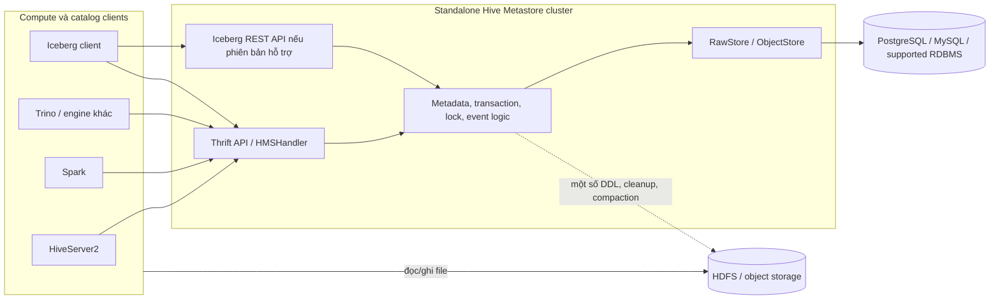
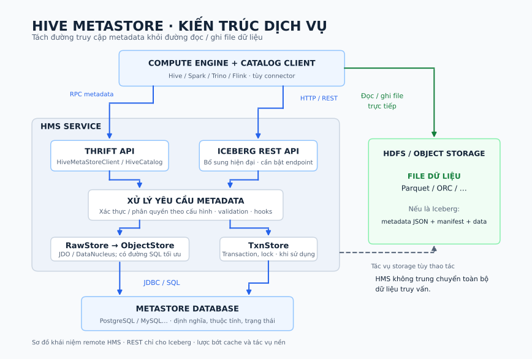
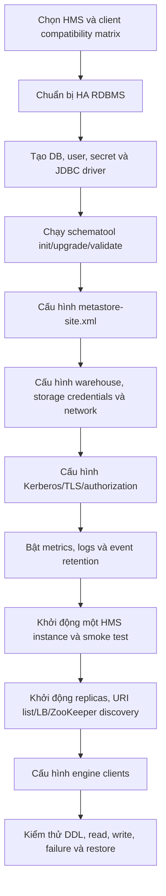
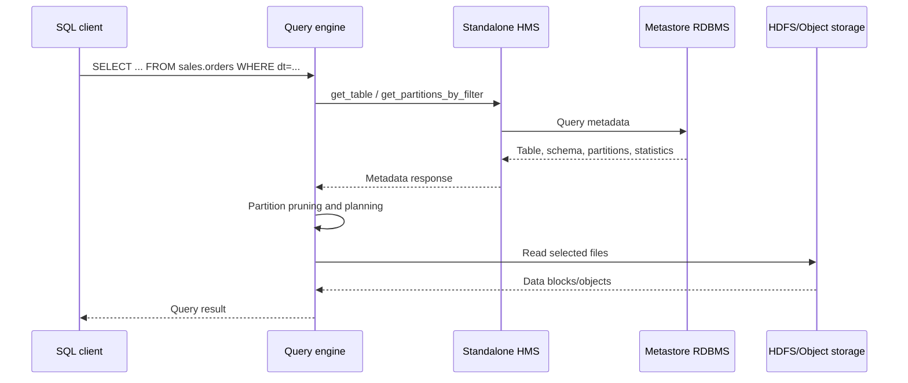
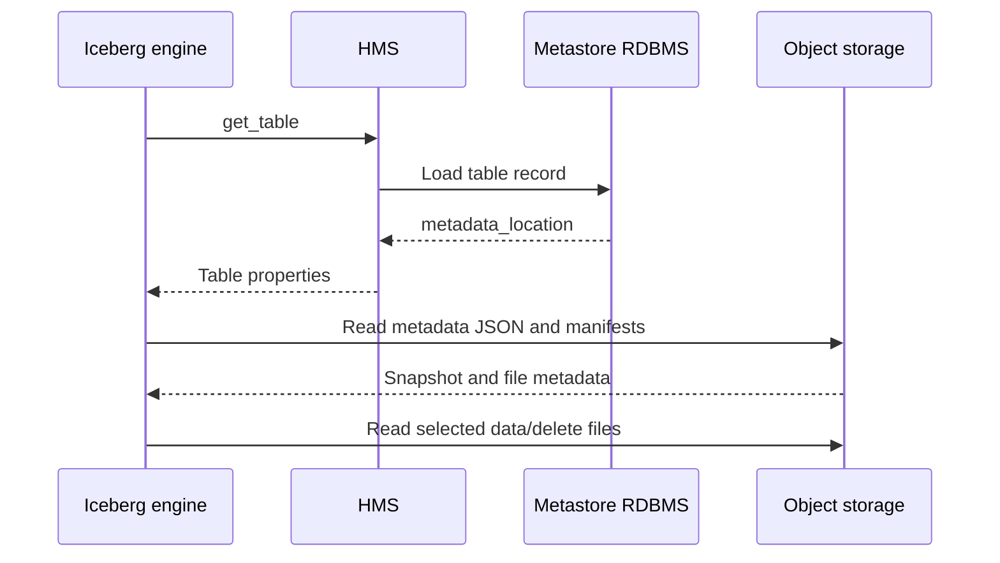
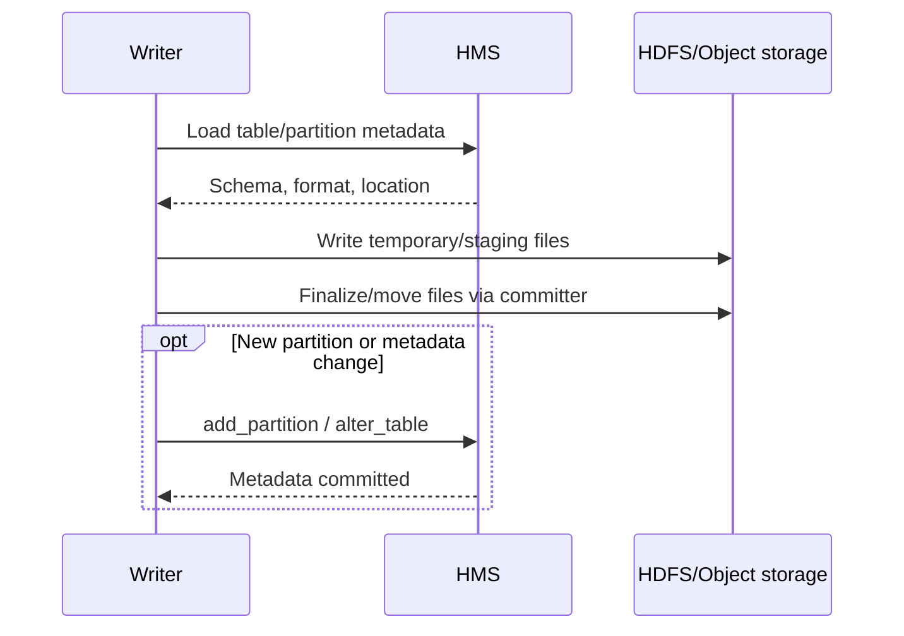
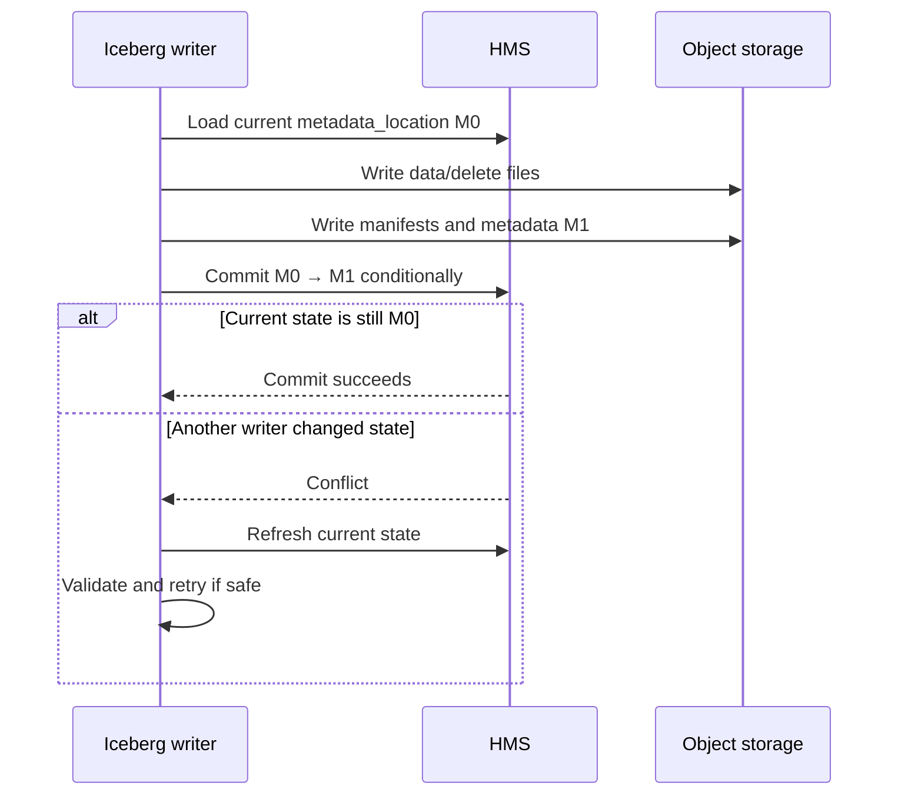
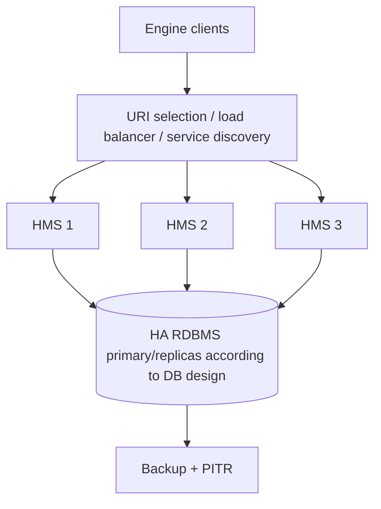

# Standalone Hive Metastore hiện đại: kiến trúc, metadata và vận hành

*Phạm vi: Standalone Hive Metastore (HMS) từ Hive 3.x trở lên, trọng tâm là mô hình service tách khỏi HiveServer2 và query engine. Nội dung được đối chiếu với tài liệu Apache Hive, Apache Iceberg và mã nguồn nhánh phát triển đến ngày 14/09/2026. Các tính năng ghi là “hiện đại” như Iceberg REST, OAuth/JWT, dynamic service discovery hoặc một số API mới phải được kiểm tra theo đúng phiên bản HMS và client đang triển khai.*

## 0. Tổng quan cách Standalone Hive Metastore hoạt động

**Standalone Hive Metastore là một dịch vụ catalog quản lý metadata kỹ thuật dùng chung cho nhiều compute engine.** Từ Hive 3.0, Metastore có thể được cài và chạy mà không cần cài phần còn lại của Apache Hive; Apache cung cấp bản phân phối riêng để các hệ thống ngoài Hive tích hợp dễ hơn. Nó vẫn nằm trong hệ sinh thái và codebase Apache Hive, nhưng vòng đời tiến trình HMS không còn phải gắn với HiveServer2. [Metastore Administration][1]

Trong báo cáo này, **catalog là nơi phân giải tên logic của đối tượng, chẳng hạn `sales.orders`, thành thông tin cần thiết để engine truy cập và quản lý bảng**. Thông tin đó phụ thuộc mô hình bảng; không thể định nghĩa mọi catalog là nơi quản lý “phiên bản metadata hiện tại”.

HMS phục vụ hai mô hình cần phân biệt ngay từ đầu:

| Khi HMS phục vụ | Engine nhận gì từ HMS? | Engine xác định dữ liệu bằng cách nào? |
|---|---|---|
| Hive table truyền thống, không ACID | Schema, format/SerDe, location, partition và statistics | Từ metadata table/partition, engine tìm và đọc file tại location tương ứng |
| Iceberg table qua `HiveCatalog` | Table record chứa tham số `metadata_location` | Iceberg đọc metadata JSON tại URI đó, chọn snapshot rồi lần theo manifests tới data/delete files |

Với Hive ACID, engine còn cần trạng thái transaction/write ID để xác định dữ liệu hợp lệ; đây là cơ chế riêng, được trình bày cùng hai mô hình trên ở mục 5, 7–9. [Hive Transactions][11], [HiveTableOperations][13]

HMS lưu các object và trạng thái do nó quản lý trong RDBMS; file dữ liệu nằm tại HDFS hoặc object storage. Với Iceberg, metadata chi tiết của table còn nằm trên storage. Trong truy vấn thông thường, engine lấy metadata qua HMS rồi đọc file trực tiếp. HMS không truyền từng hàng dữ liệu giữa storage và engine.



Một request điển hình có năm bước:

1. Client phân giải tên catalog/database/table và gọi Thrift API hoặc Iceberg REST API.
2. HMS xác thực, phân quyền và chạy pre-event hooks theo cấu hình.
3. Handler thực hiện nghiệp vụ metadata, lock hoặc transaction.
4. `RawStore`/`ObjectStore` đọc hoặc cập nhật RDBMS trong transaction metadata.
5. Client nhận metadata rồi tự truy cập data storage. Với DDL, ACID compaction hoặc cleanup, HMS cũng có thể thực hiện hay điều phối tác vụ liên quan storage.

Ba nhóm thông tin cần phân biệt; nhóm metadata Iceberg trên storage chỉ áp dụng khi bảng dùng mô hình đó:

| Trạng thái | Nơi lưu chủ yếu | Ví dụ |
|---|---|---|
| Catalog metadata | Metastore RDBMS | database, table, partition, statistics, locks |
| Table-format metadata | HDFS/object storage và một điểm tham chiếu trong catalog | Iceberg metadata JSON, snapshots, manifests |
| Dữ liệu nghiệp vụ | HDFS/object storage | ORC, Parquet, Avro, data/delete files |

## 1. Giới thiệu và bối cảnh ra đời

### 1.1. Từ Hive warehouse tới catalog service độc lập

Hive ban đầu được xây dựng để cung cấp abstraction dạng bảng và SQL trên dữ liệu Hadoop. File trong HDFS không tự mang đầy đủ namespace, schema, partition và quy tắc giải mã mà query planner cần. Metastore ra đời để tách mô tả logic khỏi file vật lý và lưu metadata đó trong một database tập trung. [Hive Design][2]

Theo thời gian, Spark, Presto/Trino, Impala và nhiều hệ thống khác cũng cần đọc cùng metadata. HMS dần trở thành hạ tầng dùng chung, dù lịch sử của nó bắt đầu bên trong Hive. Bước thay đổi quan trọng ở Hive 3.0 là khả năng phân phối và chạy Metastore độc lập. Tài liệu chính thức nêu rõ mục tiêu của separate release là giúp các hệ thống không phải Hive tích hợp dễ hơn. [Metastore Administration][1]

### 1.2. “Tách khỏi Hive” có nghĩa gì?

| Khía cạnh | Ý nghĩa |
|---|---|
| Tách tiến trình | HMS có JVM/service riêng; không cần chạy trong HiveServer2 |
| Tách gói cài đặt | Có standalone-metastore distribution/container riêng |
| Tách client | Engine ngoài Hive gọi HMS API qua mạng |
| Tách vận hành | Có cấu hình, scale, log, upgrade và HA riêng |
| Không phải tách hoàn toàn dự án | HMS vẫn thuộc Apache Hive codebase và release ecosystem |

Do đó, báo cáo này không xem Hive query engine là thành phần bắt buộc của kiến trúc HMS. HiveServer2 chỉ là một trong nhiều client có thể sử dụng catalog.

**Standalone là đặc tính triển khai; Hive non-ACID, Hive ACID và Iceberg là các mô hình bảng và giao thức truy cập.** Chạy HMS độc lập không tự chuyển Hive table sang Iceberg, không tự tạo `metadata_location`, cũng không tự bổ sung snapshot Iceberg. Cùng một HMS hiện đại có thể phục vụ các bảng thuộc những mô hình khác nhau.

### 1.3. Vai trò hiện đại

Standalone HMS hiện phục vụ ba nhóm workload:

- **Bảng Hive truyền thống:** schema, location, partition, SerDe và statistics.
- **Hive ACID:** thêm transaction, lock, write ID, compaction và visibility state.
- **Open table format, đặc biệt Iceberg:** HMS làm catalog backend hoặc cung cấp Iceberg REST endpoint; snapshot graph chi tiết vẫn do Iceberg quản lý. [Hive Transactions][11], [Iceberg REST trên HMS][8]

## 2. Bài toán giải quyết

### 2.1. Biến file thành đối tượng bảng có thể truy vấn

Ví dụ storage có đường dẫn:

```text
s3a://lake-prod/sales/orders/dt=2026-09-14/
```

Từ URI này, engine chưa biết tên bảng, kiểu cột, file format, partition key, SerDe hay owner. HMS cung cấp lớp mô tả logic:

| Bài toán | HMS cung cấp | Tác động tới engine |
|---|---|---|
| Phân giải tên | Catalog, database, table | Tìm dataset bằng định danh ổn định |
| Hiểu cấu trúc | Column, type, `StorageDescriptor` | Kiểm tra biểu thức và chọn reader |
| Tìm dữ liệu | Table/partition location | Xác định file hoặc prefix cần đọc |
| Partition pruning | Partition keys và partition objects | Loại vùng dữ liệu không cần quét |
| Lập kế hoạch | Table/column/partition statistics | Ước lượng cardinality và cost |
| Quản lý thay đổi | Create/alter/drop APIs | Dùng một contract metadata chung |

[Hive Design][2], [Thrift definition][4]

### 2.2. Chia sẻ metadata giữa nhiều engine

Nếu mỗi engine có catalog riêng, cùng một dataset có thể xuất hiện với schema hoặc partition khác nhau. HMS cung cấp một điểm đăng ký chung và operation-based API. Việc chia sẻ metadata giảm trùng lặp, nhưng không tự bảo đảm interoperability hoàn toàn: mỗi connector vẫn phải hiểu file format, SerDe, table type, transaction protocol và feature version. [Hive APIs Overview][5]

### 2.3. Tách compute khỏi metadata

Khi HMS là remote standalone service, compute cluster có thể co giãn hoặc bị thay thế mà không làm mất catalog. Client không cần credential trực tiếp tới metastore RDBMS. Đây là boundary bảo mật và vận hành quan trọng: chỉ HMS service account truy cập backend database; engine gọi API được kiểm soát.

### 2.4. Điều phối trạng thái giao dịch

Với Hive ACID, HMS còn quản lý transaction, lock, write ID, heartbeat và compaction state. Với Iceberg qua `HiveCatalog`, HMS giữ điểm vào tới metadata hiện hành và tham gia công bố metadata mới có kiểm tra trạng thái cũ. Cơ chế bảo vệ cụ thể thuộc catalog implementation và phiên bản HMS; xem mục 8.3. Hai cơ chế có mục tiêu gần nhau nhưng data model và commit protocol khác nhau. [Hive Transactions][11], [HiveTableOperations][13]

## 3. Kiến trúc và các thành phần



*Hình 1. Sơ đồ kiến trúc logic. Thrift là giao diện HMS truyền thống; Iceberg REST là phần mở rộng hiện đại và phụ thuộc phiên bản. RDBMS giữ catalog metadata, còn HDFS/object storage giữ dữ liệu và metadata file của table format.*

### 3.1. Client layer

Client có thể là HiveServer2, Spark, Trino, Flink, Iceberg library hoặc công cụ quản trị. Client chịu trách nhiệm:

- ánh xạ tên table trong SQL/API sang namespace HMS;
- gọi metadata/transaction API;
- cache metadata theo implementation;
- lập query/write plan;
- truy cập HDFS/object storage bằng credential riêng.

HMS client và query engine không phải một thành phần. Việc một engine đọc được `get_table` chưa chứng minh nó hỗ trợ ghi ACID hoặc commit Iceberg.

### 3.2. API và transport layer

Giao diện phổ biến nhất là Thrift, mặc định thường dùng cổng 9083 trong tài liệu triển khai. API chứa các operation cụ thể như lấy/tạo/sửa table, liệt kê partition, quản lý function, statistics, lock và transaction. Java client thường tiếp cận qua `IMetaStoreClient`. [Hive APIs Overview][5], [Thrift definition][4]

HMS hiện đại còn có thể cung cấp Iceberg REST Catalog API trên endpoint riêng. Thrift over HTTP và Iceberg REST là hai giao diện khác nhau: cùng có thể dùng HTTP transport nhưng khác resource model và protocol. [Iceberg REST trên HMS][8], [Hive 4.0 Major Changes][9]

### 3.3. Handler và service logic

`HMSHandler` nhận request và điều phối validation, authorization hooks, listeners, warehouse operations, transaction/lock service và persistence. HMS không chỉ là CRUD proxy thụ động: DDL, event delivery, ACID housekeeping hoặc table-format integration có thể kích hoạt logic bổ sung.

### 3.4. Persistence layer

`RawStore` là abstraction cho metadata persistence; `ObjectStore` là implementation chính dùng DataNucleus/JDO để ánh xạ object sang RDBMS. Mã nguồn còn có `MetaStoreDirectSql` cho các đường xử lý SQL trực tiếp, nên mô tả “mọi lời gọi luôn qua ORM giống nhau” là không chính xác. [ObjectStore][7]

Transaction bên trong `ObjectStore` bảo vệ thay đổi trong metastore database. Nó không tự mở rộng thành distributed transaction với HDFS/S3 hoặc nhiều engine.

### 3.5. Metastore RDBMS

Backend chứa quan hệ database, table, storage descriptor, column, partition, statistics, privileges, transactions, locks và notification events tùy tính năng. Production thường dùng PostgreSQL, MySQL, MariaDB, Oracle hoặc SQL Server theo support matrix của phiên bản. Embedded Derby phù hợp cho thử nghiệm đơn tiến trình, không phải lựa chọn production nhiều client. [Metastore Administration][1]

### 3.6. Warehouse và data storage

HDFS/object storage chứa file dữ liệu. Với managed table, HMS/Hive có trách nhiệm vòng đời storage lớn hơn; với external table, trách nhiệm thường thuộc hệ thống bên ngoài. Hành vi `DROP TABLE` còn phụ thuộc table type và purge properties, vì vậy không nên dùng quy tắc tuyệt đối “external luôn giữ dữ liệu”. [Hive DDL][14]

### 3.7. Transaction và background services

Hive ACID bổ sung `DbTxnManager`, durable locks trong metastore, transaction heartbeat, Initiator, Worker, Cleaner và housekeeping. Compactor có minor, major và rebalance compaction; các vai trò background phải được bố trí và giám sát như thành phần production. [Hive Transactions][11]

### 3.8. Event/listener và cache

Pre-event listeners có thể chặn thao tác trước khi thay đổi; event listeners phản ứng sau sự kiện; notification log cho phép hệ thống khác theo dõi thay đổi catalog. Cache có thể giảm tải backend nhưng tạo thêm yêu cầu invalidation và đo độ mới. Không nên xem event stream là distributed transaction với consumer.

## 4. Mô hình triển khai và flow khởi tạo

### 4.1. Các mô hình triển khai

| Mô hình | Đặc điểm | Đánh giá |
|---|---|---|
| Embedded HMS + Derby | Logic và DB nằm cùng client | Chỉ phù hợp demo/test nhỏ |
| Embedded HMS + remote RDBMS | Không có network hop tới HMS nhưng mỗi client mở DB connection | Khó bảo mật và scale nhiều client |
| Remote standalone HMS + RDBMS | Service riêng, client gọi Thrift/REST | Mô hình production khuyến nghị |
| Nhiều HMS instance + HA RDBMS | Stateless service replicas dùng backend chung | HA/scale-out chuẩn |
| Container/Kubernetes | HMS pod stateless, config/secret bên ngoài | Cần readiness, graceful shutdown và schema migration riêng |

Tài liệu 3.x+ khuyến cáo embedded mode ngoài trường hợp đặc biệt vì nhiều client gây áp lực connection lên RDBMS và buộc chúng có quyền trực tiếp tới database. [Metastore Administration][1]

### 4.2. Flow khởi tạo production



#### Bước 1: khóa compatibility matrix

Chọn HMS version, Java, Hadoop libraries, RDBMS/JDBC driver, engine connector và table format version. Thrift có backward compatibility rộng nhưng không nên giả định mọi tổ hợp đều tương thích. PoC phải dùng đúng DDL, table types và authentication dự kiến.

#### Bước 2: chuẩn bị metastore database

Tạo HA RDBMS, database/schema riêng, user ít quyền và connection limits. Secret không đặt trực tiếp trong image hoặc repository; dùng secret manager/credential provider của nền tảng.

#### Bước 3: khởi tạo schema bằng `schematool`

`schematool` hỗ trợ `-initSchema`, `-upgradeSchema`, `-info` và `-validate`. Production nên bật schema verification và chạy migration có kiểm soát thay vì để service tự sửa schema khi startup. [Hive Schema Tool][6], [Metastore Administration][1]

```bash
schematool -dbType postgres -initSchema
schematool -dbType postgres -info
schematool -dbType postgres -validate
```

Đây là schema **nội bộ của HMS**, khác với schema cột của table nghiệp vụ.

#### Bước 4: cấu hình service

Standalone distribution đọc `metastore-site.xml` trong `$METASTORE_HOME/conf`. Các nhóm cấu hình chính gồm:

- JDBC URL, driver, user, password và pool;
- `metastore.thrift.port`, `metastore.thrift.uris` phía client;
- warehouse/external warehouse location;
- retry, timeout và batch limits;
- authentication, TLS và authorization hooks;
- transaction/compactor nếu dùng Hive ACID;
- metrics, logs, notification/event cleanup;
- Iceberg REST port/auth nếu bật REST catalog.

#### Bước 5: khởi động và scale-out

Khởi động một instance, thực hiện `get_database`, create/drop table thử nghiệm và query qua consumer thật. Sau đó thêm replicas. Client có thể nhận danh sách URI với chiến lược `RANDOM`/`SEQUENTIAL`; Hive 4.x có dynamic discovery bằng ZooKeeper theo cấu hình và phiên bản. [Metastore Administration][1], [Hive 4.0 Major Changes][9]

#### Bước 6: nghiệm thu failure path

Kiểm tra mất một HMS instance, restart database, timeout storage, schema mismatch, writer conflict, compaction backlog và restore backup. “Service chạy” chưa đủ; phải chứng minh client failover và metadata/data vẫn khớp.

## 5. Mô hình metadata và cơ chế lưu trữ

### 5.1. Một metastore, nhiều mô hình metadata

Câu hỏi đầu tiên khi phân tích một bảng trong HMS là **“bảng này dùng mô hình nào?”**, sau đó mới hỏi metadata nằm ở đâu. Các object `Table`, `Partition`, `StorageDescriptor` và `Parameters` là khung lưu trữ của HMS; connector/table format quyết định cách diễn giải chúng. [Thrift definition][4]

| Khía cạnh | Hive table không ACID | Hive ACID | Iceberg qua `HiveCatalog` |
|---|---|---|---|
| Metadata mô tả bảng | Schema, location, format, partition… trong HMS | Mô tả bảng trong HMS, bổ sung trạng thái giao dịch | Metadata JSON Iceberg trên storage; HMS giữ table record và điểm tham chiếu |
| Partition metadata phục vụ planning | Thường là các partition object trong HMS | Partition object trong HMS kết hợp trạng thái ACID | Partition specs trong metadata JSON; giá trị partition/file metadata trong manifests |
| Cách xác định file hợp lệ | Location và quy tắc liệt kê/đọc file của engine | Valid write IDs kết hợp base/delta/delete_delta | Snapshot được chọn và cây manifest của snapshot đó |
| `metadata_location` hiện hành | Không phải khái niệm trung tâm | Không phải cơ chế visibility của Hive ACID | Điểm vào cốt lõi của `HiveCatalog` |
| Lịch sử dữ liệu | Không có snapshot Iceberg mặc định | Visibility theo transaction/write ID, không phải snapshot graph Iceberg | Snapshot và metadata được giữ theo chính sách retention của Iceberg |
| Công bố thay đổi | File commit; cập nhật HMS khi cần | Commit trạng thái transaction | Công bố metadata mới có kiểm soát xung đột |

Các hàng trên mô tả trách nhiệm logic, không có nghĩa toàn bộ metadata chỉ tồn tại ở một nơi: Iceberg integration có thể đồng bộ một số trường schema/properties vào HMS để tương thích. Với Iceberg reader, metadata Iceberg vẫn quyết định schema, partition spec và snapshot cần dùng. [HiveTableOperations][13]

### 5.2. Mô hình đối tượng logic của HMS

```text
Catalog
└── Database
    ├── Table
    │   ├── Columns / column descriptor
    │   ├── StorageDescriptor
    │   │   ├── Location
    │   │   ├── InputFormat / OutputFormat
    │   │   ├── SerDeInfo
    │   │   └── Bucket / sort properties
    │   ├── PartitionKeys
    │   ├── Parameters / table type / owner
    │   ├── Statistics
    │   └── Partitions
    │       ├── Values
    │       └── StorageDescriptor
    └── Functions và các object phụ trợ
```

Mô hình này là abstraction từ Thrift object model; schema SQL vật lý có nhiều bảng liên kết hơn. [Thrift definition][4]

| Đối tượng | Nội dung | Lưu ý thực hành |
|---|---|---|
| Catalog | Namespace cấp cao | Client cũ có thể chỉ hiểu default catalog |
| Database | Namespace, owner, location, properties | Không phải database chứa row data |
| Table | Loại bảng, partition keys, parameters | Parameter có thể là contract của connector |
| StorageDescriptor | Cột, location, format, SerDe, bucket/sort | Thường được chia sẻ qua column descriptor |
| Partition | Giá trị key và storage descriptor | Cardinality lớn gây tải metadata |
| Statistics | Row count, size, column stats | Có thể stale nếu pipeline không cập nhật |
| Privilege | Principal và grants theo model cấu hình | Không thay thế quyền filesystem/object store |
| Transaction/lock | Txn ID, write ID, lock, compaction state | Chỉ liên quan đúng transaction protocol |

### 5.3. Hive table truyền thống: HMS lưu metadata trực tiếp

Với bảng truyền thống, trạng thái truy vấn được suy ra từ table/partition metadata kết hợp với file hiện có tại location. Partition key nằm trong định nghĩa table; partition value nằm ở object partition cụ thể.

Ví dụ `sales.orders` có `dt STRING` là partition key. Partition `dt=2026-09-14` trỏ tới location của ngày đó. Nếu pipeline chép file vào prefix mới nhưng chưa đăng ký partition, engine dựa vào HMS có thể không thấy dữ liệu.

```text
sales.orders (Hive non-ACID)
  → HMS / metastore RDBMS
      ├── columns: order_id BIGINT, amount DECIMAL(...)
      ├── format / SerDe
      ├── table location: s3://lake/orders/
      ├── partition key: dt STRING
      ├── partition dt=2026-09-14 → location của partition
      └── table / column statistics
  → Engine tìm file tại các location đã chọn
  → Đọc dữ liệu
```

Ở đây không có chuỗi bắt buộc `orders → metadata-v42.json → snapshot → manifests`. HMS giữ trực tiếp mô tả bảng; engine kết hợp mô tả đó với trạng thái file trên storage. Việc có notification log, audit hoặc backup metastore cũng không đồng nghĩa có lịch sử snapshot dữ liệu để time travel. [Thrift definition][4], [Hive DDL][14]

### 5.4. Hive ACID: thêm trạng thái giao dịch

Hive ACID dùng thêm transaction ID, write ID, valid transaction/write-id list, base/delta/delete_delta directories và compaction state. Reader kết hợp metadata giao dịch với file layout để tạo snapshot hợp lệ. Metastore database giữ trạng thái điều phối; dữ liệu ACID vẫn nằm ở warehouse. [Hive Transactions][11]

### 5.5. Iceberg qua HiveCatalog: HMS giữ điểm tham chiếu hiện hành

Với `HiveCatalog`, HMS giữ table record và `metadata_location` trỏ tới Iceberg metadata JSON hiện hành. Metadata JSON tham chiếu snapshot, manifest list và manifest; manifest mô tả data/delete files. Toàn bộ snapshot graph không nằm trong các bảng SQL của metastore. [Iceberg Specification][12], [HiveTableOperations][13]

```text
HMS table record
└── metadata_location
    └── metadata.json
        ├── schemas + partition specs
        ├── current snapshot
        └── snapshot → manifest list → manifests → data/delete files
```

Ví dụ tại một thời điểm, table parameter có giá trị:

```text
sales.orders.parameters["metadata_location"]
  = s3://lake/orders/metadata/42-<uuid>.metadata.json
```

Trong thư mục `metadata/` có thể còn nhiều file cũ hoặc file do một lần commit chưa thành công tạo ra. **Reader dùng URI được catalog công bố, không chọn file có tên lớn nhất hay thời gian sửa đổi mới nhất.** Các số `42`, `43` trong ví dụ chỉ minh họa phiên bản file; không phải snapshot ID và không phải thuật toán tìm trạng thái hiện hành. [HiveTableOperations][13]

Cần tách ba khái niệm:

- **Phiên bản table metadata:** một trạng thái mô tả bảng, được ghi thành metadata JSON mới khi có thay đổi.
- **Snapshot:** trạng thái dữ liệu được Iceberg mô tả. Thay đổi properties hoặc schema có thể tạo metadata mới mà không tạo snapshot dữ liệu mới.
- **`metadata_location`:** URI trong HMS dùng để tìm metadata hiện hành của bảng; tự nó không chứa toàn bộ lịch sử dữ liệu.

Vì vậy, “đổi metadata pointer” không đồng nghĩa “mọi commit đều tạo snapshot mới”. Khả năng đọc snapshot cũ còn phụ thuộc retention và sự tồn tại của các file được tham chiếu. [Iceberg Specification][12]

Đây là sự khác biệt về phân bổ trách nhiệm: với Hive table truyền thống, HMS chứa nhiều metadata mà engine trực tiếp dùng để tìm dữ liệu; với Iceberg, `HiveCatalog` dùng HMS để định danh bảng và công bố điểm vào của trạng thái hiện hành, còn cấu trúc metadata chi tiết và snapshot do Iceberg quản lý. Hai cách này cùng tồn tại trong HMS hiện đại.

### 5.6. Managed và external table

Managed/external mô tả trách nhiệm vòng đời dữ liệu, không chỉ nơi đặt file. Tác động của `DROP`, `PURGE`, truncate và rename phụ thuộc table type, storage handler, properties và version. Pipeline phải kiểm thử lifecycle thay vì suy luận chỉ từ nhãn `EXTERNAL`. [Hive DDL][14]

## 6. API và khả năng tích hợp

### 6.1. Thrift API

Thrift là giao diện native lâu đời của HMS. API có tính operation-based:

- catalog/database/table CRUD;
- partition list/filter/add/drop;
- statistics;
- function và privilege operations;
- lock/transaction/write ID/compaction;
- notification events.

Client Java dùng `IMetaStoreClient`; các engine khác thường dùng thư viện hoặc connector tương thích. [Hive APIs Overview][5], [Thrift definition][4]

### 6.2. Iceberg qua HiveCatalog

Iceberg `HiveCatalog` dùng HMS làm catalog. Client gọi HMS để tìm table và commit metadata location mới, nhưng đọc snapshot/manifests từ storage. Đây là cách tận dụng HMS hiện hữu mà không chuyển sang REST catalog. [Iceberg Hive Integration][19]

### 6.3. Iceberg REST API do HMS phục vụ

Tài liệu HMS hiện đại mô tả REST endpoint cho Iceberg client, hỗ trợ namespace/table/view operations và transaction commit theo tập endpoint được triển khai. Các lựa chọn authentication gồm OAuth 2, JWT, simple và none; simple/none chỉ phù hợp thử nghiệm. [Iceberg REST trên HMS][8]

REST endpoint này khác trường hợp Hive engine kết nối một REST catalog bên ngoài như Polaris hoặc Gravitino. Một bên là **HMS làm server REST**; bên kia là **Hive làm REST client**. [Hive REST Catalog Integration][17]

### 6.4. Event và extensibility API

Pre-event listener có thể kiểm tra/chặn operation; post-event listener và notification log phục vụ audit, replication hoặc đồng bộ catalog. Consumer phải lưu offset/event ID, xử lý trùng lặp và event expiry. Không dùng listener như bằng chứng rằng một thay đổi ở hệ thống ngoài đã commit nguyên tử.

### 6.5. Tích hợp engine

| Engine/hệ thống | Cách tích hợp thường gặp | Điểm cần kiểm tra |
|---|---|---|
| HiveServer2 | Embedded hoặc remote Thrift HMS | ACID config, authorization, version |
| Spark | Hive catalog client hoặc Iceberg HiveCatalog | metastore client jars, conversion, write semantics |
| Trino/Presto | Hive connector gọi HMS | cache, impersonation, table format support |
| Flink | HiveCatalog/Iceberg catalog | DDL và streaming commit support |
| Impala | Remote HMS + notification events tùy kiến trúc | metadata invalidation/sync |
| Iceberg clients | HiveCatalog hoặc HMS Iceberg REST | lock, REST auth, spec/version support |

**Không truy cập trực tiếp metastore RDBMS từ ứng dụng.** Làm vậy bypass validation, authorization, listeners, compatibility layer và transaction rules; thay đổi schema nội bộ có thể phá ứng dụng khi nâng cấp.

## 7. Flow đọc

### 7.1. Bảng Hive truyền thống



Các bước:

1. Engine parse SQL và phân giải catalog/database/table.
2. Metastore client lấy table, schema, format, location và partition cần thiết.
3. HMS đọc RDBMS, chạy authorization rồi trả metadata.
4. Engine dùng predicate và statistics để lập kế hoạch.
5. Worker đọc file trực tiếp và thực thi query.

Partition pruning phụ thuộc việc predicate ánh xạ được vào partition key. Partition theo `dt` không bảo đảm engine suy ra pruning từ mọi biểu thức timestamp tương đương; đây là một hạn chế mà hidden partitioning của Iceberg giải quyết ở table-format layer. [Iceberg Partitioning][15]

### 7.2. Bảng Hive ACID

Reader lấy valid transaction/write ID state từ metastore, chọn base và delta hợp lệ tại thời điểm snapshot, rồi merge insert/update/delete khi đọc. Tài liệu hiện tại mô tả snapshot-level isolation; không nên gọi đây là mọi isolation level của RDBMS. [Hive Transactions][11]

### 7.3. Bảng Iceberg qua HiveCatalog



Trong flow Iceberg này, HMS cung cấp điểm vào; Iceberg planner dùng snapshot và manifest statistics để chọn file. Engine không cần đăng ký từng partition Iceberg thành HMS partition như cách thường dùng với Hive table. Vì vậy lỗi `get_table` thuộc catalog path, còn lỗi đọc metadata JSON/manifest thường thuộc storage path, credential hoặc table corruption. [Iceberg Partitioning][15]

Hệ quả thực hành: cùng thao tác “chép thêm file vào thư mục bảng”, một Hive non-ACID reader có thể thấy file sau khi listing/refresh phù hợp, nhưng Iceberg reader không xem file là dữ liệu của bảng cho đến khi file được đưa vào trạng thái đã commit. Việc dùng cùng HMS không làm hai flow đọc trở thành tương đương.

### 7.4. Tác động của cache

Engine và HMS có thể cache database/table/partition. Cache giảm latency nhưng làm thay đổi độ mới quan sát được. TTL, invalidation bằng notification event và thao tác refresh phải là một phần của runbook; không kết luận RDBMS stale trước khi loại trừ client cache.

## 8. Flow ghi và commit

### 8.1. Bảng Hive truyền thống, không ACID



File commit và metastore update không mặc nhiên nằm trong một distributed transaction. Nếu file đã hoàn tất nhưng `add_partition` thất bại, dữ liệu có thể tồn tại mà query không thấy. Nếu metadata được công bố quá sớm, reader có thể thấy partition chưa hoàn chỉnh.

Không nên rút gọn flow này thành “commit = update metadata HMS”. Khi append vào partition đã đăng ký, hoặc vào bảng không partition mà location không đổi, writer có thể chỉ cần công bố file theo output committer; engine vẫn có thể cập nhật statistics/events tùy implementation. Khi tạo partition mới, bước đăng ký metadata mới trở nên cần thiết đối với reader dựa vào danh sách partition trong HMS. Không có bước đổi `metadata_location` bắt buộc như Iceberg.

Biện pháp thực hành:

- dùng staging/finalization protocol phù hợp storage;
- đăng ký partition sau khi dữ liệu hoàn tất;
- làm bước metadata idempotent;
- chạy reconciliation giữa storage và HMS;
- dùng `ADD PARTITION`/API hoặc `MSCK REPAIR TABLE` có kiểm soát. [Hive DDL][14]

### 8.2. Hive ACID

Flow khái niệm:

1. Client mở transaction và lấy lock/write ID.
2. Client heartbeat để transaction không bị timeout.
3. Writer ghi delta/delete_delta theo layout ACID.
4. Client commit hoặc abort transaction tại metastore.
5. Reader chỉ thấy write IDs hợp lệ cho snapshot.
6. Initiator lên lịch compaction; Worker compact; Cleaner xóa file cũ khi an toàn.

Compaction là phần bắt buộc phải vận hành, không chỉ là tối ưu tùy chọn. Backlog làm tăng số delta và chi phí merge khi đọc. [Hive Transactions][11]

### 8.3. Iceberg commit qua HiveCatalog



Sơ đồ mô tả một lần ghi dữ liệu; commit chỉ đổi schema/properties có thể không ghi data files hoặc tạo snapshot mới. Điều kiện `M0 → M1` biểu diễn yêu cầu logic: chỉ công bố metadata dựa trên trạng thái nền còn hợp lệ.

Trong đường dùng HMS lock, `HiveTableOperations` ghi metadata mới, lấy lock, nạp lại table record, so sánh base metadata với vị trí hiện hành rồi cập nhật HMS và giải phóng lock. Các nhánh không dùng HMS lock cần cơ chế cập nhật có điều kiện được backend/phiên bản hỗ trợ. **Đây không phải khẳng định rằng mọi HMS đều có một RPC compare-and-swap riêng cho Iceberg.** Chỉ thực hiện `get_table` rồi `alter_table` mà không bảo vệ khoảng kiểm tra–cập nhật sẽ không đủ để chống lost update. Phải kiểm tra cặp phiên bản Iceberg/HMS và cấu hình lock đang dùng. [HiveTableOperations][13]

File được tạo nhưng không được snapshot đã commit tham chiếu có thể trở thành orphan. Nếu client mất response sau commit, phải kiểm tra trạng thái hiện hành trước khi dọn file; không coi mọi lỗi network là commit thất bại. [Iceberg Reliability][16]

### 8.4. Commit qua Iceberg REST

REST client gửi requirements và updates theo Iceberg REST protocol tới HMS REST endpoint. Server xác thực requirement trên trạng thái hiện hành rồi công bố update hoặc trả conflict. Semantics table vẫn là semantics Iceberg; REST thay giao diện catalog, không chuyển data file qua HMS. [Iceberg REST trên HMS][8]

## 9. Tính nhất quán và transaction

### 9.1. Bốn phạm vi transaction

| Phạm vi | Thành phần bảo vệ | Giới hạn |
|---|---|---|
| RDBMS transaction | Các row metadata trong một HMS operation | Không bao gồm file storage |
| Hive non-ACID write | Output committer; metadata operation khi cần | Không có ACID end-to-end mặc định |
| Hive ACID transaction | Write IDs, locks, valid snapshots, base/delta | Phụ thuộc table/config/engine hỗ trợ |
| Iceberg commit | Table metadata state bằng optimistic concurrency | Có thể chỉ đổi metadata, không tạo snapshot; theo từng table commit |

Đây là điểm then chốt: việc `ObjectStore.commitTransaction()` thành công chỉ nói về transaction persistence tương ứng. Nó không tự chứng minh file và nhiều table đã commit nguyên tử.

Tương tự, “snapshot” của Hive ACID là góc nhìn hợp lệ theo transaction/write ID; snapshot Iceberg là một đối tượng trong mô hình metadata của Iceberg. Cùng mục tiêu đọc nhất quán không có nghĩa chúng dùng cùng một mô hình version hoặc cùng commit protocol.

### 9.2. Hive ACID semantics

Hive ACID dùng `DbTxnManager`; transaction và lock bền vững trong metastore. Client gửi heartbeat; transaction bỏ heartbeat quá timeout sẽ bị abort. Reader nhận consistent snapshot. Tài liệu hiện tại nêu snapshot-level isolation, nên thiết kế không được giả định serializable isolation. [Hive Transactions][11]

### 9.3. Iceberg optimistic concurrency

Hai writer cùng bắt đầu từ M0. Writer A commit M1 trước. Writer B không được ghi đè thay đổi dựa trên M0; nó phải refresh, kiểm tra conflict và retry nếu operation còn hợp lệ. Atomicity nằm ở việc công bố metadata state mới, còn data/metadata files được ghi trước. [Iceberg Reliability][16]

### 9.4. Metadata và storage drift

Các tình huống cần runbook:

- file tồn tại nhưng partition chưa đăng ký;
- partition trỏ tới location không tồn tại;
- table schema khác file schema;
- Iceberg `metadata_location` trỏ tới file mất/hỏng;
- cache chưa nhận notification event;
- aborted Hive transaction hoặc failed compaction để lại file cần cleanup.

Reconciliation phải hiểu table type. Dùng `MSCK REPAIR` cho Iceberg hoặc tự xóa file ACID/Iceberg mà không hiểu snapshot có thể phá bảng.

### 9.5. Multi-table transaction

Hive ACID và Iceberg qua HMS không mặc nhiên cung cấp atomic visibility cho một business operation thay đổi nhiều table độc lập. Nếu cần consistency xuyên bảng, phải đánh giá engine/table-format/catalog protocol hỗ trợ hoặc thiết kế publication marker/versioning ở tầng ứng dụng. Snapshot của từng Iceberg table không đồng nghĩa versioned catalog branch như Project Nessie. [Project Nessie][20]

## 10. Bảo mật

### 10.1. Bề mặt cần bảo vệ

```text
Client → Thrift/REST endpoint → HMS authorization → RDBMS
   └──────────────────────────────────────────────→ HDFS/Object storage
```

Bảo vệ chỉ một mũi tên là chưa đủ. Security design phải bao gồm network, service authentication, metadata authorization, backend database và data storage.

### 10.2. Authentication và transport

- **Thrift:** cấu hình HMS hỗ trợ SASL/Kerberos; principal và keytab phải đồng nhất giữa client/server. TLS/transport options phụ thuộc phiên bản và deployment. [Hive Configuration][21]
- **Iceberg REST:** tài liệu hiện đại nêu OAuth 2, JWT, simple và none. `simple` chỉ tin header username; `none` không xác thực, nên chỉ dùng test. [Iceberg REST trên HMS][8]
- **RDBMS:** chỉ HMS service account cần quyền; dùng TLS JDBC và secret provider nếu backend hỗ trợ.
- **Storage:** HDFS Kerberos/Ranger hoặc object-store IAM/policy được đánh giá riêng với catalog authentication.

Không lấy cấu hình mặc định của image demo làm baseline production.

### 10.3. Authorization

Metastore-side authorization có thể dùng pre-event listener và authorization provider; storage-based authorization dùng quyền trên warehouse path. Hệ sinh thái thường tích hợp Apache Ranger để quản lý policy tập trung. [Storage-based Authorization][22], [Iceberg REST trên HMS][8]

SQL Standard Based Authorization tại HiveServer2 và authorization tại HMS bảo vệ các đường khác nhau. Nếu Spark/Trino gọi HMS trực tiếp, policy chỉ đặt tại HiveServer2 không bảo vệ request đó. Tương tự, từ chối metadata request không thu hồi credential storage mà client đã có.

### 10.4. Backend và secret security

- Không cho client truy cập trực tiếp metastore database.
- Tách DB user quản trị schema và DB user runtime.
- Mã hóa kết nối và backup RDBMS.
- Không hard-code JDBC password, keytab hoặc OAuth secret trong image/config repository.
- Giới hạn network từ HMS tới database và storage.
- Xoay vòng secret có thử nghiệm connection pool/restart behavior.

### 10.5. Audit

Kết hợp HMS logs, authorization audit, Ranger audit nếu dùng, RDBMS audit và storage audit. Notification log hữu ích để dựng lịch sử thay đổi nhưng không thay security audit đầy đủ. Theo dõi ít nhất create/alter/drop table, privilege change, transaction abort, compaction và authentication failure.

## 11. Khả năng mở rộng, HA và vận hành

### 11.1. Scale path

HMS service được mô tả là stateless, nên có thể thêm instance. Tuy nhiên, mọi instance dùng RDBMS chung; scale service mà không scale/tune database có thể chỉ chuyển bottleneck xuống dưới. [Metastore Administration][1]



Các nút scale chính:

- số RPC đồng thời và thread pool;
- JDBC connection pool trên mỗi instance × số instance;
- query/index của metastore schema;
- batch size và số partition trả về;
- client/HMS cache hit rate và invalidation;
- tần suất DDL/statistics/event polling;
- transaction/lock contention và compaction backlog.

### 11.2. Partition scale

Nhiều partition làm tăng row count, payload RPC và planning latency. Data Engineer nên:

- tránh partition cardinality quá cao;
- dùng filter API thay vì tải toàn bộ partition;
- dùng batch API;
- cập nhật statistics có mục tiêu;
- benchmark query metadata trên production-like volume;
- cân nhắc hidden partitioning/partition evolution khi chuyển sang Iceberg. [Iceberg Partitioning][15]

### 11.3. High availability

HA đầy đủ gồm bốn lớp:

| Lớp | Cơ chế |
|---|---|
| HMS service | Nhiều stateless instances, health check, client URI selection/LB |
| Discovery | Static URI list hoặc ZooKeeper dynamic discovery ở phiên bản hỗ trợ |
| RDBMS | HA/failover/backup theo database được chọn |
| Storage | HDFS HA hoặc durability/availability của object storage |

HMS replica sống nhưng RDBMS lỗi vẫn khiến catalog không hoạt động. Tương tự, catalog hoạt động không bảo đảm storage đọc được. Dynamic leader election dùng cho một số background task không có nghĩa toàn bộ metadata RPC đi qua một leader. [Hive 4.0 Major Changes][9]

### 11.4. Upgrade và rollback

Upgrade gồm binary **và** metastore schema:

1. đọc upgrade path chính thức và compatibility matrix;
2. backup/PITR checkpoint RDBMS;
3. chạy `schematool -info/-validate`;
4. thử migration trên bản sao production;
5. dừng hoặc kiểm soát writer trong cửa sổ migration;
6. chạy `schematool -upgradeSchema` theo kế hoạch;
7. rolling/canary service nếu version compatibility cho phép;
8. smoke test DDL, partition, ACID và Iceberg;
9. có rollback plan phù hợp với schema change.

Không nên bật automatic schema migration trong production. [Hive Schema Tool][6], [Metastore Administration][1]

### 11.5. Observability

Hive có metrics system và có thể xuất qua JMX, JSON file hoặc reporter phù hợp theo phiên bản; metastore metrics cần được bật. [Hive Metrics][23]

| Nhóm | Tín hiệu cần quan sát |
|---|---|
| API | request rate, p50/p95/p99 latency, error, timeout |
| JVM | heap, GC pause, thread count, CPU |
| JDBC | active/idle/waiting connections, pool exhaustion |
| RDBMS | slow query, lock wait, IOPS, CPU, replica lag |
| Metadata | table/partition growth, stale stats, notification lag |
| ACID | open/aborted transaction, locks, compaction queue/failure |
| Iceberg | commit conflict, orphan files, snapshot/manifest growth |

### 11.6. Backup và disaster recovery

Phải bảo vệ hai tập dữ liệu độc lập:

1. metastore RDBMS và schema/version của nó;
2. warehouse data cùng table-format metadata files.

Khôi phục chỉ một phía có thể tạo catalog-storage drift. DR drill phải kiểm tra table location, filesystem authority, encryption keys, external service endpoints và query bằng client thật. Container HMS tự thân gần như không phải tài sản cần backup; config, secret references, RDBMS và storage mới là trạng thái quan trọng. Hướng dẫn Docker chính thức minh họa việc dùng external PostgreSQL và volume riêng. [Setting Up Hive with Docker][10]

### 11.7. Runbook sự cố ngắn

1. Xác định lỗi ở client, HMS API, RDBMS hay storage.
2. Kiểm tra error rate/latency của HMS và connection pool.
3. Kiểm tra database availability, slow query và lock contention.
4. Kiểm tra authn/authz trước khi retry diện rộng.
5. Với Hive ACID, xem transactions, locks và compactions.
6. Với Iceberg, kiểm tra current metadata location và commit history.
7. Sau phục hồi, chạy reconciliation thay vì xóa file thủ công.

## 12. Ưu điểm, hạn chế và use case phù hợp

### 12.1. Ưu điểm

- Chuẩn de facto lâu đời trong hệ sinh thái Hadoop/Hive-compatible.
- Tách compute khỏi metadata và cho nhiều engine dùng chung catalog.
- Mô hình table/partition/SerDe phù hợp kho dữ liệu file-based hiện hữu.
- RDBMS backend quen thuộc, dễ backup, audit và tune bằng kỹ năng database.
- Stateless service cho phép scale-out và HA ở tầng HMS.
- Hỗ trợ Hive ACID transaction/lock/compaction.
- Có thể làm backend catalog cho Iceberg; HMS hiện đại còn có Iceberg REST endpoint.
- Tự quản giúp kiểm soát network, version, patching và data residency.

### 12.2. Hạn chế

- Đội nền tảng phải vận hành service, RDBMS, backup, security và schema migration.
- RDBMS chung có thể trở thành bottleneck khi số partition/RPC tăng mạnh.
- Partition model kiểu Hive làm metadata tăng theo partition và gắn chặt với layout.
- Non-ACID file write không có transaction chung giữa catalog và storage.
- Security có nhiều lớp/plugin, dễ để hở đường gọi trực tiếp hoặc storage credential.
- Client/version compatibility phức tạp trong môi trường nhiều engine.
- Cache và notification propagation có thể gây metadata stale.
- Không tự cung cấp business glossary, stewardship workflow hoặc lineage hoàn chỉnh.

### 12.3. Use case phù hợp

**Phù hợp cao khi:**

- có nhiều bảng Hive/HCatalog hiện hữu;
- Spark, Trino, Hive hoặc engine khác đã tích hợp HMS ổn định;
- tổ chức cần self-hosted catalog và có năng lực vận hành RDBMS/JVM;
- cần giữ compatibility trong quá trình chuyển dần sang Iceberg;
- môi trường on-prem/hybrid không muốn phụ thuộc catalog managed của một cloud.

**Cần đánh giá kỹ khi:**

- metadata có hàng chục triệu partition và access pattern liệt kê lớn;
- cần catalog multi-tenant với policy/credential vending hiện đại sẵn có;
- cần active-active xuyên vùng với conflict semantics rõ ràng;
- cần atomic multi-table versioning/branching;
- đội không muốn trực 24/7 cho service và database;
- tất cả workload đã là Iceberg REST-native và không còn yêu cầu Hive compatibility.

### 12.4. Giữ HMS hay chuyển catalog?

| Câu hỏi | Giữ/nâng cấp HMS có lợi khi | Cân nhắc catalog khác khi |
|---|---|---|
| Tài sản hiện hữu | Nhiều Hive tables và connector ổn định | Chủ yếu open table format mới |
| Vận hành | Đội kiểm soát tốt RDBMS/JVM | Muốn managed control plane |
| API | Thrift/HiveCatalog đáp ứng | REST-first là yêu cầu bắt buộc |
| Governance | Ranger/storage policy đủ dùng | Cần credential vending/policy model khác |
| Versioning | Transaction theo table đủ | Cần branch/multi-table atomic visibility |
| Di chuyển | Rủi ro đổi catalog lớn | Lợi ích đã được chứng minh bằng PoC |

Sử dụng Iceberg không bắt buộc phải bỏ HMS: `HiveCatalog` cho phép HMS tiếp tục là điểm đăng ký trong khi Iceberg quản lý snapshot, schema evolution và partition evolution. Quyết định thay catalog phải dựa trên API, governance, HA, chi phí vận hành và portability, không chỉ dựa vào table format. [Iceberg Hive Integration][19], [Iceberg Evolution][18]

### 12.5. Checklist đánh giá cho Data Engineer

- Phiên bản HMS có thực sự chạy standalone và tương thích tất cả client không?
- Source of truth của schema là DDL, crawler/discovery hay table-format writer?
- Quyền metadata và quyền storage được thực thi ở đâu?
- Ghi file và cập nhật catalog có publication/recovery protocol nào?
- Bảng là Hive non-ACID, Hive ACID hay Iceberg?
- Có giới hạn partition, batch API và cache strategy rõ ràng không?
- Ai vận hành Initiator/Worker/Cleaner và xử lý compaction backlog?
- RDBMS có HA, backup, PITR và schema-upgrade rehearsal không?
- Notification consumer có idempotency, checkpoint và lag monitoring không?
- DR drill đã khôi phục đồng thời catalog và warehouse chưa?

## Tài liệu tham khảo và phạm vi sử dụng

Các trang `latest`, tài liệu lịch sử và mã nguồn `master/main` có thể đại diện những thời điểm khác nhau. Báo cáo dùng tài liệu 3.x+ làm cơ sở cho Standalone HMS; mã nguồn chỉ dùng để kiểm chứng cấu trúc, không coi nhánh phát triển là cam kết của một bản phát hành.

1. [Hive Metastore 3.0+ Administration][1] — standalone distribution, cấu hình, RDBMS và HA.
2. [Hive Design – Architecture & Metastore][2] — bối cảnh Hadoop và thiết kế ban đầu.
3. [Hive Developer Guide][3] — ranh giới client/server/object store/query processor.
4. [Hive Metastore Thrift definition][4] — object model và RPC.
5. [Hive APIs Overview][5] — operation-based API và `IMetaStoreClient`.
6. [Hive Schema Tool][6] — khởi tạo, kiểm tra và nâng cấp schema.
7. [ObjectStore source code][7] — `RawStore`, persistence và direct SQL.
8. [Iceberg REST Catalog API backed by HMS][8] — REST endpoint, authentication và authorization.
9. [Hive 4.0 Major Changes][9] — service discovery và các thay đổi hiện đại.
10. [Setting Up Hive/HMS with Docker][10] — standalone container, external DB và volume.
11. [Hive Transactions][11] — ACID, locks, snapshot isolation và compaction.
12. [Iceberg Specification][12] — metadata tree và snapshot.
13. [Iceberg HiveTableOperations][13] — read/commit qua HMS.
14. [Hive LanguageManual DDL][14] — partition, repair và table lifecycle.
15. [Iceberg Partitioning][15] — hidden partitioning và evolution context.
16. [Iceberg Reliability][16] — optimistic concurrent commit.
17. [Hive REST Catalog Integration][17] — Hive làm client của Polaris/Gravitino.
18. [Iceberg Evolution][18] — schema và partition evolution.
19. [Iceberg Hive Integration][19] — HiveCatalog và storage handler.
20. [Project Nessie][20] — ví dụ versioned catalog/multi-table visibility.
21. [Hive Configuration Properties][21] — Kerberos/SASL, connection pool và metrics switches.
22. [Storage-based Authorization][22] — metastore-side authorization.
23. [Hive Metrics][23] — JMX/JSON và hệ thống metrics.

[1]: https://hive.apache.org/docs/latest/admin/adminmanual-metastore-3-0-administration/
[2]: https://cwiki.apache.org/confluence/display/hive/design
[3]: https://hive.apache.org/community/resources/developerguide/
[4]: https://github.com/apache/hive/blob/master/standalone-metastore/metastore-common/src/main/thrift/hive_metastore.thrift
[5]: https://hive.apache.org/community/resources/hive-apis-overview/
[6]: https://hive.apache.org/docs/latest/admin/hive-schema-tool/
[7]: https://github.com/apache/hive/blob/master/standalone-metastore/metastore-server/src/main/java/org/apache/hadoop/hive/metastore/ObjectStore.java
[8]: https://hive.apache.org/docs/latest/admin/iceberg-rest-catalog/
[9]: https://hive.apache.org/docs/latest/overview-of-major-changes/
[10]: https://hive.apache.org/docs/latest/admin/setting-up-hive-with-docker/
[11]: https://hive.apache.org/docs/latest/user/hive-transactions/
[12]: https://iceberg.apache.org/spec/
[13]: https://github.com/apache/iceberg/blob/main/hive-metastore/src/main/java/org/apache/iceberg/hive/HiveTableOperations.java
[14]: https://hive.apache.org/docs/latest/language/languagemanual-ddl/
[15]: https://iceberg.apache.org/docs/latest/partitioning/
[16]: https://iceberg.apache.org/docs/latest/reliability/
[17]: https://hive.apache.org/docs/latest/quickstart-rest-catalog/
[18]: https://iceberg.apache.org/docs/latest/evolution/
[19]: https://iceberg.apache.org/docs/latest/hive/
[20]: https://projectnessie.org/
[21]: https://hive.apache.org/docs/latest/user/configuration-properties/
[22]: https://hive.apache.org/docs/latest/user/storage-based-authorization-in-the-metastore-server/
[23]: https://hive.apache.org/docs/latest/user/hive-metrics/

## Đối chiếu cuối báo cáo — Bảy câu hỏi cốt lõi

### 1. Nó quản lý loại metadata nào?

**HMS quản lý metadata kỹ thuật, với nội dung phụ thuộc mô hình bảng.** Hive table không ACID dùng database, table, columns, StorageDescriptor, SerDe, location, partitions và statistics. Hive ACID bổ sung transaction, lock, write ID và trạng thái compaction. Với Iceberg qua `HiveCatalog`, table record chứa `metadata_location` cùng properties phục vụ tích hợp; snapshot graph không được chuyển thành các partition record của HMS. Xem mục 5. [Thrift model][4], [Hive Transactions][11], [HiveTableOperations][13]

### 2. Metadata persistence nằm ở đâu?

HMS service lưu metadata của nó trong **metastore RDBMS** như PostgreSQL hoặc MySQL được phiên bản triển khai hỗ trợ. Cache trong HMS/client là bản sao để tăng tốc, không thay thế database. Riêng Iceberg metadata JSON, manifest lists và manifests nằm trên storage cùng hệ sinh thái file của bảng; data files cũng nằm trên storage. Vì vậy, backup RDBMS chỉ bảo vệ phần metastore, không đủ khôi phục bảng nếu file bị mất. [Metastore Administration][1], [Iceberg Specification][12]

### 3. Engine resolve một table như thế nào?

Engine xác định HMS endpoint và namespace, rồi dùng connector gọi API để tìm `sales.orders`.

- **Hive non-ACID:** nhận schema/format/location và các partition cần đọc.
- **Hive ACID:** nhận thêm thông tin transaction/write ID để xây góc nhìn hợp lệ.
- **Iceberg qua HiveCatalog:** đọc `metadata_location`, sau đó tải metadata Iceberg để xác định trạng thái bảng.

Thrift là đường truyền thống; endpoint Iceberg REST của HMS là một đường tích hợp riêng, phải kiểm tra phiên bản. Việc chạy Standalone HMS không tự thay đổi mô hình của các table đã đăng ký. [Hive APIs][5], [HMS Iceberg REST][8]

### 4. Read path và write/commit path như thế nào?

| Mô hình | Read path | Write/commit path |
|---|---|---|
| Hive non-ACID | HMS → schema/partition/location → engine tìm và đọc file | Writer công bố file theo committer; thêm partition hoặc sửa metadata khi cần |
| Hive ACID | HMS + valid write IDs → base/delta/delete_delta hợp lệ | Mở transaction, lấy write ID/lock, ghi file ACID, commit/abort transaction |
| Iceberg qua HiveCatalog | HMS → metadata JSON → snapshot → manifests → files | Chuẩn bị file/metadata mới rồi cập nhật điểm tham chiếu có kiểm soát xung đột |

Append vào partition Hive non-ACID đã tồn tại không nhất thiết cần thay đổi định nghĩa table/partition. Với Iceberg, file ghi xong chưa đủ để công bố thay đổi; cơ chế lock/conditional update phải đúng với cặp phiên bản HMS–Iceberg. Xem mục 7–9.

### 5. Table state/version được quản lý bởi catalog hay table format?

**Trách nhiệm khác nhau theo từng mô hình.** Hive non-ACID dựa trên mô tả trong HMS và trạng thái file, không có snapshot Iceberg mặc định. Hive ACID phối hợp metastore transaction state với ACID file layout. Iceberg định nghĩa metadata versions, snapshots và quy tắc đọc/ghi; `HiveCatalog` dùng HMS để công bố metadata hiện hành an toàn.

Không đồng nhất metadata-file version với snapshot ID: đổi schema/properties có thể không tạo snapshot dữ liệu mới. Notification log hoặc metastore backup cũng không tự cung cấp time travel dữ liệu. [Hive Transactions][11], [Iceberg Specification][12]

### 6. Security và storage credential được xử lý ở đâu?

Authentication/authorization của HMS bảo vệ metadata API, theo cấu hình Thrift/REST, Kerberos, authorization provider hoặc hệ thống tích hợp. Quyền tại HiveServer2 chỉ bảo vệ đường đi qua HiveServer2. Engine truy cập storage bằng identity/credential mà connector được cấu hình sử dụng; HDFS permissions, IAM/object-store policies và KMS tiếp tục quyết định quyền thực tế.

Không mặc định HMS Thrift cấp storage credential tạm thời cho mọi client. Nếu dùng delegation qua REST hoặc tích hợp khác, phải kiểm tra capability cụ thể. Được đọc table metadata không đồng nghĩa được đọc file. [HMS Configuration][21], [Storage-based Authorization][22], [HMS Iceberg REST][8]

### 7. Điểm khác biệt cốt lõi của catalog này là gì?

**HMS là metastore dùng chung, có hệ sinh thái tương thích rộng và có thể vận hành độc lập với query engine.** Điểm cần nhớ là cùng một HMS phục vụ được cả mô hình lưu metadata trực tiếp của Hive lẫn mô hình tham chiếu metadata của Iceberg. HMS không tự cung cấp branch/merge toàn catalog như Nessie; khi dùng Iceberg, khả năng snapshot/time travel đến từ sự kết hợp Iceberg và catalog integration. Đổi cách triển khai sang standalone không đồng nghĩa đổi table format.
