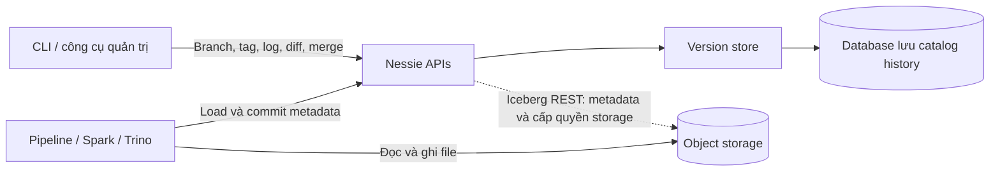
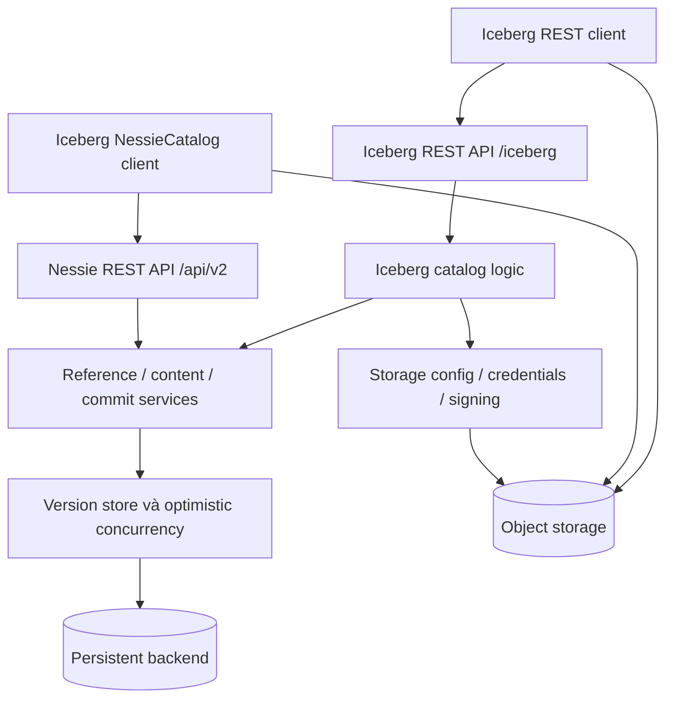
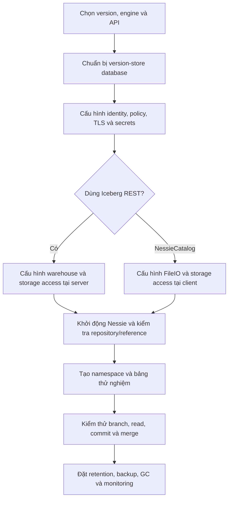
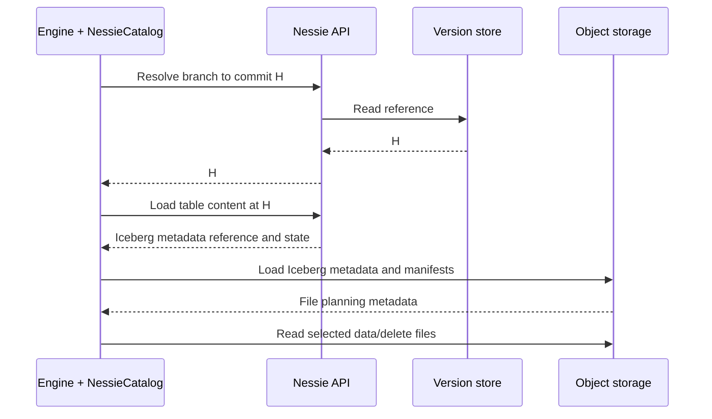
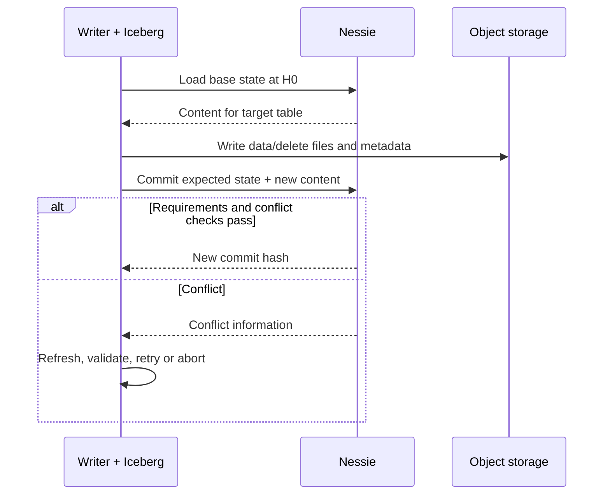
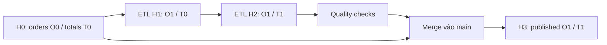
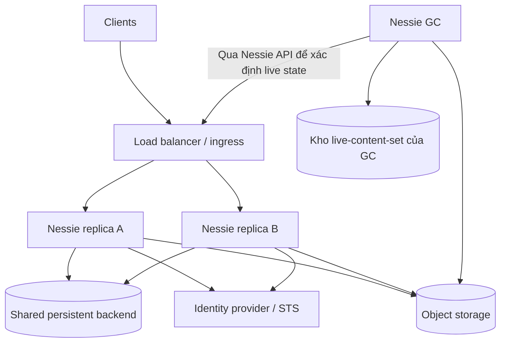

# Project Nessie: versioned catalog, transaction xuyên bảng và vận hành lakehouse

*Đối tượng: Data Engineer thiết kế, xây pipeline hoặc vận hành lakehouse với Apache Iceberg. Đối chiếu ngày 14/09/2026; mốc cấu hình và backend là Nessie 0.108.8, được trang release ghi phát hành ngày 09/09/2026. Guides không gắn phiên bản được dùng để giải thích semantics; chúng có thể chứa ví dụ cũ. Bài báo và bài viết nhà cung cấp chỉ được dùng cho bối cảnh và ứng dụng, không thay đặc tả kỹ thuật.* [Releases][1]

**Điểm cần đọc trước:** tại thời điểm đối chiếu, hướng dẫn chính thức vẫn đánh dấu tích hợp Iceberg REST của Nessie là **experimental**. Không suy từ trạng thái của version store hoặc Nessie API sang mức trưởng thành của mọi tính năng REST, view hay object-store integration. [Iceberg REST guide][2]

## 0. Tổng quan cách Project Nessie hoạt động

Giả sử pipeline cập nhật hai bảng Iceberg: `sales.orders` và `sales.order_totals`. Nếu công bố từng bảng vào production ngay sau mỗi job, dashboard có thể đọc đơn hàng mới nhưng bảng tổng hợp cũ. Nessie cho phép pipeline làm việc trên một branch riêng, kiểm tra cả hai bảng rồi công bố các thay đổi vào branch production bằng merge.

Nessie là **catalog có lịch sử phiên bản ở cấp toàn catalog**. Một commit xác định ánh xạ từ tên đối tượng tới trạng thái của chúng; branch chỉ tới commit hiện hành. Với Iceberg, trạng thái đó bao gồm tham chiếu metadata và thông tin snapshot/schema tương ứng. File dữ liệu vẫn ở object storage, còn Spark/Trino hoặc engine khác thực thi phép tính. [Architecture][3], [Specification][4]



Chu trình khái niệm:

1. Chọn branch, chẳng hạn `main`, hoặc một commit hash cụ thể.
2. Engine lấy trạng thái table tại reference đó.
3. Iceberg dùng metadata để lập kế hoạch; engine đọc/ghi file trên storage.
4. Writer đề xuất trạng thái mới với điều kiện về trạng thái đã đọc.
5. Nessie kiểm tra xung đột và công bố commit, hoặc từ chối để caller xử lý.
6. Pipeline có thể kiểm thử trên branch rồi merge các thay đổi sang branch khác.

Ba ranh giới cần nhớ:

| Thành phần | Trách nhiệm |
|---|---|
| Nessie | Namespace, references, catalog commits, history và kiểm soát công bố thay đổi |
| Iceberg | Schema, partition specs, snapshots, manifests và quy tắc trạng thái một bảng |
| Engine + storage | Tính toán, ghi/đọc file và bảo vệ dữ liệu vật lý |

Nessie branch tạo một góc nhìn catalog mới mà không sao chép toàn bộ file. Các lần ghi sau đó vẫn tiêu thụ compute và storage; giữ nhiều nhánh/lịch sử lâu ngày vẫn có chi phí. [Nessie vs Git][5]

## 1. Giới thiệu và bối cảnh ra đời

### 1.1. Từ snapshot một bảng đến trạng thái của cả dataset

Table format như Iceberg giải quyết việc mô tả tập file thuộc một phiên bản bảng. Tuy nhiên, pipeline phân tích thường thay đổi nhiều bảng: fact, dimension, aggregate và view. Snapshot của từng bảng chưa cung cấp một định danh chung cho trạng thái toàn bộ đầu ra.

Project Nessie được giới thiệu công khai bởi Dremio ngày 01/10/2020, với hướng tiếp cận branch/tag và transaction cho data lake. Bài viết ra mắt của Jacques Nadeau là nguồn sơ cấp về động cơ thiết kế, đồng thời là nội dung của bên phát triển sản phẩm; các nhận định quảng bá trong đó không được coi là benchmark độc lập. [Bài giới thiệu dự án][6]

Bài tường thuật của Susan Hall trên The New Stack ngày 01/02/2021 đặt Nessie trong hệ sinh thái Iceberg, nhấn mạnh khả năng chuẩn bị hoặc thử nghiệm dữ liệu trên branch mà chưa thay đổi góc nhìn đang phục vụ người dùng. Đây là ngữ cảnh lịch sử; tính năng hiện tại trong báo cáo được kiểm chứng lại bằng tài liệu dự án. [The New Stack][7]

### 1.2. Nessie là gì trong hệ thống hiện đại?

Nessie là dịch vụ mã nguồn mở với API và thư viện client, cung cấp version control cho catalog. Nó không phải query engine, object store hoặc hệ thống chạy workflow ETL. Nessie bổ sung semantics quản lý phiên bản cho Iceberg; không cần Hive Metastore làm backend catalog trong đường tích hợp này. [Overview][8]

Phạm vi báo cáo là **Project Nessie OSS**. Một sản phẩm thương mại dùng Nessie bên dưới có thể cung cấp giao diện, governance, orchestration hoặc SLA riêng; không tự động quy các khả năng đó cho bản OSS.

### 1.3. “Git-like” nên hiểu đến đâu?

Nessie có branch, tag, commit log, merge và transplant. Nhưng đối tượng được version hóa là catalog content, không phải từng dòng Parquet giống từng dòng text trong Git. Không có bước clone toàn bộ dữ liệu về laptop hay staging từng file bằng `git add`. Merge catalog cũng không tương đương SQL `MERGE INTO` để upsert row. [Nessie vs Git][5]

## 2. Bài toán giải quyết

### 2.1. Công bố một bộ dữ liệu nhất quán

Ví dụ xuyên suốt báo cáo dùng các trạng thái tự đặt tên:

| Commit | `orders` | `order_totals` | Ý nghĩa |
|---|---|---|---|
| H0 | O0 | T0 | Bản đang phục vụ production |
| H1 trên branch ETL | O1 | T0 | Job thứ nhất đã hoàn tất |
| H2 trên branch ETL | O1 | T1 | Cả hai job đã hoàn tất và được kiểm tra |
| H3 trên `main` sau merge | O1 | T1 | Bộ đầu ra được công bố |

Nessie hỗ trợ hai cách đưa thay đổi nhiều đối tượng vào cùng điểm công bố: một commit chứa nhiều operation, hoặc nhiều commit trên branch rồi merge. Việc engine có gom được nhiều câu SQL thành một transaction hay không phải kiểm tra riêng. [Transactions][9]

### 2.2. Môi trường thử nghiệm ít sao chép dữ liệu

Tạo branch từ commit production để thử backfill hoặc schema change. Các table không đổi tiếp tục dùng file sẵn có; phần ghi mới nằm trong trạng thái của branch thử nghiệm. Đây là isolation về catalog state; CPU, bucket và credential vẫn cần được quản lý ở hạ tầng.

### 2.3. Tái lập phân tích và điều tra sự cố

Lưu commit hash bên cạnh model run hoặc báo cáo giúp xác định đồng thời phiên bản các bảng đầu vào. Tuy vậy, để tái lập toàn bộ kết quả còn cần code version, dependencies, cấu hình và nguồn ngoài. Bài nghiên cứu về Bauplan và Nessie năm 2024 trình bày một hệ thống kết hợp catalog với runtime để hỗ trợ replay pipeline; bài này là nghiên cứu hệ thống, không phải cam kết riêng của Nessie. [Bauplan và Nessie][10]

### 2.4. Điều phối thay đổi và truy vết

Commit log/diff hỗ trợ nhận diện đối tượng thay đổi và nguyên nhân nếu pipeline ghi commit message có ý nghĩa. Tài liệu khuyến nghị message rõ ràng và review thay đổi trước merge. Commit log không tự tạo lineage đầy đủ từ nguồn tới đích hoặc kiểm tra chất lượng dữ liệu. [Best practices][11]

## 3. Kiến trúc và các thành phần

### 3.1. Hai đường tích hợp cần phân biệt



*Sơ đồ tổng hợp theo Architecture và Iceberg REST guide; biểu diễn trách nhiệm logic, không khẳng định mỗi ô là một tiến trình riêng.* [Architecture][3], [Iceberg REST guide][2]

**NessieCatalog trực tiếp:** Iceberg client sử dụng Nessie API để quản lý catalog state; client có cấu hình FileIO và quyền storage cần thiết.

**Iceberg REST:** client gọi giao diện chuẩn Iceberg; Nessie server tham gia quản lý table/view metadata và cấu hình truy cập storage. Trong đường này server cần quyền object store. Vì vậy, nhận định “Nessie server chỉ giữ con trỏ và không bao giờ truy cập storage” không đúng cho toàn bộ kiến trúc hiện đại.

### 3.2. API và các dịch vụ nghiệp vụ

Nessie API cung cấp thao tác trên references, contents, entries, commit log, diff, commit, merge và transplant. Bên dưới, version store xử lý lịch sử và điều kiện cập nhật. Java REST service được thiết kế quanh optimistic concurrency; tính nguyên tử dựa vào cập nhật có điều kiện ở persistence backend. [Architecture][3]

### 3.3. Commit kernel và persistence

Commit kernel cung cấp phần logic kết nối content model với cơ chế version store. Storage implementation lưu các đối tượng và references theo định dạng nội bộ của Nessie. Đây là lớp implementation: ứng dụng nên dùng public API, không tự cập nhật row/document của backend để đổi branch head. [Commit kernel][12]

### 3.4. Storage integration

Trong chế độ Iceberg REST, warehouse định nghĩa vị trí storage mặc định cho việc tạo bảng. Server có thể cấp credential ngắn hạn với phạm vi quyền thu hẹp hoặc ký request S3. Data file vẫn được engine trao đổi với object store; request signing thêm bước gọi server để ký, không biến Nessie thành proxy chở toàn bộ dữ liệu. [Iceberg REST guide][2]

### 3.5. Công cụ hỗ trợ

| Công cụ | Vai trò |
|---|---|
| Nessie CLI / Web UI | Xem references, log, diff và thao tác catalog |
| Spark SQL extensions | Thao tác branch/tag bằng cú pháp bổ sung khi cài đúng extension |
| Server Admin Tool | Export/import và tác vụ quản trị truy cập backend trực tiếp |
| Nessie GC | Xác định nội dung còn sống qua các reference rồi thu hồi file phù hợp |
| Identity provider | Phát hành token để xác thực client |

CLI làm việc với Nessie service; Server Admin Tool làm việc trực tiếp với database. Hai công cụ có phạm vi quyền và mục đích khác nhau. [Migration guide][13]

## 4. Mô hình triển khai và flow khởi tạo

### 4.1. Các mô hình triển khai

| Mô hình | Dùng khi | Điều kiện |
|---|---|---|
| Local container + in-memory | Học API, demo | State không bền vững |
| Một node + RocksDB | Chấp nhận một node | Persistent disk, backup và thời gian khôi phục |
| Nhiều service replica + remote database | Production cần HA | Backend chung, health check và cấu hình nhất quán |
| Kubernetes/Helm | Nền tảng đã vận hành Kubernetes | Database và secrets phải chuẩn bị theo chart |

Hướng dẫn Helm mô tả cấu hình nhiều loại version store và secret cho database. Cài chart không đồng nghĩa chart tự triển khai đầy đủ database HA; cần kiểm tra tài nguyên phụ thuộc của backend đã chọn. [Kubernetes guide][14]

### 4.2. Backend theo mốc 0.108.8

| Backend | Đánh giá được tài liệu công bố |
|---|---|
| PostgreSQL `JDBC2` | Production; `JDBC` cũ deprecated |
| MongoDB `MONGODB2` | Production; `MONGODB` cũ deprecated |
| Bigtable | Production |
| RocksDB | Production, chỉ một node |
| In-memory, H2 | Development/test |
| MariaDB, MySQL | Experimental |
| Cassandra, CockroachDB | Experimental, có vấn đề đã biết |
| DynamoDB | Bảng support ghi beta; cảnh báo giới hạn row size cho Iceberg REST |

Không sao chép support matrix từ bài hướng dẫn Nessie cũ vào thiết kế mới. Các enum xuất hiện trong cấu hình cũng không có nghĩa tất cả backend đạt mức production tương đương. [Configuration 0.108.8][15]

### 4.3. Flow khởi tạo



Đề xuất triển khai cho đội dữ liệu:

1. Khóa tổ hợp Nessie, engine, Iceberg runtime, client và API. Ghi rõ tính năng experimental được chấp nhận trong PoC nào.
2. Tạo backend bền vững; quản lý cấu hình/secret bằng cơ chế của nền tảng.
3. Khởi động service, kiểm tra default branch và endpoint. Không hard-code giả định tên reference trong mọi môi trường.
4. Tạo namespace và table qua connector được hỗ trợ.
5. Xác minh restart giữ state, reader truy cập đúng branch và writer không có quyền publish ngoài phạm vi.
6. Chạy bài thử hai bảng, conflict và mất response trước khi đưa vào production.

### 4.4. Ví dụ cấu hình Spark cho đường NessieCatalog

Các dòng sau là khung cấu hình minh họa, cần bổ sung runtime JAR tương thích, authentication và FileIO theo môi trường:

```properties
spark.sql.catalog.nessie=org.apache.iceberg.spark.SparkCatalog
spark.sql.catalog.nessie.catalog-impl=org.apache.iceberg.nessie.NessieCatalog
spark.sql.catalog.nessie.uri=https://nessie.example.com/api/v2
spark.sql.catalog.nessie.ref=main
spark.sql.catalog.nessie.warehouse=s3://example-lake/warehouse
```

Với đường Iceberg REST, sử dụng `type=rest` và endpoint `/iceberg` theo hướng dẫn riêng, không trộn cấu hình hai catalog implementation. Các lệnh branch trong Spark đòi hỏi Nessie SQL extension, không phải cú pháp SQL chuẩn sẵn có ở mọi engine. [Spark integration][16]

## 5. Mô hình metadata và cơ chế lưu trữ

### 5.1. Các khái niệm cơ bản

| Khái niệm | Ý nghĩa | Ví dụ |
|---|---|---|
| Reference | Tên trỏ tới commit | Branch `main`, tag `release_2026_09` |
| Branch | Reference nhận commit mới | `etl/run_1042` |
| Tag | Nhãn tại một commit, không nhận table commit như branch | `validated_release` |
| Commit hash | Định danh trạng thái catalog trong lịch sử | H0, H1 là ký hiệu minh họa |
| Content key | Tên phân cấp để tìm object | `sales.orders` |
| Content ID | Định danh object bền qua rename/branch | ID của bảng orders |
| Content value | Trạng thái object tại reference/commit | Metadata và các ID Iceberg liên quan |
| Namespace | Nhóm tên table/view | `sales` |

Content key có thể đổi khi rename; content ID giữ danh tính object. Trong model Iceberg, chỉ có metadata location là chưa đủ để diễn giải branch state: Nessie còn theo dõi các ID snapshot, schema, partition spec và sort order. [Specification][4]

Tag nên được quản trị như mốc phát hành cố định; API có thao tác assign tag sang commit khác nếu caller được phép. Commit hash mới là định danh trạng thái cụ thể; quyền assign/delete reference và chính sách retention vẫn phải kiểm soát. [Java API examples][27]

### 5.2. Catalog history và Iceberg metadata là hai lớp

```text
Nessie database
  branch main ──> commit H0
  branch etl  ──> commit H2
  contents tại H2:
    sales.orders       -> trạng thái Iceberg O1
    sales.order_totals -> trạng thái Iceberg T1

Object storage
  Iceberg metadata JSON
    -> snapshot -> manifest list -> manifests
       -> data files / delete files
```

Nessie commit không phải Iceberg snapshot ID. Một commit catalog có thể mô tả thay đổi ở nhiều object; một snapshot Iceberg mô tả trạng thái dữ liệu một bảng. Bảng không thay đổi giữa hai commit catalog có thể tiếp tục dùng cùng snapshot. Metadata-only update cũng không nhất thiết sinh data snapshot mới. [Iceberg specification][17]

### 5.3. Branching và chi phí lưu trữ

Branch mới ban đầu chia sẻ trạng thái hiện hữu. Khi writer thay đổi bảng, nó ghi file/metadata mới theo table format. Dữ liệu chung vẫn được tham chiếu từ các branch khác. Vì vậy:

- tạo branch không phải deep copy warehouse;
- xóa branch không tương đương xóa ngay mọi file từng được branch dùng;
- sửa/xóa file chung ngoài protocol có thể ảnh hưởng nhiều branch;
- tên branch không nhất thiết ánh xạ thành một folder vật lý riêng.

Đây là hệ quả vận hành của việc version hóa tham chiếu thay vì sao chép byte. [Nessie vs Git][5]

### 5.4. Version-store database và data warehouse

Database của Nessie lưu lịch sử catalog, reference và content state. Object storage giữ các tài sản Iceberg. Với REST, server còn quản lý thông tin metadata phục vụ giao thức; không nên áp mô tả “database chỉ có một URI mỗi bảng” cho mọi implementation.

Backup hoặc migration repository phải bảo toàn quan hệ tới metadata/data còn tồn tại. Khôi phục catalog vào hash cũ sẽ không tái tạo file đã bị GC hoặc lifecycle rule xóa.

## 6. API và khả năng tích hợp

### 6.1. Nessie API và Iceberg REST API

| Giao diện | Trách nhiệm chính | Consumer |
|---|---|---|
| Nessie API, thường `/api/v2` | References, contents, history, diff, commit, merge/transplant | Nessie clients, CLI, NessieCatalog |
| Iceberg REST, `/iceberg` | Namespace/table/view operations theo giao thức Iceberg | RESTCatalog clients |
| Spark extensions | Lệnh version control trong Spark SQL | Spark với đúng extension |
| Admin Tool | Export/import backend | Người vận hành |

Nessie API là REST/OpenAPI riêng của Nessie; nó không đồng nghĩa endpoint Iceberg REST. Client hỗ trợ một trong hai chưa chắc hỗ trợ mọi tính năng của giao diện còn lại. [Specification][4], [Spark integration][16]

### 6.2. Tích hợp engine

| Engine/client | Điểm bắt đầu | Cần kiểm thử |
|---|---|---|
| Spark + Iceberg | NessieCatalog hoặc RESTCatalog | Runtime JAR, extension, branch selection, commit |
| Trino | Iceberg connector với catalog type tương ứng | Ref selection, credentials, cache |
| Hive + Iceberg | Storage handler và catalog configuration | Thao tác hỗ trợ, lựa chọn branch |
| Dremio | Nessie source theo bản sản phẩm | Feature matrix và quyền riêng của sản phẩm |
| Client Iceberg REST khác | Endpoint REST của Nessie | Endpoint/format/authentication hỗ trợ thực tế |

Tài liệu Trino integration lưu ý việc quản lý branch/tag bằng SQL không có sẵn như trong Nessie CLI; reference được chọn qua cấu hình connector. Hướng dẫn Hive cũng có cách chọn branch riêng, không nên đem cú pháp `table@branch` của một engine sang engine khác. [Trino][18], [Hive][19]

Bài Dremio năm 2023 mô tả Nessie source và các workflow phát triển/thử nghiệm; dùng để hiểu ví dụ tích hợp, không dùng version tối thiểu trong bài làm mặc định cho triển khai hiện tại. [Dremio integration article][20]

### 6.3. Branch và warehouse trong REST

Hướng dẫn chính thức cho phép chọn branch và warehouse qua URI, chẳng hạn `/iceberg/experiments|sales`. `warehouse` trong ngữ cảnh này là location được server đặt tên; nó không phải Git repository hay một branch. Cấu hình URI/reference cần đọc đúng tài liệu client vì các trang hướng dẫn có khác biệt giữa phiên bản. [Iceberg REST guide][2]

### 6.4. Nguyên tắc migration catalog

Đăng ký cùng metadata Iceberg vào catalog mới có thể không cần sao chép data files, nhưng **quyền sở hữu commit** phải rõ ràng. Không để hai catalog độc lập cùng quản lý current state của một bảng rồi kỳ vọng chúng tự đồng bộ. Kế hoạch cutover cần freeze writer, kiểm tra metadata location, quyền storage, lịch sử cần giữ và rollback. Đây là đề xuất thiết kế; không phải thủ tục migration phổ quát của Nessie.

## 7. Flow đọc

### 7.1. Đọc qua NessieCatalog



Sơ đồ biểu diễn logic; cache và batch API có thể thay đổi số request. Tại bước load, client cần giữ đúng snapshot/state gắn với Nessie reference, thay vì chỉ đọc current snapshot bất kỳ trong một metadata file. [Spark integration][16], [Iceberg specification][17]

### 7.2. Đọc qua Iceberg REST

Engine load table từ Nessie REST catalog. Server trả metadata/config và cơ chế truy cập storage được cấu hình. Hướng dẫn Nessie nêu REST response chỉ trình bày snapshot tương ứng Nessie commit để giữ isolation giữa các branch/tag. Time travel do đó phải dùng cách chọn Nessie reference/hash phù hợp; không mặc định history của mọi branch xuất hiện dưới dạng Iceberg snapshot history trong response. [Iceberg REST guide][2]

### 7.3. Đọc nhất quán xuyên bảng

Đây là ví dụ phân tích quan trọng:

```text
t0: main = H0
t1: reader load orders tại H0
t2: pipeline merge, main = H3
t3: reader refresh main và load order_totals tại H3
```

Merge đã nguyên tử nhưng reader vẫn ghép O0 với T1 vì đọc hai lần ở hai mốc khác nhau. Để tái lập một bộ input, resolve reference thành hash H một lần rồi đọc cả hai bảng tại H; xác minh connector thực sự duy trì hash đó trong toàn bộ query/job. [Transactions][9]

### 7.4. Lỗi đọc nên kiểm tra theo lớp

| Hiện tượng | Hướng kiểm tra |
|---|---|
| Table không tồn tại | Sai branch/hash/key hoặc quyền lọc metadata |
| Table cũ dù pipeline xong | Client cache, reference chưa refresh, merge chưa hoàn tất |
| Load được table nhưng đọc file lỗi | Storage permission, KMS, credential expiry, file đã bị xóa |
| Kết quả khác lần chạy trước | Hash đầu vào, code/runtime, nguồn ngoài, retention |

## 8. Flow ghi và commit

### 8.1. Commit một bảng qua NessieCatalog



File ghi xong chưa có nghĩa branch đã trỏ tới trạng thái mới. Commit catalog là bước công bố. Client retry phải tuân theo Iceberg validation; hai append có thể xử lý khác với overwrite/delete đụng cùng dữ liệu. Optimistic commit của Iceberg không phải giấy phép retry mù mọi thao tác. [Iceberg reliability][21]

### 8.2. Commit qua REST

REST writer gửi requirements/updates tới server; server kiểm tra và quản lý metadata theo giao thức. Không mặc định client trực tiếp ghi final metadata JSON như đường NessieCatalog. Cả hai đường đều cần phối hợp file preparation và atomic catalog publication; trạng thái experimental của REST phải được xét trong kiểm thử. [Getting started with REST][22]

### 8.3. Công bố pipeline nhiều bảng bằng branch

Workflow tự thiết kế cho ví dụ `orders`/`order_totals`:

1. Resolve `main` thành H0; tạo branch `etl/run_1042` từ H0.
2. Chạy ingestion và aggregation trên branch đó.
3. Lưu các commit hash, input watermark và code revision trong run metadata.
4. Kiểm tra số bản ghi, tổng tiền, uniqueness và quan hệ giữa hai bảng.
5. Xác nhận branch không bị writer khác thay đổi sau validation.
6. Merge vào `main` với kiểm soát expected target state; xử lý conflict nếu production đã thay đổi.
7. Ghi hash kết quả H3 làm output chính thức; consumer quan trọng đọc cùng H3.



Atomic publication là khả năng catalog; quality checks và ownership branch là trách nhiệm workflow. Consumer theo branch ETL vẫn có thể nhìn thấy trạng thái trung gian H1; branch đó không nên là nguồn production. [Transactions][9], [Best practices][11]

### 8.4. Merge, transplant và xung đột

Merge đưa thay đổi từ lịch sử nhánh nguồn sang đích theo semantics và chế độ được chọn; transplant chọn commit để áp dụng sang branch khác. Cả hai đều cần conflict resolution, không phải copy nguyên warehouse. Khi cùng content key thay đổi ở hai phía, không nên giả định hệ thống tự ghép đúng từng row theo nghiệp vụ. [Java API examples][27], [Transactions][9]

### 8.5. Xử lý lỗi không rõ kết quả

Nếu server commit thành công nhưng response mất, caller có thể nhận timeout. Hãy kiểm tra log/content/hash và run identifier trước khi ghi lại. Nếu operation thất bại trước publication, file không được tham chiếu có thể trở thành orphan. Việc xác định orphan cần xét mọi reference còn được giữ; không xóa ngay toàn bộ file của job dựa vào HTTP error. [Iceberg reliability][21], [GC guide][23]

## 9. Tính nhất quán và transaction

### 9.1. Bốn bảo đảm cần đánh giá riêng

| Tầng | Phạm vi | Không tự suy ra |
|---|---|---|
| Object write | Độ bền/nhất quán object theo storage | Transaction nhiều file |
| Iceberg table commit | Trạng thái hợp lệ của một bảng | Transaction toàn pipeline |
| Nessie commit/merge | Công bố thay đổi catalog nguyên tử trong operation tương ứng | Mọi consumer tự pin cùng hash |
| Workflow nghiệp vụ | Kiểm tra input/output, side effects, idempotency | Nessie rollback được message/API ngoài |

Nếu pipeline còn gửi email, cập nhật PostgreSQL hoặc publish Kafka ngoài catalog, Nessie không tự transaction hóa các side effect đó. Cần outbox, run ledger hoặc cơ chế phối hợp riêng tùy bài toán.

### 9.2. Optimistic concurrency và read set

Specification mô tả các operation `Put`, `Delete`, `Unmodified` và expected content để kiểm tra state. Branch head tiến lên không nhất thiết đồng nghĩa mọi write đều xung đột: cần xét các content và điều kiện mà operation kiểm tra. [Specification][4]

Tài liệu Transactions mô tả primitives phục vụ các mức isolation, nhưng đồng thời lưu ý tool integration chưa tự động phơi bày đầy đủ chúng. Không nên viết “mọi query Spark/Trino dùng Nessie đều serializable”. Nếu cần bảo đảm read-modify-write xuyên bảng, phải xác minh read dependencies cũng được kiểm tra tại commit. [Transactions][9]

### 9.3. Commit history không phải exactly-once toàn pipeline

Một commit nguyên tử ngăn công bố nửa tập operation; nó không tự ngăn job chạy lại và thêm cùng batch hai lần. Đề xuất thực hành: định danh `run_id`, checkpoint nguồn, kiểm tra batch đã công bố, và có protocol retry xử lý trường hợp kết quả không rõ. Với dữ liệu streaming, cần kiểm thử cả engine checkpoint lẫn catalog commit.

### 9.4. Rollback và time travel

Đọc tại hash cũ hoặc điều chỉnh reference giúp quay về trạng thái catalog trước. Nhưng quay lùi toàn branch có thể làm mất khả năng nhìn thấy các thay đổi tốt được công bố sau mốc đó. Trước rollback phải so sánh content bị ảnh hưởng và đánh giá consumer cache.

Khả năng truy vấn lịch sử có điều kiện: metadata/data liên quan còn tồn tại, quyền vẫn hợp lệ và connector hiểu trạng thái đó. Commit log tồn tại không phải bằng chứng mọi file lịch sử còn được giữ. [GC guide][23]

## 10. Bảo mật

### 10.1. Authentication

Nessie hỗ trợ bearer token được kiểm tra qua OpenID Connect. Tài liệu authentication mô tả mặc định có thể chạy không xác thực với identity anonymous; deployment production cần bật và kiểm thử auth rõ ràng. Token của user/service account nên đến từ identity provider và secret mechanism của nền tảng. [Authentication][24]

Authentication trả lời “ai gọi”; authorization trả lời “được làm gì”. Hai bước phải được cấu hình riêng. TLS và policy network bảo vệ đường client → service; quyền database và storage là các boundary tiếp theo.

### 10.2. Authorization trên reference và content

Nessie có authorizer SPI và implementation dựa trên CEL, với ngữ cảnh như operation, roles, ref, path và content type. Tài liệu 0.108.8 phân biệt rõ metadata có sẵn cho custom authorizer với biến dùng được trong CEL; không phải mọi chi tiết Iceberg action đều truy cập được bằng CEL. [Authorization 0.108.8][25]

Mô hình quyền đề xuất:

| Vai trò | Quyền nghiệp vụ |
|---|---|
| Reader | Đọc reference và content được cấp |
| ETL writer | Ghi branch thuộc run/domain của mình |
| Publisher | Kiểm tra và merge vào production |
| Administrator | Quản lý cấu hình, reference nhạy cảm, backup/restore |

Cần bảo vệ cả assign/delete reference, đọc bằng detached hash và thao tác merge. Chỉ chặn `INSERT` trên `main` không đủ nếu caller vẫn có đường thay đổi reference tương đương.

### 10.3. Quyền metadata và quyền dữ liệu

Authorization của catalog không ngăn được client có credential độc lập đọc trực tiếp file. Với đường NessieCatalog, quản lý IAM/object-store policy của client là thiết yếu. Với REST, scoped credential hoặc signing giúp kết nối quyết định catalog với storage access, nhưng vẫn cần loại bỏ quyền storage quá rộng được cấp ngoài luồng. [Authorization 0.108.8][25]

Branch isolation không tự trở thành hàng rào chống sửa byte: principal có thể xóa file chung trong bucket vẫn có thể gây hỏng nhiều branch. Vì vậy role chạy ETL và role GC nên tách biệt.

### 10.4. Audit và giới hạn governance

Ghi nhận principal đã xác thực, operation, reference, hash, content key, kết quả và request/run ID. Commit message/author do pipeline cung cấp hữu ích cho truy vết, nhưng không thay thế security audit đáng tin cậy.

Nessie không tự tạo row/column masking hoặc kiểm tra foreign key nghiệp vụ chỉ vì có policy trên table. Các yêu cầu này cần engine hoặc governance layer phù hợp, được kiểm chứng trên đường truy cập thực tế.

## 11. Khả năng mở rộng, HA và vận hành

### 11.1. Scale service và backend

Kiến trúc cho phép phục vụ trên nhiều server nhờ concurrency control ở version store. Production cần database chung và cấu hình repository/security/storage đồng nhất giữa replicas. RocksDB một node không trở thành cluster HA bằng cách tăng replica pod dùng database cục bộ riêng. [Architecture][3], [Configuration 0.108.8][15]



*Kho live-content-set là persistence của công cụ GC, khác về trách nhiệm với version-store database. GC lấy lịch sử catalog qua Nessie API.*

Scale cần đo theo workload: số content keys, commit rate, độ dài history, số references, conflict rate, metadata payload, database latency và số request storage/signing. Dữ liệu bảng nhỏ vẫn có thể tạo áp lực catalog nếu commit cực kỳ thường xuyên.

### 11.2. Nút thắt thường gặp

| Tín hiệu | Phân tích/biện pháp đề xuất |
|---|---|
| Commit conflict cao | Nhiều writer cùng table/branch; điều chỉnh ownership và batch |
| Latency database tăng | Kiểm tra pool, IOPS, hot keys và payload |
| Load table chậm | Metadata lớn, storage latency, credential service |
| Signing request tăng mạnh | Xem khả năng credential vending phù hợp client/storage |
| History và storage tăng liên tục | Branch lifecycle, retention và GC chưa thống nhất |
| Merge thường xuyên thất bại | Branch sống quá lâu hoặc pipeline phụ thuộc state đã cũ |

Đây là hướng chẩn đoán, không phải benchmark hoặc quota sản phẩm. Sizing phải dùng bảng và concurrency đại diện môi trường thực.

### 11.3. Garbage collection có nhận biết branch

GC phải biết file nào còn được tham chiếu bởi các branch/tag và lịch sử được giữ. Nessie GC dùng live-content-set: bước mark duyệt lịch sử references theo cutoff policy; bước sweep ánh xạ nội dung còn sống sang file Iceberg rồi nhận diện file có thể thu hồi. Default cutoff `NONE` giữ toàn bộ lịch sử của reference tương ứng. [GC guide][23]

Runbook đề xuất:

1. Quy định retention theo loại branch: production, release tag, experiment.
2. Tách bước mark, sweep và deletion; giữ kết quả để kiểm tra.
3. Chọn thời gian bảo vệ phù hợp job đang ghi và query dài.
4. Kiểm tra candidate files bằng deferred deletion trước khi bật xóa tự động.
5. Thử đọc tại các hash/tag được cam kết giữ sau lần GC thử nghiệm.

Không bật độc lập `expire_snapshots`, orphan cleanup hoặc bucket lifecycle từ một góc nhìn branch mà chưa xác minh tương thích. Specification cảnh báo maintenance Iceberg thông thường có thể phá khả năng giữ state của Nessie; phải theo hướng dẫn maintenance áp dụng cho đúng integration. [Specification][4]

### 11.4. Backup, restore và nâng cấp

Server Admin Tool hỗ trợ export/import repository. Tài liệu phân biệt: backup export bằng tool từ 0.94.0 không bắt buộc dừng service; import phục hồi phải dừng server. Migration backend cần downtime để lấy đủ state nguồn và chuyển target nhất quán. [Migration guide][13]

Kế hoạch khôi phục cần cả repository và file Iceberg. Ngoài database backup, lưu cấu hình warehouse, identity/policy, key references và retention policy. Chỉ có bản sao object storage không khôi phục được branch heads; chỉ có catalog export không cứu được file đã xóa.

Nâng cấp phải đọc release notes và upgrade matrix. Một số kiểu version store cũ đã bị loại bỏ, và một số chuyển đổi cần migration. Không mặc định đổi container image là rolling upgrade an toàn cho mọi cặp phiên bản. [Upgrade notes][26]

### 11.5. HA, DR và tính sẵn sàng đầu cuối

Nessie replica, database, object store, identity provider và STS đều ảnh hưởng truy vấn/commit. Multi-Region database replication không tự tạo active-active catalog an toàn; phải kiểm chứng semantics cập nhật có điều kiện, độ trễ và failover của backend.

Đề xuất SLO: tách availability của load metadata, commit và truy vấn dữ liệu; đo p95/p99 theo operation. DR drill cần kiểm tra hash, branch, file location, credential và truy vấn đa bảng sau failover. Với OSS self-hosted, SLA do đội vận hành thiết lập.

### 11.6. Checklist nghiệm thu

- Tạo branch từ H0 không công bố thay đổi thử nghiệm lên production.
- Hai bảng sau publish được đọc tại cùng hash kết quả.
- Concurrent writes cùng table tạo conflict hoặc retry đúng semantics.
- Timeout sau commit không tạo duplicate khi job chạy lại.
- Reader không được phép assign/delete/publish reference.
- Restart/failover giữ catalog state.
- GC giữ đủ mọi hash/tag nằm trong retention contract.
- Restore khôi phục được cả metadata lẫn khả năng đọc file.

## 12. Ưu điểm, hạn chế và use case phù hợp

### 12.1. Ưu điểm

- Version control ở cấp catalog giúp ghi lại một bộ trạng thái nhiều bảng.
- Branch hỗ trợ backfill, thử nghiệm và validate trước publication.
- Chia sẻ file hiện hữu giảm nhu cầu copy toàn bộ dataset khi tạo môi trường logic.
- Commit log/diff hỗ trợ điều tra thay đổi và tái lập input.
- Có Nessie-native integration và hướng Iceberg REST.
- Có thể tự triển khai trên backend/hạ tầng phù hợp yêu cầu tổ chức.

### 12.2. Hạn chế và trade-off

- Branch/publish workflow cần orchestration và ownership rõ ràng.
- Engine integration quyết định mức isolation và SQL capability thực tế.
- Không tự hợp nhất xung đột row theo nghiệp vụ hoặc transaction hóa side effects ngoài catalog.
- GC phức tạp hơn catalog chỉ giữ current state; retention tạo chi phí thực.
- Policy catalog không thay quyền dữ liệu, masking hoặc isolation tài nguyên.
- Tính năng REST/storage/view cần xét trạng thái experimental và phiên bản.
- Đội self-hosted vận hành thêm database, service, credentials, backup và monitoring.

### 12.3. Use case phù hợp

| Use case | Vì sao có ích | Điều kiện để có ích thực sự |
|---|---|---|
| ETL nhiều bảng theo batch | Validate rồi publish một bộ đầu ra | Consumer pin hash, publisher có kiểm soát |
| Backfill/thử thuật toán | Làm việc trên branch từ production state | Không sửa file chung ngoài protocol |
| ML/analytics reproducibility | Lưu một catalog hash cho nhiều input | Giữ file và lưu code/runtime |
| Điều tra và sửa dữ liệu | Log/diff và đọc trạng thái cũ | Retention/GC bảo vệ lịch sử cần thiết |
| Lakehouse nhiều engine | Chia sẻ versioned catalog | Kiểm thử compatibility và quyền trên từng engine |

### 12.4. Khi nào chưa cần Nessie?

Nếu chỉ có một bảng, một writer và nhu cầu time travel trong bảng, Iceberg snapshot có thể đã đủ. Nếu nhu cầu chính là discovery nhiều nguồn, glossary hoặc quản trị nghiệp vụ, cần đánh giá catalog/governance khác hoặc bổ sung chúng. Nếu toàn bộ hệ thống chưa có cách quản lý branch ownership và retention, thêm Nessie có thể tăng độ phức tạp trước khi tạo lợi ích.

### 12.5. So sánh trọng tâm với HMS và Glue

| Góc nhìn | Standalone HMS | AWS Glue Data Catalog | Project Nessie |
|---|---|---|---|
| Điểm nghiên cứu chính | Metastore dùng chung, Hive model và vận hành | Managed metadata service trong AWS | Catalog history, references và publication |
| Workflow nổi bật | Đăng ký/tra cứu table và partition | Discovery, tích hợp AWS, Lake Formation | Branch → write → validate → merge |
| Câu hỏi transaction cốt lõi | Hive non-ACID/ACID hay Iceberg? | File registration hay table-format commit? | Commit nhiều content và consumer đọc cùng hash chưa? |
| Gánh nặng thiết kế | Service/DB/security/schema upgrade | IAM/LF, quotas, regional DR | Backend, branch lifecycle, integration và GC |

Bảng trên so sánh trọng tâm kiến trúc trong chuỗi báo cáo, không khẳng định feature parity của mọi phiên bản. Tiêu chí chọn Nessie nên là nhu cầu quản lý phiên bản và công bố trạng thái **xuyên bảng** có thể kiểm chứng bằng pipeline thực tế.

## Tài liệu tham khảo và cách sử dụng nguồn

Tài liệu chính thức là cơ sở cho API/semantics; release-specific docs dùng cho trạng thái backend và policy. Bài nhà cung cấp có thể có thiên lệch thương mại; bài báo lịch sử không dùng để kết luận khả năng hiện tại. Các sơ đồ, ví dụ `orders`/`order_totals`, runbook và checklist là tổng hợp thiết kế của báo cáo, chưa phải thử nghiệm chạy trên một deployment Nessie.

1. [Nessie releases][1] — mốc phiên bản nghiên cứu.
2. [Configure Nessie with Iceberg REST][2] — semantics REST, storage access và giới hạn.
3. [Nessie architecture][3] — service và atomic metadata updates.
4. [Nessie specification][4] — content model và commit operations.
5. [Nessie vs Git][5] — phạm vi của Git-like semantics.
6. [Dremio: Introducing Project Nessie, 01/10/2020][6] — nguồn sơ cấp về bối cảnh ra đời.
7. [The New Stack: Apache Iceberg — A Different Table Design for Big Data, 01/02/2021][7] — báo công nghệ, ngữ cảnh lịch sử.
8. [Nessie guides overview][8] — định vị dự án.
9. [Nessie transactions][9] — multi-table publication và giới hạn integration.
10. [Reproducible data science over data lakes: Bauplan and Nessie, 2024][10] — bài nghiên cứu hệ thống trên arXiv; không xem như benchmark độc lập của riêng Nessie.
11. [Nessie best practices][11] — commit messages và review.
12. [Commit kernel][12] — lớp implementation.
13. [Migration & Backup/Recovery][13] — export/import và điều kiện dừng service.
14. [Nessie on Kubernetes][14] — Helm và backend configuration.
15. [Configuration 0.108.8][15] — backend support matrix.
16. [Nessie + Iceberg + Spark][16] — cấu hình engine.
17. [Apache Iceberg specification][17] — snapshot và metadata tree.
18. [Nessie + Iceberg + Trino][18] — connector và branch selection.
19. [Nessie + Iceberg + Hive][19] — integration-specific behavior.
20. [Dremio: Introducing Nessie as a Source, 20/06/2023][20] — ví dụ tích hợp sản phẩm, nguồn nhà cung cấp.
21. [Apache Iceberg reliability][21] — optimistic commit và concurrent writes.
22. [Getting started with Nessie and Iceberg REST][22] — hệ thống mẫu và storage integration.
23. [Management Services / Nessie GC][23] — retention, live content và sweep.
24. [Nessie authentication guide][24] — OIDC/bearer; trang rolling được kiểm tra bổ sung với cấu hình phiên bản.
25. [Authorization 0.108.8][25] — reference/content authorization và CEL.
26. [Server upgrade notes][26] — migration và rolling upgrade constraints.
27. [Nessie Java API examples][27] — assign reference, merge và transplant.

[1]: https://projectnessie.org/releases/
[2]: https://projectnessie.org/guides/iceberg-rest/
[3]: https://projectnessie.org/develop/
[4]: https://projectnessie.org/develop/spec/
[5]: https://projectnessie.org/guides/nessie_vs_git/
[6]: https://www.dremio.com/blog/introducing-project-nessie/
[7]: https://thenewstack.io/apache-iceberg-a-different-table-design-for-big-data/
[8]: https://projectnessie.org/guides/
[9]: https://projectnessie.org/guides/transactions/
[10]: https://arxiv.org/abs/2404.13682
[11]: https://projectnessie.org/guides/best-practices/
[12]: https://projectnessie.org/develop/kernel/
[13]: https://projectnessie.org/guides/migration/
[14]: https://projectnessie.org/guides/kubernetes/
[15]: https://projectnessie.org/nessie-0-108-8/configuration/
[16]: https://projectnessie.org/iceberg/spark/
[17]: https://iceberg.apache.org/spec/
[18]: https://projectnessie.org/iceberg/trino/
[19]: https://projectnessie.org/iceberg/hive/
[20]: https://www.dremio.com/blog/introducing-nessie-as-a-dremio-source/
[21]: https://iceberg.apache.org/docs/latest/reliability/
[22]: https://projectnessie.org/guides/try-nessie/
[23]: https://projectnessie.org/guides/management/
[24]: https://projectnessie.org/nessie-latest/authentication/
[25]: https://projectnessie.org/nessie-0-108-8/authorization/
[26]: https://projectnessie.org/server-upgrade/
[27]: https://projectnessie.org/develop/java/

## Đối chiếu cuối báo cáo — Bảy câu hỏi cốt lõi

### 1. Nó quản lý loại metadata nào?

**Nessie quản lý trạng thái và lịch sử của catalog:** references (branches/tags), commits, namespaces, content keys, content IDs và content values. Với Iceberg, content state mang metadata location cùng các ID cần để diễn giải trạng thái bảng tại reference, như snapshot/schema/spec/sort-order IDs theo model tương ứng.

Nessie không lưu các business rows trong commit log. Nó cũng không chỉ là bảng tra cứu “tên table → một URI hiện tại”: một object có thể có trạng thái khác nhau trên các branch. [Nessie Specification][4]

### 2. Metadata persistence nằm ở đâu?

Reference, commit history và content state nằm trong **version-store backend** được cấu hình cho Nessie. Với mốc 0.108.8 của báo cáo, PostgreSQL qua JDBC2 là một lựa chọn production; các backend khác có đặc tính vận hành riêng, xem mục 4.2. In-memory không cung cấp durability sau mất tiến trình.

Iceberg metadata/manifests và data/delete files nằm trên storage. Đường Iceberg REST còn có metadata phục vụ protocol do server quản lý; không nên giả định database chỉ lưu một URI mỗi table. Backup phải bảo vệ cả repository và các file còn được tham chiếu. [Configuration 0.108.8][15], [Commit kernel][12], [Migration and backup][13]

### 3. Engine resolve một table như thế nào?

Định danh thực tế cần cả **table key và reference/commit context**. Ví dụ: `sales.orders` tại commit `H0` có thể khác chính bảng đó tại `H1`.

Qua NessieCatalog, client resolve reference thành hash, lấy content của key tại hash đó rồi tải metadata theo đúng Iceberg state đã chọn. Qua Iceberg REST, server trả table metadata tương ứng Nessie reference; cách chọn reference phụ thuộc cấu hình và integration. Muốn đọc nhiều bảng cùng một mốc, cần giữ cùng commit hash, thay vì resolve branch head mới cho từng bảng. [Nessie Specification][4], [Iceberg REST guide][2], [Spark integration][16]

### 4. Read path và write/commit path như thế nào?

**Read:** reference/hash → content state → metadata Iceberg → snapshot/manifests → engine đọc files.

**Write:** writer chuẩn bị files và thay đổi bảng; catalog integration gửi commit với expected state/requirements. Nessie kiểm tra xung đột rồi công bố commit mới trên branch. Qua REST, server tham gia xử lý metadata updates; không áp nguyên flow client tự ghi final metadata JSON của NessieCatalog cho đường này.

**Pipeline nhiều bảng:** có thể ghi trên branch riêng, kiểm định kết quả rồi merge để công bố tập thay đổi. Những lần ghi riêng lẻ trước merge không tự trở thành một transaction duy nhất; consumer trên branch làm việc vẫn có thể thấy trạng thái trung gian. Xem mục 7–9. [Transactions][9], [Best practices][11], [REST getting started][22]

### 5. Table state/version được quản lý bởi catalog hay table format?

**Cả hai, ở hai cấp khác nhau.** Iceberg định nghĩa trạng thái một bảng và cấu trúc snapshot/file metadata. Nessie version hóa ánh xạ các object trong catalog và xác định table state nào được nhìn thấy tại một commit.

Nessie commit hash không phải Iceberg snapshot ID. Một catalog commit có thể đổi nhiều object; một table không đổi có thể tiếp tục dùng snapshot cũ. Snapshot Iceberg và branch/tag Iceberg cũng không đồng nghĩa branch/tag toàn catalog của Nessie. History còn tồn tại không bảo đảm time travel nếu các file cần thiết đã bị xóa. [Nessie Specification][4], [Iceberg Specification][17], [GC guide][23]

### 6. Security và storage credential được xử lý ở đâu?

Nessie server xử lý authentication và authorization cho API, references và content theo cấu hình; ví dụ OIDC và các quy tắc authorization của phiên bản được dùng. Branch là ranh giới catalog state, không tự là vùng cách ly IAM/bucket.

Với NessieCatalog, engine thường cần storage credential được cấu hình riêng. Với Nessie Iceberg REST, server có thể cấp credential được giới hạn quyền hoặc ký request S3 theo capability và cấu hình. Engine vẫn trao đổi dữ liệu với storage; quyền IAM/object store/KMS vẫn có hiệu lực. Credential độc lập quá rộng có thể cho phép truy cập ngoài kỳ vọng catalog policy. [Authentication][24], [Authorization 0.108.8][25], [REST storage integration][2]

### 7. Điểm khác biệt cốt lõi của catalog này là gì?

**Nessie thêm lịch sử và thao tác branch/tag/merge ở cấp catalog**, hữu ích khi cần tái lập trạng thái nhiều bảng hoặc Write–Audit–Publish. Lợi ích vượt khỏi time travel của một bảng Iceberg.

Để dùng đúng, workflow phải quản lý branch ownership, expected state, hash mà consumer đọc và GC có nhận biết references. Atomic catalog publication không tự biến mọi Spark/Trino query thành serializable transaction, không rollback side effects ngoài catalog và không tự bảo đảm exactly-once toàn pipeline. [Transactions][9], [Best practices][11]
