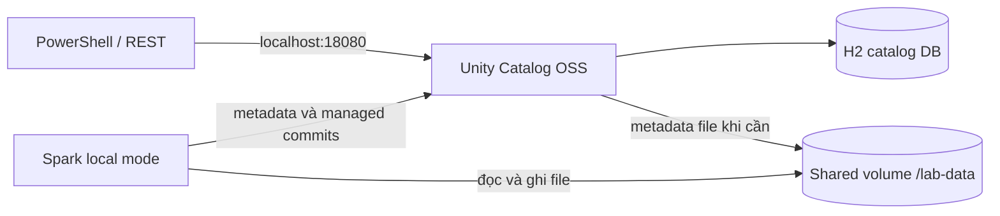

# Unity Catalog OSS: lab thực hành

Lab cục bộ dành cho Windows + Docker Desktop (Linux containers). Mục tiêu: hiểu catalog entry, file dữ liệu, Delta log và catalog-managed commit bằng cách quan sát hai bảng thực tế.

**Trạng thái kiểm chứng:** đã chạy thành công `lab.ps1 up` và `lab.ps1 demo` trên Docker Desktop Linux containers ngày 28/09/2026. Demo thoát với exit code 0; cả hai kiểm tra time travel và kiểm tra tổng hợp identities/features/dữ liệu đều `PASS`.

Kết quả runtime: hai bảng `lab.sales.orders_external` và `lab.sales.orders_managed` đều chứa `(1,100), (2,250)`; version 1 vẫn có `amount=200` ở dòng 2. Chỉ bảng managed có feature `catalogManaged`. UC Delta API trả `latest-table-version=2` và một commit version 2 chưa backfill tại thời điểm kiểm tra. Bài snapshot hai terminal và bài hai writer chưa được chạy trong lượt này.

## 1. Thành phần

| Thành phần | Phiên bản / vai trò |
|---|---|
| UC OSS | `unitycatalog/unitycatalog:v0.6.0` |
| Spark | `spark:4.0.1-scala2.13-java17-python3-ubuntu` |
| Delta connector | `io.delta:delta-spark_4.0_2.13:4.4.0` |
| UC connector | `io.unitycatalog:unitycatalog-spark_4.0_2.13:0.6.0` |
| Catalog DB | H2 mặc định, giữ trong named volume `catalog-db` |
| Storage | Named volume `table-data`, mount cùng đường dẫn `/lab-data` ở UC và Spark |



Đây là mô hình một máy để học. Shared filesystem giúp tránh phải cấu hình cloud IAM. Nó không mô phỏng S3 credential vending hoặc storage của một Spark cluster nhiều máy. Auth tắt và UC chỉ bind `127.0.0.1`. Hai container dùng cùng UID root để tránh lệch quyền file trên volume; không mount Docker socket. Đây không phải cấu hình production.

## 2. Khởi động

1. Mở Docker Desktop, chờ engine hoạt động và chọn Linux containers.
2. Nên dành khoảng 6 GB RAM trở lên cho Docker; cần Internet để pull image và tải Maven dependencies.
3. Mở PowerShell tại thư mục này:

```powershell
cd 'D:\it\data engineer\apache polaris\technology-research\unity-catalog\lab'
docker info
.\lab.ps1 up
.\lab.ps1 demo
```

Nếu chính sách PowerShell chặn script, có thể chạy mà không thay đổi policy lưu trên máy:

```powershell
powershell -NoProfile -ExecutionPolicy Bypass -File .\lab.ps1 up
powershell -NoProfile -ExecutionPolicy Bypass -File .\lab.ps1 demo
```

`up` chờ UC sẵn sàng. `demo` tạo namespace `lab.sales`, chạy bài tập và dừng Spark sau khi xong; UC tiếp tục chạy. Lần đầu Maven tải dependencies có thể mất vài phút. Cache được giữ trong named volume `ivy-cache` để các container Spark sau tái sử dụng. `conf/ivysettings.xml` dùng Maven Central tại `https://repo.maven.apache.org/maven2/`; cấu hình này được thêm sau khi lần chạy đầu gặp lỗi TLS tải dependencies từ `repo1.maven.org`.

## 3. Bài 1 — Catalog chứa gì?

Sau `demo`, xem API trực tiếp:

```powershell
$uc = 'http://127.0.0.1:18080/api/2.1/unity-catalog'
Invoke-RestMethod "$uc/catalogs/lab" | ConvertTo-Json -Depth 10
Invoke-RestMethod "$uc/schemas/lab.sales" | ConvertTo-Json -Depth 10
Invoke-RestMethod "$uc/tables/lab.sales.orders_external" | ConvertTo-Json -Depth 10
Invoke-RestMethod "$uc/tables/lab.sales.orders_managed" | ConvertTo-Json -Depth 10
```

So sánh `table_type`, `data_source_format`, `table_id`, `storage_location`. Cả hai entry phải là `DELTA`; một bảng `EXTERNAL`, một bảng `MANAGED`.

**Câu hỏi:** catalog entry chứa các dòng đơn hàng hay chỉ thông tin để tìm và quản lý bảng?

## 4. Bài 2 — Delta thường và catalog-managed Delta

`demo` thực hiện các bước trong `scripts/exercises.py`:

- Tạo `orders_external` với `LOCATION 'file:///lab-data/external/orders'`.
- Tạo `orders_managed` không có LOCATION và bật `delta.feature.catalogManaged`.
- Ghi `(1,100), (2,200)` vào mỗi bảng.
- Cập nhật dòng 2 thành `250`.
- Đọc phiên bản trước cập nhật bằng `VERSION AS OF`: phải vẫn thấy `200`.
- Kiểm tra feature `catalogManaged` có ở managed table và không có ở external table.

```powershell
.\lab.ps1 inspect
.\lab.ps1 files
.\lab.ps1 shell
```

Trong Spark SQL shell:

```sql
SHOW TABLES IN lab.sales;
SELECT * FROM lab.sales.orders_external ORDER BY id;
SELECT * FROM lab.sales.orders_managed ORDER BY id;
DESCRIBE DETAIL lab.sales.orders_external;
DESCRIBE DETAIL lab.sales.orders_managed;
DESCRIBE HISTORY lab.sales.orders_managed;
```

`inspect` còn gọi UC Delta API để hiển thị `latest-table-version` và các commit chưa backfill. Danh sách `commits` rỗng là bình thường nếu writer đã publish/backfill nhanh; không phải bằng chứng UC không điều phối commit.

**Điều cần quan sát:** cả hai bảng có time travel. Khác biệt là ai phê chuẩn commit và reader cần thông tin từ đâu; không phải “chỉ managed mới có ACID”. Không suy ra `EXTERNAL` luôn đồng nghĩa không catalog-managed ở mọi sản phẩm: trong lab, hãy kiểm tra chính `tableFeatures`.

## 5. Bài 3 — Snapshot ổn định khi bảng thay đổi

Mở sẵn terminal B và chạy `.\lab.ps1 shell` trước để tránh thời gian tải dependencies. Sau đó, ở terminal A:

```powershell
.\lab.ps1 snapshot
```

Khi A in `Snapshot version=...`, chạy trong SQL shell B trong vòng 30 giây:

```sql
UPDATE lab.sales.orders_managed SET amount = amount + 10 WHERE id = 2;
```

A đọc lại **cùng version** và kiểm tra kết quả không đổi; sau đó in bảng hiện tại để so sánh. Đây là bài chứng minh snapshot/time travel, không phải bài đo isolation của một transaction nhiều câu lệnh.

## 6. Bài 4 — Hai writer

Mở hai SQL shell bằng `.\lab.ps1 shell`. Chạy gần như cùng lúc trong cả hai:

```sql
UPDATE lab.sales.orders_managed SET amount = amount + 1 WHERE id = 1;
```

Đọc `DESCRIBE HISTORY` và dữ liệu. Nếu cả hai lệnh thành công thì tổng tăng phải là 2. Nếu có conflict, ghi lại lỗi, đọc trạng thái mới rồi chạy lại lệnh thất bại. Hai lệnh có thể không thực sự chồng lấn vì bảng nhỏ; **không bảo đảm lần chạy nào cũng thấy conflict**. OCC cho phép chuẩn bị dữ liệu song song, còn commit phải được sắp thứ tự hợp lệ.

Không ngắt UC để “tạo conflict”: mất kết nối là lỗi khả dụng, khác với xung đột transaction.

## 7. Kiểm tra lại, dừng và chạy tiếp

```powershell
.\lab.ps1 demo      # Đặt lại dữ liệu hai bảng bài tập, giữ lịch sử; có thể chạy lại
.\lab.ps1 verify    # Kiểm tra dữ liệu chuẩn, loại bảng và features sau demo
.\lab.ps1 status
.\lab.ps1 logs
.\lab.ps1 stop      # Dừng container, giữ dữ liệu
.\lab.ps1 up        # Khởi động lại
.\lab.ps1 down      # Gỡ container/network, vẫn giữ named volumes
```

`verify` kỳ vọng chính xác `(1,100), (2,250)` trong cả hai bảng. Nếu vừa làm bài UPDATE thủ công, chạy lại `demo` trước. `demo` ghi đè dữ liệu **chỉ hai bảng học tập này**, không dùng chúng để chứa dữ liệu riêng.

Không có lệnh tự động xóa volumes. H2 DB và file dữ liệu là hai phần cần giữ cùng nhau; xóa một phía rồi giữ phía kia không phải cách reset hợp lệ.

## 8. Khi có lỗi

| Dấu hiệu | Cách xử lý |
|---|---|
| Cannot connect / pipe docker_engine | Mở Docker Desktop và chọn Linux containers; thử `docker info`. |
| Port 18080 already allocated | Đổi host port trong compose và địa chỉ localhost trong lab.ps1/REST commands cho khớp. |
| Maven unresolved dependency / TLS / timeout | Kiểm tra Internet, proxy tới Maven Central. Không tự đổi sang connector phiên bản khác Spark. |
| HTTP 500 hoặc UC thoát | Chạy `lab.ps1 logs`; kiểm tra lỗi đầu tiên của UC/H2/storage. |
| Không thấy `catalogManaged` | Không coi bài tập đã thành công; kiểm tra phiên bản jars và lỗi DDL. |
| `verify` báo dữ liệu khác | Bạn có thể đã UPDATE ở bài 3/4; chạy `demo` để về dữ liệu chuẩn. |
| Docker config.json access denied trong phiên agent | Chạy từ PowerShell của bạn; không đổi quyền Docker config chỉ để bỏ cảnh báo. |

## 9. Nguồn và phạm vi

- [UC OSS v0.6.0 release: ma trận Spark/Delta connector](https://github.com/unitycatalog/unitycatalog/releases/tag/v0.6.0)
- [Dockerfile UC v0.6.0: đường dẫn /home/unitycatalog](https://github.com/unitycatalog/unitycatalog/blob/v0.6.0/Dockerfile)
- [Spark integration cùng tag](https://github.com/unitycatalog/unitycatalog/blob/v0.6.0/docs/integrations/unity-catalog-spark.md)
- [Managed tables](https://unitycatalog.io/blogs/introducing-unity-catalog-managed-tables/)
- [Delta concurrency](https://docs.delta.io/concurrency-control/)

Lab tập trung vào catalog, Delta và consistency. Authen/authorization với IdP, cloud credential vending, UniForm và HA là các bài tiếp theo; kết quả của lab này không xác nhận các chức năng đó.
