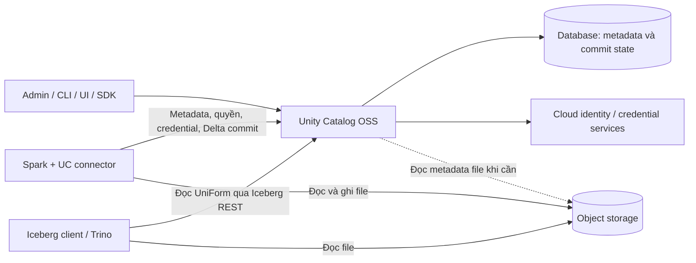
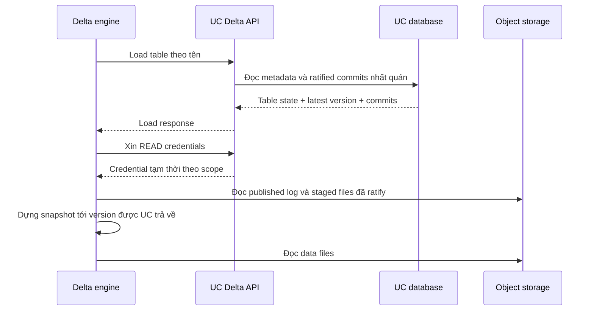
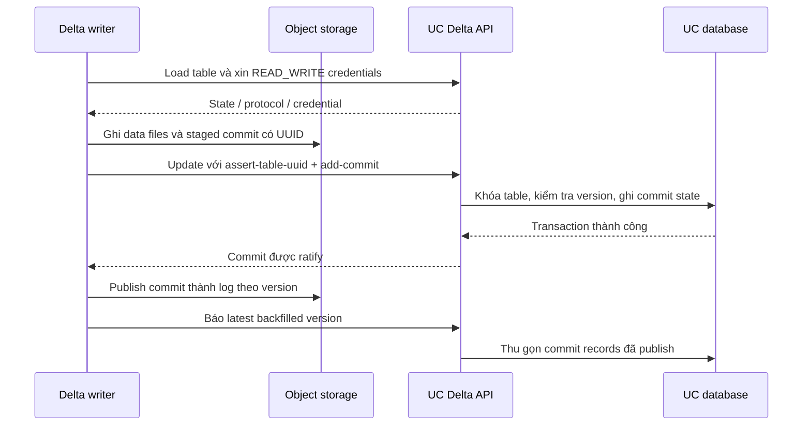

# Unity Catalog OSS: kiến trúc, luồng dữ liệu và vận hành cho Data Engineer

*Nghiên cứu ngày 18/09/2026. Mốc chính: Unity Catalog OSS **v0.6.0**, commit `6605f867d9a8b63205534dd8d575adb430e8f798`. Đối tượng: Data Engineer lựa chọn catalog, tích hợp Spark/Trino và vận hành lakehouse. Báo cáo đối chiếu tài liệu chính thức với mã nguồn tại tag phát hành; ví dụ là hướng dẫn tham khảo, chưa chạy kiểm thử runtime trong lần nghiên cứu này.*

**Cách đọc:** mục 0–4 để nắm kiến trúc; mục 5–8 để hiểu đọc/ghi và quyền; mục 9–11 để tích hợp và thử nghiệm; mục 12–15 để đánh giá vận hành và quyết định áp dụng. Nguồn được gắn ngay cạnh nhận định; mục 16 tổng hợp hướng đọc tiếp.

## 0. Unity Catalog OSS làm gì trong một pipeline thực tế?

Giả sử Spark ghi bảng `lake.sales.orders`, Trino cần đọc cùng dữ liệu, còn nhóm ML muốn quản lý model và thư mục chứa tài liệu huấn luyện. Nhóm nền tảng cần một nơi quản lý tên tài nguyên, schema, owner, quyền và thông tin truy cập storage.

**Unity Catalog OSS cung cấp catalog cho nhiều loại tài sản dữ liệu và AI, có REST API, phân quyền và cấp credential tạm thời.** Engine vẫn thực hiện SQL, xử lý dữ liệu và đọc/ghi file. Với managed Delta tables, catalog còn tham gia quyết định commit nào được chấp nhận vào lịch sử bảng. Với Iceberg REST trong v0.6.0, đường được triển khai chủ yếu là đọc metadata UniForm của Delta. Hai đường này có khả năng và giới hạn khác nhau. [Tổng quan][1], [Delta API][3], [Iceberg service][4]



Sơ đồ biểu diễn vai trò logic, không khẳng định mỗi query luôn tạo đúng một request. Client có thể cache metadata/credential; managed Delta reader cần kết hợp log đã publish với commit được catalog phê chuẩn.

Các kết luận nên nắm trước khi đọc sâu:

| Câu hỏi | Kết luận theo v0.6.0 |
|---|---|
| Có phải Databricks Unity Catalog đầy đủ được đóng gói để tự host? | Không được suy diễn như vậy. OSS và dịch vụ Databricks có phạm vi khác nhau |
| Có chỉ là nơi lưu schema/location? | Không. Managed Delta có catalog-mediated commit |
| Có thay Spark/Trino hay object storage? | Không; UC quản lý metadata, truy cập và một phần điều phối commit |
| Có hỗ trợ managed tables? | Có managed Delta; nhận định “OSS chỉ hỗ trợ external tables” đã lỗi thời |
| Có Iceberg REST tức là tạo/ghi native Iceberg đầy đủ? | Không. Source của endpoint phải được kiểm tra riêng |
| Có HA bằng cách tăng replica? | Cần external DB, signing keys thống nhất và kiểm chứng đồng bộ quyền |
| Có tự động maintenance như dịch vụ managed? | Chưa có cơ sở để kết luận; đặc tả và source còn các giới hạn quan trọng |

## 1. Phạm vi, phiên bản và cách đọc nguồn

### 1.1. Ba tên dễ bị trộn lẫn

| Tên | Ý nghĩa trong báo cáo |
|---|---|
| **Unity Catalog OSS** | Repository `unitycatalog/unitycatalog`, tự triển khai server, database và tích hợp |
| **Databricks Unity Catalog** | Dịch vụ governance trong Databricks; tài liệu mô tả thêm lineage, ABAC, audit và các khả năng gắn với runtime/platform |
| **Delta UniForm** | Cơ chế cung cấp metadata tương thích định dạng khác trên dữ liệu Delta; không phải một catalog độc lập |

Dự án OSS sử dụng Apache License 2.0, thuộc LF AI & Data Foundation ở mức sandbox theo tài liệu dự án. Bài nghiên cứu SIGMOD Companion 2025 của đội phát triển hữu ích để hiểu triết lý catalog–engine separation, nhưng chính bài viết lưu ý có tính năng chưa hiện diện trong OSS. Vì thế, kiến trúc dịch vụ Databricks hoặc số liệu quy mô của dịch vụ đó không được chuyển thành bảo đảm cho bản tự host. [Dự án][1], [Bài nghiên cứu][2]

### 1.2. Vì sao chọn v0.6.0?

Trang releases chính thức tại thời điểm nghiên cứu đánh dấu v0.6.0 là latest, công bố ngày 20/08/2026. Các điểm đáng chú ý gồm UC Delta API mở rộng, SQL views, metric views với Spark 4.2, cải tiến xác thực và credential vending. Token sinh qua token exchange có thời hạn mặc định 24 giờ; bootstrap admin token là trường hợp khác. [Release v0.6.0][5]

Báo cáo dùng thứ tự bằng chứng:

1. **Source tại v0.6.0:** xác nhận handler, kiểm tra quyền, transaction và implementation thực tế.
2. **Spec và docs trong cùng tag:** xác nhận hợp đồng client/server và hướng dẫn tương ứng.
3. **Release notes:** xác định thay đổi giữa các bản.
4. **Docs chính thức đang công khai:** bổ sung nền tảng; có thể chứa ví dụ cũ.
5. **Suy luận vận hành:** được ghi là khuyến nghị hoặc điều cần PoC, không coi là tính năng sản phẩm.

Ví dụ, phần API docs tự sinh ghi “không cần authorization” không thay thế được kiểm tra annotation/decorator của server khi bật auth. Tương tự, định nghĩa “managed table được catalog quản lý lifecycle” chưa chứng minh mọi backend đã xóa file khi drop. [API reference][3], [Server assembly][6], [File operations][7]

## 2. Mô hình đối tượng và loại metadata

### 2.1. Định danh ba cấp

```text
Metastore
├── Catalog: lake
│   ├── Schema: sales
│   │   ├── Table: orders
│   │   ├── View: recent_orders
│   │   ├── Metric view: revenue_metrics
│   │   ├── Volume: contracts
│   │   ├── Function: normalize_product_code
│   │   └── Registered model: demand_forecast
│   │       └── Model versions
│   └── Schema: finance
└── Storage credentials / external locations: tài nguyên quản lý truy cập storage
```

Tên `lake.sales.orders` có ba thành phần: catalog, schema, table. `catalog` ở đây là một container logic; không mặc định là connector tới một hệ thống bên ngoài như mô hình catalog-of-catalogs. UC còn dùng UUID để nhận diện tài nguyên. Trong rename table cùng schema, source giữ nguyên UUID và storage location. Tên phục vụ con người; UUID giúp giữ identity khi tên thay đổi. [Catalog model][8], [Table model][9], [Table repository][10]

### 2.2. UC lưu gì, table format lưu gì?

| Lớp | Ví dụ metadata | Nơi lưu / chủ thể chịu trách nhiệm |
|---|---|---|
| Catalog | Tên, UUID, schema, columns, format, location, properties, owner, timestamps | Database của UC |
| Access control | Principal, privileges, quan hệ tài nguyên | Database/policy model của UC |
| Managed Delta commit | Commit đã ratify, version, staged filename, trạng thái backfill | Database UC phối hợp với Delta log trên storage |
| Delta table | Actions thêm/xóa file, protocol, checkpoints, lịch sử dữ liệu | `_delta_log` và file trên storage; engine/Delta client xử lý |
| UniForm | Iceberg metadata được chuyển đổi và location tương ứng | File metadata trên storage; UC cung cấp qua đường tương thích |
| Data/artifacts | Parquet, tài liệu, model artifacts | Object storage hoặc filesystem đã cấu hình |

Schema xuất hiện ở cả catalog và table format không có nghĩa hai bản luôn tự đồng bộ với mọi writer. Client phải tuân thủ protocol cập nhật metadata. Một công cụ sửa file hoặc log ngoài đường đã được quản lý có thể tạo metadata lệch, dù tên bảng vẫn hiện trong UI. [Persistence setup][11], [Managed-table protocol][12]

### 2.3. Asset ngoài table

- **Volume:** đặt tên và quản lý quyền cho một vùng file; phù hợp landing files, tài liệu hoặc artifact. Volume không biến các file đó thành bảng có transaction.
- **Function:** lưu định nghĩa và signature của hàm. Execution cần client/runtime tương ứng; catalog không tự trở thành cụm tính toán UDF.
- **Registered model/model version:** quản lý tên model, version và thông tin artifact; tách model registry khỏi nơi training/serving.
- **View/metric view:** lưu SQL hoặc định nghĩa dimensions/measures và dependencies; engine hiểu loại view mới thực thi được.

Đây là lý do UC OSS đáng quan tâm với nền tảng kết hợp dữ liệu bảng và AI. Việc có asset model không tự cung cấp đầy đủ orchestration, model serving, semantic query engine hoặc lineage tự động. [Volumes][13], [Functions][14], [Models][15], [Metric views][16]

## 3. Kiến trúc server và persistence

### 3.1. Các thành phần chính

| Thành phần | Vai trò | Ý nghĩa với Data Engineer |
|---|---|---|
| Java + Armeria | HTTP server, routing, chuyển đổi request/response | Đây là stack thực tế của UC OSS; không dùng Quarkus như Polaris |
| API services | Catalog, schema, table, volume, model, credential, Delta, Iceberg | Mỗi API surface có contract riêng |
| Authentication/access decorators | Kiểm tra identity và quyền trước nghiệp vụ | Cùng token nhưng quyền endpoint khác nhau |
| Repositories + Hibernate | Entity persistence và transaction | Database là dependency vận hành bắt buộc |
| JCasbin + JDBC adapter | Lưu và đánh giá policy | Cần kiểm tra consistency khi chạy nhiều instance |
| Cloud credential vendors | AWS/Azure/GCP credential | Catalog permission phải nối đúng với cloud IAM |
| Spark/Hadoop connectors | Resolve table, truy cập file theo credential scope | Chọn đúng artifact/version ảnh hưởng tính đúng đắn |
| CLI/UI/SDK | Quản trị và tích hợp | Tạo được tài nguyên qua UI chưa chứng minh query chạy được |

Source build yêu cầu Java 17 trở lên và dùng sbt. Java cần cho server và Java cần cho engine là hai yêu cầu phải kiểm tra riêng. [Build][17], [Bootstrap server][6]

### 3.2. Metadata database

Mặc định repository có H2 dạng file trong `etc/db`; môi trường test dùng H2 in-memory. Hướng dẫn triển khai có cấu hình PostgreSQL và MySQL thông qua Hibernate/JDBC. Source còn có test chuyên biệt cho Delta commits trên hai database này. Điều đó xác nhận có đường tích hợp và test trong dự án, không phải kết quả benchmark hay kiểm thử production của báo cáo. [Deployment][18], [Hibernate][11], [PostgreSQL test][19], [MySQL test][20]

**Khuyến nghị triển khai:** dùng PostgreSQL/MySQL được vận hành độc lập cho môi trường nhiều instance; quản lý connection pool, backup và migration như một database quan trọng. Cấu hình mẫu có `hibernate.hbm2ddl.auto=update`; không nên coi auto-update schema là một kế hoạch upgrade/rollback đầy đủ. [Cấu hình Hibernate][21]

### 3.3. Ranh giới transaction

`TransactionManager` mở session, bắt đầu transaction và commit/rollback. Đường load của Delta API đọc metadata và commit state trong transaction `REPEATABLE_READ`; đường cập nhật giữ thay đổi trong một transaction và khóa bản ghi bảng khi xử lý commit/backfill. [Transaction manager][22], [Table repository][10], [Commit repository][23]

Ba hệ quả:

1. Database transaction bảo vệ trạng thái UC trong phạm vi transaction đó.
2. Ghi Parquet/staged log vào storage và gửi REST request là các thao tác riêng; không có bằng chứng về một transaction phân tán rollback toàn bộ chúng.
3. Tính nguyên tử ở một bảng không chứng minh một job ghi mười bảng được publish cùng lúc.

Khi thiết kế pipeline, cần phân biệt **atomic commit của table**, **nhất quán metadata catalog** và **exactly-once của toàn pipeline**.

## 4. Ba giao diện API phải phân biệt

| Giao diện | Base path | Dùng cho |
|---|---|---|
| UC REST API | `/api/2.1/unity-catalog` | Catalog/schema, asset metadata, permissions, credential, external location |
| UC Delta API | `/api/2.1/unity-catalog/delta/v1` | Delta table discovery, staging, load, update/commit và credentials |
| Iceberg REST | `/api/2.1/unity-catalog/iceberg` | Đường đọc metadata UniForm theo Iceberg REST được triển khai |

Ngoài ra server có control API cho authentication và user management. Không lấy endpoint OAuth của Databricks workspace rồi mặc định dùng được với OSS. [API tổng][24], [Delta API][3], [Server routing][25]

Một chuỗi thao tác UC Delta tiêu biểu:

```text
GET  /delta/v1/config?catalog=lake&protocol-versions=1.0
POST /delta/v1/catalogs/lake/schemas/sales/staging-tables
POST /delta/v1/catalogs/lake/schemas/sales/tables
GET  /delta/v1/catalogs/lake/schemas/sales/tables/orders
GET  /delta/v1/catalogs/lake/schemas/sales/tables/orders/credentials?operation=READ
POST /delta/v1/catalogs/lake/schemas/sales/tables/orders
```

Các path trên tương đối với UC REST base. `POST .../tables/orders` mang `requirements` và `updates`, có thể chứa action `add-commit`. Trong protocol này, load response trả các commit chưa backfill; không nên ghép request của Delta API mới với payload của API commit đời trước. Client nên bắt đầu bằng `/config` để thương lượng version và endpoint. [Managed-table protocol][12], [Delta API][3]

## 5. Read path: engine đọc một bảng như thế nào?

### 5.1. External Delta table thông thường

Ví dụ `orders_ext` đã trỏ tới một thư mục Delta do đội dữ liệu quản lý:

1. Engine resolve tên bảng qua UC để lấy identity, location và metadata.
2. UC đánh giá quyền; client xin credential phù hợp nếu dùng vending.
3. Delta client đọc log/checkpoint để dựng snapshot của bảng.
4. Engine chọn file, thực hiện pruning và đọc Parquet trực tiếp từ storage.

UC không truyền toàn bộ các row qua server. Dữ liệu có thể tồn tại trước khi đăng ký catalog; registration tạo entry, không tự chuyển file thành Delta hoặc xác nhận dữ liệu sạch. [Table API][24], [Spark connector][26]

### 5.2. Managed Delta table

Điểm khác biệt là lịch sử mới nhất có thể gồm commit đã được UC chấp nhận nhưng chưa được publish thành log file theo tên version thông thường.



Reader kết hợp published log với danh sách ratified commits, chỉ dựng state tới `latest-table-version` đã được trả về. Không được tự lấy “file log có version lớn nhất” làm chân lý. Nếu một version có cả trong catalog response và published log, protocol quy định xử lý theo entry catalog để đọc staged commit tương ứng. [Managed-table protocol][12]

**Hệ quả vận hành:** còn đầy đủ Parquet và `_delta_log` không đồng nghĩa có thể bỏ UC database rồi đọc managed table bằng path. Catalog state là một phần của khả năng khôi phục bảng. Delta docs cũng yêu cầu truy cập catalog-managed tables qua managing catalog. [Delta catalog-managed tables][27]

### 5.3. Phân biệt các số version

| Giá trị | Dùng để làm gì? |
|---|---|
| UUID của table | Xác định đúng đối tượng, chống cập nhật nhầm bảng cùng tên sau drop/create; tên field phụ thuộc API, ví dụ `table_id` trong UC REST và `metadata.table-uuid` trong Delta load |
| Delta table version | Thứ tự commit làm thay đổi state dữ liệu |
| `etag` | Điều kiện kiểm soát cập nhật metadata; không phải Delta snapshot version |
| Latest backfilled version | Mốc mà các commit trước đó đã được publish đầy đủ vào log |
| Iceberg snapshot ID của UniForm | Identity trong metadata Iceberg được chuyển đổi; không được so bằng số với Delta version |

Trong protocol của UC, data-only commit và backfill không nhất thiết đổi metadata `etag`. Pipeline phải giữ đúng loại version cho loại kiểm tra tương ứng. [Protocol][12], [UniForm][28]

## 6. Write path: external và managed Delta

### 6.1. External table không có `catalogManaged`

Engine ghi data files và thực hiện transaction theo Delta protocol/storage integration. UC quản lý entry và truy cập nhưng không mặc định phê chuẩn mọi commit của đường filesystem-based Delta. Nếu writer đổi schema/properties bên ngoài cơ chế đồng bộ catalog, cần kiểm tra cách cập nhật metadata UC của connector đó. [Delta overview][27], [Spark connector][26]

### 6.2. Tạo managed table: staging trước, registration sau

Managed-table flow gồm:

1. Client gửi create staging table.
2. UC cấp UUID, location và contract gồm protocol/features/properties bắt buộc.
3. Client ghi initial log `0.json` đúng contract, cùng data files nếu là CTAS.
4. Client finalize bằng create table; UC kiểm tra staging state, principal và metadata khai báo.
5. Bảng được đăng ký ở version 0.

Spec không bắt buộc server phải đọc và kiểm chứng mọi nội dung `0.json`; client vẫn chịu trách nhiệm bảo đảm log thực tế khớp phần khai báo. Vì vậy, “server-side validation” không đồng nghĩa UC phân tích mọi row hoặc chứng minh mọi writer đều đúng. [Protocol][12], [Managed contract][29]

Trong source v0.6.0, contract mặc định yêu cầu reader protocol tối thiểu 3, writer protocol tối thiểu 7 và các feature như `catalogManaged`, `v2Checkpoint`, `vacuumProtocolCheck`, `deletionVectors`, `inCommitTimestamp`. Client phải đọc contract server trả về; không chỉ kiểm tra nó có đọc được Delta cơ bản. Có ngoại lệ cấu hình riêng cho UniForm Iceberg V2/deletion vectors, nên compatibility phải xét cả table features. [Contract source][29]

### 6.3. Commit vào managed table đã tồn tại



“Ratified” nghĩa là UC đã chọn commit làm thành viên lịch sử; “published” nghĩa là commit đã được ghi ra vị trí log chuẩn trên storage. Hai thời điểm có thể khác nhau. UC yêu cầu version mới nối tiếp version đã ratify; source dùng write lock trên record table và ràng buộc commit để điều phối cạnh tranh. [Protocol][12], [Commit repository][23]

### 6.4. Hai writer cùng cập nhật

Ví dụ cả A và B đọc version 20 rồi đề xuất version 21. Catalog chọn được commit hợp lệ trước; request còn lại có thể gặp conflict. Writer thua phải tải lại state, đánh giá conflict theo Delta và xây commit mới nếu được phép. Đổi số version rồi gửi lại một cách máy móc có thể vi phạm logic read-modify-write của engine.

UC Delta API hiện mô tả thao tác trên từng table. Không có căn cứ trong API đã kiểm tra để khẳng định UC OSS v0.6.0 cung cấp transaction atomic nhiều bảng cho mọi engine. Việc Delta protocol tạo nền tảng cho multi-table transactions là một khả năng kiến trúc, khác với tính năng end-to-end đã triển khai. [Delta API][3], [Delta architecture][27]

### 6.5. Timeout, retry và backfill

| Tình huống | Cách hiểu đúng | Việc client/operator cần làm |
|---|---|---|
| Ghi file xong, chưa gọi UC | File có thể chưa thuộc table history | Không coi là commit thành công |
| UC đã ratify, response bị mất | Kết quả request chưa rõ với client | Reload/reconcile; giữ identity của staged commit |
| Retry đúng commit còn được DB theo dõi | Source nhận ra cùng version + staged filename | Có thể trả thành công mà không áp thay đổi lần nữa |
| Retry commit cũ đã bị purge khỏi tracking DB | Source không đủ dữ liệu nhận diện replay | Có thể trả conflict; client cần kiểm tra log/history |
| Ratify thành công, writer chết trước publish | Ratified staged commit vẫn quan trọng với reader | Writer khác có thể cooperative publish theo protocol |
| Tồn đọng quá nhiều unbackfilled commits | Backpressure tại catalog | Backfill trước khi retry ghi tiếp |

Source đặt giới hạn **10 unbackfilled commits mỗi table**, không phải giới hạn lịch sử bảng chỉ có 10 phiên bản. Đây là ngưỡng backlog để ngăn state tạm tăng mãi; client bình thường cần publish/backfill chủ động. Báo backfill trước khi file đã publish bền vững có thể khiến catalog xóa record cần để đọc commit. [Commit repository][23], [Recovery protocol][12]

## 7. Iceberg REST và UniForm: khả năng thực tế

### 7.1. UniForm chia sẻ dữ liệu như thế nào?

UniForm tạo metadata tương thích Iceberg/Hudi cho dữ liệu Delta, cho phép client thích hợp đọc cùng data files. Tài liệu Delta mô tả đường chuyển đổi metadata bất đồng bộ; vì vậy, khi dùng đường đó cần xét độ trễ conversion thay vì mặc định reader Delta và Iceberg luôn thấy cùng thời điểm. UniForm nhìn từ Iceberg/Hudi là đường read-only. [Delta UniForm][28]

Với managed Delta, UC protocol còn mang thông tin `uniform`, metadata location và converted Delta version trong quá trình cập nhật. Phải xác minh cơ chế publish metadata của chính writer đang dùng; không trộn hướng dẫn UniForm/HMS cũ với UC managed-table protocol mới. [Managed protocol][12], [Uniform mapper][30]

### 7.2. Endpoint matrix từ source v0.6.0

| Nhóm thao tác Iceberg REST | Hành vi đã đọc từ source |
|---|---|
| Get config | Yêu cầu `warehouse` là tên UC catalog; trả prefix `catalogs/<catalog>` |
| List/load namespace | Ánh xạ tới schema; nested namespaces không được hỗ trợ |
| List tables | Lọc các table có UniForm metadata location |
| Table exists / load table | Kiểm tra UniForm metadata, đọc Iceberg metadata file |
| Load view | Handler luôn trả `NoSuchViewException`; chưa triển khai load view thực |
| Report metrics | Trả thành công; handler không xử lý lưu metrics |
| Create/update/commit/delete Iceberg table | Không có trong tập endpoint được service triển khai/quảng bá |
| Iceberg multi-table transaction | Không có trong service đã kiểm tra |

Khi load table, service kiểm tra location trong Iceberg metadata phải khớp location table đã đăng ký, rồi trả FileIO config qua `TableConfigService`. Đây là bằng chứng về cơ chế cụ thể; không chỉ là tuyên bố “Iceberg compatible”. [Iceberg service][4], [Table config][31]

### 7.3. Giới hạn phân quyền cần chú ý

Các method trong `IcebergRestCatalogService` v0.6.0 mang biểu thức authorization kiểm tra **`OWNER` trên metastore**. Khi bật authorization, không được mặc định một user chỉ có `SELECT` ở table sẽ dùng đường Iceberg giống đường UC native. Bài toán reader Iceberg với quyền tối thiểu phải được kiểm thử riêng trước khi chọn kiến trúc này. [Iceberg source][4], [Authorization routing][25]

Đây cũng giải thích vì sao demo dùng auth tắt hoặc token quản trị có thể đọc thành công, còn triển khai với principal bị giới hạn quyền lại thất bại.

### 7.4. Kết luận sử dụng

UC OSS phù hợp để đánh giá mô hình **Delta writer + nhiều loại reader**, khi client đáp ứng table features và security model. Nếu mục tiêu chính là nhiều engine tự do tạo/commit native Iceberg, cần so sánh một Iceberg catalog chuyên dụng và kiểm chứng endpoint write/transaction; không chọn UC OSS chỉ vì có URL `/iceberg`. [UC UniForm guide][32], [Iceberg implementation][4]

## 8. Authentication, authorization và credential

### 8.1. Ba câu hỏi khác nhau trong một lần đọc

| Câu hỏi | Cơ chế |
|---|---|
| Bạn là ai? | Authentication: token/IdP và identity UC |
| Bạn được phép làm gì với tài nguyên? | Authorization: privilege trên catalog/schema/table/asset |
| Engine có mở được object storage? | Cloud credential và policy IAM/storage |

Đăng nhập thành công chưa có nghĩa được đọc table. Load metadata thành công cũng chưa đủ nếu cloud credential hoặc quyền storage sai.

Source mặc định để `server.authorization=disable`; khi bật, server sử dụng authentication/access decorators và JCasbin authorizer. Vì vậy, cấu hình demo mặc định không đại diện deployment có kiểm soát truy cập. [Config][33], [Server][6]

### 8.2. Identity và token exchange

Luồng điển hình: principal lấy token từ IdP → gọi token exchange của UC → UC kiểm tra token và tài khoản local → phát UC access token → client gọi API bằng Bearer token.

Source kiểm tra issuer allowlist, signature/JWKS và audience; principal còn phải tồn tại và được enable trong user repository. Tên cấu hình như `server.authorization-url` hoặc `server.token-url` không thay thế các kiểm tra issuer/audience. Token cấp qua exchange có expiration; không được xây job dài hạn dựa vào giả định token vĩnh viễn của bản cũ. [Auth source][34], [Auth guide][35]

Với pipeline không có người đăng nhập tương tác, cần kiểm chứng đúng flow machine identity mà tổ hợp IdP/client/UC hỗ trợ. Không lấy ví dụ đăng nhập Google bằng trình duyệt làm bằng chứng về mọi kiểu service principal.

Khi cấu hình production, ưu tiên issuer cụ thể và audience cụ thể: wildcard issuer mở rộng những host mà server có thể liên hệ để tìm JWKS, còn `server.audiences=*` tắt kiểm tra audience. Không dùng bootstrap admin token cho job thông thường; đây là credential đặc quyền cần bảo vệ và có kế hoạch thay thế/thu hồi riêng. [Auth configuration][35], [Release security notes][5]

### 8.3. Privilege và ownership

Đối với principal thông thường, đọc credential table cần quyền đi qua catalog/schema và `SELECT`; xin `READ_WRITE` cần `SELECT` cùng `MODIFY`, hoặc nhánh ownership tương ứng. Create external table còn kiểm tra quyền trên external location khi dùng mô hình location được quản lý. [Authorization expressions][36]

JCasbin dùng policy database và quan hệ hierarchy. Matcher xử lý `OWNER` riêng: quyền ownership không được diễn giải đơn giản là mọi privilege luôn kế thừa giống nhau; service expression bổ sung các nhánh owner ở cấp catalog/schema/table. Cần đọc effective permissions theo thao tác, không chỉ liệt kê grant records. [JCasbin][37], [Policy model][38]

Ví dụ cấp quyền qua CLI cho một reader, sau khi user đã được tạo và admin token được nạp an toàn vào biến môi trường:

```bash
bin/uc --auth_token "$UC_ADMIN_TOKEN" permission create \
  --securable_type catalog --name lake \
  --privilege 'USE CATALOG' --principal reader@example.com

bin/uc --auth_token "$UC_ADMIN_TOKEN" permission create \
  --securable_type schema --name lake.sales \
  --privilege 'USE SCHEMA' --principal reader@example.com

bin/uc --auth_token "$UC_ADMIN_TOKEN" permission create \
  --securable_type table --name lake.sales.orders \
  --privilege 'SELECT' --principal reader@example.com
```

Đây là ví dụ cho đường UC table access. Các grant này không loại bỏ giới hạn metastore-owner của Iceberg service đã nêu. [Privilege guide][39], [Iceberg service][4]

### 8.4. Storage credential, external location và managed storage

Ba khái niệm cần tách:

- **Storage credential:** đối tượng UC chứa thông tin dùng để đạt được identity storage, ví dụ AWS IAM role ARN.
- **External location:** vùng storage có URL, gắn với credential và được quản trị bằng quyền UC.
- **Managed storage root:** vùng để UC cấp location cho managed assets trong catalog/schema.

Trên AWS, UC chạy với master identity, assume storage role được trust; external ID là một phần của thiết lập trust. Engine nhận credential tạm thời cho thao tác và path, không cần nhận master identity của server. [AWS guide][40], [AWS vendor][41]

**Lưu ý version cụ thể:** hướng dẫn AWS trong tag có chỗ dùng `aws.s3.masterRoleArn`; `ServerProperties` và file cấu hình v0.6.0 sử dụng **`aws.masterRoleArn`**, cùng `aws.accessKey`, `aws.secretKey`, `aws.region`. Với bản này nên đối chiếu key trong code/config thay vì chép nguyên đoạn hướng dẫn cũ. [Config][33], [Properties source][42]

### 8.5. Multi-cloud không có nghĩa feature parity

| Backend | Đường credential trong source | Giới hạn cần hiểu |
|---|---|---|
| AWS S3 | AssumeRole; có mô hình storage credential + external location; còn fallback per-bucket cũ | Credential static cấu hình sẵn được mô tả dành cho test, không đại diện cơ chế downscope động |
| Azure ADLS | Credential vendor/generator theo cấu hình ADLS, user delegation SAS | Vendor trả `UNIMPLEMENTED` nếu đi qua storage-credential/external-location DAO path |
| GCS | Google credentials được downscope bằng Credential Access Boundary | Tương tự Azure, vendor trả `UNIMPLEMENTED` với storage-credential/external-location DAO path; không suy feature parity từ AWS |

`StorageCredentialVendor` yêu cầu path có prefix thay vì cloud-storage root và privileges không rỗng. Đây là kiểm tra ranh giới, nhưng quyền thực tế vẫn phụ thuộc cloud policy và credential generator được chọn. [Vending entry point][43], [AWS][41], [Azure][44], [GCP][45]

### 8.6. Phạm vi bảo vệ

Khi engine đã giữ credential cloud còn hiệu lực, revoke grant trên UC không tự làm credential đó biến mất khỏi bộ nhớ engine. Thu hồi ở catalog và thu hồi ở storage là hai cơ chế cần đánh giá riêng theo provider/TTL. Tương tự, nếu người dùng còn credential storage độc lập với quyền rộng, họ có thể đi bằng một đường không chịu quyết định của UC. Đây là hệ quả kiến trúc của credential vending, cần được kiểm chứng trong thiết kế IAM.

Credential theo prefix/file cũng không tự thực thi filter theo row hoặc mask theo column bên trong Parquet. Yêu cầu fine-grained data security cần đường query/engine có enforcement tương ứng. Tài liệu Databricks mô tả row filters/masks và ABAC trong dịch vụ của họ; báo cáo không tìm được bằng chứng đủ để gán cùng capability cho OSS v0.6.0. [Databricks access controls][46], [Vending source][43]

## 9. SQL views, metric views và assets AI

### 9.1. Views theo đúng engine version

| Capability theo release v0.6.0 | Spark 4.0 / 4.1 | Spark 4.2 |
|---|---|---|
| Đọc SQL view đã tồn tại | Có | Có |
| Create/drop SQL view | Chưa hỗ trợ qua connector | Có |
| Replace/rename SQL view | Chưa hỗ trợ | Chưa hỗ trợ |
| Metric view end-to-end | Chưa hỗ trợ | Có với connector tương ứng |

Source phân biệt `VIEW`, `METRIC_VIEW` và từ chối tạo `MATERIALIZED_VIEW`. Việc một enum/API model có tên object type không có nghĩa server đã hiện thực lifecycle và compute của loại đó. [Release][5], [Table repository][10], [Metric guide][16]

Metric view lưu định nghĩa dimensions/measures; engine tính aggregation. Nó không đồng nghĩa materialized view hay một service đã tự tính và cache doanh thu cho dashboard. Ví dụ doanh nghiệp có thể chuẩn hóa định nghĩa `net_revenue = sum(net_amount)` một lần, nhưng reader phải hiểu metric-view semantics mới sử dụng được.

### 9.2. Ý nghĩa của functions/models với Data Engineer

Function registry có thể giúp chuẩn hóa hàm dùng trong pipeline hoặc tool cho ứng dụng AI. Model registry giúp version và quản lý artifact cùng hierarchy với data assets. Cần xác định rõ nơi execution diễn ra, package/runtime cần gì và principal nào đọc artifact. Không suy ra model training, serving hoặc model lineage tự động chỉ từ thao tác đăng ký model thành công. [Functions][14], [Models][15]

Một ghi chú về nguồn: tài liệu metric views tại tag vẫn có đoạn nói chưa có Delta Spark artifact 4.2, trong khi release 0.6.0 đưa tọa độ package 4.2. Báo cáo không dùng tổ hợp đó cho ví dụ Delta chính; khi triển khai phải kiểm tra Maven artifacts thực tế và ma trận compatibility của release. [Metric guide][16], [Release][5]

## 10. Engine integration: cần kiểm tra đến mức nào?

### 10.1. Ma trận đánh giá

| Engine/client | Đường tích hợp đã có nguồn | Kết luận có thể dùng | Phần cần PoC |
|---|---|---|---|
| Spark + UC connector | `UCSingleCatalog`, Delta integration, credential-scoped filesystem | Đường tham chiếu phù hợp nhất để nghiên cứu managed Delta | Long-running job, token refresh, feature compatibility, concurrent writers |
| Spark + Iceberg REST | UC Iceberg endpoint | Đọc UniForm được docs mô tả | Privilege tối thiểu, conversion freshness; không coi là native Iceberg writer |
| Trino Iceberg connector | REST catalog tới UC endpoint | Có hướng dẫn truy vấn Delta UniForm | Warehouse mapping, security và storage config theo Trino version |
| DuckDB | UC/Delta extension trong hướng dẫn tích hợp | Có đường discovery/query | Support `catalogManaged` và table features của đúng extension đang cài |
| Flink hoặc engine Delta khác | UC Delta API là contract để tích hợp | Có API không chứng minh connector đã hỗ trợ trọn vẹn | Commit, staging, backfill, checkpoints, vending và streaming recovery |

Nguồn: [Spark][26], [Trino guide][47], [DuckDB guide][48], [Delta API][3].

### 10.2. Version cần ghim cùng nhau

Một bộ cấu hình cần ghi đủ: UC server, Spark minor, Scala binary version, UC connector, Delta connector, Hadoop/cloud libraries, table features và auth mode. Release 0.6.0 cung cấp artifact Spark riêng cho 4.0/4.1/4.2 và hướng dẫn dùng Delta Lake 4.4.0. Không dùng tên artifact 0.3.0 trong hướng dẫn cũ rồi đổi mỗi số version. [Release][5], [Spark connector][26]

Đối với Trino, docs UC cũ dùng tên schema dạng ghép và không truyền warehouse; source hiện tại yêu cầu warehouse là UC catalog và namespace là schema. Cấu hình nên được xây từ current Trino properties và `/config` của server, sau đó kiểm tra `SHOW SCHEMAS`/`SHOW TABLES`. [UC Trino guide][47], [Iceberg service][4], [Trino REST properties][49]

### 10.3. Streaming và dbt

Đối với streaming, UC không thay checkpoint của Spark/Flink. Cần test restart từ checkpoint, commit đã ratify nhưng chưa publish, token hết hạn và replay micro-batch. Với dbt, catalog server cũng không cung cấp SQL execution endpoint; adapter phải kết nối engine được hỗ trợ. Đây là các yêu cầu tích hợp pipeline, không phải capability mặc định chỉ vì UC có REST API.

## 11. Lab tham khảo cho Data Engineer

### 11.1. Mục tiêu và điều kiện

Lab nên chứng minh ba việc: resolve tên bảng qua UC; engine truy cập được storage bằng đúng identity; managed commit đi đúng protocol. Các lệnh sau là Bash cho Linux/WSL, dựa trên release/source đã nghiên cứu. Cần JDK phù hợp cho server và Spark, có quyền truy cập artifact registry và một storage location đã cấu hình.

```bash
git clone --depth 1 --branch v0.6.0 \
  https://github.com/unitycatalog/unitycatalog.git
cd unitycatalog
build/sbt package
bin/start-uc-server
```

Server mặc định ở port 8080. Chạy local quickstart trước rồi mới bật auth theo hướng dẫn IdP; không dùng auth tắt làm kết quả nghiệm thu production. [README v0.6.0][1], [Auth][35]

### 11.2. Chuẩn bị storage và namespace

Đối với AWS, hoàn thiện master role, storage role, trust/external ID và bucket policy theo hướng dẫn chính thức. Sau đó dùng CLI để tạo storage credential và external location, rồi tạo catalog với storage root nằm trong location đó. Tên IAM ARN/path phải lấy từ tài khoản lab thực tế. [AWS deployment][40]

```bash
bin/uc --auth_token "$UC_ADMIN_TOKEN" credential create \
  --name lake_storage --aws_iam_role_arn "$STORAGE_ROLE_ARN"

bin/uc --auth_token "$UC_ADMIN_TOKEN" external_location create \
  --name lake_root --url "$LAKE_ROOT_URL" --credential_name lake_storage

bin/uc --auth_token "$UC_ADMIN_TOKEN" catalog create \
  --name lake --storage_root "$LAKE_ROOT_URL"

bin/uc --auth_token "$UC_ADMIN_TOKEN" schema create \
  --catalog lake --name sales
```

Credential creation trả external ID để hoàn thiện trust policy; phải làm xong bước đó trước khi thử đọc/ghi. Với Spark chạy phân tán, tránh local path chỉ tồn tại trên server UC hoặc trên một executor.

### 11.3. Kết nối Spark 4.0

Ví dụ dưới đây bám tọa độ package trong release 0.6.0; `UC_TOKEN` là token của writer đã được cấp quyền, `UC_URI` là URL server:

```bash
bin/spark-sql --master 'local[*]' \
  --packages 'org.apache.hadoop:hadoop-aws:3.4.1,io.delta:delta-spark_4.0_2.13:4.4.0,io.unitycatalog:unitycatalog-spark_4.0_2.13:0.6.0' \
  --conf 'spark.sql.extensions=io.delta.sql.DeltaSparkSessionExtension' \
  --conf 'spark.sql.catalog.spark_catalog=org.apache.spark.sql.delta.catalog.DeltaCatalog' \
  --conf 'spark.hadoop.fs.s3.impl=org.apache.hadoop.fs.s3a.S3AFileSystem' \
  --conf 'spark.sql.catalog.lake=io.unitycatalog.spark.UCSingleCatalog' \
  --conf "spark.sql.catalog.lake.uri=$UC_URI" \
  --conf "spark.sql.catalog.lake.token=$UC_TOKEN" \
  --conf 'spark.sql.defaultCatalog=lake'
```

`bin/spark-sql` ở bước này thuộc thư mục Spark. Token qua command-line chỉ phù hợp minh họa local; job platform cần cơ chế phân phối secret và che giá trị theo môi trường triển khai. [Release configuration][5]

```sql
CREATE TABLE lake.sales.orders (
  order_id BIGINT,
  region STRING,
  amount DECIMAL(18,2)
) USING DELTA;

INSERT INTO lake.sales.orders VALUES
  (1001, 'north', 125.50),
  (1002, 'south', 210.00);

SELECT region, SUM(amount) AS total_amount
FROM lake.sales.orders
GROUP BY region;

DESCRIBE DETAIL lake.sales.orders;
```

Không có `LOCATION` nên ví dụ hướng tới managed Delta table, với điều kiện managed storage và client/server đã cấu hình đúng. Xác nhận `tableFeatures`, UUID, storage location và Delta API load response để biết bảng được tạo theo đường mong muốn; không chỉ nhìn query trả hai dòng. [Managed creation][12], [Spark connector][26]

### 11.4. Kiểm tra API mà không in storage secrets

```bash
curl --fail --silent --show-error \
  -H "Authorization: Bearer $UC_TOKEN" \
  "$UC_URI/api/2.1/unity-catalog/delta/v1/config?catalog=lake&protocol-versions=1.0" \
  | jq '{protocol_version: .["protocol-version"], endpoints}'

curl --fail --silent --show-error \
  -H "Authorization: Bearer $UC_TOKEN" \
  "$UC_URI/api/2.1/unity-catalog/delta/v1/catalogs/lake/schemas/sales/tables/orders" \
  | jq '{table_id: .metadata["table-uuid"], latest_version: .["latest-table-version"], pending_commits: (.commits | length)}'
```

Đây là các bước quan sát state, không phải một script tự cài đặt toàn bộ IdP/IAM/storage. Tiếp theo nên chạy hai session writer đồng thời và đối chiếu version/state khi một session bị ngắt giữa ratify và publish. [Delta API][3], [Protocol][12]

## 12. Vận hành: những gì phải bổ sung ngoài quickstart

### 12.1. Deployment và tính sẵn sàng

Một thiết kế production cần tối thiểu: TLS/network boundary, UC server được ghim version, database bền vững, IdP, secret management và object storage. Với managed Delta, UC nằm trên đường đọc state và phê chuẩn commit; không nên thiết kế nó như một dịch vụ chỉ cần bật lúc đăng ký bảng.

Repository có Helm chart, tùy chọn database dạng file/PostgreSQL và cấu hình signing-key secret. Chart mặc định một replica, auth tắt; các giá trị mẫu không phải một chứng nhận HA. Cần kiểm tra chart đã render, cấu hình thực tế trong container và quyền IAM của workload. [Helm values][50]

Hai bẫy triển khai cụ thể:

- **Docker volume:** `compose.yaml` ghim image bằng `latest`, mount dữ liệu vào `/opt/unitycatalog/etc/data`, trong khi cấu hình Hibernate mặc định dùng `./etc/db/h2db`. Không coi named volume đó là bằng chứng database đã được persist. Phải mount đúng DB path hoặc dùng external database, rồi thử recreate container. [Compose][51], [Hibernate config][21]
- **Nhiều replica:** `JCasbinAuthorizer` tạo một `SyncedEnforcer` trong process và tự lưu thay đổi qua JDBC adapter. Trong phần wiring đã kiểm tra không thấy watcher/periodic reload policy giữa các process. `Synced` ở đây bảo vệ truy cập đồng thời trong process, không chứng minh đồng bộ giữa replica. **Suy luận cần PoC:** grant/revoke ở A có thể chưa hiện diện ngay trong policy đã nạp ở B. Shared DB và load balancer chưa đủ để kết luận HA an toàn. [Authorizer][37]

Kiểm thử bắt buộc khi scale-out: grant rồi revoke qua replica A; gọi API qua B bằng principal đó trước/sau thay đổi; kiểm tra thêm khi restart và khi token còn sống. Chỉ chốt topology sau khi biết rõ cơ chế refresh và độ trễ thu hồi quyền.

### 12.2. Backup và disaster recovery

Backup phải xét ít nhất ba nhóm state:

| State | Vì sao cần giữ? | Cách nghiệm thu đề xuất |
|---|---|---|
| UC database: metadata, policies, staging và commit records | Managed commit chưa publish có thể chỉ được nhận diện qua DB | Restore DB rồi load đúng UUID/version của table |
| Data, Delta log, staged commits, checkpoints, UniForm metadata | DB không chứa bản sao toàn bộ file hay rows | Dựng được snapshot và đối chiếu count/checksum nghiệp vụ |
| Config, signing keys, IdP/IAM mapping và secret references | Restore data không khôi phục đường authentication/storage access | Token/identity hợp lệ hoạt động; principal bị cấm vẫn bị từ chối |

**Khuyến nghị:** định nghĩa RPO/RTO bằng bài restore thực tế, gồm tình huống commit đã ratify nhưng chưa publish. Backup DB tại thời điểm A và storage tại thời điểm B không tự tạo thành một snapshot ứng dụng nhất quán. Khi thiết kế khôi phục, phải giữ các staged files còn được catalog tham chiếu; không xóa chúng chỉ vì thấy đã cũ. [Read/recovery protocol][12], [Persistence][11]

Không đề xuất “mất catalog thì đăng ký lại theo path” như một phương án DR chung cho managed tables. Cách đó có thể mất identity, quyền và trạng thái commit mà Delta protocol yêu cầu. [Catalog-managed requirements][27]

### 12.3. Maintenance: giới hạn có ảnh hưởng trực tiếp tới pipeline

Đặc tả managed-table trong v0.6.0 **không cho phép thêm các thao tác maintenance ngoài ngoại lệ mặc định của protocol**. Cụ thể, `VACUUM`, `OPTIMIZE`, `REORG` và metadata cleanup vẫn bị cấm trong protocol version này. Ngoại lệ gồm checkpoint, log compaction và version checksum; checkpoint/log compaction chỉ nhắm tới version đã publish. Thu thập statistics ghi vào catalog, ví dụ `ANALYZE`, cũng chưa có API hỗ trợ. [Managed-table spec][12]

Phạm vi kết luận này là **managed tables theo protocol đang xét**, không phải mọi external Delta table. Hệ quả cần đánh giá là small files, tăng storage, chi phí đọc và kế hoạch retention. Không chép lịch `VACUUM` của external Delta sang managed table, cũng không dùng cloud lifecycle để xóa file theo tuổi mà bỏ qua reference/retention của bảng.

Endpoint report metrics còn là ví dụ quan trọng về khoảng cách giữa mục đích thiết kế và implementation: `DeltaApiService.reportMetrics` kiểm tra UUID rồi trả `204`, chưa lưu report hoặc gọi maintenance scheduler. Iceberg handler cũng chỉ acknowledge. Vì vậy, gửi metrics thành công chưa chứng minh đã có bộ tối ưu bảng tự động. [Delta handler][52], [Iceberg handler][4]

### 12.4. DROP và orphan cleanup

`TableRepository` gọi `FileOperations.deleteDirectory` khi xóa managed table, nhưng implementation của hàm này **không thực hiện xóa cho S3, GS và ABFS/ABFSS**; nhánh local filesystem mới xóa directory. Repository còn bắt lỗi xóa directory, ghi log rồi tiếp tục xóa catalog records. [Table delete][10], [File operations][7]

Do đó, trong source đã kiểm tra:

- `DROP` thành công không bảo đảm file cloud đã biến mất.
- File còn tồn tại không bảo đảm có thể `UNDROP`: protocol chưa hỗ trợ thao tác này và catalog commit state có thể đã bị xóa.
- Staging protocol không quy định expiry, automatic cleanup hoặc API abandon/delete staging table. Một lần create bị gián đoạn có thể để lại allocation/file cần xử lý riêng. [Lifecycle và staging rules][12]

**Khuyến nghị:** lưu inventory UUID–location trước thay đổi vòng đời; xây quy trình đối soát orphan có dry-run, thời gian giữ an toàn và phê duyệt. Không xóa trực tiếp các file còn được live table, snapshot hoặc ratified commit tham chiếu. Báo cáo không cung cấp script purge vì chưa có đủ trạng thái storage thực tế để xác định mục tiêu an toàn.

### 12.5. Quan sát hệ thống và xử lý lỗi

Các chỉ số dưới đây là **đề xuất xây thêm hoặc thu từ hạ tầng/client**, không phải khẳng định UC đã xuất sẵn dashboard:

| Tín hiệu | Giúp phát hiện gì? |
|---|---|
| API latency p50/p95/p99, status code theo endpoint | Catalog chậm, lỗi xác thực, quá tải |
| DB connection pool, transaction/lock latency, query latency | Commit bị nghẽn ở DB hoặc một bảng có nhiều writer |
| Unbackfilled commit count và tuổi commit chưa publish | Backfill bị kẹt trước khi chạm ngưỡng backlog |
| Conflict rate và retry count từ writer | Tranh chấp commit hoặc client xử lý retry sai |
| STS/SAS/GCS token latency, failure, refresh | Cloud identity/IAM và credential hết hạn |
| Delta version so với converted version của UniForm | Reader Iceberg đang đọc metadata trễ |
| Dung lượng staged/orphan files, số lượng small files | Chi phí storage và thiếu maintenance |
| Audit metadata access/grant/revoke có principal + resource + kết quả | Điều tra sự cố truy cập; phải che token/secret |

HTTP server trả lời được không có nghĩa DB, IdP và storage đều dùng được. Readiness nên có kiểm tra dependency phù hợp; synthetic test nên bao gồm load metadata và đọc một object nhỏ bằng identity bị giới hạn quyền.

Khi debug, phân tầng theo thứ tự: **401 → token/issuer/audience; 403 → quyền UC hoặc cloud policy tùy nơi trả lỗi; 404 → tên/namespace/endpoint; conflict → version/requirements; 429 → throttling hoặc commit backlog; 5xx → server/DB/cloud dependency**. Đọc error body và log của đúng thành phần trước khi quyết định retry; không retry vô hạn mọi mã lỗi. [Error contract][12]

## 13. So sánh phạm vi OSS với dịch vụ Databricks

| Nhu cầu | UC OSS v0.6.0 trong phạm vi nghiên cứu | Databricks Unity Catalog |
|---|---|---|
| Hosting/SLA | Đội triển khai tự vận hành server, DB, IAM và DR | Tích hợp trong nền tảng dịch vụ Databricks |
| Catalog nhiều loại asset | Có tables, volumes, functions, models và views | Cùng hướng quản trị data/AI, tích hợp với nhiều dịch vụ của platform |
| Điều phối managed Delta | Có protocol và implementation commit cần client tương thích | Có managed-table capabilities gắn với runtime/platform; không suy ngang compatibility |
| Lineage tự động | Có dependency metadata cho view; chưa đủ bằng chứng cho lineage tự động toàn pipeline/table/column như dịch vụ | Docs mô tả thu lineage ở runtime trên các workload được hỗ trợ |
| Row filters, column masks, ABAC | Không kết luận có tương đương chỉ từ credential vending hoặc lời giới thiệu tổng quát | Có tài liệu riêng, với điều kiện compute/runtime và giới hạn cụ thể |
| Maintenance/audit/monitoring hoàn chỉnh | Phải thẩm định từng khả năng; metrics endpoint không đồng nghĩa scheduler/audit platform | Có khả năng tích hợp dịch vụ; cần đọc phạm vi của từng tính năng |

[Databricks overview][53], [Databricks lineage][54], [Filters/masks][46], [OSS view dependencies và persistence][10], [OSS metrics handler][52]

Điểm quyết định không phải “open source tốt hơn hay managed tốt hơn”, mà là **năng lực đội vận hành, engine/table format hiện có và các yêu cầu governance bắt buộc**. API quen thuộc hoặc tên sản phẩm giống nhau không tạo ra feature parity.

## 14. Khi nào nên chọn, và lộ trình đánh giá

### 14.1. Các tình huống phù hợp để PoC

- Nền tảng ưu tiên Spark/Delta, muốn quản lý table và assets AI bằng một API/hierarchy chung.
- Cần tự host catalog, kiểm soát metadata database và thiết kế cloud IAM của mình.
- Muốn thử mô hình catalog-managed Delta commits và đã có khả năng ghim/kiểm thử connector.
- Cần Delta writer cùng reader qua UniForm, chấp nhận kiểm chứng feature compatibility, độ trễ và quyền của Iceberg API.

Không nên coi là lựa chọn mặc định nếu yêu cầu quyết định là: native Iceberg write từ nhiều engine; lineage/ABAC tương đương Databricks ngay khi cài; maintenance managed tables đầy đủ; hoặc SLA/HA mà đội không thể tự thẩm định. Đây là đánh giá dựa trên các giới hạn đã nêu, không phải xếp hạng mọi catalog trên thị trường.

### 14.2. Bộ tiêu chí nghiệm thu PoC

| Bài test | Điều kiện đạt cần ghi vào biên bản |
|---|---|
| Version và protocol | Ghi chính xác server/client/engine/Scala/JDK/features; tạo và load đúng API path |
| Least privilege | Reader đọc được, không ghi được; writer không truy cập ngoài scope; không dùng admin để làm pass |
| Cloud credential scope | Credential tạm không đọc/ghi ngoài path được phép; refresh hoạt động với job dài |
| Concurrent commits | Hai writer không làm mất commit đã được chấp nhận; conflict/retry giữ đúng kết quả nghiệp vụ |
| Crash recovery | Dừng writer ở các mốc trước ratify, sau ratify, sau publish; reader và retry phục hồi đúng |
| Metadata evolution | Đổi schema/property theo workload thực; client cũ bị từ chối hoặc xử lý theo contract |
| UniForm reader | Đối chiếu dữ liệu và converted version; xác nhận quyền tối thiểu trên Iceberg path |
| HA policy consistency | Grant/revoke có hiệu lực theo SLA trên từng replica; không chỉ test load balancer trả 200 |
| Persistence và DR | Recreate container/restore DB + storage + config; đối chiếu UUID/version/count |
| Maintenance và chi phí | Chứng minh kế hoạch small files, retention, staging/orphan phù hợp giới hạn protocol |
| Token lifecycle | Token hết hạn bị từ chối; job refresh đúng; revoke được đo cả catalog lẫn storage |
| Upgrade/rollback | Thử trên bản sao DB; có phương án khi schema hoặc table feature đã được nâng cấp |

Các hàng trên là **đề xuất kiểm thử, chưa phải kết quả đã chạy**. Một PoC `CREATE → INSERT → SELECT` chỉ kiểm chứng happy path, chưa giải quyết các điều kiện còn lại.

### 14.3. Lộ trình chuyển đổi

1. **Inventory:** liệt kê tables/assets, format/features, paths, identities, engine versions và quyền hiện tại.
2. **External trước:** chọn vài external tables ít rủi ro để xác nhận naming, quyền, vending và engine compatibility. Giữ nguyên nguồn dữ liệu, tránh đăng ký trùng dẫn đến writer ngoài kiểm soát.
3. **Managed pilot riêng:** tạo mới bảng pilot bằng staging/create flow, kiểm chứng commit và recovery. Protocol hiện không có thao tác bật/tắt `catalogManaged` cho một table đang tồn tại, nên migration không phải chỉ sửa một property UC. [Creation-only rule][12]
4. **Dual validation:** so sánh dữ liệu, schema và quyền giữa pipeline cũ/mới; xác định cutover boundary cho writer và checkpoint streaming.
5. **Cutover có rollback:** chỉ mở rộng sau khi có runbook, owner, backup, test restore và phương án xử lý backlog/orphan. Không nâng table features trước khi toàn bộ writer/reader cần thiết đã tương thích.

## 15. Tóm tắt cho Data Engineer

**Mental model đúng:** UC OSS là control plane cho data/AI assets; với managed Delta, nó còn giữ state cần để xác định commit hợp lệ. Compute engine vẫn xử lý dữ liệu và object storage vẫn giữ file.

Giá trị chính là namespace/API chung, quản lý quyền, credential vending và điều phối managed Delta. Đổi lại, đội sử dụng phải hiểu rõ sự khác nhau giữa UC REST, UC Delta và Iceberg REST; trách nhiệm vận hành database/identity; và giới hạn hiện tại về maintenance, cleanup, multi-replica policy và client compatibility.

**Khuyến nghị kết luận:** đưa UC OSS v0.6.0 vào shortlist cho nền tảng Delta/Spark kết hợp data và AI assets. Chỉ quyết định production sau khi workload thật vượt qua bộ tiêu chí ở mục 14. Đối với nền tảng ưu tiên native Iceberg writes hoặc yêu cầu governance đầy đủ như Databricks, các giới hạn của bản OSS cần được coi là điều kiện go/no-go, không phải chi tiết triển khai nhỏ.

## 16. Nguồn và hướng đọc tiếp

Toàn bộ nguồn chính là tài liệu dự án, source repository, docs engine/vendor và bài nghiên cứu của nhóm phát triển. Các liên kết source được ghim ở **tag v0.6.0**; docs dạng website là nguồn đã truy cập ngày **18/09/2026** và có thể đổi về sau. Để tái lập sâu hơn, dùng commit đã ghi ở đầu báo cáo. Không dùng bài marketing hoặc blog bên thứ ba làm bằng chứng cho endpoint, transaction hay quyền thực tế.

| Muốn tìm hiểu | Nguồn nên đọc trước |
|---|---|
| Tổng quan và thay đổi version | [README][1], [release v0.6.0][5] |
| Contract managed Delta | [ManagedTablesSpec][12], [Delta API reference][3], [Delta catalog-managed docs][27] |
| Commit, locking, replay và backfill | [DeltaCommitRepository][23], [TableRepository][10] |
| Iceberg compatibility | [Iceberg REST service][4], [Delta UniForm][28] |
| Security và IAM | [Auth guide][35], [authorization expressions][36], [AWS deployment][40], [credential entry point][43] |
| Triển khai và failure modes | [Deployment][18], [Helm][50], [FileOperations][7] |
| Phân biệt OSS với Databricks | [Bài nghiên cứu SIGMOD 2025][2], [Databricks overview][53] |

**Giới hạn nghiên cứu:** đã đối chiếu docs, release và source; chưa chạy integration test, kiểm thử tải, triển khai multi-cloud, thử HA hay DR. Không đưa ra con số throughput/latency hoặc tuyên bố production readiness khi chưa có phép đo.

[1]: https://github.com/unitycatalog/unitycatalog/blob/v0.6.0/README.md
[2]: https://www.databricks.com/sites/default/files/2025-06/unity-catalog-open-universal-governance-lakehouse-beyond.pdf
[3]: https://github.com/unitycatalog/unitycatalog/blob/v0.6.0/api/delta-docs/README.md
[4]: https://github.com/unitycatalog/unitycatalog/blob/v0.6.0/server/src/main/java/io/unitycatalog/server/service/IcebergRestCatalogService.java
[5]: https://github.com/unitycatalog/unitycatalog/releases/tag/v0.6.0
[6]: https://github.com/unitycatalog/unitycatalog/blob/v0.6.0/server/src/main/java/io/unitycatalog/server/UnityCatalogServer.java
[7]: https://github.com/unitycatalog/unitycatalog/blob/v0.6.0/server/src/main/java/io/unitycatalog/server/persist/utils/FileOperations.java
[8]: https://github.com/unitycatalog/unitycatalog/blob/v0.6.0/api/Models/CatalogInfo.md
[9]: https://github.com/unitycatalog/unitycatalog/blob/v0.6.0/api/Models/TableInfo.md
[10]: https://github.com/unitycatalog/unitycatalog/blob/v0.6.0/server/src/main/java/io/unitycatalog/server/persist/TableRepository.java
[11]: https://github.com/unitycatalog/unitycatalog/blob/v0.6.0/server/src/main/java/io/unitycatalog/server/persist/utils/HibernateConfigurator.java
[12]: https://github.com/unitycatalog/unitycatalog/blob/v0.6.0/spec/protocols/ManagedTablesSpec.md
[13]: https://github.com/unitycatalog/unitycatalog/blob/v0.6.0/docs/usage/volumes.md
[14]: https://github.com/unitycatalog/unitycatalog/blob/v0.6.0/docs/usage/functions.md
[15]: https://github.com/unitycatalog/unitycatalog/blob/v0.6.0/docs/usage/models.md
[16]: https://github.com/unitycatalog/unitycatalog/blob/v0.6.0/docs/usage/metric-views.md
[17]: https://github.com/unitycatalog/unitycatalog/blob/v0.6.0/build.sbt
[18]: https://github.com/unitycatalog/unitycatalog/blob/v0.6.0/docs/server/deployment.md
[19]: https://github.com/unitycatalog/unitycatalog/blob/v0.6.0/server/src/test/java/io/unitycatalog/server/sdk/deltacommits/PostgresDeltaCommitsCRUDTest.java
[20]: https://github.com/unitycatalog/unitycatalog/blob/v0.6.0/server/src/test/java/io/unitycatalog/server/sdk/deltacommits/MySQLDeltaCommitsCRUDTest.java
[21]: https://github.com/unitycatalog/unitycatalog/blob/v0.6.0/etc/conf/hibernate.properties
[22]: https://github.com/unitycatalog/unitycatalog/blob/v0.6.0/server/src/main/java/io/unitycatalog/server/persist/utils/TransactionManager.java
[23]: https://github.com/unitycatalog/unitycatalog/blob/v0.6.0/server/src/main/java/io/unitycatalog/server/persist/DeltaCommitRepository.java
[24]: https://github.com/unitycatalog/unitycatalog/blob/v0.6.0/api/README.md
[25]: https://github.com/unitycatalog/unitycatalog/blob/v0.6.0/server/src/main/java/io/unitycatalog/server/ArmeriaServerBuilder.java
[26]: https://github.com/unitycatalog/unitycatalog/blob/v0.6.0/connectors/spark/src/main/scala/io/unitycatalog/spark/UCSingleCatalog.scala
[27]: https://docs.delta.io/delta-catalog-managed-tables/
[28]: https://docs.delta.io/delta-uniform/
[29]: https://github.com/unitycatalog/unitycatalog/blob/v0.6.0/server/src/main/java/io/unitycatalog/server/service/delta/UcManagedDeltaContract.java
[30]: https://github.com/unitycatalog/unitycatalog/blob/v0.6.0/server/src/main/java/io/unitycatalog/server/service/delta/DeltaUniformUtils.java
[31]: https://github.com/unitycatalog/unitycatalog/blob/v0.6.0/server/src/main/java/io/unitycatalog/server/service/iceberg/TableConfigService.java
[32]: https://docs.unitycatalog.io/usage/tables/uniform/
[33]: https://github.com/unitycatalog/unitycatalog/blob/v0.6.0/etc/conf/server.properties
[34]: https://github.com/unitycatalog/unitycatalog/blob/v0.6.0/server/src/main/java/io/unitycatalog/server/service/AuthService.java
[35]: https://github.com/unitycatalog/unitycatalog/blob/v0.6.0/docs/server/auth.md
[36]: https://github.com/unitycatalog/unitycatalog/blob/v0.6.0/server/src/main/java/io/unitycatalog/server/auth/AuthorizeExpressions.java
[37]: https://github.com/unitycatalog/unitycatalog/blob/v0.6.0/server/src/main/java/io/unitycatalog/server/auth/JCasbinAuthorizer.java
[38]: https://github.com/unitycatalog/unitycatalog/blob/v0.6.0/server/src/main/resources/jcasbin_auth_model.conf
[39]: https://docs.unitycatalog.io/server/users-privileges/
[40]: https://github.com/unitycatalog/unitycatalog/blob/v0.6.0/docs/server/aws.md
[41]: https://github.com/unitycatalog/unitycatalog/blob/v0.6.0/server/src/main/java/io/unitycatalog/server/service/credential/aws/AwsCredentialVendor.java
[42]: https://github.com/unitycatalog/unitycatalog/blob/v0.6.0/server/src/main/java/io/unitycatalog/server/utils/ServerProperties.java
[43]: https://github.com/unitycatalog/unitycatalog/blob/v0.6.0/server/src/main/java/io/unitycatalog/server/service/credential/StorageCredentialVendor.java
[44]: https://github.com/unitycatalog/unitycatalog/blob/v0.6.0/server/src/main/java/io/unitycatalog/server/service/credential/azure/AzureCredentialVendor.java
[45]: https://github.com/unitycatalog/unitycatalog/blob/v0.6.0/server/src/main/java/io/unitycatalog/server/service/credential/gcp/GcpCredentialVendor.java
[46]: https://docs.databricks.com/gcp/en/data-governance/unity-catalog/filters-and-masks
[47]: https://github.com/unitycatalog/unitycatalog/blob/v0.6.0/docs/integrations/unity-catalog-trino.md
[48]: https://docs.unitycatalog.io/integrations/unity-catalog-duckdb/
[49]: https://trino.io/docs/current/object-storage/metastores.html
[50]: https://github.com/unitycatalog/unitycatalog/blob/v0.6.0/helm/values.yaml
[51]: https://github.com/unitycatalog/unitycatalog/blob/v0.6.0/compose.yaml
[52]: https://github.com/unitycatalog/unitycatalog/blob/v0.6.0/server/src/main/java/io/unitycatalog/server/service/delta/DeltaApiService.java
[53]: https://docs.databricks.com/aws/en/data-governance/unity-catalog
[54]: https://docs.databricks.com/aws/en/data-governance/unity-catalog/data-lineage
